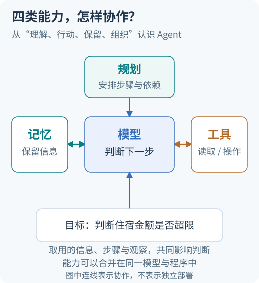

# AI Agent 系统学习与面试手册

Agent 怎样理解一个目标，为什么需要工具，任务做到一半又靠什么记住进展？这份手册从这些问题讲起，逐步连接模型、上下文、工具、检索、记忆与规划，再进入评测和工程实现。

| 你想怎样阅读 | 从这里开始 |
| --- | --- |
| 先理解 Agent 的组成和工作方式 | **[01 · Agent 的组成与协作](learning/01-system-map.md)**：在课程本页阅读概念、图解和完整例子 |
| 已有基础，深入工程问题 | **[12 章进阶课程](advanced/README.md)**：按章节阅读机制、案例、推导与设计 |
| 按面试问题查漏补缺 | **[92 篇逐题文章](questions/README.md)**：每题独立阅读，包含短答、详细解释、追问与案例 |

需要先看全貌，可以查看 [知识主线与阅读顺序](learning/knowledge-map.md)。

## 从组成看懂协作



小明问：“11月12日去海岚出差，住宿每晚650元，超过标准吗？”模型要读懂这名员工的问题，工具负责取得制度，任务记录保留日期与已查资料，规划决定先查什么、还缺什么。运行时把这些能力组织成连续的过程。[进入课程完整讲解](learning/01-system-map.md)

手册包含10章基础、12章进阶与92道详解题。基础和进阶课程保留完整讲解，能够按章节连续学习；独立面试题提供短答、深入解析与追问，供复习和查漏。代码和实验作为理解后的进一步练习。图解帮助你看清信息如何流动，追问用来检查能否用自己的话说清。

按目录阅读可打开 [在线学习手册](https://harrytted.github.io/ai-agent-interview-playbook/)。遇到术语，可查作者的 [AI编程字典](https://agent.harrylab.cn/dictionary/)；需要更多图解与工程文章，可选读 [Agent技术博客](https://agent.harrylab.cn/articles/)。

## 基础课程

基础部分先回答“是什么、为什么需要、怎样工作”，再用同一个政策助手串起概念。模型与输入、行动与知识、状态与规划、质量与可靠性四条线相互连接；具体章节关系见 [知识主线](learning/knowledge-map.md)。

| 学习阶段 | 课程 | 核心产出 |
| --- | --- | --- |
| 模型和输入 | [01 组成与协作](learning/01-system-map.md) · [02 LLM 原理](learning/02-llm-primer.md) · [03 上下文](learning/03-context-and-prompts.md) | 画清职责，复算注意力，组织有效证据 |
| 行动与知识 | [04 工具循环](learning/04-agent-loop.md) · [05 工具/MCP](learning/05-tools-and-mcp.md) · [06 RAG](learning/06-rag-and-retrieval.md) | 读执行轨迹，定义工具合同，检查检索链路 |
| 状态与协作 | [07 记忆](learning/07-memory-and-state.md) · [08 规划与多 Agent](learning/08-planning-and-multi-agent.md) | 管理状态与版本，解释协作和恢复的边界 |
| 质量与交付 | [09 评测](learning/09-evaluation.md) · [10 可靠性与安全](learning/10-reliability-and-security.md) | 定义指标与终态，处理失败和越权 |

[完整课程与阅读顺序](learning/README.md) · [术语回查](learning/glossary.md) · [课程参考资料](learning/verification.md) · [GitHub 学习资源深度调研](research/learning-resources.md)

## 进阶课程

进阶课程将 GitHub 项目、作者技术博客、官方文档、协议和论文整理成可连续学习的知识。沿同一个政策研究助手案例，从运行机制走到设计练习，再用轨迹、故障和评测判断改进。

| 学&#8288;习&#8288;阶&#8288;段 | 课程 | 核心产出 |
| --- | --- | --- |
| 运&#8288;行&#8288;基&#8288;础 | [01 Harness](advanced/01-harness-and-deep-agents.md) · [02 持久执行](advanced/02-durable-execution.md) · [03 上下文工程](advanced/03-context-engineering.md) · [04 记忆与技能](advanced/04-memory-and-skills.md) | 长任务交接、恢复状态图、上下文与记忆合同 |
| 能&#8288;力&#8288;组&#8288;织 | [05 工具路由/MCP](advanced/05-tool-routing-and-mcp.md) · [06 Agentic RAG](advanced/06-agentic-rag.md) · [07 多 Agent](advanced/07-multi-agent-systems.md) · [08 编码与计算机操作](advanced/08-coding-and-computer-use.md) | 工具选择、证据策略、协作图和操作环境 |
| 质&#8288;量&#8288;优&#8288;化 | [09 评测反馈](advanced/09-evaluation-and-feedback.md) · [10 性能与推理](advanced/10-performance-and-serving.md) · [11 安全治理](advanced/11-security-and-governance.md) · [12 Agent 训练](advanced/12-agent-training.md) | 回归集合、共享预算、授权边界与训练决策 |

[完整进阶路线](advanced/README.md) · [贯穿项目工作坊](advanced/project-workshop.md) · [官方知识体系](advanced/official-learning-map.md) · [机制实验](examples/advanced/README.md)

每章都有对应的 [3 篇进阶题文章](questions/README.md#进阶系统)。先读场景和机制，再闭卷说短答，最后展开详细答案与案例。遇到不会的追问，可以直接回到学习章节补上那一步。

## 知识地图

Q001–Q056 覆盖基础与通用工程，Q057–Q092 对应 12 章进阶系统知识，采用相同的详解与案例标准。课程按知识关系完整讲解，面试题按问题组织回答与追问；学习和复习可以沿两种入口往返。

| 模块 | 题号 | 你应当能够解释 |
| --- | --- | --- |
| [Agent 与 LLM 基础](questions/README.md#agent-与大模型基础) | Q001–Q008 | Agent 边界、Transformer、训练与推理、模型适配 |
| [规划与编排](questions/README.md#规划状态与多-agent-编排) | Q009–Q016 | 循环、ReAct、状态、恢复、并发与多 Agent 取舍 |
| [RAG 与检索](questions/README.md#rag-与检索诊断) | Q017–Q024 | 分块、检索、重排、权限、归因与评测 |
| [工具、记忆与协议](questions/README.md#工具调用记忆与-mcp) | Q025–Q032 | Schema、执行边界、MCP、上下文和持久记忆 |
| [评测与可观测性](questions/README.md#05--评测与可观测性) | Q033–Q040 | 数据集、失败归因、Judge 偏差、成本与延迟 |
| [可靠性与安全](questions/README.md#06--可靠性与安全) | Q041–Q048 | 重试、幂等、人审、注入、隔离与故障恢复 |
| [系统设计与项目表达](questions/README.md#07--系统设计与项目表达) | Q049–Q056 | 需求、架构、验收、真实贡献与可复现证据 |
| [12 章进阶面试](docs/advanced/README.md) | Q057–Q092 | 长任务、上下文、检索协作、运行质量与训练取舍 |

## 每天怎么学

每天可以只解决一个能说清的问题：读案例，预测下一步，运行或手算一次，再口述关联题。面试复习时，每天闭卷回答 3–5 题，读解析、答追问，最后留一个微练习结果。

别急着把每页都涂成已读。对同一个例子加一句“这时网络断了呢”，往往比多背三个框架名更能发现缺口。

只阅读文档无需安装。默认离线工具需要 **Python 3.10+**，仅使用标准库，无需联网、安装依赖或配置密钥；可选live路径需要单独提供供应商凭据。在仓库根目录运行：

```bash
# 抽 5 题，只显示问题，先口述再看答案
python3 scripts/study.py draw --count 5

# 只练新增的 36 道进阶题
python3 scripts/study.py draw --topic docs/advanced/ --count 3

# 查看单题回答、追问和练习
python3 scripts/study.py show Q001
python3 scripts/study.py show Q060

# 自评分：0 不会；1 提示后会；2 独立说清；3 能追问并举证
python3 scripts/study.py review Q001 --score 2

# 查看到期题目、尚未学习的题目和进度
python3 scripts/study.py due
python3 scripts/study.py stats

# 观察驱动的政策任务与独立评分
python3 -m examples.policy_agent eval --suite all --mode offline --output .local/policy_agent/all-report.json

# 隔离的执行器边界实验
python3 examples/agent_lab/lab.py --scenario all

# 复算 Attention、余弦、RRF 与检索指标
python3 examples/foundations/math_lab.py --section all

# 验证多次尝试指标、共享预算、关键路径与崩溃恢复
python3 examples/advanced/runtime_lab.py --scenario all
```

复习记录保存在 `.local/study-progress.json`，默认不进入 Git。日期间隔规则详见 [复习说明](practice/README.md)。

## 理解以后，再用实验和项目加深

想亲手观察工具往返，可以选做 [00 · 走完一次任务](learning/00-first-agent.md)。[政策实验](examples/policy_agent/README.md)提供查询、澄清、旧资料与恢复的可运行过程；阅读概念章节不必先安装或运行它。


[7 天项目实验](docs/engineering/08-project-lab.md)提供从工具循环到真实模型接入的验收步骤。旧执行器实验使用固定脚本；新增政策实验提供观察驱动规则、持久状态和本地授权/恢复替身。模型接入状态、模拟权限与生产系统之间的边界见各实验README；项目经历和线上效果须用自己的实测填写。

准备面试时使用 [模拟面试](practice/mock-interviews.md)、[项目表达模板](practice/project-story-template.md) 和 [错题复盘模板](practice/review-template.md)。所有业务数据、项目职责和指标请用自己的真实材料填写。

## 参与完善

读到不准确的解释、遇到跑不通的示例，欢迎反馈；有值得分享的面试经验或实战做法，也欢迎一起补充。

- **纠错与补充**：通过 [Issue](https://github.com/harrytted/ai-agent-interview-playbook/issues/new) 注明题号或章节位置，写下修改建议，尽量附上参考来源。
- **分享经验与案例**：欢迎通过 [Pull Request](https://github.com/harrytted/ai-agent-interview-playbook/compare) 补充面试追问、答题思路或实战案例，让下一位读者少绕一点弯。
- **反馈代码问题**：提交 [Issue](https://github.com/harrytted/ai-agent-interview-playbook/issues/new) 时，请说明运行环境、复现步骤，以及预期结果和实际表现，方便定位与修复。

内容格式、引用要求和提交前检查见 [贡献指南](CONTRIBUTING.md)。

## 参考资料与延伸阅读

想查原论文、官方文档，或继续挑选外部项目与教程，可以打开 [资料索引](research/README.md)，按当前问题选读。

本文档与代码为本仓库原创整理，采用 [MIT License](LICENSE)。引用的资料、外部项目和商标归各自权利人所有；其内容适用原项目许可。这里只链接外部资料，不搬运其题库、插图或模板。

[变更记录](CHANGELOG.md)
