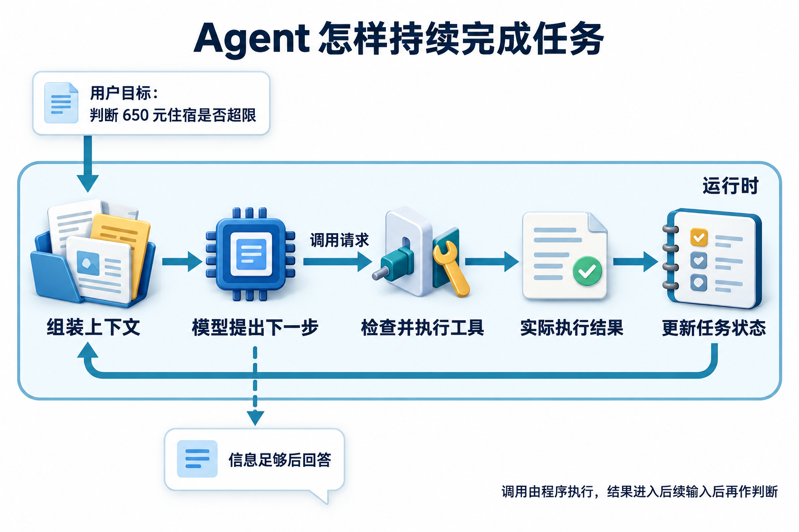

# 01 · Harness 与 Deep Agents：组织跨会话的工作

[工程进阶目录](README.md) · [下一章：持久执行](02-durable-execution.md)

## Harness 的职责与 Deep Agents 的位置

**Harness（Agent 的运行支撑层）** 是围绕模型建立的一组运行机制。模型根据当前输入提出回答或动作请求，harness 将输入组织、工具执行、状态保存、调度、权限和停止规则接起来，使任务能够连续推进。它处理的是“怎样让模型在一个真实系统里持续工作”。

基础原理中的工具循环描述一轮轮怎样行动；harness 进一步管理轮与轮之间、会话与会话之间的工作条件。框架可以提供这些机制的一部分，应用仍要定义完成标准与业务权限。**Deep Agents 是一种具体的 harness 实现**，把计划、文件上下文和子任务等能力组合起来；阅读它时，要把通用职责与这个项目的接口分开。

理解这层分工后，再看一个跨会话任务，就能知道该补任务记录、执行控制还是模型输入，不必每次都先给模型换个更响亮的名字。

## 查到一半退出后，任务还剩什么

你让政策助手比较三个地区的差旅制度，整理冲突与例外流程，明天下午交付带出处的报告。它查到一半退出，第二天换一个会话继续。你最想知道的不是它还能写多少字，而是：昨天查过什么，证据还有效吗，今天从哪里接着做？

这个任务会经历检索、草稿修改、等待补充和会话切换，需要把进度、依据与下一动作留在可交接的工作台上。建议先读基础原理中的[工具循环](../learning/04-agent-loop.md)、[状态与记忆](../learning/07-memory-and-state.md)和[可靠性与安全](../learning/10-reliability-and-security.md)；学完本章，应能把长任务拆成可交接的工作单元，解释计划、文件、子任务和执行环境分别由谁管理。

## Harness 管理行动条件

先把三份职责分开：模型根据当前输入提出下一动作，运行时执行动作，harness 将这些步骤组织成能持续工作的系统。它接起模型适配、工具路由、上下文组装、状态保存、调度、权限与观察接口，让每次行动有条件、每次中断有记录。

可以把它想成工作台上的任务卡、工具柜与交接簿。换一个更聪明的模型会改善判断，但审批对象、并发写入约束和外部报告是否已经发布，仍要由应用保存或确认。

长任务还需要明确的完成合同。研究报告不能只以“已写完”结尾，应检查三个地区是否都有有效来源、每个差异是否对应条款、冲突是否显式保留。Anthropic 的长程 harness 实践采用初始化、增量推进和交接材料连接多次会话；这里可吸收的是可恢复的工作组织方式。[长程 harness 的工作交接](https://www.anthropic.com/research/effective-harnesses-for-long-running-agents)

把控制信息放在文件里，也不意味着文件中的每句话都有执行权。用户目标、运行时约束、工具返回的原文应带来源与不同信任级别。工具结果可以更新证据目录，不能自行改变“只生成草稿”的动作范围。**计划表示待完成的工作，授权规定执行边界**，二者要由不同检查落实。

## Deep Agents 提供了哪些可组合能力

Deep Agents 将计划、文件系统上下文、子任务委派和记忆等能力组织成 harness，并提供托管与自行运行的入口。应按任务选择组件，而不是把所有组件开启当作成熟度指标。[Deep Agents 概览](https://docs.langchain.com/oss/python/deepagents/overview)

研究助手可以把计划记录为“核对日期→分别检索→比较→审阅”，把长原文放入文件工具可访问的位置，再让专门工作单元只处理某个地区。主任务收回结构化证据、缺口和产物指针，而不是接收全部中间搜索记录。是否委派，取决于子任务能否独立验收以及需要多少父任务背景。

隔离上下文与继承上下文也有不同用途。独立查一个地区时，提供共同日期、员工类别和输出合同即可；继续父任务中途的复杂调查，则可能需要继承已有历史。Deep Agents 区分 isolated 与 fork 等委派模式；本文的 fork 说明以 `deepagents>=0.7.13` 文档为范围，该能力仍标为 beta，阅读旧版本时不能假定存在同一接口。工具、技能和权限的继承规则应分别配置。[子任务的上下文与能力配置](https://docs.langchain.com/oss/python/deepagents/subagents) 上下文少不会自动带来更小权限；任务描述里写“只读”也不能代替只读工具集合。

## 文件 Backend、状态与 Sandbox 是三件事

看到一个文件路径时，先问“它实际存在哪里”。文件工具只是读写接口，**Backend 决定路径映射**：当前线程状态、真实目录，或跨线程存储。再问“代码在哪里运行、能接触什么”，这才进入 **Sandbox 的执行环境与隔离约束**。

档案柜能存报告，不能因此变成安全实验室。支持读取文件的 backend 未必允许执行脚本；容器能运行代码，也未必自动保存下一次会话所需状态。[Deep Agents Backend 的职责](https://docs.langchain.com/oss/python/deepagents/backends)

| 对象 | 研究助手中的内容 | 必须另外考虑的问题 |
|---|---|---|
| 运行状态 | 已完成地区、待澄清条件、预算 | 检查点保存与状态迁移 |
| 文件 Backend | 原文、证据清单、报告草稿 | 路径映射、命名空间、访问控制 |
| Sandbox | PDF 解析、表格比较、辅助计算 | 网络、凭据、资源和进程生命周期 |

三者分别回答“任务进展是什么、文件存在哪里、程序能做什么”，**保存进度、存放文件与隔离执行需要分别验证**。

默认的线程文件若依靠内存检查点，进程结束就可能丢失；映射真实目录的写入则可能在任务失败后仍然存在。跨用户复用存储时，命名空间应来自可信主体，不能来自模型填写的租户字符串。切换执行机器前，还要确认新机器能解析产物指针并取得对应版本。

## 一次跨会话交接怎样形成

假设任务分为六项：确定适用日期，分别取得甲、乙、丙三地制度，比较条款，形成报告。三地查询各算一项，六项工作分别使用稳定标识，并记录各自的验收条件。随后建立三类产物：计划保存工作状态，证据清单保存来源与版本，报告文件保存可审阅内容。它们通过标识关联，避免让计划中的一句“检索完成”成为唯一证据。

第一轮完成甲、乙两地检索，丙地服务不可用。助手写入甲乙的文档 ID、有效期和摘录位置，将丙标为阻塞，并保存下一次允许重试的条件。退出前留下交接摘要：目标、已完成项、未解决冲突、产物位置、预算余量及下一动作。原文与草稿分开保存，摘要里的判断可以沿证据指针回查。

第二轮启动时，先读取任务版本与最近交接，再检查产物是否存在、原有权限是否仍有效。计划中甲地已完成，但其文档后来被撤回，就应重新打开相关工作项，而不是把“完成”状态当作永久真理。丙地恢复后只补缺口，不重复下载全部甲乙材料。

第三轮发现甲乙对住宿上限使用不同员工类别，协调者要求统一适用条件。修订草稿时写入新报告版本，旧报告保留自己的证据清单。提交审阅的应是一份具体版本；报告继续变化时，旧审阅结果不能无条件覆盖新内容。

交接材料可以帮助重建上下文，仍要能定位到真实产物。若只有一篇漂亮总结，却没有证据 ID、文件版本和下一步条件，新会话只能再次猜测。长程应用开发的后续实践也强调结构化交接，并通过移除组件观察其作用来调整 harness。[Harness 结构的迭代](https://www.anthropic.com/research/harness-design-long-running-apps)

## 可直接交接的成品：两地政策比较包



[查看原图](../website/assets/diagrams/G1-system-flow.png)

把T05做到可交接的位置，留下下面这份设计样本。它表达进展与依据，不授予接手者额外权限。

```json
{
  "goal": "比较2026-11-12海岚与云洲普通员工住宿上限",
  "scope": "只读比较，不创建工单",
  "work_items": [
    {"id":"h","city":"海岚","status":"verified","evidence_refs":["P17-v2#4"]},
    {"id":"y","city":"云洲","status":"verified","evidence_refs":["P19-v1#4"]},
    {"id":"compare","depends_on":["h","y"],"status":"ready"}
  ],
  "facts": {"海岚":700,"云洲":650},
  "unknowns": [],
  "next_action": "重新校验引用仍适用后输出比较，不执行写入"
}
```

接手前读取当前权限与来源；若P19被撤回，把y由verified改为needs_evidence，compare由ready改为blocked，700与650的旧比较不能继续发布。已取得但撤回的材料保留历史关联，当前输入只说明它失效及缺口。

再加入T10“云洲餐补金额”时，住宿条款不能填餐补工作项。交接包应新增明确未知项，下一动作是取得餐补制度或说明证据不足。完成标准是每个工作项的状态都由可核对证据支持，不能因为文档写满就把状态全改done。

## 用验收决定保留哪些组件

为同一组研究任务设置直接循环、增加文件交接、增加独立复核三个配置。分别统计来源覆盖、恢复后重复工作、错误发布、总耗时与资源使用。若文件交接减少了重做，却让过时证据持续流入报告，就要修订失效规则；若复核者只是重复主模型结论，应检查它是否拿到独立证据和明确的裁定规则。

能力增强与治理配置应随版本一起管理：模型版本、提示、工具合同、计划格式、backend 路由和审阅规则，共同决定一次任务如何运行。只更换模型名称而复用旧的恢复记录，可能使新旧任务对同一字段产生不同解释。

## 设计练习

为三地政策研究画出一份交接合同，并选择线程文件、跨线程存储和 sandbox 分别保存或处理什么。注入三个故障：丙地查询失败，甲地文件被撤回，报告在审阅后被修改。验收时应能从稳定标识找回产物、重新打开失效工作项，并说明哪些动作必须重新审阅。

## 自检

<details><summary>1. 把原文写入文件，是否就获得了执行隔离？</summary>

没有。文件接口决定数据访问方式；执行隔离还需要 sandbox、网络和资源策略。真实目录与虚拟文件的持久化行为也不同。
</details>

<details><summary>2. 新会话读到“甲地已完成”，能否直接跳过甲地？</summary>

应先核对完成项对应的文档、产物版本、适用条件和当前权限。证据撤回或任务条件变化会使原完成状态失效。
</details>

<details><summary>3. 为什么工具列表少，不一定代表权限更小？</summary>

一个通用执行器就可能拥有很大权限。需要同时检查工具功能、服务端对象授权、路径与网络范围，以及凭据实际能做什么。
</details>

## 参考资料

- [Anthropic：Effective harnesses for long-running agents](https://www.anthropic.com/research/effective-harnesses-for-long-running-agents)
- [Anthropic：Harness design for long-running application development](https://www.anthropic.com/research/harness-design-long-running-apps)
- [Deep Agents 概览](https://docs.langchain.com/oss/python/deepagents/overview)、[Backends](https://docs.langchain.com/oss/python/deepagents/backends)、[Subagents](https://docs.langchain.com/oss/python/deepagents/subagents)

[工程进阶目录](README.md) · [下一章：持久执行](02-durable-execution.md)

[配套进阶面试题](../docs/advanced/01-harness-and-deep-agents.md)
