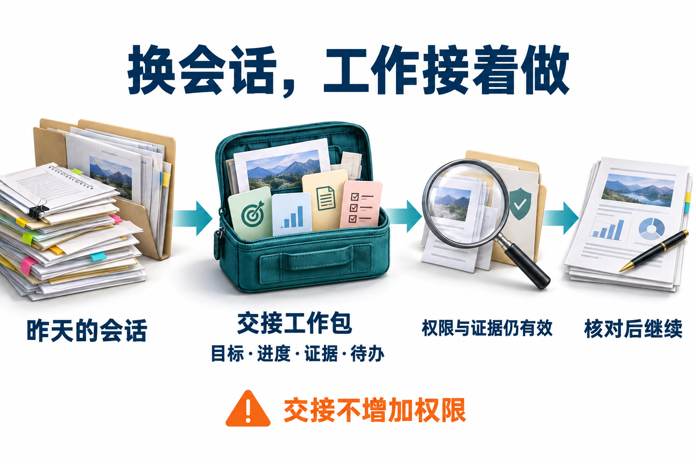

# 01 · Harness 与 Deep Agents：组织跨会话的工作

[工程进阶目录](README.md) · [下一章：持久执行](02-durable-execution.md)

## Harness 的职责与 Deep Agents 的位置

**Harness（Agent 的运行支撑机制总称）** 包含运行时（Runtime）及其配套的上下文、工具、状态、权限、调度和验收机制。运行时是推进“决定→执行→观察”循环的程序部分；harness从整体上描述这些机制怎样支持任务持续工作，不要求再部署一个叫Harness的独立服务。

基础原理中的工具循环描述一轮轮怎样行动；harness 进一步管理轮与轮之间、会话与会话之间的工作条件。框架可以提供这些机制的一部分，应用仍要定义完成标准与业务权限。**Deep Agents 是一种具体的 harness 实现**，把计划、文件上下文和子任务等能力组合起来；阅读它时，要把通用职责与这个项目的接口分开。

理解这层分工后，再看一个跨会话任务，就能知道该补任务记录、执行控制还是模型输入，不必每次都先给模型换个更响亮的名字。

## 查到一半退出后，任务还剩什么

你让政策助手比较三个地区的差旅制度，整理冲突与例外流程，明天下午交付带出处的报告。它查到一半退出，第二天换一个会话继续。你最想知道的不是它还能写多少字，而是：昨天查过什么，证据还有效吗，今天从哪里接着做？

这个任务会经历检索、草稿修改、等待补充和会话切换，需要把进度、依据与下一动作留在可交接的工作台上。建议先读基础原理中的[工具循环](../learning/04-agent-loop.md)、[状态与记忆](../learning/07-memory-and-state.md)和[可靠性与安全](../learning/10-reliability-and-security.md)；学完本章，应能把长任务拆成可交接的工作单元，解释计划、文件、子任务和执行环境分别由谁管理。

## Harness 管理行动条件

先看整体与组成部分：模型根据当前输入提出下一动作；harness中的运行时组织输入、校验并调度执行器、记录观察，再决定下一轮或停止。长任务需要的检查点、文件交接与外部验收也属于这套支撑机制，可以在同一程序内组合，也可以按部署需求拆成服务。这里划分的是职责，不能据此多画一层必须存在的部署节点。

可以把它想成工作台上的任务卡、工具柜与交接簿。换一个更聪明的模型会改善判断，但审批对象、并发写入约束和外部报告是否已经发布，仍要由应用保存或确认。

长任务还需要明确的验收约定。研究报告不能只以“已写完”结尾，应检查三个地区是否都有有效来源、每个差异是否对应条款、冲突是否显式保留。Anthropic 的长程 harness 实践采用初始化、增量推进和交接材料连接多次会话；这里可吸收的是可恢复的工作组织方式。[长程 harness 的工作交接](https://www.anthropic.com/research/effective-harnesses-for-long-running-agents)

把控制信息放在文件里，也不意味着文件中的每句话都有执行权。用户目标、运行时约束、工具返回的原文应带来源与不同信任级别。工具结果可以更新证据目录，不能自行改变“只生成草稿”的动作范围。**计划表示待完成的工作，授权规定执行边界**，二者要由不同检查落实。

## 把运行循环写成可检查的状态转换

实现 harness 时，需要先决定哪些事实由程序掌握。可以把控制状态写成 `S=(revision, phase, goal, conditions, plan, evidence, operations, budget)`：`revision` 标识状态修订，`phase` 表示就绪、等待、执行中或终态，其余字段分别保存目标、条件、依赖、证据、操作意图和累计额度。模型上下文是从 S 与可见资料中选出的投影，不是状态本身；审批主体、配额账本和操作提交记录通常不应交给模型改写。[LangGraph Graph API](https://docs.langchain.com/oss/python/langgraph/graph-api)提供共享状态、节点和转移机制；下面是应用层设计，不是框架自动保证的合同。

一次推进可分成“取得快照→生成建议→条件提交→执行→接收观察”。模型调用较慢，通常不应一直占着数据库写锁；它针对版本 r 生成建议，回来时用 r 检查任务是否仍相同。如果用户已更正条件或取消，旧建议必须重新评估，不能覆盖新状态。

```text
读状态快照 S_r，并从允许信息构造本轮输入
模型提出候选动作 a（此时尚未执行）
原子提交：仅当 revision=r、阶段允许、配额足够时
          预留额度，保存动作意图与稳定ID，revision递增
未提交：重新读取状态；不执行已经过时的建议
提交后：调度执行器；观察按意图ID回填，再判断继续/等待/结束
```

这类“版本符合才更新”称为比较并交换式的条件更新。若状态存在关系表，可以用 `WHERE task_id=… AND revision=旧值` 的条件 UPDATE，并检查实际更新行数；其他保存事件、意图和预留额度的写入仍要放进同一事务，不能先把额度扣在另一个内存变量里。[PostgreSQL 18 UPDATE](https://www.postgresql.org/docs/18/sql-update.html)说明条件更新与返回已更新行的语义。它保护的是本地状态转换；外部动作与本地提交的恢复窗口继续由[02章](02-durable-execution.md)处理。

循环应保持几条不变量：已花额度不会因重规划清零；旧条件的观察不进入新条件的有效证据集；等待状态不继续派发动作；模型说“完成”后还要经过产物验收。把输入、建议、提交决定、实际观察分开记录，才能定位失败是在选择、调度还是环境执行；验证时让“模型建议返回”与“用户取消提交”交换顺序，检查结果是否仍服从最新已提交状态。

## 控制器怎样从计划得到下一项工作

**控制器（controller）** 是决定何时继续、等待或停止的程序；**调度器（scheduler）** 从可执行工作中分配有限的运行名额。模型可以建议依赖关系和优先级，程序仍要校验节点身份、依赖是否存在、有无循环、输入版本和额度。待办列表中的先后顺序并不自动构成可执行计划。

把计划表示为依赖图：节点记录输入引用、验收条件、状态和已消费额度，边 `u→v` 表示 v 依赖 u 的已验证产物。对于一个没有依赖环的计划，节点 n 进入就绪集合的条件可写为：`ready(n)=尚未派发 ∧ 所有前驱产物验收通过且适用 ∧ 必要输入已知 ∧ 当前动作获准`。这是一种应用调度合同；LangGraph 的节点、状态更新和条件边可承载类似逻辑，但不会替应用定义业务验收。[LangGraph 的图与控制流](https://docs.langchain.com/oss/python/langgraph/graph-api)

```text
合并已收到的事件，重新计算受影响节点的依赖有效性
若取消已提交：只安排允许的结果核对与清理
否则，若产物满足交付条件：提交完成状态
否则，若预算或期限不足以继续：提交部分结果与停止原因
否则，计算 ready；从中选不超过并发/剩余额度的工作
    条件提交动作意图、输入修订及预算预留，再派发
    若没有 ready：
        有待补输入/外部结果/审批 → 保存等待原因与唤醒条件，释放执行资源
        无任何可解除条件 → 报告依赖缺口或计划错误，不空转调用模型
```

先确认依赖，再调度，能防止下游消费尚未验收的草稿；派发前预留共享额度，能防止多个分支各自认为“还剩一次调用”。若名额有限，可优先推进关键依赖，同时让长期就绪项逐步提高优先级，避免一直被新任务插队。这是吞吐、交付延迟与公平性的取舍，不存在适合所有任务的固定排序。

**安全性**检查“错误动作不会被放行”，例如同一执行尝试不被并发重复领取；**活性**检查“条件满足后还能继续”。等待记录应持久保存 `waiting_for`、关联请求或事件 ID、期限及恢复入口。通知只作唤醒提示：即使通知重复、先到或丢失，恢复入口也应重新读取可靠状态；用扫描或可重放事件发现已满足的等待条件，不能仅靠某个进程内的回调。多进程领取与租约的实现见[16章](16-service-deployment-and-operations.md)，这里不把就绪判断等同于已经取得执行权。

验证可以用无需模型的事件排列：节点 A、B 并行，C 依赖两者；交换 A/B 的完成顺序，C 都只能派发一次。再让 B 失败或等待输入，C 必须保持阻塞；重复发送 B 完成通知不能重复扣费；在完成通知前取消，已派发结果可以记账，却不得启动 C。这些是应检查的状态断言，本章没有宣称已实现一套通用图调度器。

## Deep Agents 提供了哪些可组合能力

Deep Agents 将计划、文件系统上下文、子任务委派和记忆等能力组织成 harness，并提供托管与自行运行的入口。应按任务选择组件，而不是把所有组件开启当作成熟度指标。[Deep Agents 概览](https://docs.langchain.com/oss/python/deepagents/overview)

研究助手可以把计划记录为“核对日期→分别检索→比较→审阅”，把长原文放入文件工具可访问的位置，再让专门工作单元只处理某个地区。主任务收回结构化证据、缺口和产物指针，而不是接收全部中间搜索记录。是否委派，取决于子任务能否独立验收以及需要多少父任务背景。

隔离上下文与继承上下文也有不同用途。独立查一个地区时，提供共同日期、员工类别和输出合同即可；继续父任务中途的复杂调查，则可能需要继承已有历史。Deep Agents 区分 isolated 与 fork 等委派模式；本文的 fork 说明以 `deepagents>=0.7.13` 文档为范围，该能力仍标为 beta，阅读旧版本时不能假定存在同一接口。工具、技能和权限的继承规则应分别配置。[子任务的上下文与能力配置](https://docs.langchain.com/oss/python/deepagents/subagents) 上下文少不会自动带来更小权限；任务描述里写“只读”也不能代替只读工具集合。

## 文件 Backend、状态与 Sandbox 是三件事

看到一个文件路径时，先问“它实际存在哪里”。文件工具只是读写接口，**Backend 决定路径映射**：当前线程状态、真实目录，或跨线程存储。再问“代码在哪里运行、能接触什么”，这才进入 **Sandbox 的执行环境与隔离约束**。

档案柜能存报告，不能因此变成安全实验室。支持读取文件的 backend 未必允许执行脚本；容器能运行代码，也未必自动保存下一次会话所需状态。[Deep Agents Backend 的职责](https://docs.langchain.com/oss/python/deepagents/backends)

| 对象 | 研究助手中的内容 | 必须另外考虑的问题 |
|---|---|---|
| 运行状态 | 已完成地区、待澄清条件、预算 | 检查点保存与状态迁移 |
| 文件 Backend | 原文、证据清单、报告草稿 | 路径映射、命名空间、访问控制 |
| Sandbox | PDF 解析、表格比较、辅助计算 | 网络、凭据、资源和进程生命周期 |

三者分别回答“任务进展是什么、文件存在哪里、程序能做什么”，**保存进度、存放文件与隔离执行需要分别验证**。

默认的线程文件若依靠内存检查点，进程结束就可能丢失；映射真实目录的写入则可能在任务失败后仍然存在。跨用户复用存储时，命名空间应来自可信主体，不能来自模型填写的租户字符串。切换执行机器前，还要确认新机器能解析产物指针并取得对应版本。

## 一次跨会话交接怎样形成

交接包连接三个对象：可靠控制状态、可定位的产物和方便阅读的摘要。状态负责决定下一步，产物承载证据与交付物，摘要帮助新会话快速理解；三者不能互相替代。交接应记录同一状态修订及其产物版本，避免摘要刚写完，报告又被另一轮改写，结果拼成从未存在过的“当前版本”。

一个最小合同可包含 `task_id/state_revision/run_version`、目标与硬约束、节点状态及阻塞原因、产物 ID/内容版本、证据依赖、未确认操作意图、累计额度和下一步条件。秘密凭据不写进交接包；从新执行环境取得权限，再解析产物指针。摘要中的“已确认”必须指向验收记录，不能覆盖状态里的 `unknown`。

```text
读取兼容的控制状态及交接修订；不兼容则进入迁移/补信息分支
核对产物存在、内容版本、当前可读性和业务适用条件
对失效输入沿依赖边标记下游需重验；保留已发生操作的历史身份
对结果未知的外部动作先查询/对账；不按摘要新建一次
仅将已验证状态与本轮所需资料装入上下文，重新计算 ready
```

例如，两个来源已核实、第三个来源暂不可用时，保存第三项的阻塞条件，不必让新会话重做前两项。但其中一个来源被撤回，就重新打开依赖它的比较与报告节点；与该来源无关的工作不应全部清零。正文或适用人群变化后，旧审批仍属于原版本，不能沿用到新交付物。

交接质量因此可以单独验证：随机移走一个产物、改变一个条件、重复加载同一工作包，检查能否定位缺口、只重开受影响节点并保持操作 ID 不变。长程应用开发实践强调结构化交接，并通过移除组件观察其作用；本章的合同是对这种思路的工程展开，不是这些字段已由 Deep Agents 自动保存的承诺。[Harness 结构的迭代](https://www.anthropic.com/research/harness-design-long-running-apps)

[](../website/assets/diagrams/advanced/A01-harness.png)

读图时沿着“保存工作包→重新核对→继续工作”看：交接让新会话找到进度和依据，证据撤回时仍要重新打开对应工作项。

## 可直接交接的成品：两地政策比较包

模型、运行时、工具与环境的基础关系见[基础章的系统组成](../learning/01-system-map.md)；本节继续检查交接包的数据合同。

把两地住宿比较做到可交接的位置，可以留下这样一份简短工作包。它是设计示意，用来表达进展与依据。

| 要交接什么 | 已记录的内容 |
| --- | --- |
| 目标 | 比较2026年11月12日海岚与云洲的普通员工住宿上限 |
| 范围 | 只读比较，不创建工单 |
| 已完成 | 两地适用条款已取得：海岚700元/晚，云洲650元/晚 |
| 依据 | 分别保留两地住宿标准的生效日期、适用类别与原文位置 |
| 下一步 | 重新核对来源与当前权限，再生成比较结果 |

如果云洲的资料已被撤回，就把“云洲资料已确认”改为“需要补证据”，暂停比较。旧材料保留为历史记录，不能继续支持当前结论。

如果用户接着问“云洲餐补多少”，就新增一个待解决的问题。住宿条款不能替餐补作答，下一步应取得餐补制度，取不到就说明证据不足。工作包是否完整，要看每个判断有没有依据。

## 用验收决定保留哪些组件

为同一组研究任务设置直接循环、增加文件交接、增加独立复核三个配置。分别统计来源覆盖、恢复后重复工作、错误发布、总耗时与资源使用。若文件交接减少了重做，却让过时证据持续流入报告，就要修订失效规则；若复核者只是重复主模型结论，应检查它是否拿到独立证据和明确的裁定规则。

能力增强与治理配置应随版本一起管理：模型版本、提示、工具合同、计划格式、backend 路由和审阅规则，共同决定一次任务如何运行。只更换模型名称而复用旧的恢复记录，可能使新旧任务对同一字段产生不同解释。

## 设计练习

为三地政策研究画出一份交接合同，并选择线程文件、跨线程存储和 sandbox 分别保存或处理什么。注入三个故障：丙地查询失败，甲地文件被撤回，报告在审阅后被修改。验收时应能从稳定标识找回产物、重新打开失效工作项，并说明哪些动作必须重新审阅。

## 自检

<details><summary>1. 把原文写入文件，是否就获得了执行隔离？</summary>

没有。文件接口决定数据访问方式；执行隔离还需要 sandbox、网络和资源策略。真实目录与虚拟文件的持久化行为也不同。
</details>

<details><summary>2. 新会话读到“甲地已完成”，能否直接跳过甲地？</summary>

应先核对完成项对应的文档、产物版本、适用条件和当前权限。证据撤回或任务条件变化会使原完成状态失效。
</details>

<details><summary>3. 为什么工具列表少，不一定代表权限更小？</summary>

一个通用执行器就可能拥有很大权限。需要同时检查工具功能、服务端对象授权、路径与网络范围，以及凭据实际能做什么。
</details>

## 参考资料

- [Anthropic：Effective harnesses for long-running agents](https://www.anthropic.com/research/effective-harnesses-for-long-running-agents)
- [Anthropic：Harness design for long-running application development](https://www.anthropic.com/research/harness-design-long-running-apps)
- [Deep Agents 概览](https://docs.langchain.com/oss/python/deepagents/overview)、[Backends](https://docs.langchain.com/oss/python/deepagents/backends)、[Subagents](https://docs.langchain.com/oss/python/deepagents/subagents)

[工程进阶目录](README.md) · [下一章：持久执行](02-durable-execution.md)

[配套进阶面试题](../docs/advanced/01-harness-and-deep-agents.md)
