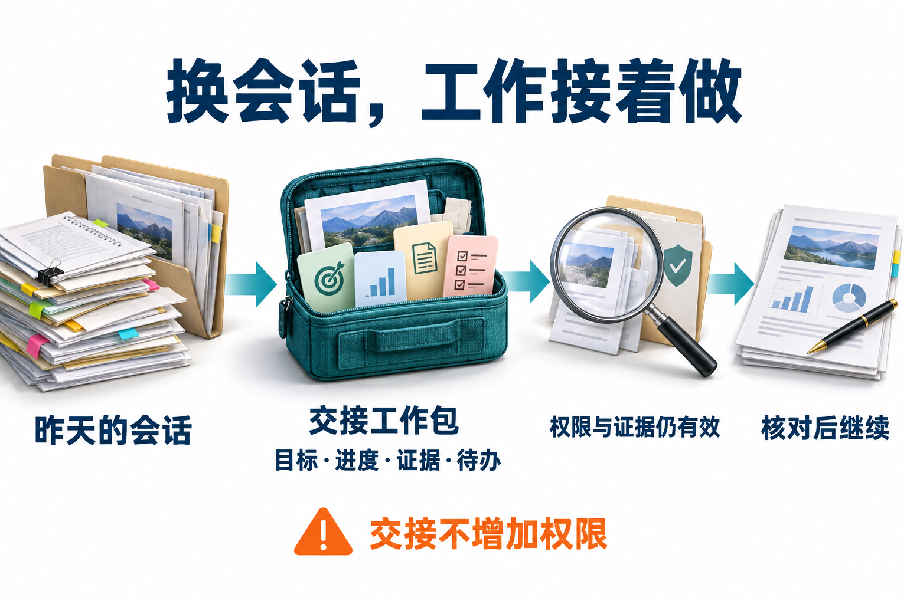

# 01 · Agent 运行框架与 Deep Agents

**运行框架（Harness）负责把模型的决定接到任务状态和执行环境。** 它准备输入，限制可用动作，接收工具结果，再决定继续、等待或结束。任务跨会话时，还要能用保存的状态接手。

## 控制器与状态转换

控制器读取当前状态，再决定能否派发动作。状态里应有任务目标、已核实的证据、计划版本、待处理操作和剩余预算。能够影响后续执行的字段，由运行时校验后写入。

| 状态 | 进入条件 |
| --- | --- |
| **可执行** | 前置条件、权限和预算已满足。 |
| **等待** | 需要用户补充、审批或外部回执。已记录恢复位置。 |
| **完成** | 必要产物已验收，外部结果已确认。 |
| **失败或停止** | 达到上限、不可继续，或用户已取消。保留未确认操作。 |

模型可以建议计划和动作。状态转换需要可信记录作依据。单纯生成一段「已完成」的文字，无法跳过验收。

### 状态版本与并发提交

一次状态更新要带上读取时看到的版本。存储只在版本仍匹配时接受更新。提交成功后版本前进。提交失败说明状态已经变了，执行者应重新读取和判断，废弃基于旧状态生成的动作。

将领取工作、保存执行意图和预留额度放进同一次提交。这样，两个执行者即使同时选中同一步，也只有一个能取得派发资格。提交以后仍可能遇到远端回执丢失，写入结果要通过原操作编号核实。

任务事件应包含前一状态、触发条件、所选动作和更新后的状态。重启时可核对哪一步已确认，哪一步尚在等待。记录模型请求有助于复盘决定，外部状态仍以执行服务的结果为准。

## 计划节点与就绪条件

计划可以组织成有向无环图。每个节点记录输入、验收条件和执行状态。依赖边指向使用上一步产物的节点。

节点尚未派发、前驱产物已通过验收、必要输入齐备，并且当前动作获准时，才能进入就绪队列。预算不足时，应先等待资源或停止。下游收到完成通知后，还要核对产物版本和适用条件。

新增信息推翻了某个前提时，更新计划版本。让旧条件下的待办退出队列。已经派发的动作单独跟踪，按回执或查询结果确认事实。

### 等待与恢复入口

没有就绪节点时，先读取阻塞原因。资料缺失、等待用户、额度不足和依赖失败需要不同的恢复方式。可恢复的等待应持久保存关联请求、截止时间和继续条件。

通知只负责叫醒执行者。处理通知时，重新读取当前任务状态。通知重复、提前到达或丢失时，系统可以依靠可重放事件或定时扫描检查等待条件。这样可以验证任务满足条件后确实能继续。

### 计划变化后的局部失效

每个节点记录所用输入版本与前驱产物版本。更新条件时，从改变的节点沿依赖边标记受影响的产物。只重新执行失效范围。已经完成的独立节点仍可参与汇总。

正在运行的旧节点可能稍后返回结果。接收时校验计划版本和实际输入。过期的结果留在历史，等待当前计划决定是否重新验收。

## Deep Agents、文件与执行隔离

Deep Agents 组合了任务清单、文件操作和子任务委派等能力。任务清单让计划可见。文件可以放较长的中间产物。子任务可以在较小的上下文中独立处理，再交回结果。

| 部分 | 工程责任 |
| --- | --- |
| **文件后端** | 决定文件放在哪里、保存多久、哪些任务可访问。 |
| **任务状态** | 保存执行位置、计划版本、等待条件和确认结果。 |
| **执行沙箱** | 限制进程的文件、网络、权限和资源。 |

把文件放到外部存储后，仍要校验读写身份和路径。文件接口与进程隔离分别设计。保存策略也要确认能否跨进程和跨会话。

### 状态、文件与子任务的绑定

应用需要约定文件的作用域。任务内临时文件随任务清理。跨会话产物要有稳定路径、版本和访问范围。运行状态中可以只保存文件引用，但恢复前必须确认文件还在且与原记录匹配。

子任务只收到完成目标所需的输入和权限。交回内容采用可验证的结构，包括产物版本、事实出处和未解决项。外层控制器验收之后，才推进下游依赖。

## 跨会话交接

交接记录保存目标、当前版本、已验收产物和下一步。待处理动作还要有原操作编号、前置条件和外部确认状态。证据存引用和版本，避免只留一段无法核对的总结。

新会话先恢复状态，再核对文档有效期、当前权限和结果是否已确认。已经完成且仍然适用的工作可以复用。条件已改变时，只重做受影响的部分。

### 核对交接的一致性

先恢复控制状态，再核对工作包的修订与任务状态是否一致。资料、产物或用户条件变更时，更新相应节点，并检查旧审批是否仍对应当前动作。待确认的外部操作继续沿用原编号。

交接记录要能区分已经取得的证据、已经确认的结论和计划中的动作。压缩过程如果把三者写成同一份完成清单，接手者就可能跳过仍需要验证的步骤。

## 运行框架验收

先核对暂停后能否在正确位置继续。再检查旧计划失效后是否还有动作被派发。写任务还要验证恢复前后的外部对象数量。只有额外组件解决了这些可观察的问题，才值得承担它的调试和运维成本。

同时观察两类结果。受约束的动作是否始终无法越过前置条件，以及前置条件满足后任务能否在期限内继续。分别检查重复派发、过期结果、丢失唤醒、权限撤回与合规任务误拦。

## 配套阅读

展开面试题、实验与资料

- [配套面试题](../docs/advanced/01-harness-and-deep-agents.md)
- [一手资料](official-learning-map.md#进阶-01-的来源)

[工程进阶目录](README.md) · [下一章：02 · 持久执行](02-durable-execution.md)
