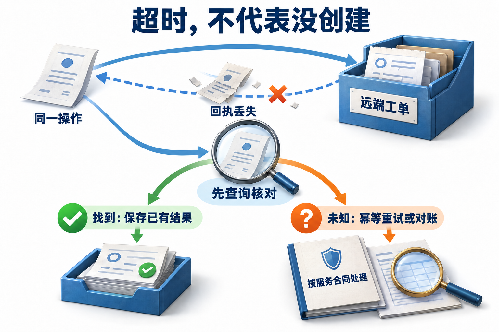

# 02 · 持久执行：恢复进度与控制外部副作用

[上一章：Harness](01-harness-and-deep-agents.md) · [工程进阶目录](README.md) · [下一章：上下文工程](03-context-engineering.md)

## 持久执行为何要分别处理进度与副作用

**持久执行（durable execution）** 是把任务进度与已确认结果保存到可靠记录中，使程序中断后能够恢复工作的运行方式。基础原理中的状态告诉我们“任务走到哪里”，持久执行还要规定“恢复时取回哪些结果、重跑哪些计算”。

**检查点（checkpoint）** 保存某个边界的应用状态；**重放（replay）** 依据记录重新推进代码。它们帮助恢复本地计算，而创建工单、发送消息等**外部副作用**发生在另一个系统中，是否完成需要另外确认。**幂等**关心重复执行同一操作能否保持与执行一次相同的业务效果；具体响应与幂等键保留期仍以服务合同为准。它与保存进度解决不同的问题。

## 工单建好了，恢复时该怎么办

政策助手刚把研究报告的发布工单创建好，程序却在显示“成功”前退出了。几小时后点击继续，应该再创建一次，还是先找回那张工单？如果连原来的批准也找不到，恢复就会同时遇到进度和副作用两个难题。

## 恢复的是已记录的计算，不是原来的调用栈

Checkpoint 更像账本上的一页：它记住某个边界的应用状态，恢复时按记录继续安排工作，而不是把原进程冻住。LangGraph 的节点可以从函数开头重执行；Functional API 从入口重放，并恢复已经持久保存的 task 结果。

因此，“回到审批处”说的是恢复流程中的位置，不是原来的 Python 调用栈一直等在那里。知道哪些结果会被取回、哪些代码会再跑一遍，才能判断重复风险。[节点重执行](https://docs.langchain.com/oss/python/langgraph/graph-api#re-execution-and-idempotency)、[Functional API 的确定性](https://docs.langchain.com/oss/python/langgraph/functional-api#determinism)

读取当前时间、生成随机标识、调用模型及访问远端，都会产生可能变化的结果。把这些操作放到有稳定身份的任务边界，并保存结果，才能让同一次恢复沿着已记录的决策继续。每次恢复都重新生成业务操作 ID，会把一次原始意图变成多个看似独立的写请求。

任务边界也要够细。若一个任务先发邮件再写日志，邮件成功后进程退出，整个任务重做仍可能重复发信。拆分结果能减少重做范围，剩下的“远端成功、本地结果未落盘”窗口则要由外部幂等、查询或对账处理。

## 重放怎样匹配历史结果

**确定性**在这里不是“模型每次生成同样一句话”，而是恢复同一份历史时，流程仍发出与历史兼容的控制命令。以 Temporal 为例，工作流代码重放时产生的命令会与事件历史匹配，改变命令类型或顺序可能破坏匹配；不确定的模型、网络和数据库调用应放到 Activity 中。Activity 是由工作流调度、结果进入历史的执行单元，本身仍可能重试。[Temporal 的确定性约束](https://docs.temporal.io/workflow-definition#deterministic-constraints)

可以用一份教学历史观察这个差别：`读取配置#1→结果v2；调用模型#2→方案B；等待批准#3`。恢复时取回 #1 和 #2 的已保存结果，再等同一个批准，不重新让模型选一次。若在重放路径上直接按本机当前时间选择“方案A/方案B”，第二天就可能发出历史中没有的命令；若在前面插入新任务，也可能改变按调用位置匹配的结果。

不同框架的匹配单位不同。LangGraph Functional API 从入口重放并取回已完成 task 的结果，task 与 interrupt 的调用安排需要保持兼容；Temporal 按自己的命令/事件合同匹配。**给业务意图一个稳定 ID，不会自动修复框架的重放顺序**，也不能据此把一个框架的限制推广给所有实现。[LangGraph Functional API 的恢复规则](https://docs.langchain.com/oss/python/langgraph/functional-api#determinism)

```text
恢复固定运行版本与可靠历史
每遇到一个持久计算边界：
    有兼容的已完成记录 → 取回结果，不重新执行该计算
    有进行中/结果未知记录 → 按该操作的恢复合同处理
    无记录且到达历史末尾 → 保存新的执行身份，再安排执行
    与已有历史不兼容 → 停止恢复，迁移或使用兼容版本；不跳过不匹配项
```

这段伪代码说明共同原则，没有实现 Temporal 或 LangGraph 的内部重放器。验证重放合同应保存一份真实历史，再分别改变一个纯局部变量、命令顺序和不确定输入边界，确认哪些变化仍兼容；只用全新任务跑通新代码，测不到旧历史失配。

## Event、Checkpoint 和 Pending Approval 各保存什么

事件记录表达发生过的转换，例如“当前报告已提交审批”；检查点表达某一时刻的聚合状态，例如“等待这份报告获批，待执行的创建动作已保存”。排障 trace 可以抽样或丢失，不能直接当作可靠事件账本。若应用采用事件作为状态依据，就需要有序标识、可靠存储和可重建的归并规则。

采用事件归并时，可写 `S_i = reduce(S_(i-1), event_i)`；检查点必须带上已包含的事件位置 k，恢复从 k 之后继续归并。归并函数只解释已记录事实，不在重放时再次调用付款或发信。遗漏位置可能重复应用事件，跳过位置可能丢更新；重复投递要按事件身份处理，不能只看两个事件的文字相同。

检查点与日志尾部还要有一致的提交边界，不能把“状态已到第10项”与“日志只持久到第8项”拼接使用。这里的序号只表示单个任务或聚合内的顺序，不假定所有分布式事件具有同一全局时钟；跨对象顺序需要显式依赖或服务合同。

等待审批时，应保存请求 ID、报告摘要、参数 hash、申请人与审批对象，只保存一个“尚未批准”的布尔值是不够的。恢复收到的批准要绑定同一版本，校验审批人的当前权限与有效期，再检查待操作对象是否变化。LangGraph 的 interrupt 提供暂停和外部输入恢复机制；具体批准合同由应用实现。[Interrupts](https://docs.langchain.com/oss/python/langgraph/interrupts)

动作摘要还应覆盖对象 ID、工具版本和规范化参数。仅对报告正文计算 hash，遗漏收件人或附件变化，会使旧批准作用于新动作；hash 用于绑定内容，审批人的身份仍需独立验证。

审批等待不应长期占据一个工作进程。持久记录等待状态后释放执行资源；事件到来再调度恢复。用户修改正文时，可把原请求标为“已被新版本替代”，并为新版本建立新的审批对象，避免旧按钮批准新报告。

## 工单创建与本地记账之间的窗口

假设报告已获批，工单服务也创建成功，但响应丢失了。本地还停在“待创建”，这时换一个新操作标识提交，就可能多建一张工单。恢复时应沿原来的操作标识查询；若服务支持幂等重试，就使用同一标识和相同参数，并核对已经存在的工单内容。

**本地去重表不能天然覆盖远端事务。** 服务端记录幂等键与变更对象的过程，需要符合其一致性合同；同 ID 不同参数应拒绝或进入明确冲突分支。[幂等请求的意图与参数](https://aws.amazon.com/builders-library/making-retries-safe-with-idempotent-APIs/)

本地既要记下“准备创建工单”，又要把消息交出去，可以先把消息放进 outbox 这个“待寄箱”：业务状态和待投递消息在同一数据库事务内写入，提交后由分发器送往下游。

这解决本地双写一致性，却没有把外部工单服务变成本地事务的一部分。快递员没拿到回执可能再送一次，分发器也可能重复投递，因此消费方仍要按事件 ID 去重。[Transactional outbox](https://docs.aws.amazon.com/prescriptive-guidance/latest/cloud-design-patterns/transactional-outbox.html)

消费方去重必须与它保护的业务变更一起提交。下面是消费数据库内的合同伪代码；`receipt` 是已处理事件的回执，唯一键可以是 `(consumer, event_id)`，同一键还需核对载荷摘要，防止 ID 被复用来表达另一件事。这里的串行化要求并发处理在这些记录上的效果等同于按某个先后顺序执行，不能由两个进程各自查到“不存在”就同时开工。

```text
BEGIN
  若存在 receipt：核对载荷摘要；相同则返回原回执，不重复变更
  否则：原子取得该事件的处理资格（唯一约束/等价串行化）
        校验业务前置条件，执行本数据库内的业务变更
        保存 receipt 与结果
COMMIT
提交成功后才确认消息；遇到并发唯一键冲突则重读已提交回执
```

若先单独写“已处理”再变更，进程可能在两者之间退出，重投后却错误跳过；若先变更再单独写回执，重投可能重复变更。同事务使这两个中间状态不对外提交，但要求回执和被保护变更处于同一事务域。消费函数内部再调用另一个远程接口，会重新出现提交窗口；outbox 不能沿调用链无限传递“只发生一次”的保证。事件需要按业务顺序处理时，还要验证版本或前置事件，去重只解决重复，不解决乱序。

| 故障点 | 能确认什么 | 恢复动作 |
|---|---|---|
| 本地事务未提交 | 状态与 outbox 均未生效 | 重新评估并提交同一业务意图 |
| 事务已提交、尚未投递 | 仍有待发事件 | 分发器继续投递 |
| 远端成功、确认丢失 | 结果可能已发生 | 查询、幂等重试与对账 |
| 下游确认、标记未保存 | 消息可能再次投递 | 消费方返回已有结果 |

[](../website/assets/diagrams/advanced/A02-recovery.png)

先看橙色分支：“没收到成功”只说明结果未知。恢复要找回同一操作意图，能否安全重试还取决于外部服务的合同。

## 从临时模拟走到跨命令恢复

远端提交与本地确认的基础故障窗口见[基础章的 checkpoint 与外部事务](../learning/07-memory-and-state.md#checkpoint-记录进度不替外部系统提交事务)；这里继续核对跨命令恢复留下的可靠记录。

旧`runtime_lab.py --scenario replay`用两个独立SQLite数据库说明事务窗口，场景结束会清理临时目录。[工单崩溃恢复实验](../examples/policy_agent/README.md)保留`.local/policy_agent/<run-id>/`，用两个Python进程演示恢复，便于亲自检查持久对象。

| 边界 | 任务记录 | 工单服务 | 下一步 |
| --- | --- | --- | --- |
| 批准后提交前 | 完整参数、批准指纹与操作标识已保存 | 没有对象 | 可以按该意图执行 |
| 服务提交后，本地确认前崩溃 | 仍可能记录执行中/未知 | 一个已提交对象 | 恢复原意图，先核对 |
| 第二进程查到同一对象 | 保存工单标识和已确认结果 | 仍为一个对象 | 写入确认成功 |
| 再次恢复 | 已有确认结果 | 仍为一个对象 | 不重复创建 |

进程一以退出码73结束，是故障注入的证据，不能当作验收通过；测试随后检查第二进程和后端内容。恢复用原租户与操作ID，相同ID异参数返回冲突，不能静默更新已创建对象。

条件变式：恢复前撤销当前用户的读取或写入资格。重新加载当前权限，不能把保存的批准视为永久通行证。等待人工期间不消耗活跃期限，但累计决策、调用和请求预算继续沿用。本例只证明明确定义的本地服务合同，不把它扩写成任意远程接口的exactly-once保证。

## 代码升级要维护重放合同

同一任务的已完成结果常按执行身份和顺序关联。恢复前随意插入新的 task 或调整 interrupt 顺序，可能使旧记录与新代码错位。应固定运行版本，或在兼容路径上迁移，再允许任务继续。[任务与中断的重放要求](https://docs.langchain.com/oss/python/langgraph/functional-api#determinism)

状态迁移要写出字段含义。例如旧版 `amount=650` 没有币种，新版需要金额单位与币种，就不能只补一个任意默认值。可以从原始请求恢复，无法判定则转为需补信息。迁移还应保留操作 ID、已确认的外部对象和审批版本；改变行为含义时重新审批。

本例为每次运行固定状态 schema、模型决策产物、工具合同版本和待执行动作摘要。旧任务读取旧报告，不与新版本草稿混用。升级后的修复应验证成功路径与故障窗口，尤其检查是否因为字段缺失重新走进已完成的写操作。

## 取消、租约与 Fencing

取消应先持久保存停止意图，再阻止新的业务动作调度；终态查询、对账与必要清理按允许范围继续。远端已发出的请求可能仍完成，结果应进入对账；释放本地等待不等于撤销远端写入。长任务由租约控制执行权时，还要处理工作进程暂停后再次苏醒的情况。

假设工作进程 A 持有令牌 41，暂停到租约过期；B 获得新令牌 42，并向受保护存储提交成功。随后 A 恢复，携带 41 写入。存储若记录已见最大令牌并拒绝更小值，就能阻止 A 覆盖 B 的结果。Fencing 的关键是受保护资源参与校验，不能只在协调者的内存里比较。[Fencing token 的原始讨论](https://martin.kleppmann.com/2016/02/08/how-to-do-distributed-locking.html)

这里的 fencing token 是按受保护锁/资源范围递增的执行代次，不是认证令牌。对单一资源的一种检查顺序是：在同一原子或串行化边界内，验证当前主体资格，拒绝 `token < max_seen` 的请求，按稳定业务操作 ID 核对已有回执，再提交资源变更及 `max_seen=max(max_seen, token)`。相同 token 不表示同一次业务动作，仍需单独的幂等身份；跨资源共享 token 也必须明确其发放和比较范围。

这个算法阻止的是“资源已经接受较新代次之后，旧代次再覆盖它”。如果租约刚过期，资源尚未见过 42，只有 `max_seen` 的资源并不知道 41 已过期，仍可能接受它；需要严格到期拒绝时，还要在写入提交处验证当前执行权。不能声称一个递增字段会中止在途 HTTP、撤回已发送消息或把过期瞬间变成所有系统共同的截止点。

Fencing 控制陈旧执行者，幂等控制同一意图重复请求，二者处理不同问题。外部服务不识别令牌时，需要其他能把执行权校验与写入一致性绑定的方案。若采用网关，它必须是不可绕过的写入口，并能原子或串行地协调校验与写入；仅先查租约再转发，检查后仍可能发生竞争。仅给请求增加一个字段没有效果，租约到期与资源收到新令牌之间的时序也必须纳入故障测试。

把两个时序分开验证：`41过期→42写入→41迟到` 必须拒绝迟到写；`41过期→41先到→42后到` 仅靠最大已见令牌不能保证第一笔被拒。再给同一个业务 ID 分别携带相同与不同参数，检查去重和冲突分支。多 Worker 的条件领取、续租和完成提交见[16章](16-service-deployment-and-operations.md)，不要把租约活性机制与资源写入的安全条件混成一个检查。

## 设计练习

画出待批准报告的审批与工单状态表，在“批准返回前、事务提交后、远端成功后、新工作进程接管后”分别暂停进程。为每个位置列出可靠记录、操作 ID、允许恢复路径与禁止副作用。再把状态 schema 升级为必须带币种，说明哪种旧请求能迁移，哪种必须补充信息。

## 自检

<details><summary>1. 为什么给工具套上 durable task，仍可能重复写入？</summary>

远端写入成功与任务结果持久化之间仍可能中断。需要结合稳定业务意图 ID、外部幂等合同或结果查询处理这个窗口。
</details>

<details><summary>2. Outbox 已成功投递一次，消费方为何还需要幂等？</summary>

分发器可能在收到确认前重发，也可能在确认后、保存已投递标记前退出。同一事件可能多次到达消费方。
</details>

<details><summary>3. 拿到租约就能保证旧工作进程不会写入吗？</summary>

不能仅靠租约本身保证。旧进程可能暂停后恢复，受保护资源必须验证执行权或 fencing 令牌，并拒绝陈旧请求。
</details>

## 参考资料

- [LangGraph：重执行与幂等](https://docs.langchain.com/oss/python/langgraph/graph-api#re-execution-and-idempotency)、[Functional API](https://docs.langchain.com/oss/python/langgraph/functional-api#determinism)、[Interrupts](https://docs.langchain.com/oss/python/langgraph/interrupts)
- [AWS：幂等 API](https://aws.amazon.com/builders-library/making-retries-safe-with-idempotent-APIs/)、[Transactional outbox](https://docs.aws.amazon.com/prescriptive-guidance/latest/cloud-design-patterns/transactional-outbox.html)
- [Martin Kleppmann：How to do distributed locking](https://martin.kleppmann.com/2016/02/08/how-to-do-distributed-locking.html)

[上一章](01-harness-and-deep-agents.md) · [工程进阶目录](README.md) · [下一章：上下文工程](03-context-engineering.md)

[配套进阶面试题](../docs/advanced/02-durable-execution.md)

## 应用实验延伸

[HTTP任务服务](16-service-deployment-and-operations.md) · [事件驱动任务](17-event-driven-and-proactive-agents.md)
