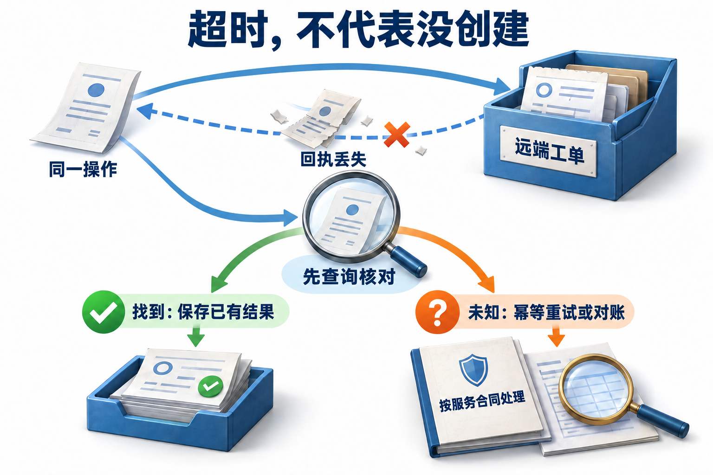

# 02 · 持久执行与恢复

**持久执行把任务进度和等待条件写入可恢复的存储。** 进程重启后，系统可以重建状态，并从已记录的决定继续。外部副作用还要与服务端单独核对。两边的提交时间可能不同。

## 恢复与确定性重放

检查点保存某个已确认位置的状态。事件历史记录后来发生的输入、动作和结果。恢复可以读取检查点，再应用后续事件。采用代码重放的引擎会重新运行编排逻辑，并用已记录的结果匹配历史命令。

历史匹配通常要核对步骤身份、顺序和版本。时间、随机数、外部读取等会变化的结果，由框架记录，或交给单独的任务执行。重放经过该位置时使用原结果。已知结果缺失或命令不匹配时，应报告兼容问题。

### 按框架的历史单位匹配

Temporal 的工作流会把编排代码重发的命令与事件历史匹配。实际调用外部系统时，由 Activity 执行并记录结果。逻辑重跑可以复用已完成结果。Activity 本身可能重试，外部写入仍需幂等。

LangGraph 的函数式接口恢复时会从入口重新执行，复用已完成任务的结果。任务与中断的调用位置需要兼容历史。具体匹配规则按所采用的框架核对。业务操作编号解决外部意图识别，流程重放还要有自己的历史身份。

## 进度记录与等待条件

| 记录 | 保存的内容 |
| --- | --- |
| **事件** | 已发生的输入、派发、观察和确认。 |
| **检查点** | 任务状态、队列位置、所处版本和未确认动作。 |
| **待审批动作** | 操作者范围、具体参数、草稿版本和恢复条件。 |

检查点能否跨进程保留，取决于实际存储。恢复审批时，重新检查当前权限和草稿版本。恢复预算从已消耗的额度继续计算。

每份检查点标记已涵盖的最后事件位置。恢复先装载检查点，再应用后续事件。截断历史前，确认检查点和后续保留的记录可以共同恢复所有等待、批准与未确认写入。

恢复批准时，要用可信身份核对批准作用域、参数版本和撤回状态。审批过期或动作发生变化时，保持等待并重新取得所需确认。恢复预算使用上次保存的消耗与原期限。

## 外部写入与故障窗口

派发前持久记录业务意图，分配稳定操作编号。服务端在自己的边界内核对参数、去重并写入。调用方收到确认后，记录外部对象与结果。

写入前退出，可以按原意图继续。写入后确认前退出，先用原编号查询或对账。查询无法区分未执行和仍在处理时，保持结果未知。服务端具备相应的幂等保证，才按原编号重放。

事务发件箱（outbox）可以把本地业务变更和待投递消息一起提交。投递仍可能重复。消费方用稳定消息身份或业务操作编号，按自己的事务边界处理去重和副作用。

### 消费方的事务去重

在消费端，先用稳定事件编号查询处理回执。已有记录时核对载荷并复用处理结果。新事件则在同一事务里写入回执和业务变更。提交之后再向消息来源确认。

并行消费时，唯一键和事务规则保证只有一次变更能提交。另一执行者遇到冲突就读取已经提交的结果。回执与变更分开提交会留下缺口。先写回执会让恢复错误跳过变更，先做变更会让恢复重复执行。

消费方内部再次调用远端服务时，需要再设计那一段的意图、幂等和对账。消息顺序也单独检查。去重可以挡住重复事件，却无法决定不同版本的先后。

## 升级与历史兼容

编排顺序、工具参数和状态字段的变化，都可能改变历史匹配。发布前用旧任务历史跑恢复测试。对在途任务，可以固定旧工作流版本，或使用明确的迁移规则转换持久状态。迁移后核对待操作、批准和外部标识能否继续对应。

发布检查使用保存过的历史，覆盖进行中、等待审批和已经派发但未确认的任务。逐条比较新代码产生的命令和原历史。如果版本不兼容，继续运行原版本，或显式迁移到可验证的恢复点。

迁移时留存原托管版本、旧动作和可回查的外部编号。迁移失败要能保留原状态。不要在历史不匹配时丢弃未识别的事件后继续。

## 租约、写入隔离与取消

租约让执行者在一段时间内持有任务。租约过期后，旧执行者仍有可能运行。每次领取分配递增代次，提交时由存储检查当前代次。能识别该代次的下游，也可以拒绝旧持有者的请求。

租约只决定谁有资格继续推进。已经发出的远端动作是否取消，要读取服务回执。服务端没有确认时，保留操作编号和未知状态。新执行者先对账，再决定下一步。

### 过期执行者隔离

把代次作为写入前置条件，可以拦住已经失去租约的执行者。这个代次通常是递增值，称为隔离令牌。只限制调度层时，旧执行者仍可能向远端发送请求。要扩大保护范围，需要受保护资源自己校验代次，或让它只能经当前持有者的执行入口访问。

取消、领取与写入可以同时发生。保存取消请求时间和派发提交点。取消先提交时停止后续派发，派发已经提交时保留外部对账义务。补偿需要自己的授权、操作编号和验收。

## 恢复验收

分别检查派发前中断、提交后回执丢失、重复进程领取和新版本恢复旧任务。终态应当能解释每个动作的结果。验收要核对外部对象、操作编号和本地持久状态。

## 配套阅读

展开面试题、实验与资料

- [配套面试题](../docs/advanced/02-durable-execution.md)
- [工单崩溃恢复实验](../examples/policy_agent/README.md)
- [一手资料](official-learning-map.md#进阶-02-的来源)

[上一章：01 · Harness 与深度 Agent](01-harness-and-deep-agents.md) · [工程进阶目录](README.md) · [下一章：03 · 上下文工程](03-context-engineering.md)
