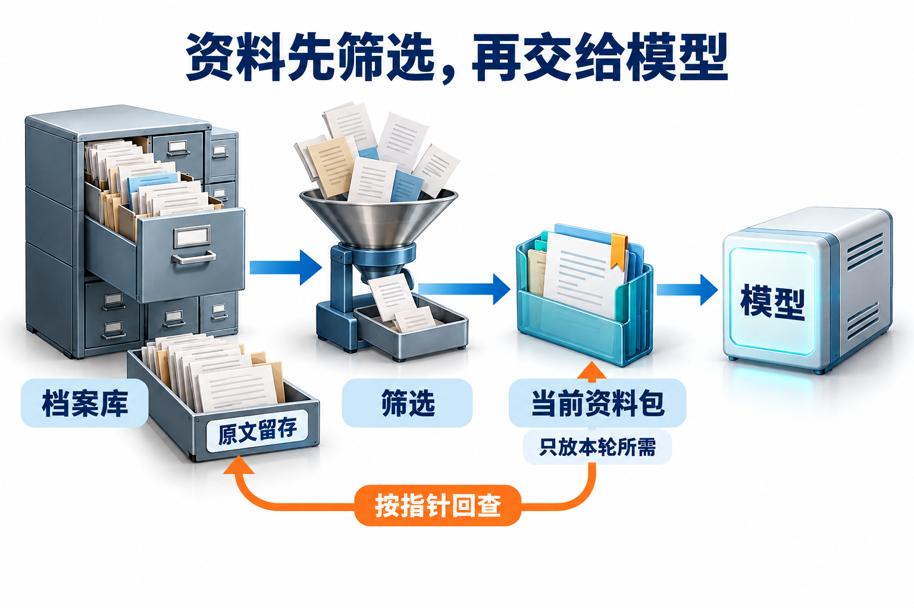

# 03 · 上下文工程：选择、压缩与分层复用


## 上下文工程怎样组织模型当前输入

**上下文（context）** 是模型在当前一次调用中实际收到的信息，包括指令、用户请求、任务状态、工具说明和选入的资料。**上下文工程（context engineering）** 是持续决定这些信息如何选择、组织、更新和按需读取的工作，使当前判断拿得到必要依据。[上下文的持续组织](https://www.anthropic.com/research/effective-context-engineering-for-ai-agents)

提示工程通常更聚焦指令和表达方式，上下文工程进一步处理信息来源、生命周期与有限容量；两者相互配合。**资料已经保存，与资料已经进入当前输入，是两件事。**

内容太长时，可以外置原文并保留指针，也可以摘要重写表达。前者要保证还能找回，后者要检查是否丢了条件。

<div id="材料越来越多为何仍漏掉条件"></div>

## 容量约束与信息完整性

每次模型调用的输入都有容量约束。应用需要明确本轮问题、必要条件、工具定义和已选证据各占多少空间，再根据接口规则预留输出。超过预算时，应重新选择材料、拆分任务或按需补读；截去一个必要条件，即使请求可以发送，也不能视为输入已经准备完整。

**能装入窗口，不等于关键条件已被保留或正确使用。** 排查“漏条件”要分别检查资料、装配、压缩与模型判断，才能知道应改哪一个环节：

| 检查位置 | 可观察的失败 | 对应处理 |
| --- | --- | --- |
| 原始资料 | 来源本身缺少必要条件 | 补充资料或澄清，不让摘要补写事实 |
| 本轮装配 | 来源有条件，但没有选入输入 | 修正证据选择与依赖装配 |
| 摘要转换 | 原文有否定、例外或范围，摘要丢失或改写 | 回查原文，修正压缩规则并重验 |
| 模型使用 | 条件已完整进入输入，判断仍未遵守 | 检查信息组织与模型使用情况，在固定证据下复测 |

窗口超限属于容量问题，旧结论与有效证据混用还涉及版本和一致性。它们需要分别记录，不能把所有失败都归为“材料太多”。长输入中信息利用受位置影响的经验，可作为评测动机，但仍要按目标模型和任务验证，不能当作统一规律。[Lost in the Middle及其受测范围](https://arxiv.org/abs/2307.03172)

## 用任务依赖选择信息

可以将信息分为当前目标、可信约束、已确认状态、活跃证据、候选索引和历史轨迹。先列出本轮尚待完成的判断，再确定每个判断需要的定义、条件和来源；同一份历史轨迹对故障诊断可能必要，对下一步事实比较却未必有用。信息价值取决于当前子目标及其依赖。

每个片段都要回答几个问题：支撑哪个待决判断、来源在哪里、适用何时、当前主体是否可见、是否已被新版本替代。选择时先过滤失效或无权材料，再考虑相关性和预算。相关性分数不表达版本有效性，旧材料不能只因匹配度高就进入当前证据集。

把原文留在模型外，并不意味着以后再也不用它。应保存可解析的证据指针，例如文档 ID、内容版本、章节、字符区间和检索参数；必要时重新读取。指针解析也要检查当前权限，路径本身不是访问凭证。

## 在容量约束内按判断需求选择信息

“挑相关内容”还不是选择算法。先把本轮必须完成的判断写成集合 R，把候选资料组织成证据包 P：一个包同时包含断言、适用主体、条件、时间、单位及来源位置；正文金额和限制条款不能作为彼此无关的片段竞争名额。再对每个包记录 token 成本、能支持的判断、依赖包和相反证据；这些是本章提出的选择元数据，不是假定模型已经算出了真实信息价值。

若接口共享输入输出窗口，先计算 `装配预算 B=窗口上限−输出预留−固定输入−安全余量`；输入上限独立的接口则分别核算。固定输入可含指令、工具与稳定任务字段，其余必须的条件和未知项进入下面的K，同一内容只计费一次。先满足不能删的约束，再选证据包；预算应按目标 tokenizer（模型分词器）或服务计数接口复核，不能只数汉字。选入的包若依赖另一条定义或例外，必须把依赖一并计费，不能把残缺包当成已覆盖。

一个可实现的启发式是：先满足必须覆盖的判断，再按“新增覆盖权重÷新增 token 成本”逐包加入；每次加入后重算边际覆盖，重复材料不重复得分。它类似带依赖的预算选择，**不保证全局最优**，权重也需要任务集验证。比如预算600，金额主条款400、金额重复解释200、例外条件200；只取相关性最高的前两包会漏掉例外，选主条款与例外才能覆盖两个必要判断。若必须证据连同条件超过 B，应拆成多步读取、缩小交付范围或说明缺口，而不是截掉条件后宣布证据齐全。

**依赖闭包**指选入一项信息时，把理解和使用它必需的依赖递归补齐，直到不再新增依赖。它处理的是“结论必须连同定义、前提和未决冲突读取”的关系，不等于把所有关联资料塞进来。候选包若依赖未取得或无权取得的定义，应标成不可用于当前判断；不能把缺失依赖按零成本计算。

```text
K = 本轮尚未计入固定输入、必须保留的目标/约束/未知项/控制状态
X = closure(K)；若依赖不可用或 cost(X)>B：拆步/缩小本轮目标
重复：
    对每个候选 p，计算 A = closure(p) - X
    delta_cost = cost(X∪A) - cost(X)
    排除 A 为空、delta_cost<=0、依赖不可用、版本失效或 cost(X∪A)>B 的候选
    gain = 加入 A 后新增的判断覆盖权重（同一判断不重复计分）
    选择 gain/delta_cost 最大且 gain>0 的项，加入 X
    没有可加入项则停止
输出 X、未覆盖判断及可补读指针；不能仅输出一串正文
```

闭包计算用已访问集合防止重复展开；依赖形成环时应把互相依赖的内容作为整体，或报告错误依赖，不能无限递归。这里假定每个有内容的增量包有正成本，避免已覆盖项参与比值形成0/0。组合的成本按去重后的实际表示重新计数，拼接和分隔也有开销；gain仍是应用给定的近似覆盖，不是模型信息量的精确估计。检索块与父段落的具体装配见[06章](06-agentic-rag.md#从chunk回到parent再把上下文装进预算)，本章讨论所有来源信息的共同容量约束。

外置之后，本轮需要保留“未装入但可读取”和“资料源不存在”两种不同状态。前者可以沿指针补读，后者需要澄清或停止；把二者都摘要成“无资料”会改变后续决策。这套过程将[Anthropic 上下文工程](https://www.anthropic.com/research/effective-context-engineering-for-ai-agents)中的选择与按需读取落实为显式规则，效果仍须用证据覆盖与最终任务表现验证。

<div id="一次具体的压缩与恢复"></div>

### 预算核算与恢复检查

假设统一输入输出窗口为32000 token，预留输出4000。原先24段证据每段1800，共43200，无法直接装入。先按主题与有效期筛选，再选六段各1500，共9000；加上固定说明3000、任务状态1000、必要工具信息1000，输入总计14000。其他材料保留在外部证据索引中，按需展开。

14000只是容量核算，还需检查六段是否覆盖必要判断、依赖是否完整、输出预留是否足够。缺定义时沿指针补读并重新计数；来源更新则使依赖它的摘要失效，再重建输入。会话切换从当前目标、未决问题和产物指针恢复，需要时读取原始轨迹。

容量与质量应分别记录：输入构成、判断覆盖、回读次数、摘要遗漏和最终错误。输入变短却丢掉硬约束，仍是信息损失；跨租户缓存复用错误则是隔离问题，二者都不能用平均token数判断。

## 大工具结果如何清理

工具返回的大 HTML 或 JSON 可以先在执行层解析，提取需要的字段，保留总条数、筛选条件、截断标记与原始产物位置。若只展示前几行而不说明截断，模型可能把“不在预览中”误当成“不存在”。空结果、权限拒绝和解析失败也应保留不同状态。

**外置（offloading）**把原内容保存在当前输入之外，本轮留下必要字段与可解析指针；需要细节时重新读取。**摘要（summarization）**生成一种新的、更短的内容表示，可能丢失条件或改变确定程度。前者要验证定位与回读，后者还要验证原文和摘要是否保留相同判断条件。

Deep Agents 分别提供 offloading 与 summarization。两条路径都要保住重新取得必要信息的能力；选择哪条，要看后续需要精确原文还是只需连续任务状态。[Deep Agents 上下文机制](https://docs.langchain.com/oss/python/deepagents/context-engineering)

例如，原文“仅对已批准的外部培训适用”不能压成“培训适用”。摘要应保留批准状态、培训类别与证据指针。需要作出有副作用的决定时，再从原文核对关键条件，不能让几轮摘要之后的结论成为唯一依据。

还要区分**可靠协议记录**与**给下一轮看的摘要**。原始工具调用、响应身份、错误和已提交操作保存在可靠记录中；摘要只是它们的投影，不能把一次失败改写成成功、给未执行动作伪造工具结果。若模型接口要求工具请求与结果配对，就要遵守该接口的消息合同，或用其支持的上下文管理方式重建输入；不能任意删半对消息后宣称协议仍合法。清理历史工具文本与保留可恢复状态是两种职责。[Anthropic 的压缩与结构化笔记实践](https://www.anthropic.com/research/effective-context-engineering-for-ai-agents#compaction)

[](../website/assets/diagrams/advanced/A03-context.png)

沿着“档案库→筛选→当前资料包→模型”看：本轮只放需要的内容，原文仍保留在外部。关键条件不清时，再按指针回查。

## 压缩要保留哪些可判断关系

文本变短会合并原来不同的情况。设原输入为 x，摘要为 C(x)，某个必须检查的条件函数为 f；对已经列出的检查项，应核对 `f(x)=f(C(x))`。例如“是否只读”“条件是否已批准”“金额对应哪类员工”“是否仍有冲突”都应保持；这是一组可测的判断保持要求，不是保证模型对所有开放问题行为等价的证明。

逐条核对时，把摘要中的金额、主体、否定、例外、时效和不确定性指回原文，再检查原文中会改变动作的条件是否在摘要里有对应项。摘要缺少来源或已把“尚未批准”改成“可执行”，应丢弃该摘要并回查。分层摘要可以经可靠依赖链回查具体源版本，不必每层复制原文；若链条已经丢失，只剩上轮摘要的肯定结论，就不足以给下轮摘要背书。验证压缩时可固定其他输入，只改其中一个条件，检查压缩结果还能否区分这两个任务。

若压缩器把“可写”和“不可写”两份输入都映成同一句摘要，下游只看摘要就无法稳定区分它们，增加推理轮数也不能恢复已经消失的差异。因此先验证表示是否保住判断条件，再验证模型是否会使用它。可分开统计必要条件遗漏率、摘要新增但原文不支持的断言数、动作判断改变率和回查次数；自动检查适合 ID、日期、数值和状态，开放含义仍需标注样本复核。

同预算对照应固定任务、输入资料与输出要求，依次比较原文选择、只外置、结构化摘要和自由摘要；同时记录输入成本与最终判断，不能只比压缩率。再做位置变式，把同一关键条件移到开头、中间、结尾，或只改变一个否定词，看错误来自遗漏还是使用失败。《Lost in the Middle》在其 2023 年模型与任务中观察到位置信息利用差异；它提供评测动机，不是所有当前模型都有同样曲线的定律。[原论文及实验范围](https://arxiv.org/abs/2307.03172)

压缩也有开销。按同一种成本单位，设生成摘要一次花费 C，每次后续调用少用 S、却增加回查成本 L，则 n 次复用的净节省为 `n×(S−L)−C`。教学取 C=1200、S=800、L=200，复用两次刚好持平，三次净省600；如果 L≥S，单靠增加复用次数不会回本。这是可复算的成本模型，不是实测 token 或费用，真实输入/输出价格、缓存折扣与延迟需分别测量；即使成本回本，关键判断丢失仍不能接受。

### 压缩示例：保留哪些判断条件

<div id="完成样本压缩前后保住哪些判断"></div>

用一次只读故障诊断检查摘要损失。用户要求“只分析，不重启服务”，工具返回了带时区的错误窗口、被截断的日志预览，以及一次失败后成功的读取；这些状态不能压成“日志已齐，服务有问题”。下面是设计样本，没有模型运行成绩。

| 原始材料 | 本轮保留什么 | 怎样回查 |
| --- | --- | --- |
| 错误发生于09:00–09:10 UTC | 原时区及时间窗口 | 日志查询参数与响应位置 |
| 只展示前100条，共1200条 | `truncated=true`，尚未覆盖全部记录 | 完整产物指针与过滤条件 |
| 用户“只分析，不重启” | 只读范围 | 回查用户原话 |
| 读取第一次超时、第二次成功 | 数据已读到；历史超时仅供排障 | 两次调用身份与结果记录 |
| 尚不能判断是否为数据库故障 | 保留未决假设，不写成结论 | 待补证据清单 |

压缩后的输入可以写得很短：

> 只读分析09:00–09:10 UTC故障，不重启服务。
>
> 日志读取已成功，目前预览100/1200条，已截断；完整产物与原查询参数可回查。
>
> 数据库故障仍是假设，需要补证据，不能由预览直接确认。

把UTC删掉，查询可能偏移数小时；删掉截断标记，少量预览就可能被当作完整统计；把假设改成结论，则改变了诊断结果。压缩验收关注这些差异能否被保住与回查，而不只是摘要是否顺口。

## 从目录到细节的渐进加载

**渐进加载**把可发现的目录与实际执行需要的详细内容分层。常驻输入保留名称、用途与适用条件等元数据，选择能力后加载过程正文，执行中再按依赖读取参考资料或脚本。每一层回答“是否需要继续展开”，避免一开始就装入所有过程细节。Agent Skills 规范以元数据、指令和按需资源组织这种方式。[Progressive disclosure](https://agentskills.io/specification#progressive-disclosure)

目录本身也需要版本与权限。用途相近的过程应明确区分输入类型、适用范围和版本；同一技能的新旧版本不能仅凭名字随机选择。加载后仍要保留数据与指令的边界，引用材料中的命令不会因进入上下文就成为高优先级指令。

## 四个不同的复用层

**缓存（cache）** 通过复用已有结果减少重复工作，但不同层缓存的对象并不相同。**KV Cache（Key-Value Cache，键值缓存）** 保存注意力计算中的键和值，前缀缓存可进一步复用匹配输入前缀的相关计算；它们与直接复用文档候选或最终答案的业务缓存应分开理解。

| 层次 | 复用对象 | 仍需检查什么 |
|---|---|---|
| 检索结果缓存 | 候选或文档片段 | 索引版本、有效期、主体权限 |
| 生成过程 KV Cache | 已处理位置的中间表示 | 模型及计算配置、缓存生命周期 |
| 前缀或 Prompt Cache | 相同输入前缀的计算结果 | 匹配条件、缓存隔离与失效 |
| 最终答案缓存 | 先前生成的回答 | 问题与条件等价、证据更新、权限 |

对于常见因果注意力模型，已有位置的 KV 可以被后续生成复用。vLLM 的自动前缀缓存进一步在共享前缀的请求间复用相应 KV，主要减少重复的 prefill 计算；新 token 仍要生成。答案缓存则可能直接跳过模型调用，二者不是同一件事。[vLLM 自动前缀缓存](https://docs.vllm.ai/en/stable/features/automatic_prefix_caching/)

两个请求共享前6000 token、后2000不同，只能说明匹配前缀可能复用；动态后缀与输出仍要处理。这里先掌握复用对象与内容选择，[10章](10-performance-and-serving.md#关键路径与缓存失效示例)再把缓存放到依赖图中复算端到端收益，不能直接把前缀长度比例换成加速比例。

稳定前缀应放确实稳定的系统说明、工具定义或共享资料，动态任务信息随后加入。随意调整工具顺序、在最前面插入时间戳，都可能缩短可复用前缀；但不能为了命中率保留过时规则或不适用的材料。正确性优先决定输入内容，再优化其稳定表示。

共享缓存还要考虑租户隔离与侧信道。vLLM 提供按请求加 salt 限制前缀复用范围；应用应由可信上下文分配隔离组，而不是让任意客户端宣称属于另一个组。[缓存隔离设计](https://docs.vllm.ai/en/stable/design/prefix_caching/) 缓存是否命中不改变用户能读取哪些政策。

## 设计练习

为 24 段政策材料建立证据索引，标注版本、权限、适用条件和所支撑的判断。写一份 1000 token 以内的任务摘要，然后删除其中一个关键条件，让同伴只看摘要作答。验收时应定位信息在哪次转换中丢失，演示如何通过指针补回，并设计政策撤回后使相关检索缓存、摘要与答案缓存同时失效的流程。

## 自检

<details><summary>1. 把全部正文存进文件，能否直接删除来源元数据？</summary>

不能。没有版本、位置与权限信息，后续无法可靠回查或判断材料是否仍适用。文件路径也不能代替资源授权。
</details>

<details><summary>2. 前缀缓存命中后，为什么还会产生较长的等待？</summary>

动态后缀、输出生成和排队等工作仍然存在；缓存也受容量、复用条件与调度影响，不能只按前缀长度预测总延迟。
</details>

<details><summary>3. 摘要已经包含“结论”，发布前为什么还可能取回原文？</summary>

摘要可能丢失适用条件或不确定性。涉及重要判断时，应检查结论对应的有效条款，确认版本和当前访问权限。
</details>

## 参考资料

- [Anthropic：Effective context engineering for AI agents](https://www.anthropic.com/research/effective-context-engineering-for-ai-agents)
- [Deep Agents：Context engineering](https://docs.langchain.com/oss/python/deepagents/context-engineering)
- [Agent Skills 规范](https://agentskills.io/specification)
- [vLLM：自动前缀缓存](https://docs.vllm.ai/en/stable/features/automatic_prefix_caching/)、[缓存设计与隔离](https://docs.vllm.ai/en/stable/design/prefix_caching/)


[配套进阶面试题](../docs/advanced/03-context-engineering.md)

[上一章：02 · 持久执行](02-durable-execution.md) · [工程进阶目录](README.md) · [下一章：04 · 记忆与技能](04-memory-and-skills.md)
