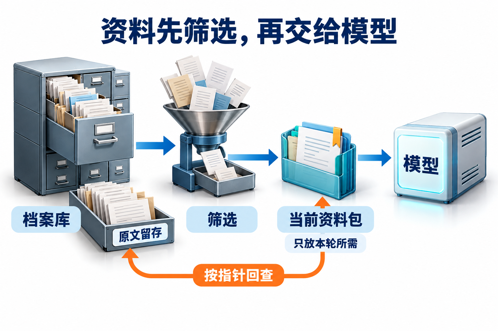

# 03 · 上下文选择、压缩与复用

**上下文工程负责让模型在有限输入里看到足够的信息。** 每一轮都按下一步决定的需要整理指令、状态、证据和工具。要保住的不只是结论，还包括能判断它是否适用的条件。

## 按依赖装配输入

先列清下一步需要判断的对象、日期、范围和动作。再沿这些条件找证据来源。每份材料连同解释它所必需的字段一起选择。正文、表头、单位和例外条款有依赖时，要按一组处理。

输入预算先扣掉输出预留、任务指令和实际序列化开销。用目标模型的分词方式确认预算。剩余空间分给状态、证据与工具。先放必需条件，再按相关性和获取成本补充材料。依赖仍缺失时，缩小这一轮的任务，或读取缺失部分后再决策。

### 有预算的证据选择

把要判断的条件列成集合。每份候选证据记录可支持的条件、所需 token、依赖材料和冲突来源。判断依据依赖定义或例外时，计入整个证据包的成本。残缺证据包只能标为部分覆盖。

先保住必要条件。对剩余候选，可以按「新增覆盖权重 ÷ 新增 token」逐项挑选。每选一项就重算剩余价值。与已有资料重复的判断只计一次。权重取自真实任务的验收需要，再用同一批任务比较方案。

当所有必要依赖放不进窗口时，将任务拆成多个可验证步骤。每步产出有出处的结论与待确认项，最后再按共同条件汇总。

## 压缩与原文回查

摘要要保留事实的主体、值、单位、适用时间和例外，也要保留未确认项和原文位置。把事实、推断和用户偏好分开保存。关键结论将用于写入或发布时，按来源回查。

评估压缩时，先列出原输入支持的关键判断。再用压缩后的输入逐项验证。确认裁剪是否改变了条件、动作权限或结论。估算成本时，把生成摘要和后续回读的代价都算进去。只有节省的输入费用超过这些代价，压缩才降低了该路径的总费用。

### 何时必须展开原文

摘要可以替代背景材料的重复阅读。涉及数字、否定、例外或相关范围时，要保存能恢复判断的信息。没有查到、资料冲突和暂未取得三类状态应分别保留。

来源材料发生修改或权限变化时，按依赖失效摘要。对关键动作，按资料标识和版本回读，再检查适用期。复盘时同时查看压缩前后内容和实际输入，区分「候选里有」与「模型收到」。

### 压缩的执行成本

净节省可按「减少的输入费用 − 生成摘要费用 − 后续回读费用」估算。输入价格、缓存命中与调用次数同时变化时，应使用各自的实际计费。压缩还可能增加一次同步等待。比较时同时记录账单、路径耗时和被保住的必要条件。

## 大结果留在窗口之外

工具输出较大时，保存完整结果和读取位置。模型输入先放简短摘要、保留字段、来源版本和可读取范围。再次展开前，核对当前读取权限。

分页和截断要带上边界标记。只读取了部分结果时，明确哪些内容还没看过。关闭已结束步骤的临时材料，但保留足以解释后续决策的引用。

完整工具结果要绑定工具版本、请求标识和返回边界。后续读取只展开指定范围。返回分页游标、总量是否已知和截断原因。这样可以区分「结果本身为空」与「需要的条目还在下一页」。

记录没有送进模型的字段和略去原因。排查漏项时沿工具原始结果、选择规则、发送请求查。把截断记录保留在输入里，可以让下一轮知道是否应补读。

## 从目录逐层展开

先提供简短目录和适用范围，选中后再读取详细内容。目录需要能区分相近的工具、技能或资料。核心授权与必要约束应在执行前可用，不能等到可选附录被读到才生效。

目录和详情也要绑定同一版本。目录宣称存在的能力如果读取失败，应明确标为不可用。定义何种信号触发展开，何时需要再回读，怎样避免重复读取同一内容。逐步展开能缩小首次输入，也会增加往返。

## 不同层的复用

| 机制 | 保存什么 | 核对什么 |
| --- | --- | --- |
| **状态与记忆** | 已确认事实、进度或长期记录。 | 当前权限、版本和适用期。 |
| **结果缓存** | 某次检索或工具调用的输出。 | 查询条件、资源版本和权限范围。 |
| **前缀缓存** | 输入前缀对应的模型计算结果。 | 服务是否实际命中，以及生成阶段是否仍占主要耗时。 |
| **文件与目录** | 完整材料和按需读取的位置。 | 文件版本、访问控制和展开成本。 |

前缀缓存适合较稳定的共享输入。把稳定要求和按用户变化的信息分别组织，有助于识别可复用的前缀。实际命中条件与隔离策略依服务而定。

业务结果缓存要纳入数据版本、请求范围和身份。命中后也应执行现行权限检查。系统记录缓存版本和命中阶段，便于定位过期内容到底来自缓存、存储还是输入装配。

## 比较装配方案

固定任务、模型、资料版本和总预算。分别记录必要条件进入输入的比例、结论获得证据支持的比例、回读次数和总耗时。判断新方案时，重点检查出错的任务丢了哪项条件。

## 配套阅读

展开面试题、实验与资料

- [配套面试题](../docs/advanced/03-context-engineering.md)
- [一手资料](official-learning-map.md#进阶-03-的来源)

[上一章：02 · 持久执行](02-durable-execution.md) · [工程进阶目录](README.md) · [下一章：04 · 记忆与技能](04-memory-and-skills.md)
