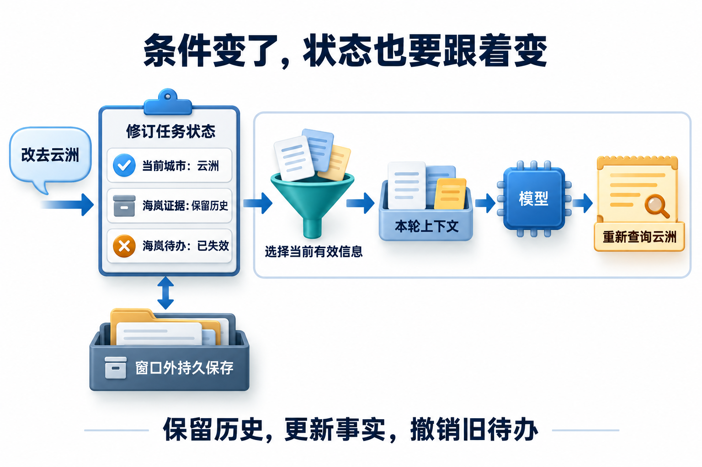

# 04 · 记忆与技能：管理事实变化和可复用过程

[上一章：上下文工程](03-context-engineering.md) · [进阶目录](README.md) · [下一章：工具路由与 MCP](05-tool-routing-and-mcp.md)

## 记忆与技能怎样分工

**Agent 记忆**是让系统在后续步骤或会话中重新取用既有信息的机制，需要同时考虑保存、查找、更新和失效。**工作记忆**围绕当前任务保留进展，**长期记忆**允许跨会话复用事实、经验或做事方式；两者最终都要经过选择，才能进入模型当前上下文。

**技能（Skills）** 把可复用的做事方法组织成过程包，例如检查步骤、参考资料、脚本与模板。记忆描述信息怎样保留和复用，技能描述过程知识怎样封装，二者可以配合。本章分别管理带来源的事实记录与可复用的过程；把事实写进文件、把步骤写进数据库，都不会改变内容的性质。读取记忆或技能会改变推理时可用的信息，**不意味着模型参数已经更新**。

这一章接着基础课的状态与记忆，重点看事实变化怎样被记录，以及过程升级怎样被管理。先认清抽屉里放的是名册还是操作手册，再决定怎么更新。

## 旧事实与旧流程会带来什么问题

助手昨天记住了住宿金额，今天却拿旧制度指导新申请；你更新了比较流程，它又把一次成功经验套到所有任务上。问题可能不在“记得不够多”，而在它把事实与做事方法装进了同一个抽屉。

关于人、制度和任务的事实会随业务变化，比较、引用和审阅的过程会随工具与方法升级。把两者分开管理，才能避免旧制度变成操作步骤、偶然成功变成普遍规则。建议先读基础课的[状态与记忆](../learning/07-memory-and-state.md)、[RAG](../learning/06-rag-and-retrieval.md)和[提示与上下文](../learning/03-context-and-prompts.md)；学完本章，应能设计两类知识的生命周期，解释时间、冲突、版本及权限如何共同影响读取。

## 工作记忆与长期事实的身份

工作记忆保存当前任务目标、未决条件、活跃证据和下一动作。长期记忆则需要稳定主体、信息类型、来源、时间和访问范围；“本次去海岚”属于任务事实，不能直接升级为常住城市。LangGraph 区分线程状态的 checkpointer 与跨线程应用数据的 store，存储层次仍需配合业务命名空间。[状态与跨线程数据](https://docs.langchain.com/oss/python/langgraph/persistence)

长期事实最好有实体标识和事件来源。**实体解析**是判断不同记录是否指向同一主体的过程，需要结合可靠标识与来源。两名显示名均为“小明”的员工不能只靠姓名合并；政策 P17 的新版本应关联同一政策实体，但保留不同的内容版本。合并实体时要验证租户、业务 ID、别名与来源，不让相似文本替代身份解析。

## 事实何时有效，系统何时得知

先区分两条时间轴：**业务有效时间**回答“哪天的差旅适用什么”，**记录时间**回答“系统在当时知道什么”。假设住宿标准从 11 月 1 日由 600 改为 700，而助手在 11 月 5 日才取得通知，两个日期分别落在这两条轴上。只有一个 `updated_at`，无法同时解释规则变化与延迟入库。

读历史时先选对“时钟”。为每次断言保存有效区间、记录版本与来源事件后，10 月的历史查询使用旧规则；收到更正后，11 月 2 日的差旅应按新规则判断。

但要调查助手在 11 月 3 日为什么回答旧金额，就得回到它当时拿到的材料集合。“当时适用什么”和“当时知道什么”不是同一问法。保留更正事件与原始证据，才能解释差异，不能用覆盖后的当前值重写过去的认知。

Graphiti 通过实体、关系与来源 episode 组织时间图，关系包含有效时间字段，并保留事实失效信息。其源码中的 `valid_at`、`invalid_at` 与 `created_at`、`expired_at` 分别参与事实时间和记录生命周期的表达。[Graphiti 的时间图](https://github.com/getzep/graphiti)、[关系数据结构](https://github.com/getzep/graphiti/blob/main/graphiti_core/edges.py)

具体时间语义仍要由业务类型约束。“已宣布下月开始执行”是当前存在的一条公告，不能被抽取成“新标准今天已经适用”。计划、承诺、发生事件和现行规则应有不同关系或属性。抽取日期不完整时保留未知，再由制度版本和条款确定有效范围。

## 冲突不能只按最后写入者取胜

一条关系可以因新证据而结束有效期，但要先确认是同一实体、同一适用条件以及确实矛盾的断言。“管理人员 700、普通员工 600”可以同时成立；来源更晚也可能只是转述旧制度。Graphiti 的关系维护实现会结合时间范围处理已识别的矛盾边，应用仍需控制输入来源与事实类型。[矛盾关系的时间处理](https://github.com/getzep/graphiti/blob/main/graphiti_core/utils/maintenance/edge_operations.py)

本例的写入流水线先接收原始事件，再抽取候选事实、解析实体、检查来源与适用范围，最后决定追加、替代或保留冲突。高影响规则进入待确认区，不能因为模型成功输出了三元组就立即成为生效政策。读取时先限定租户、主体、时间与类型，再做相关性排序。

失效也不只影响主表。政策撤回后，相关图边、向量结果、任务摘要和最终答案缓存都可能继续传播旧值。可以用来源依赖关系找到受影响产物并标记失效；新请求不再选入它们，历史记录仍保存其当时来源和更正关系。

## 反思记忆保存的是可检验的经验

假设助手三次遗漏“员工类别”，可以形成候选经验：“比较住宿标准前，检查员工类别是否明确。”记录应带触发场景、失败轨迹、适用任务与验证结果，而不是只存“以后必须先问更多问题”。后者可能让本来信息充分的请求也不断澄清。

Reflexion 使用语言反馈与情节记忆影响后续尝试；它改变的是后续可读取的信息，不以更新模型权重为机制。[Reflexion 原论文](https://arxiv.org/abs/2303.11366) 工程上应按任务检索少量相关经验，设置过期与撤回规则，并用正反例评估经验是否减少同类错误。用户原文、模型反思与已批准操作规则应保持不同信任级别。

## Skills 装载的是过程知识与资源

Skill 可以把适用条件、操作步骤、示例、脚本和模板组成可加载的过程知识。Agent Skills 规范以 `SKILL.md` 为入口，并允许附带参考资料与资源；渐进加载先提供名称与描述，匹配任务后再读取正文和所需文件。[Agent Skills 规范](https://agentskills.io/specification)

事实记忆回答“小明属于哪类员工”，技能回答“怎样选规则、补缺项、生成带证据的比较表”。前者像带来源的名册，后者像可复用的操作手册；手册里写着“打开财务系统”，并不等于读者就拿到了财务钥匙。

读取技能不会修改模型参数，也不会让脚本自动获得网络或文件权限。规范中的 `allowed-tools` 是实验性字段，宿主是否支持与真实授权仍要分别检查。

研究比较技能可以拆为入口说明、条款映射参考、报告模板和表格校验脚本。入口只说明何时使用及必要步骤，具体地区规则由检索提供，避免把每天变化的金额硬编码进过程。Deep Agents 也按元数据、指令和资源分层加载技能。[技能的加载过程](https://docs.langchain.com/oss/python/deepagents/skills)

## 技能升级像发布程序一样管理

假设 `policy-compare` 从 v2 升至 v3，新版要求保留反例和来源有效期。发布包应固定指令、脚本、模板与依赖版本，记录可使用的工具合同及资源权限；运行开始后绑定该版本，避免任务执行到一半读到另一套步骤。

先在固定任务集合比较 v2、v3：正常比较、缺人员类别、来源冲突、权限撤回及旧脚本失败。分别检查事实完整性、无效澄清、错误动作和资源消耗。若 v3 退步，将新任务路由回 v2；对已生成或已发布产物，还需按其版本和来源单独修复，回滚技能不会撤销已经发生的业务动作。

依赖也属于发布对象。模板引用新增字段但解析脚本仍输出旧字段，会造成过程层面的静默错配；可以在激活技能前验证文件、依赖与输出合同。对来自外部的技能包，读取说明、安装依赖和执行脚本是三个不同动作，应由宿主分别控制。

## 修订记录与过程合同，分别保存

[查看原图](../website/assets/diagrams/G6-state-memory.png)

用P17完成一份双时间记录，日期均为教学设定：

| 记录 | 业务有效区间 | 系统取得时间 | 金额与来源 |
| --- | --- | --- | --- |
| m1 | 2026-01-01至2026-11-01前 | 2026-10-20 | 600，P17-v1#4 |
| m2 | 2026-11-01起 | 2026-11-05 | 700，P17-v2#4 |

问“11月2日适用什么”，按业务时间查700；问“系统11月3日为何答600”，回到当时记录集合调查。追加m2及其来源，不把m1改写成它从未存在。若新来源同等级、同有效期却写500，进入冲突判断，不按记录时间简单获胜。

`policy-compare`则是过程知识，完成合同如下：输入为可信主体、两个城市、业务日期；先检查未知项，分别读取适用制度，核对类别/日期/权限，输出比较表和引用；缺任一必要证据就说明缺口；默认不写入。版本1只比较金额，新增例外材料比较需版本2及回归任务T06。技能不能夹带固定“海岚永远700元”作为步骤。

内容类别（事实、事件、过程）和存储方式（字段、文档、向量索引）是两个维度。同一过程可存Markdown；同一事实可用结构化字段并建索引，语义记忆不等于一定用向量库。变式验收：把P17换为旧日期，过程不变、读取事实改变；若输出仍700，说明把数据错误写进了技能。

## 设计练习

建立“住宿标准变化”的实体与事件表，同时保存有效时间、记录时间、来源和适用员工。加入延迟通知、两个同名用户和一条低可信冲突材料。再设计比较技能 v2→v3 的发布清单。验收时应能回答历史规则与历史认知两个问题，阻止跨主体合并，定位受撤回事实影响的产物，并说明技能回滚后哪些业务动作仍需补偿。

## 自检

1. 系统今天收到新政策，是否说明今天才开始生效？

不是。接收时间与业务有效时间不同，应依据正式条款确定有效区间，并保留延迟入库的记录。

2. 两条金额不同的关系是否一定需要删除旧关系？

不一定。先核对主体、人员类别、地区和时间，可能是不同条件下同时成立的规则；真正更正也应保留来源与历史关系。

3. 技能里声明允许发送邮件，是否就可以执行？

不能仅凭技能文字执行。仍需宿主暴露相应工具、当前用户授权、业务要求时的具体动作确认及执行环境权限。

## 参考资料

- [LangGraph Persistence](https://docs.langchain.com/oss/python/langgraph/persistence)
- [Graphiti](https://github.com/getzep/graphiti)、[关系模型](https://github.com/getzep/graphiti/blob/main/graphiti_core/edges.py)、[关系维护](https://github.com/getzep/graphiti/blob/main/graphiti_core/utils/maintenance/edge_operations.py)
- [Reflexion](https://arxiv.org/abs/2303.11366)
- [Agent Skills 规范](https://agentskills.io/specification)、[Deep Agents Skills](https://docs.langchain.com/oss/python/deepagents/skills)

[上一章](03-context-engineering.md) · [进阶目录](README.md) · [下一章：工具路由与 MCP](05-tool-routing-and-mcp.md)

[配套进阶面试题](../docs/advanced/04-memory-and-skills.md)
