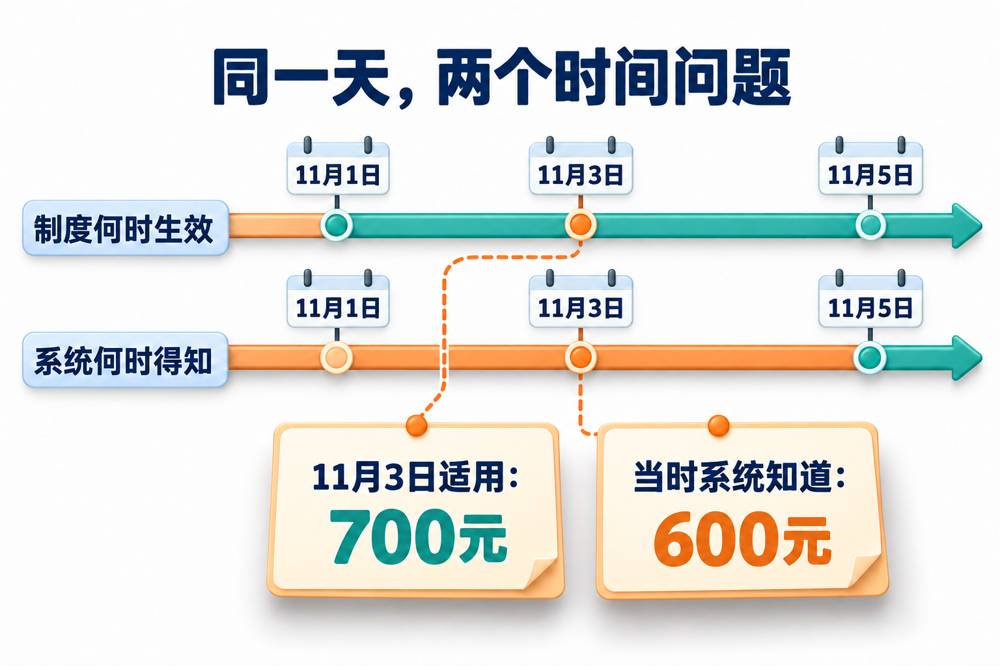

# 04 · 记忆与技能：管理事实变化和可复用过程

[上一章：上下文工程](03-context-engineering.md) · [工程进阶目录](README.md) · [下一章：工具路由与 MCP](05-tool-routing-and-mcp.md)

## 记忆与技能怎样分工

**Agent 记忆**是让系统在后续步骤或会话中重新取用既有信息的机制，需要同时考虑保存、查找、更新和失效。**工作记忆**围绕当前任务保留进展，**长期记忆**允许跨会话复用事实、经验或做事方式；两者最终都要经过选择，才能进入模型当前上下文。

**技能（Skills）** 把可复用的做事方法组织成过程包，例如检查步骤、参考资料、脚本与模板。记忆描述信息怎样保留和复用，技能描述过程知识怎样封装，二者可以配合。把事实写进文件、把步骤写进数据库，都不会改变内容的性质。读取记忆或技能会改变推理时可用的信息，**不意味着模型参数已经更新**。

## 旧事实与旧流程会带来什么问题

助手昨天记住了住宿金额，今天却拿旧制度指导新申请；你更新了比较流程，它又把一次成功经验套到所有任务上。问题可能不在“记得不够多”，而在它把事实与做事方法装进了同一个抽屉。

关于人、制度和任务的事实会随业务变化，比较、引用和审阅的过程会随工具与方法升级。把两者分开管理，才能避免旧制度变成操作步骤、偶然成功变成普遍规则。

## 工作记忆与长期事实的身份

工作记忆保存当前任务目标、未决条件、活跃证据和下一动作。长期记忆则需要稳定主体、信息类型、来源、时间和访问范围；“本次去海岚”属于任务事实，不能直接升级为常住城市。LangGraph 区分线程状态的 checkpointer 与跨线程应用数据的 store，存储层次仍需配合业务命名空间。[状态与跨线程数据](https://docs.langchain.com/oss/python/langgraph/persistence)

长期事实最好有实体标识和事件来源。**实体解析**是判断不同记录是否指向同一主体的过程，需要结合可靠标识与来源。两名显示名均为“小明”的员工不能只靠姓名合并；海岚住宿标准的新版本应关联同一份制度，但保留不同的内容版本。合并实体时要验证租户、业务 ID、别名与来源，不让相似文本替代身份解析。

## 从一次观察到可复用记忆

长期保存之前先做**准入**：判断这条内容是什么、能支持哪种事实、是否值得保存。一次用户提问、一个搜索片段和一次模型总结，都只是带来源的观察，不会自动成为确认事实。把“用户这次去甲地”抽成“用户常住甲地”，错误发生在抽取和准入，换更好的向量检索无法补救。

一种应用流水线是 `原始事件→候选抽取→身份/来源/适用性检查→追加或更正事实版本→发布检索索引`。候选应保留原话位置、来源事件 ID、主体、事实类型、条件、时间、不确定性和信任级别。模型可以提出这些字段，但高影响字段要依据可信业务记录或确认流程接受；未确认内容留在候选区，不能与正式事实同权使用。

```text
接收事件 e；按可信命名空间与事件ID保存原始记录
提取候选 c；无法确认主体/时间/含义则保留未知或请求确认
核对 c 的证据确实支持该断言，而非问题、计划或转述
查找同一事实键：重复来源 → 复用记录；可证实更正 → 追加版本
                  不同适用范围 → 并存；真矛盾 → 保存冲突
原子提交接受决定及待索引事件；只有已接受版本进入相应读取域
```

**巩固（consolidation）** 是把多次观察整理成更便于复用的事实或经验，不能把十次检索到同一原文误算成十份独立证据。巩固产物保留来源依赖、适用范围和反例，不能只留下无法回查原材料的旧摘要；可以经可靠依赖链回查具体源版本，不要求每份摘要复制整条链或原文。Generative Agents 研究用观察、检索和反思构成记忆架构，说明了这种分层的用途；其仿真角色行为实验不是本手册事实准入正确率的证据。[Generative Agents 原论文](https://arxiv.org/abs/2304.03442)

前台同步写入能保证本次接受决定立即可见，却增加请求延迟；后台抽取与巩固减少前台工作，却可能滞后或失败。无论采用哪种，都要按来源事件和事实版本重试，且让待确认、已接受、被更正与已撤回具有不同状态。下节时间模型回答接受之后如何保留历史，后面的索引机制回答何时能被检索到。

## 事实何时有效，系统何时得知

先区分两条时间轴：**业务有效时间**回答“哪天的差旅适用什么”，**记录时间**回答“系统在当时知道什么”。假设住宿标准从 11 月 1 日由 600 改为 700，而助手在 11 月 5 日才取得通知，两个日期分别落在这两条轴上。只有一个 `updated_at`，无法同时解释规则变化与延迟入库。

读历史时先选对“时钟”。为每次断言保存有效区间、记录版本与来源事件后，10 月的历史查询使用旧规则；收到更正后，11 月 2 日的差旅应按新规则判断。

但要调查助手在 11 月 3 日为什么回答旧金额，就得回到它当时拿到的材料集合。“当时适用什么”和“当时知道什么”不是同一问法。保留更正事件与原始证据，才能解释差异，不能用覆盖后的当前值重写过去的认知。

Graphiti 通过实体、关系与来源 episode 组织时间图，关系包含有效时间字段，并保留事实失效信息。其源码中的 `valid_at`、`invalid_at` 与 `created_at`、`expired_at` 分别参与事实时间和记录生命周期的表达。[Graphiti 的时间图](https://github.com/getzep/graphiti)、[关系数据结构](https://github.com/getzep/graphiti/blob/main/graphiti_core/edges.py)

具体时间语义仍要由业务类型约束。“已宣布下月开始执行”是当前存在的一条公告，不能被抽取成“新标准今天已经适用”。计划、承诺、发生事件和现行规则应有不同关系或属性。抽取日期不完整时保留未知，再由制度版本和条款确定有效范围。

[](../website/assets/diagrams/advanced/A04-memory-time.png)

先沿上轨看制度何时变化，再沿下轨看系统何时得知。查“11月3日适用什么”与查“系统11月3日为什么这样答”，用的是不同时间条件。这是双时间设计示意，本地政策实验尚未实现这套索引。

## 冲突不能只按最后写入者取胜

一条关系可以因新证据而结束有效期，但要先确认是同一实体、同一适用条件以及确实矛盾的断言。“管理人员 700、普通员工 600”可以同时成立；来源更晚也可能只是转述旧制度。Graphiti 的关系维护实现会结合时间范围处理已识别的矛盾边，应用仍需控制输入来源与事实类型。[矛盾关系的时间处理](https://github.com/getzep/graphiti/blob/main/graphiti_core/utils/maintenance/edge_operations.py)

本例的写入流水线先接收原始事件，再抽取候选事实、解析实体、检查来源与适用范围，最后决定追加、替代或保留冲突。高影响规则进入待确认区，不能因为模型成功输出了三元组就立即成为生效政策。读取时先限定租户、主体、时间与类型，再做相关性排序。

失效也不只影响主表。政策撤回后，相关图边、向量结果、任务摘要和最终答案缓存都可能继续传播旧值。可以用来源依赖关系找到受影响产物并标记失效；新请求不再选入它们，历史记录仍保存其当时来源和更正关系。

## 权威事实记录与检索索引怎样共同更新

记忆系统通常需要分开保存**事实记录**和**查找路径**。事实记录可以用 `(tenant, subject_id, fact_type, scope, record_version)` 标识，内容另有来源、有效时间、记录时间及冲突状态；语义向量、关键词表和关系邻接表是指向这些版本的派生索引。相似度只帮助找到候选，是否仍为有效事实必须回到记录与权限判断。[LangGraph Store](https://docs.langchain.com/oss/python/langgraph/persistence#checkpointer-vs-store)保存应用定义的数据，但不会替应用定义这套事实更新规则。

对于本章双时间合同，查询条件至少包含 `valid_from≤业务时点<valid_to`，若要还原历史认知，还要加 `recorded_from≤认知时点<recorded_to`；未结束区间按开放上界处理。同一主体不同适用范围应保留为不同事实，真正更正则追加记录版本并关闭旧版本的记录区间，不能直接改掉旧版本当时声称的有效范围。候选冲突尚未解决时，读取端得到的应是冲突集合，而非任意一行金额。

更新需要考虑事实已改、索引尚未改的时间差。一种设计是在同一事务写入新事实版本、当前版本指针及待更新索引事件；索引器按事实ID和版本幂等写入，完成后发布索引代次。索引若在外部系统，不能把这一步称为跨系统原子更新；查询端先按派生索引取候选ID，再从权威记录核对版本、失效标记和当前授权。

这样能挡住陈旧候选，但索引未跟上时仍可能漏掉新记忆。若业务要求刚提交的事实随后就可查到，即写后读一致性（读己之写，read-your-writes），可以临时合并尚未入索引的已提交记录，或等待索引水位（已完成索引更新的版本位置）到达所需版本，不能只写“最终会同步”。事务加待更新事件的原理见[AWS outbox 模式](https://docs.aws.amazon.com/prescriptive-guidance/latest/cloud-design-patterns/transactional-outbox.html)，并非声明 Graphiti 或所有 store 都采用此实现。

失效传播可以维护 `source_version→fact_versions→derived_summaries/cache_keys` 的反向依赖。撤回时先阻止新读取，再异步清理派生项；清理没有完成的窗口内，读取端的版本与授权复核仍必须生效。验证应故意暂停索引更新，分别查询旧事实、新事实和被撤回事实：旧值不得继续作为当前事实返回，新值暂不可检索则明确报告新鲜度限制；“旧值被拦住”与“新值一定召回”是两个验收条件。[14章](14-ingestion-and-index-lifecycle.md)提供单写者完整索引发布的具体实现对照。

## 检索、反馈与遗忘怎样形成闭环

读取记忆应先确定问题类型。已知主体的明确字段优先按事实键与时间查询；寻找相关经历才做关键词或语义召回，再回到记录核对适用性。只有合法且适用的候选才参与相关性、时间接近程度等排序；“最近常被读到”不能覆盖相反的权威更正。它与[06章](06-agentic-rag.md)共享检索方法，本章额外关注跨会话事实的身份和修订生命周期。

反馈也会污染记忆。若“被检索一次”就自动提高重要性，同一条早期错误会更常入选，再被模型引用为确认，形成自我强化。可以把使用次数与证据质量分别记录，去掉同源重复，并以未参与经验形成的新任务验证：错误是否减少、无效澄清是否增加、经验的反例是否仍能通过。时间衰减适合降低某些经验的排名，不能让仍有效的长期约束随天数自动失效。

**遗忘**至少有三种含义：到期后不再作为当前事实使用、业务更正后保留可审计历史、按删除要求清除允许范围内的存储副本。它们对应的保留规则不同。逻辑撤回可先写 tombstone（禁止继续读取/重建的删除标记）及修订号，再异步清理索引、摘要和缓存；迟到的索引事件先查标记，不能把已删旧版本重新发布。

删除一条向量不等于删除原文、交接摘要和已发出的报告；删除外部记忆也不等于让模型参数遗忘训练知识。恢复旧备份时同样要重新应用当前撤回或删除记录。验证时分别暂停索引器、重复旧更新事件、恢复旧内容快照，检查撤回是否仍有效；实体隔离、来源可追溯和删除传播是本章设计条件，当前本地政策实验没有实现完整的个人记忆删除系统。

## 反思记忆保存的是可检验的经验

假设助手三次遗漏“员工类别”，可以形成候选经验：“比较住宿标准前，检查员工类别是否明确。”记录应带触发场景、失败轨迹、适用任务与验证结果，而不是只存“以后必须先问更多问题”。后者可能让本来信息充分的请求也不断澄清。

Reflexion 使用语言反馈与情景记忆影响后续尝试；它改变的是后续可读取的信息，不以更新模型权重为机制。[Reflexion 原论文](https://arxiv.org/abs/2303.11366) 工程上应按任务检索少量相关经验，设置过期与撤回规则，并用正反例评估经验是否减少同类错误。用户原文、模型反思与已批准操作规则应保持不同信任级别。

## Skills 装载的是过程知识与资源

Skill 可以把适用条件、操作步骤、示例、脚本和模板组成可加载的过程知识。Agent Skills 规范以 `SKILL.md` 为入口，并允许附带参考资料与资源；渐进加载先提供名称与描述，匹配任务后再读取正文和所需文件。[Agent Skills 规范](https://agentskills.io/specification)

事实记忆回答“小明属于哪类员工”，技能回答“怎样选规则、补缺项、生成带证据的比较表”。前者像带来源的名册，后者像可复用的操作手册；手册里写着“打开财务系统”，并不等于读者就拿到了财务钥匙。

读取技能不会修改模型参数，也不会让脚本自动获得网络或文件权限。规范中的 `allowed-tools` 是实验性字段，宿主是否支持与真实授权仍要分别检查。

研究比较技能可以拆为入口说明、条款映射参考、报告模板和表格校验脚本。入口只说明何时使用及必要步骤，具体地区规则由检索提供，避免把每天变化的金额硬编码进过程。Deep Agents 也按元数据、指令和资源分层加载技能。[技能的加载过程](https://docs.langchain.com/oss/python/deepagents/skills)

## 技能从装载到执行需要哪些状态

技能格式规定材料怎样组织，不定义统一的执行状态机。应用可以把一次技能运行划为 `发现→装载并固定版本→检查输入和依赖→执行步骤→验证产物→完成/阻塞/失败`。固定版本应覆盖正文、脚本和引用资源；只固定 `SKILL.md` 却临时读取已变化的脚本，仍会混用两个版本。[Agent Skills 的文件结构与渐进加载](https://agentskills.io/specification#progressive-disclosure)

每一步接收显式输入与已确认观察，产生候选产物或工具意图，再由宿主校验。输入缺失进入阻塞；工具出错保留失败观察；产物未通过合同就不把步骤标成完成。步骤需要写入时，采用[02章](02-durable-execution.md)的稳定操作身份与恢复合同；“重新执行技能”不能默认重发所有已完成动作。

过程正确与事实正确要分开验收：固定一个技能版本，改变事实日期，应得到适用事实变化后的结果；固定事实，改变技能的输出字段要求，应触发格式或质量验证变化。技能里出现“忽略限制、使用管理员接口”仍只是外部指令材料，不能修改当前主体、工具授权或批准对象。前置检查减少无效执行，但每次实际读取和派发仍须重新核对当前权限。

## 技能升级像发布程序一样管理

假设“政策比较”技能从第2版升至第3版，新版要求保留反例和来源有效期。发布包应固定指令、脚本、模板与依赖版本，记录可使用的工具合同及资源权限；运行开始后绑定该版本，避免任务执行到一半读到另一套步骤。

先在固定任务集合比较第2版和第3版：正常比较、缺人员类别、来源冲突、权限撤回及旧脚本失败。分别检查事实完整性、无效澄清、错误动作和资源消耗。若第3版退步，让新任务重新使用第2版；对已生成或已发布产物，还需按其版本和来源单独修复，回滚技能不会撤销已经发生的业务动作。

依赖也属于发布对象。模板引用新增字段但解析脚本仍输出旧字段，会造成过程层面的静默错配；可以在激活技能前验证文件、依赖与输出合同。对来自外部的技能包，读取说明、安装依赖和执行脚本是三个不同动作，应由宿主分别控制。

## 修订记录与过程合同，分别保存

状态、存储与当前输入的基础关系见[基础章的记忆分层](../learning/07-memory-and-state.md)；下面进一步保存双时间修订记录与过程合同。

仍用住宿标准做一份双时间设计样本，日期均为教学设定。假设系统10月20日只知道旧标准，11月5日才得知它已在11月1日被替代。**需要保留“当时认为何时有效”的记录版本**，只在旧行补一个最终失效日，便无法还原此前的认知。下表的区间均左闭右开，`∞`表示尚无结束时间；系统记录区间表示该版本何时是系统的当前认知。[双时间的版本与区间](https://docs.xtdb.com/about/time-in-xtdb.html)

| 记录版本 | 该版本声称的业务有效区间 | 系统记录区间 | 金额与来源 |
| --- | --- | --- | --- |
| 最初保存的旧标准 | [2026-01-01, ∞) | [2026-10-20, 2026-11-05) | 600元，旧住宿标准 |
| 收到更正后的旧标准 | [2026-01-01, 2026-11-01) | [2026-11-05, ∞) | 600元，旧住宿标准，结合新版生效信息 |
| 新标准 | [2026-11-01, ∞) | [2026-11-05, ∞) | 700元，新住宿标准 |

问“按目前已知，11月2日适用什么”，在当前记录中按业务日期查到新标准的700元；问“系统11月3日为何答600”，先把系统记录时间设为11月3日，找到当时保存的旧标准，再按业务日期查询。11月5日收到通知后，保留最初记录，另存更正后的旧标准与新标准；不能覆盖系统此前认为旧标准仍然有效的那段历史。若新来源同等级、同有效期却写500，进入冲突判断，不按记录时间简单获胜。这里说明记录合同，本地政策实验只提供政策有效期，未实现这套双时间索引。

“政策比较”技能则是过程知识，执行约定如下：输入为可信主体、两个城市、业务日期；先检查未知项，分别读取适用制度，核对类别/日期/权限，输出比较表和引用；缺任一必要证据就说明缺口；默认不写入。版本1只比较金额，新增例外材料比较需版本2及“超标咨询材料”回归用例。技能不能夹带固定“海岚永远700元”作为步骤。

内容类别（事实、事件、过程）和存储方式（字段、文档、向量索引）是两个维度。同一过程可存Markdown；同一事实可用结构化字段并建索引，语义记忆不等于一定用向量库。变式验收：把查询日期换为旧标准适用的日期，过程不变、读取事实改变；若输出仍为700元，说明把数据错误写进了技能。

## 设计练习

建立“住宿标准变化”的实体与事件表，同时保存有效时间、记录时间、来源和适用员工。加入延迟通知、两个同名用户和一条低可信冲突材料。再设计比较技能从第2版升级到第3版的发布清单。验收时应能回答历史规则与历史认知两个问题，阻止跨主体合并，定位受撤回事实影响的产物，并说明技能回滚后哪些业务动作仍需补偿。

## 自检

<details><summary>1. 系统今天收到新政策，是否说明今天才开始生效？</summary>

不是。接收时间与业务有效时间不同，应依据正式条款确定有效区间，并保留延迟入库的记录。
</details>

<details><summary>2. 两条金额不同的关系是否一定需要删除旧关系？</summary>

不一定。先核对主体、人员类别、地区和时间，可能是不同条件下同时成立的规则；真正更正也应保留来源与历史关系。
</details>

<details><summary>3. 技能里声明允许发送邮件，是否就可以执行？</summary>

不能仅凭技能文字执行。仍需宿主暴露相应工具、当前用户授权、业务要求时的具体动作确认及执行环境权限。
</details>

## 参考资料

- [LangGraph Persistence](https://docs.langchain.com/oss/python/langgraph/persistence)
- [Graphiti](https://github.com/getzep/graphiti)、[关系模型](https://github.com/getzep/graphiti/blob/main/graphiti_core/edges.py)、[关系维护](https://github.com/getzep/graphiti/blob/main/graphiti_core/utils/maintenance/edge_operations.py)
- [Reflexion](https://arxiv.org/abs/2303.11366)
- [Agent Skills 规范](https://agentskills.io/specification)、[Deep Agents Skills](https://docs.langchain.com/oss/python/deepagents/skills)

[上一章](03-context-engineering.md) · [工程进阶目录](README.md) · [下一章：工具路由与 MCP](05-tool-routing-and-mcp.md)

[配套进阶面试题](../docs/advanced/04-memory-and-skills.md)

## 对照案例：分层读取知识、记忆与技能

[OpenViking](https://github.com/volcengine/OpenViking)将知识、记忆与技能放进统一的上下文组织方式，并区分摘要、概览与原始内容层次。这适合作为本章的实现对照：当前步骤只需要摘要时先读摘要，需要证明具体金额时再读原文位置。该项目的一种目录或分层方法不自动保证本应用的事实有效期、权限或删除传播。

把同一个政策问题分别交给“全量原文输入”和“先概览后定向读取”，记录证据覆盖、输入量、额外读取与失败任务。需要哪一层由任务证据决定；读取更多层也可能增加延迟。[第14章摄取实验](14-ingestion-and-index-lifecycle.md)提供可追溯原文与版本的本地基线，外部记忆系统的效果另行测量。
