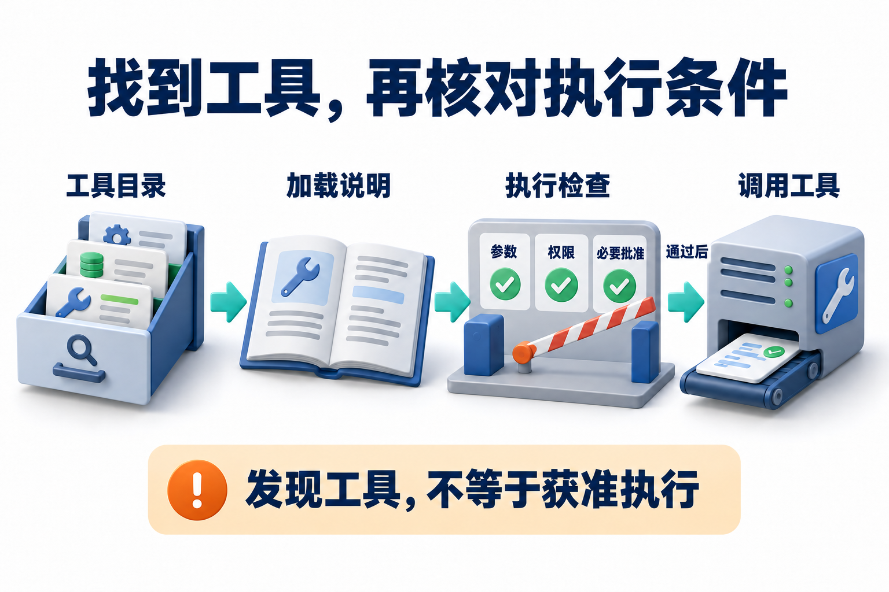

# 05 · 工具路由与 MCP

**工具路由把当前任务缩小到适合、可用且获准的工具。** 工具目录可以很大。运行时只让模型看到本轮需要了解的能力，执行器再对具体动作做最终校验。

## 从发现工具到批准执行

先按身份、租户和工具可用状态缩小目录，再按动作语义找候选。用工具说明和输入约束区分读取、创建、修改、发送等动作。选中的工具只在参数和作用对象明确后进入执行检查。

路由失败要指出发生在哪一步。可能是应有工具没进入候选，也可能是候选齐全却选错了。工具选对后，参数、业务条件和对象权限仍需各自通过校验。

### 路由逐步缩小候选

先限定用户和任务允许使用的工具范围。再按任务所需的动作类型筛选，最后对候选排序。工具过多时可以先读取短目录，再展开高相关工具的完整定义。模型有权看见的工具，也要在每次真实执行前验证。

记录每轮候选集合及排除原因。正确工具没有被召回时，修目录描述和筛选。正确工具在候选中却被忽略时，核对动作边界、重叠描述和排序输入。只比较最终成功率会漏掉这两类有不同改法的问题。

## 固定工具定义与执行模式

运行时保存工具定义版本、参数结构、返回字段和副作用。发现时记录所用版本，执行前确认当前定义仍与已验证参数兼容。目录或合同发生变化时，重新选择或校验。旧参数按旧含义解释，不能直接交给新版工具。

Schema 能表达类型、必填字段和取值范围。具体是否生效，要检查执行层使用的校验器和它支持的约束。敏感参数从可信会话或服务配置取得。

区分协议结构、执行环境和业务合同。协议定义参数如何传。执行环境决定代码能操作什么。业务合同决定日期、对象状态和资源归属是否成立。遇到定义升级时，用兼容适配器或重新加载工具，让执行器知道请求按哪个版本解释。

## MCP 的版本与目录刷新

**2025-11-25 版**先用 `initialize` 协商版本和能力。初始化成功后用 `tools/list` 读取工具目录，用 `tools/call` 请求执行。目录分页要读到需要的范围。收到支持的目录变更通知后，刷新已保存的定义。

**2026-07-28 版**按请求携带协议版本和所需客户端能力。客户端可以用 `server/discover` 查询服务端支持的版本与能力。接入时按实际版本选择消息流程。目录有缓存时，按服务提供的更新机制刷新，并在执行前核对合同。

### 能力发现与目录状态

旧版初始化完成后，客户端使用协商出的能力。分页游标按服务端发给当前查询的值使用。需要完整目录时，继续读取下一页。收到可用的变更通知后使受影响的缓存失效。

新版按请求处理。能力发现提供的是服务端当前声明，不负责绑定业务授权和任务状态。宿主仍可给已选工具保存自己的定义版本或摘要。目录变化前已经发出的请求按原身份处理，新的请求先重新校验。

## 并发回包与取消

保留协议请求标识、模型工具调用标识和业务操作编号。三个标识分别关联传输回包、模型上下文和外部意图。同一动作的重试可以有新的请求标识，业务操作编号保持稳定。

回包按标识配对。传输连接变化时，先检查所用版本支持的恢复方式，再决定是否继续等待。取消和完成可能同时发生。只有收到服务确认，才能知道远端是否停止。回执不明的写入按原操作编号对账。

### 传输恢复与业务恢复

等待表保存模型调用标识、协议请求标识、工具定义、操作编号和截止时间。多条返回按协议标识找到原等待项，再关联模型调用。超时后到达的结果可以用来对账。能否推进当前计划，还要看任务状态和版本。

在 2025-11-25 版中，服务支持流恢复时，可按该版本合同恢复原 Streamable HTTP 流。回放回包仍归原请求。新发的协议请求使用独立标识，同一业务意图沿用操作编号。新版或其他传输按自己的恢复合同处理。会话重建后查不到待决写入结果时，进入业务对账。

## 按失败阶段排查

| 观察 | 先核对 |
| --- | --- |
| 应有工具没找到 | 能力配置、目录范围、分页和候选筛选。 |
| 弄错读取与写入 | 工具说明、动作约束和路由结果。 |
| 参数不合格或对象无权访问 | 参数定义版本、调用身份和业务校验结果。 |
| 返回超时或未完成 | 请求标识、预算、服务回执和外部状态。 |

比较路由方案时，固定任务和预算。分别统计候选覆盖、选对工具、参数通过和任务完成。看变化最早出在哪个阶段。

## 用代码处理工具中间结果

程序化工具调用可以由受控代码发出多次请求，再将聚合结果交给模型。这样能减少传回模型的中间数据。每个底层动作仍需检查权限、参数和预算，并留有可查的调用记录。控制执行代码的读写和网络范围。

代码批量处理后可以只返回目标字段与证据索引。日志要保留各次调用和被丢弃的中间结果位置。出错时可区分调用失败、汇总失败和结果裁剪错误。比较前后，用同样任务测模型输入、工具用量、执行耗时和质量。

## 协议访问与业务授权

MCP 连接是否获准由协议和部署配置决定。服务还要核对身份对具体数据或动作的权限。令牌适用的服务与范围也要单独检查。

A2A 负责 Agent 之间的任务交互。委派时应明确任务所有权、输入、期限、结果和取消规则。接收方只能使用分配给它的能力，也可以在其内部用 MCP 连接工具。

HTTP 接入采用访问令牌时，核对签发者、目标服务、有效期和权限范围。本地进程按部署规则取得凭据。宿主对连接身份的检查与服务对资源的检查都要有效。远端任务状态表示协议进度，实际写入仍用原操作编号查证。

## 配套阅读

展开面试题、实验与资料

- [配套面试题](../docs/advanced/05-tool-routing-and-mcp.md)
- [一手资料](official-learning-map.md#进阶-05-的来源)

[上一章：04 · 记忆与技能](04-memory-and-skills.md) · [工程进阶目录](README.md) · [下一章：06 · Agentic RAG](06-agentic-rag.md)
