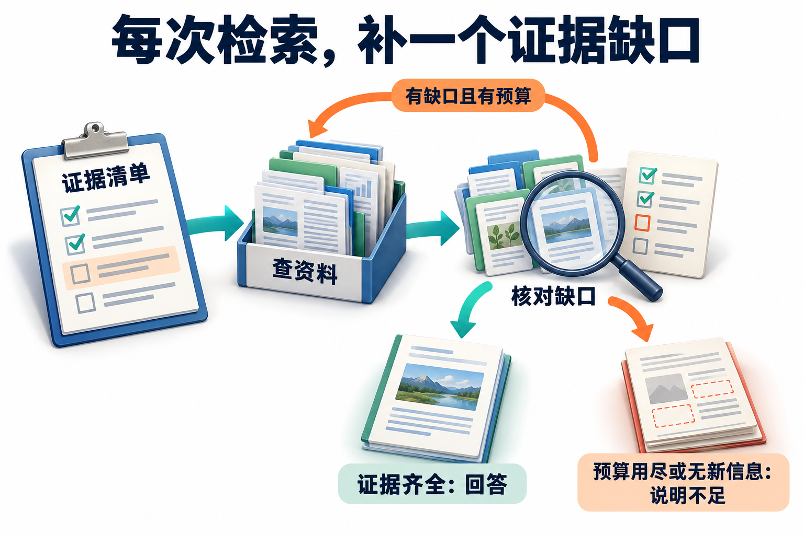

# 06 · Agentic RAG：从召回算法到证据决策

[上一章：工具路由与 MCP](05-tool-routing-and-mcp.md) · [工程进阶目录](README.md) · [下一章：多 Agent 系统](07-multi-agent-systems.md)

## 先分清检索器、排序器和决策策略

**信息检索（Information Retrieval，IR）**根据查询，从资料集合中找出可能相关的对象；**RAG（检索增强生成）**再把取得的材料用于回答。**Agentic RAG**让决策过程依据已有观察，选择下一种检索动作、补读或停止。它在检索器外增加了策略，不能代替检索器内部的匹配算法。

把一次查询写成集合变换，比先罗列工具名更容易定位故障：

```text
D = 某份固定资料快照
D_scope(user, access_revision) = 当前访问域内的资料
C_raw = 在访问域内由各路检索、排名与窗口截断取得的原始候选
C_valid = C_raw经业务日期、对象等适用条件筛选后的候选
R = 对C_valid排序、去重后准备展开的对象
P = 在输入预算内选入的证据与必要上下文
answer = 根据P生成并核验的回答
```

“召回”在工程中常指取得候选这一步；`Recall@k`则是有标注时的评价指标，二者不要混用。`C_raw`可以包含主题相关但不适用于问题日期的旧版制度；`C_valid`通过已知适用条件，仍需核验内容能否支持结论。适用性不明的项应另记待核对，不能暗当有效。**相关性排序、使用资格和证据裁决是三个不同判断。**

这是一套逻辑分层，不强制元数据筛选都在检索之后执行：实现可以提前筛选以减少无效候选。无论执行顺序怎样，未经授权的正文都不能进入模型或外部重排器；后文全库后置过滤反例只在可信执行器内部讨论候选ID的损失。

## 词项倒排怎样召回，BM25又怎样排序

### 从查询词到候选文档

词项检索要求索引侧与查询侧的词项输出兼容。本章基线使用同一套分词与规范化规则；实际系统也可以明确配置查询侧同义词扩展或不同分析器，只要生成的查询词项能够匹配索引，并保持原问题语义。[Elasticsearch search_analyzer合同](https://www.elastic.co/docs/reference/elasticsearch/mapping-reference/search-analyzer)说明了索引与查询分析器可以不同的情况。

**倒排索引**记录每个词项出现在哪些文档或片段中，posting还可保存词频、位置等信息。查询时访问相关posting，再按OR、AND或短语合同组合，不必逐篇阅读全文。

中文分词会改变什么算“同一个词”，产品编号、金额单位和版本号也可能被拆错。若查询把“不得报销”处理成“报销”，后面的排序算法不能自动恢复丢掉的否定。先检查查询词、索引词和零命中的原因，再调整召回数量；分词错误与排序错误需要不同修法。

**BM25**在词项匹配上加入稀有度、词频饱和与长度归一。**IDF（Inverse Document Frequency，逆文档频率）**让出现在较少对象中的词获得更高权重。下面选用正值IDF和常见的单字段形式，查询词去重，不另加查询词频项；这是一份便于复算的合同，不声称逐位复现Lucene的字段norm和全部优化。[Robertson与Zaragoza的BM25原理综述](https://www.staff.city.ac.uk/~sbrp622/papers/foundations_bm25_review.pdf)解释其概率检索背景；正值IDF的具体写法可核对[Lucene 9.12.3 BM25Similarity](https://lucene.apache.org/core/9_12_3/core/org/apache/lucene/search/similarities/BM25Similarity.html)。

```text
IDF(t) = ln(1 + (N - df(t) + 0.5) / (df(t) + 0.5))
K(d)   = k1 * (1 - b + b * len(d) / avgdl)
score(q,d) = sum over distinct matched t in q, tf(t,d)>0:
             IDF(t) * tf(t,d) * (k1 + 1) / (tf(t,d) + K(d))
```

`N`是索引对象数，`df(t)`是含该词的对象数，`tf(t,d)`是词在对象中的出现次数，`len(d)`和`avgdl`是同一分词口径下的长度与平均长度。这里要求`k1>=0`、`0<=b<=1`且`avgdl>0`，空库直接返回空候选，不代入除零公式。文档分块后，索引对象变成块，这些统计量也随之改变，不能把全文索引的参数效果直接照搬过来。

### 为什么重复关键词不会线性加分

固定`k1=1.2`、`b=0.75`，令块长等于平均长度，则`K=1.2`。暂不乘IDF，词频部分可以手算：

```text
tf=1: 1*2.2/(1+1.2) = 1
tf=2: 2*2.2/(2+1.2) = 1.375
tf=8: 8*2.2/(8+1.2) ≈ 1.913
当tf持续增大，词频部分趋近2.2，不会无限线性增长。
```

这就是词频饱和：同一词从没出现到出现一次很有信息，再重复许多次收益递减。`k1`影响饱和速度；`k1=0`时，已匹配词的词频因子为1，重复次数不再产生区分。它没有因此理解同义词，也不会检查否定或事实真假。

长度归一处理另一个偏差：长块有更多机会碰到查询词。若长度从100增至200、平均长度仍100，`K`由1.2增为2.1，单次命中的词频部分由1降为`2.2/3.1≈0.710`。`b=0`关闭这项长度影响，`b=1`使用完全的长度比例；增大`b`不等于检索必然更好，长文中的完整答案也可能被过度压低。

因此调BM25要看明确失败：编号精确匹配是否保留、短块是否丢上下文、长块是否被无关词稀释。BM25分数是当前索引与查询下的排序值，不是“答案正确概率”，跨查询也不能直接拿同一阈值当业务保证。

## 双编码向量：表示能力和搜索算法分别负责什么

**双编码器（bi-encoder）**分别把查询与文档编码成向量，再用便宜的向量运算比较。词项表示在整个词表中通常只有少量维度非零，称为稀疏表示；编码器产生的固定维度向量通常称为稠密表示。文档向量可预先计算，查询只编码一次；查询编码器与文档编码器可以不同，必须遵循同一模型的配套输入与训练合同。[DPR原论文](https://arxiv.org/abs/2004.04906)采用独立问题/段落编码器和内积，说明“向量召回”并不等于统一使用余弦。

```text
qv = E_query(q)       dv = E_document(d)
内积：       dot(qv,dv) = sum_i qv[i]*dv[i]       越大越近
余弦相似度： dot(qv,dv)/(norm(qv)*norm(dv))       越大越近
平方L2距离： sum_i (qv[i]-dv[i])^2               越小越近
```

当两边都归一为单位向量时，恒有`L2_squared = 2 - 2*dot`，可保证所列度量的排序等价；不满足这个条件时不能一般地推导等价。零向量不能按此定义计算余弦；未归一时，文档向量范数会影响内积排序。Faiss报告的是平方L2，其距离与归一化约定见[官方度量说明](https://github.com/facebookresearch/faiss/wiki/MetricType-and-distances)。

可以用给定向量看出区别，不需要真实Embedding模型：令`q=(1,0)`、`A=(1,1)`、`B=(3,4)`。内积分别为1和3，B更靠前；余弦分别约0.707和0.600，A更靠前；平方L2分别为1和20，A更近。因此把同一批未归一向量从内积直接换成余弦，已经改变了检索合同，不能把名次变化都归因于ANN误差。

向量可能把措辞不同、含义接近的材料放到一起，但这取决于编码器的训练域和输入方式。金额、否定、人员类别或版本只改一个字，向量仍可能很近。模型版本、维度、查询/文档前缀、归一化和距离函数都要固定；向量维度相同不足以证明不同模型的输出可以混搜。

**精确向量搜索**要求按所选度量返回真正的top-k。本章采用Flat穷举基线，对资格域中每个向量计算距离或相似度，计算量随对象数和维度增长；精确搜索这个目标本身并不排除其他加速方法。**ANN（Approximate Nearest Neighbor，近似最近邻）**通过缩小搜索范围或近似距离节省资源，允许漏掉按同一度量本应靠前的对象。Faiss的`IndexFlatL2/IP`属于精确基线，HNSW和只探查部分列表的IVF属于近似路径。[Faiss索引分类](https://github.com/facebookresearch/faiss/wiki/Faiss-indexes)

这产生两层误差：表示本来就没把正确证据排近，或表示合理但搜索索引漏掉近邻。先固定向量做精确搜索，再比较ANN，才能区分两者；ANN相对精确近邻的召回高，不意味着这些近邻真的回答了问题。

## HNSW和IVF在哪里省计算，又在哪里漏候选

### HNSW：沿向量邻接图探索

**HNSW（分层可导航小世界图）**把向量组织成多层邻接图，越高层包含的点越少。搜索从高层入口开始，贪心移动到更接近查询的邻点，再逐层下降；底层以候选队列扩展邻居，并保留一组较好的结果。它用可导航的邻接关系缩小搜索，而不是计算所有向量。[HNSW原论文](https://arxiv.org/abs/1603.09320)

查询参数`ef_search`（hnswlib称`ef`）控制搜索工作集合的宽度。宽度更大通常能保留更多待比较路线，代价是更多距离计算和延迟；它不是最终返回的`k`，也不等于“恰好访问ef个点”的硬上限。hnswlib要求`ef`不小于`k`，具体接口以[官方参数合同](https://github.com/nmslib/hnswlib/blob/master/ALGO_PARAMS.md)为准。

底层搜索可按原论文的`SEARCH-LAYER`理解：维护待扩展候选队列、已见ID集合和有限的较优结果集合；先弹出当前最近候选，计算未见邻居的距离，能改善结果集合的邻居再进入探索。集合超过宽度时移除最差项，按候选与当前结果的比较执行近似剪枝，再从保留结果中返回k项。这种结束条件节省了比较，也意味着未探索区域仍可能存在更近点，不能把结果集合已满当作穷举证明。

`M`和`ef_construction`在建图时影响连接与构建探索，查询时调大`ef_search`不能把一个坏编码器变好，也不能凭空补上未入库文档。需要记录建图参数、随机性、索引版本、相对Flat的近邻召回与真实延迟；不能把原论文的复杂度趋势当成任意数据和过滤条件下的延迟保证。

### IVF：先选分区，再扫描分区内的向量

**IVF（倒排文件索引）**此处的列表按向量分区组织，不是前面的词项posting。典型实现先训练粗聚类中心，将库向量分配到中心对应列表；查询先找接近的中心，再扫描其中`nprobe`个列表。真正的最近邻若落在未探查列表中，就无法进入候选。[Faiss的IVF机制](https://github.com/facebookresearch/faiss/wiki/Faiss-indexes#cell-probe-methods-indexivf-indexes)

`nlist`是建索引时的分区数，`nprobe`是查询时探查的列表数。增大`nprobe`扩大扫描范围，但各列表长度不同，扫描量不必恰好等于数据量的`nprobe/nlist`。`IVFFlat`在被扫描列表内使用原向量距离；若再用PQ（Product Quantization，乘积量化）将向量分成子空间、用码本近似表示，量化又引入一层误差。`nprobe=nlist`只有在相应精确距离配置下才回到穷举，不会自动消除PQ误差。[Faiss FAQ](https://github.com/facebookresearch/faiss/wiki/FAQ#what-does-it-mean-when-a-search-returns--1-ids)

调参必须固定编码器、资格域和目标召回，比较同一批查询的延迟分位数、内存及建索引成本。HNSW的探索宽度与IVF的探查列表数控制的是不同算法步骤，不能按参数数值相同就声称工作量可比。本地实验不运行这两种索引，不提供ANN速度或召回基准。

## 受限检索为什么会候选饥饿

设某查询的全库精确排序为`[X1,X2,X3,A,B,C]`，前三项均无权或不适用于业务日期，而A、B、C是当前可用材料。全库只取top-3再过滤，结果为空；先在合法集合中检索top-3，却能得到A、B、C。**这里即使没有ANN误差，后置过滤也已经损失候选。**

所以“检索top-k后过滤”一般不等于“在过滤后的集合中检索top-k”。可以按可见域分区、使用索引支持的过滤搜索，或在预算内扩大候选后重新检查，但过滤接口是否参与探索、是否支持某索引及是否会提前终止，需要按实现验证。[Faiss动态过滤说明](https://github.com/facebookresearch/faiss/wiki/FAQ#is-it-possible-to-dynamically-exclude-vectors-based-on-some-criterion)

过滤越严格，可用候选可能越少；增大返回数量并非必定足够，放宽权限更不是补召回的方法。用“合法域中的精确top-k”作对照，记录过滤前后数量、缺少的合法ID和扫描预算，才能知道问题是资格域太小、截断太早还是ANN探索不足。拒绝访问、正常空集和超时要分开；空集不赋予系统探查不可见资料是否存在的资格。

## 混合召回、RRF与重排解决不同问题

### 融合扩大候选覆盖，不裁定事实

词项召回较容易保留精确编号与术语，向量召回可能补入同义表达。**混合召回**通常先取两路候选并集，按稳定文档版本/块ID去重，再融合排名；能否互补要靠逐题标注证明，不由“稀疏+稠密”这几个字保证。两个分数的尺度不同，直接相加需要说明归一化或学习权重。

**RRF（Reciprocal Rank Fusion，倒数排名融合）**只使用各路名次：

```text
RRF(d) = sum over result lists i containing d: 1 / (c + rank_i(d))
rank从1开始；某路未返回该对象，该路贡献为0。
c是平滑常数，区别于最终返回数量k。
```

原论文在其实验中使用`c=60`，它不是所有业务必须照搬的常数。[RRF原论文](https://plg.uwaterloo.ca/~gvcormac/cormacksigir09-rrf.pdf) 基础章与[机制实验](../examples/advanced/retrieval-mechanisms.md)已有完整手算，这里进一步检查融合前的窗口限制。

设关键且适用的证据X在两路完整排序中分别排第21和第30。若每路只取20，X不在`C_raw`并集内，对任意合法`c`的贡献都为0；调平滑常数不能救回被窗口丢掉的对象。把每路窗口增至30，X才有机会进入并集，并在通过适用性检查后进入`C_valid`，但最终是否保留仍取决于融合、重排与装配。

这个变式把原始候选槽位从`20+20=40`增至`30+30=60`。并集去重后的对象数未必增加20，实际耗时也不必恰增50%；取决于两路重合、索引搜索、批处理与下游工作。比较融合参数时要固定窗口，比较扩大窗口时则同时报告覆盖、候选工作量、延迟与输入预算，避免把多付资源当成融合算法变好。

同一块在一路结果中只计一次；重复查询、转载副本和同一来源的重叠块不能被解释为多份独立证据。不同通道可以共同提高一个对象的融合名次，但“两路都搜到”仍不证明其日期、权限或内容正确。

通道本身也可能近重复：把某个检索器的同一排名复制成“新一路”，公式会再次累计它的贡献，相当于提高这一路权重。RRF不会自动识别通道相关性；改写路数、通道权重和调用成本应一起记录，再验证新增路径是否真补了证据。

### 重排提高已有候选的次序，覆盖有上限

**重排（reranking）**用更精细的查询—候选匹配模型重新排序。典型cross-encoder把查询与段落一起输入，让它们在模型内部交互；双编码器则预先独立表示文档。联合编码更昂贵，通常只对有限候选执行，且仍可能误判否定、数字或长段落。[BERT段落重排原论文](https://arxiv.org/abs/1901.04085)与[Sentence Transformers检索—重排说明](https://www.sbert.net/examples/sentence_transformer/applications/retrieve_rerank/README.html)给出这一分工。

固定块粒度、没有额外补读或parent展开时，纯重排后的结果是输入候选集合的子集。此处明确令`C=C_valid`，即本轮已完成适用筛选、交给重排的固定候选；G为当前条件下人工标注的相关块，则：

```text
最终选入集合P ⊆ C
Recall(P) = |P ∩ G| / |G| ≤ |C ∩ G| / |G|
```

G有4块而C只含其中2块，再完美的排序也不能突破这份候选的50%覆盖上限。重排器可把已有正确块提前，却救不回从未召回的块；如果系统随后补检索或展开父段落，那是新增候选的另一项动作，应另记成本和覆盖变化。不要把重排分数当成可信来源等级。

## 查询改写、分解与多跳：改变输入就有信息损失

**查询改写**把原问题变成检索输入，可能补同义词或消除对话省略。输入应包含原问题与已确认条件，输出除查询文本外，还要保留不可变条件：对象ID、业务日期、人员类别、否定、金额单位和可见域。改写可把“酒店钱”换成“住宿金额”，不能把“是否不允许”改成“如何办理”。

这些条件可以进入独立过滤字段，而不必全部出现在向量查询文本里，但必须能核对它们没有丢失。保留原查询作为对照，检查新增命中和漏失；多种改写的并集会增加召回开销及干扰，也需要按同一块ID去重。HyDE进一步生成假想文档再编码检索，它生成的文本可能包含虚构细节，**只能用作查询表示，不能成为证据**。[HyDE原论文](https://arxiv.org/abs/2212.10496)

**查询分解**把一个问题拆成若干必要子问题，并保存它们如何合成原答案。输入是整体目标与约束，输出是子问题、所需证据类型和依赖；不能把每个子问题都变成独立自由创作。若原问题要求同时满足A和B，只解决A不算完整回答；分解漏掉例外条件，也不能由更强的子检索器修复。

**多跳检索**则有数据依赖：第一跳输出的实体ID或关系，进入第二跳查询。应传递稳定标识及来源，而不只传模型写的一句推断；错误实体连接会让后续查询在错误对象上越做越精细。IRCoT研究交替使用已有推理与检索来构造后续输入，说明后续查什么依赖前面得到什么；并发发出一堆同义查询不自动构成这种多跳。[IRCoT原论文](https://arxiv.org/abs/2212.10509)

检索源也由缺口决定：文本找条款，数据库计算精确数量，业务API查对象状态。把计数写成段落再搜相似文本，不能替代带日期、去重与分母合同的真实聚合。遇到来源缺失或权限拒绝，改写查询不能改变这些硬条件。

## 从chunk回到parent，再把上下文装进预算

**chunk（片段）**是检索单位，**parent（父段落或文档）**是补足语境的较大单位。小块更集中，却可能把“仅对已批准项目适用”与金额拆开；大块条件完整，但可能稀释匹配并占满输入。Parent retrieval先命中小块，再通过父ID取回更完整范围，是一种粒度分工，不是单纯把top-k加大。[LangChain ParentDocumentRetriever合同](https://reference.langchain.com/python/langchain-classic/retrievers/parent_document_retriever/ParentDocumentRetriever)

展开时必须固定父子关系对应的文档版本、位置与当前权限，不能让旧块指针读到新版父正文。多个子块来自同一父段时先合并重叠区间；展开的原文也增加了证据集合，前一节的固定候选上限应按新集合重新计算。片段评测命中而完整条件未被读入，是上下文装配失败，不宜都算作召回失败。

**context packing（上下文装配）**是在token预算内选择证据及必要条件：先为指令、问题和输出留空间，再按尚未覆盖的子问题分配材料；去掉重复正文，保留标题、单位、例外与来源位置。选片段可以近似为“单位token带来的新增证据覆盖”，但这是启发式，不保证全局最优，也不能仅按相似度截取前几段。

应保留能够改变判断的反证。若两条有效材料相互冲突，只装入分数更高的一条会制造虚假的确定性。检索、父段展开、压缩和装配各记录保留/丢弃的块ID、理由与token数；最后从关键断言回查原文，确认被压缩的否定或适用条件仍在。

## 知识冲突：先确定身份与适用域，再检查权威关系

语言模型的**参数知识**来自训练后的权重，检索证据来自当前外部资料，二者不是同一来源。原始RAG研究将参数记忆与非参数检索记忆组合起来，并不意味着模型一看到新资料就必定服从它。[RAG原论文](https://arxiv.org/abs/2005.11401) 对要求按指定制度回答的应用，模型可以帮助理解，不能用“我记得是另一个金额”覆盖当前有效条款；反过来，任意搜到的网页也不能仅因“外部”就成为权威。

把冲突变成可检查的断言集合，先规范化主体、属性、单位与条件。`每晚700元`与`每次行程700元`不是同一个数值规则；管理人员与普通员工也不是同一适用域。只有对同一问题条件给出不能同时成立的断言，才进入冲突处理。

按下面的顺序做资格筛选和裁决，相关性分数不参与授权或生效判断：

1. 核对文档身份、版本、来源位置与当前访问资格，去掉重复转载或同一来源的重复块。用稳定的文档族标识和业务条件建立可比较集合，不能把不同制度族的版本号排成一条替代链。
2. 用问题中的业务日期匹配有效区间，再核对地区、人员和事项；“今天上传”不等于“今天生效”，新版也不自动适用于历史问题。
3. 检查可信目录记录的替代、废止或优先关系，且只在这些关系覆盖的条件范围内采用。这是业务提供的偏序：部分材料可能不可比较；不能由模型猜一套法规优先级，也不要求用单一分数排齐全部来源。版本号更大、发布者名字更响亮，不能替代明确规则；优先关系成环应报配置错误。
4. 同等级、同适用期且没有可信替代关系的断言若仍矛盾，标为未解决冲突，保留双方出处及缺少的裁决条件，停止输出唯一确定值。

例如同一制度v1在11月1日前为600，v2从当日起为700，是两个时间域的规则，不必多数表决。若两份同级现行文件对同一对象分别规定700和500，又没有明确优先关系，检索器应返回冲突证据；重复找到十份700的转载也没有增加十个权威来源。这里的裁决顺序是本手册的业务合同，金额与日期是教学输入，不是通用法律解释规则。

冲突状态应跟着来源版本传播到摘要、任务和缓存。补读正式条文或请求可信裁决可以改变状态；提高相似度、扩大top-k或让模型投票不能凭空创建优先关系。具体版本与当前授权分离的实现继续看[14章](14-ingestion-and-index-lifecycle.md#删除撤权和回退必须一起验证)。

实现时，在同一断言域中去掉被可信优先关系覆盖的断言，检查剩下的极大元：没有适用证据是`unknown`；有多条不可兼容且未被支配的有效断言是`conflicting`；剩余断言一致才得到有依据的值。冲突不是普通“没搜够”，不能不断追加查询直到挑到自己偏好的答案；没有新的权威依据时应保留歧义。

## Agentic策略：状态、动作和停止条件必须可执行地定义

前面的算法解决“给定查询怎样找材料”。策略还要决定下一次发什么查询，以及已有材料是否足够。可以用以下状态表示一轮工作；这是一份设计合同，不声称已经实现完整自主研究器：

```text
S = (original_question, confirmed_constraints, evidence_by_id,
     required_claims, unresolved_gaps, conflicts, tried_queries,
     index_version, access_revision, remaining_budget, deadline)
```

`required_claims`记录回答必须支持哪些判断；`evidence_by_id`按文档版本、块/区间保存观察及其适用条件；`conflicts`保存未裁决的矛盾。不能把“找到一篇资料”直接写成“结论已完成”。动作可选词项/向量/混合检索、读取父段、沿引用补读、查询结构化来源、澄清或停止，每个动作都要有要补的缺口、允许输入和预期观察。

查询去重键至少包含规范化查询、过滤条件、检索器配置与索引/权限修订。相同条件下已无新增证据的请求，不应换一个请求ID就无限重试；来源或条件真正变化时，也不能因文本相同就永远复用空结果。证据去重与查询去重分开，防止把同一块从三个改写里返回当三次覆盖增长。

```text
while True:
    revalidate_current_constraints_and_evidence()
    if every_required_claim_supported and no_unresolved_required_conflict:
        return verified_answer
    if not budget_allows_next_action or not before_deadline: break
    action = select_action_for_a_specific_gap(state)
    if no_legal_action_can_add_evidence: break
    reserve_shared_call_and_input_budget(action)
    observation = execute_with_current_authorization(action)
    state = merge_by_stable_ids(state, observation)
return supported_partial_result_with_gaps_and_stop_reason
```

[](../website/assets/diagrams/advanced/A06-evidence-loop.png)

A06只画策略循环的位置：动作内部仍要使用前面的召回、过滤、重排与装配机制。完整停止要求必要主张有支持且关键冲突已处理；预算耗尽、来源不可用或没有可增加信息的合法动作，也触发停止，但输出应是部分结果与原因。相似度超过阈值或模型自称有把握，不能替代这些条件。

预算由主任务共享，检索分支、改写模型、重排和父段读取都算资源，失败同样记账。可用新增有效证据或关闭缺口衡量进展，不能用调用成功次数衡量；只有执行预算，没有语义停止条件，会让循环不断重复取得同一批材料。

## GraphRAG 什么时候有帮助

GraphRAG用语义实体、关系和派生摘要建立另一类访问路径。它与HNSW都用“图”，但图的含义不同：HNSW边主要帮助向量近邻导航；知识图的边表达从材料中抽取的关系，错误实体归并或错误关系会改变被查询的知识结构。

以Microsoft GraphRAG标准流水线为范围：原文形成TextUnits，抽取实体与关系，汇总描述，通过分层Leiden社区发现构造群组，再生成社区报告，并为后续检索生成向量。**社区报告是派生产物，不是新增的一手事实。** 其他图检索实现未必使用相同流水线。[官方索引dataflow](https://microsoft.github.io/graphrag/index/default_dataflow/)

局部查询先按查询与实体描述的语义关系找实体入口，沿实体—关系、实体—TextUnit、实体—报告等映射取得候选，再排序、过滤并装入上下文。它不等于对全图任意跑一次最短路；入口实体错了，即使后面的关系遍历完全正确也会取错材料。[官方Local Search](https://microsoft.github.io/graphrag/query/local_search/)

全局查询选取某个社区层级的报告，将报告切成批次；map阶段生成带重要性评分的中间要点，reduce阶段过滤、汇总为回答。它适合资料集合的共同主题，重要性分数也不是来源真实性概率。概览中的主题必须能沿报告、实体/关系、TextUnit回到原文，单项金额或适用条件仍需核对原条款。[官方Global Search](https://microsoft.github.io/graphrag/query/global_search/)

图路径能连接文本匹配不直接呈现的关系，也提前支付了抽取、实体消歧、社区划分与报告生成成本。文档更新可能改变实体归并、边与社区结构，不能预设“一篇变化只重算一个节点”；每个派生层都应记录来源血缘和失效范围。报告若已混入无权资料，不能只隐藏底层链接，必须在构建及使用时明确可见域。这里未部署GraphRAG，也没有本地实体抽取或图查询成绩。

## 用oracle、分层指标与消融决定优化什么

### 把不同的“召回”放进各自分母

先固定查询集、资料快照、可见域、业务日期和相关性标注。标注单位可以是块或必要证据组，但必须事先声明；正确证据不唯一时，不能把一种合法来源任意标成唯一答案。相反主张都需要展示的冲突题，应把双方材料纳入证据要求。

```text
证据Recall@k = top-k中命中的标注相关对象数 / 全部标注相关对象数
Precision@k  = top-k中命中的标注相关对象数 / k
ANN Recall@k = |ANN_top_k ∩ exact_vector_top_k| / k
```

这里Precision不足k的缺位按不相关计，其他分母口径需另行声明；没有相关证据的无答案题另测缺证据识别，不能给空分母的Recall默认满分。ANN Recall评估索引近似误差，证据Recall与Precision评估对象和任务的相关性；只有资格域至少有k个对象等条件满足时，才按所列ANN分母比较。

#### 同距近邻怎样计分

精确top-k还需要并列距离合同。可固定“距离后按ID排序”作为可重现的精确参照，但若第k位存在同距对象，ANN返回另一个同距ID，按ID交集计算的指标会下降，却不能据此断言距离更差。例如k=1、A与B到查询的距离都为1，参照选A、搜索返回B，ID重叠为0，距离质量却相同。

因此报告ID重现率时，同时说明边界同距处理及预先约定的距离容差；可另报告返回距离相对精确第k距离的偏差，或按边界同距集合评价。浮点容差需按度量与数值精度声明，不能事后调宽来掩盖误差。同距仅表示所选向量度量相同，不表示两份文档具有相同事实或业务资格。[Faiss的同距与精度分析](https://github.com/facebookresearch/faiss/wiki/FAQ#analyzing-accuracy-issues-with-indexivfpq)

MRR（平均倒数排名）关注首个相关结果的位置，nDCG（归一化折损累计增益）评价分级相关性与名次；多跳问题还要单列必要证据组是否全部覆盖，不能只找到一个片段就算成功。BEIR提供跨任务的检索评估方式及多类基线，不能将某模型在一个数据域上的优势当作本业务结论。[BEIR论文](https://arxiv.org/abs/2104.08663)与[评测实现](https://github.com/beir-cellar/beir/blob/main/beir/retrieval/evaluation.py)

除相关性外，分别统计过期/无权对象进入模型的数量、冲突漏报、父段条件完整性、答案支持率、引用正确性、延迟与成本。增加top-k可能提高召回，同时降低精度并挤掉装配预算；最终回答更差并不一定说明召回器退步。

### Oracle检索隔离的是哪一段

**oracle（理想参照）检索**在诊断中用人工确认的正确证据替换候选，不是上线时偷看答案。保持问题、权限、资料版本、生成器和可行的上下文预算不变，观察后续是否能正确作答：换入正确证据仍错，应继续查排序、装配或生成；明显改善才说明前面的候选获取值得重点检查。它是定位干预，不自动证明只有一个根因。

还可分三次干预：在`C_valid`的原候选上限内用正确块替换错误块，但保留原重排器；在这份相同候选中使用人工正确排序；最后直接给出满足预算的完整证据包。第一步后仍丢块而第二步修复，指向排序；排序正确但只有完整证据包能修复，指向父段或装配。若正确证据在原预算内根本放不下，要先记录预算不可行，不能用更大的oracle输入偷偷改善条件。

### 消融要让每项改动有可归因的结果

从词项基线和精确向量基线开始，分别增加混合、重排、改写、parent展开与Agentic追加，再单独替换为ANN。每次只改主要因素，并记录候选上限、最终token预算和调用成本；两路各取20与一路取20并非相同候选工作量，需要同时报告固定总预算的对照。

| 固定条件下的观察 | 优先检验的机制 | 不足以解释问题的改法 |
| --- | --- | --- |
| 精确向量有正确块，ANN没有 | 探索/分区、过滤、索引版本 | 更换生成提示 |
| 两路候选并集没有正确块 | 分词、表示、查询与资料覆盖 | 只训练重排器 |
| 候选有正确块，最终上下文没有 | 重排、去重、parent及装配预算 | 只增大生成模型 |
| 完整正确证据仍被答错 | 约束使用、主张推导和输出验证 | 无限追加相似材料 |
| 新版排第一，却回答错历史日期 | 有效时间与优先关系 | 把最新上传权重再调大 |

按编号精确匹配、同义问法、否定、多跳、历史日期、冲突与受限域分层查看结果。开发集用于调参，保留集用于验证，近重复查询和同源文档按组切分；用逐题配对结果保留改善与退步。引用变多、答案变长或模型自评更高，都不能代替这一层证据。

## 可复算实验与本章边界

[标准库检索机制实验](../examples/advanced/retrieval-mechanisms.md)用于观察词项/BM25、手工向量的精确排序、RRF、候选过滤损失、重排覆盖上限和冲突筛选。手工分词与手工向量只让运算可复算，不构成中文分词器或真实Embedding的效果证据；候选截断也不冒充真实HNSW/IVF运行。

```bash
python3 examples/advanced/retrieval_lab.py --section all
```

先复算本章tf饱和与长度归一，再预测受限top-k例子的空集，以及缺两块候选时的重排上限。最后把两份同级有效材料设为相反数值：预期保留歧义，不因相似度或转载数量选出唯一金额。实验命令和实际输出以配套说明为准。

未实现的部分包括真实编码/重排模型、ANN基准、自主查询改写、完整Agentic状态机和GraphRAG。它们已有算法与验证合同，接入后仍要分别测量；不从算例通过推导真实模型质量。外部算法与官方接口核查于2026-11-05，采用其他版本时重新核对配置和输出含义。

[配套进阶面试题：Q072–Q074](../docs/advanced/06-agentic-rag.md) · [知识摄取与索引生命周期](14-ingestion-and-index-lifecycle.md) · [SQL与数据分析](15-text-to-sql-and-data-analysis.md)
