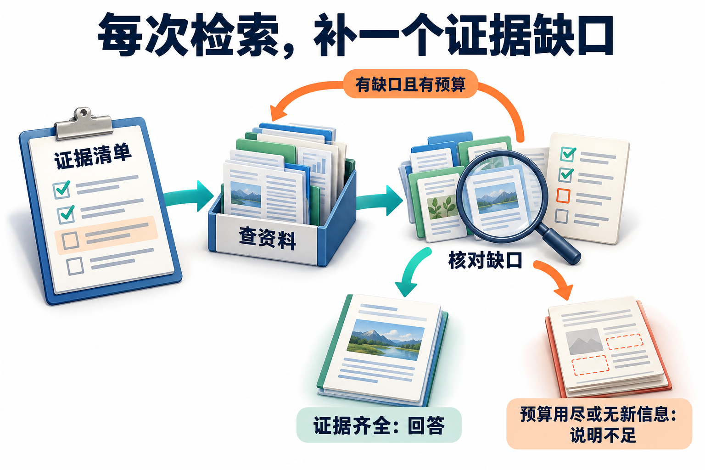

# 06 · Agentic RAG：按证据缺口选择下一次检索

[上一章：工具路由与 MCP](05-tool-routing-and-mcp.md) · [工程进阶目录](README.md) · [下一章：多 Agent 系统](07-multi-agent-systems.md)

## RAG 的流程、Agent 的决策与图索引

**RAG（Retrieval-Augmented Generation，检索增强生成）** 是在生成回答时引入检索所得资料，让模型依据外部证据作答。基础原理部分先讲了文档入库、检索筛选和生成这条链路；固定流程可以预先决定这些阶段怎样连接。

**智能体驱动的检索增强生成（Agentic RAG）** 进一步让 Agent 根据问题与已有结果选择检索动作：是否需要检索、查哪种来源、缺什么证据、是否继续。一次查询不够时，它会把结果作为下一步选择的依据。关键能力是围绕证据缺口作决定，检索轮数本身不代表研究质量。

后文还会遇到 **GraphRAG**：它侧重用图关系和派生索引组织资料。图索引与检索决策是不同维度，可以组合，也要分别评估成本和正确性。先弄清要补什么，再决定翻哪只资料柜。

## 搜了十轮仍缺证据，问题在哪

你问“例外审批增加，是不是新政策造成的”，助手搜了十轮，引用也排满一页，结论就更可靠吗？如果缺的是申请分母，再多找几份政策也补不上；如果缺的是正式条文，搜索摘要又不能替它签字。

固定 RAG 通常先检索片段再回答。这里的研究任务还可能先找到实体，再查询另一套资料，并在文档、数据库与知识图谱间切换。Agentic RAG 要把每次检索绑定到一个证据缺口，决定查哪里、补什么、何时停止，而不是把搜索次数当成绩单。

## 从问题分解走到证据依赖图

企业研究助手收到：“哪些海外差旅项目的住宿例外审批增加了？是否与新版政策有关？”这里至少包含项目与地区映射、申请趋势、政策生效区间，以及二者关系的解释。前三者可以收集事实，最后一句涉及归因，不能仅凭时间相邻就给出因果结论。

先把结论拆成证据节点：项目集合、统计窗口、例外数量与分母、对应政策版本，最后才比较变化。为各节点写清输入、输出和所需证据，研究就从一串搜索词变成了可检查的依赖图。

如果下一次查询必须用上一步返回的项目 ID，就有真实数据依赖。先同时搜索一堆项目名，并不会因为开了很多标签页就自动变成多跳推理。

自适应检索可在直接回答、单次检索和迭代检索之间选择。Adaptive-RAG 原始研究使用查询复杂度分类器来选择策略，说明不同问题不必承担相同检索开销。企业实现还要加入时效、权限和证据要求：一句很短的“今天生效了吗”，也可能必须查询当前制度。[Adaptive-RAG 原始论文](https://arxiv.org/abs/2403.14403)

从证据清单出发，检查每次查询补上了什么。橙色回路要求既有缺口又有预算；证据齐全才完整回答，预算耗尽或连续没有新信息时说明不足。这是检索决策的设计示意。

## 文档、SQL 与工具检索如何配合

条文适合文本检索，申请数量适合数据库聚合，项目归属可能来自业务 API。把所有数据都转换成段落再做向量搜索，会丢失结构约束和精确统计能力。一个查询计划可以先通过业务 API 取得允许访问的项目 ID，再用受控 SQL 聚合数量，最后检索与这些地区、日期相匹配的政策。

SQL 工具应限制可访问表、列、行和执行资源；只读账号、参数化值和查询结构检查各有作用。参数化能保护值输入，不能自动限制模型生成的任意表名、连接或全表扫描。对于统计任务，还要记录时间字段、去重规则、状态过滤和分母，确保两个窗口可以比较。

采用 PostgreSQL 行级权限时，还要核对实际执行角色：启用策略后也不能忽略表所有者、超级用户或具有 `BYPASSRLS` 的角色可能绕过行级检查。让所有请求共用高权限数据库角色，会破坏原本希望实现的租户隔离。[PostgreSQL 行级权限](https://www.postgresql.org/docs/current/ddl-rowsecurity.html)

工具返回零行也不是“现实中不存在”。它可能表示可见范围无数据、权限过滤、同步延迟或错误参数。明确返回的权限拒绝、参数错误和执行失败应与正常空结果分开记录，并携带查询范围与数据新鲜度；但行级权限过滤后只返回空集时，调用者通常无法判断不可见行是否存在。此时只能说明“当前可访问范围内未找到”，不能为了探明原因改用高权限旁路查询。不同来源不应共享同一个无法追踪含义的 `confidence` 字段。

## 逐步执行一条多跳研究链

第一步，用户确定比较两个等长窗口和相同项目范围，助手通过项目目录找到 A、B、C 三个项目。第二步，数据库返回各项目的有效申请总数与例外数。假设 A 的例外数从 10 增至 20，但总申请从 100 增至 400，则例外占比从 10% 降至 5%；只看计数会误述趋势。这组数用于演示统计口径。

第三步，按地区、员工类别和出差日期查政策。检索器找到一份更新通知，但通知指向另一份正式条文，助手必须继续读取被引用条文，并核对生效条件；搜索摘要或通知标题不足以支持具体金额。第四步，把政策版本与申请窗口连接，标记不能确定适用版本的申请，而不是默默分到新制度。

第五步，发现 B 项目中途换了承包方，于是补查人员类别映射。这是由证据缺口触发的重规划。若查询无法取得必要映射，应把 B 列为暂不可比，而不是持续改写相同查询直到得到喜欢的答案。第六步，输出事实比较与可能解释，明确哪些关系仍需要更强的研究设计支持。

## 把“继续搜索”写成可核对的证据缺口

用户问11月12日海岚报价800元是否超标，以及例外咨询需要什么。不是“相关资料越多越好”，而是分别满足两项证据需求：

| 轮次 | 已有证据 | 尚缺内容 | 合法下一步 |
| --- | --- | --- | --- |
| 开始 | 无 | 金额标准、咨询材料 | 检索住宿与咨询制度 |
| 取得适用的住宿金额条款 | 上限700，报价800超过 | 日期、城市、金额、事由的咨询要求出处 | 定向查找咨询材料要求 |
| 取得咨询材料要求 | 两类依据齐全 | 无 | 分别引用并说明咨询不等于批准 |
| 两份适用资料存在冲突 | 同级有效条文分别700/500 | 无法确定权威一致结论 | 保留双方来源，转交人工判断 |

完成回答样本：“按适用的住宿标准，800元高于700元的每晚金额上限；按咨询材料要求，可以准备出行日期、城市、金额和事由进行例外咨询。咨询不代表已批准，也没有创建工单。”如果第一次只查到金额标准，就不能凭常识补出材料清单。

把这次查询取得的咨询材料要求删去，再预测输出：应追加一次有目标的读取；仍取不到则明确缺材料证据。调用顺序允许合理差异，评分检查覆盖与结果，不要求每个模型逐行复制示范。下面的GraphRAG为机制选读，本仓库不部署图索引或把该两文档例子称为图推理实测。

## GraphRAG 什么时候有帮助

当资料中反复出现项目、人员、地区、供应商及关系时，可在入库阶段抽取实体和关系，做实体归一、社区发现，并生成社区摘要。Microsoft GraphRAG 的标准索引流水线包含这类步骤；图和摘要是由原始材料派生的索引，不是比原文更权威的新事实。[GraphRAG 索引说明](https://microsoft.github.io/graphrag/index/overview/)

其局部查询结合具体实体周边的图信息与原文片段，适合追问某项目关联的政策和组织。全局查询面向社区报告，通过 map-reduce 汇总整个集合，更适合“这些项目主要有哪些共同风险”这类全局问题。选择查询方式应看问题范围，不能把全局摘要拿来证明一笔申请是否满足某条规定。[GraphRAG 查询说明](https://microsoft.github.io/graphrag/query/overview/)

图索引把一部分理解工作搬到了入库时：要付出抽取、消歧、社区划分和摘要生成的成本。它像事先整理好的关系地图，查询更方便，修路后也要维护地图。

政策变化时，旧块、相关实体关系、社区报告和缓存都可能受影响，局部文档变化甚至会波及更广的聚合结构。保留派生节点到原文版本的血缘，才能按变化范围重算并衡量新鲜度；“只改一个节点”不是由文档数量自动决定的。

权限同样要贯穿派生数据。社区摘要如果混入两个租户的资料，即使底层检索做了 ACL，摘要仍可能泄露跨租户信息。可以按可见域构建索引或在生成和使用摘要时实施明确隔离；不能让摘要绕过原文权限政策。

## 反向核对证据，并为研究设置停止条件

草稿完成后，从每个关键断言反向找证据：来源是否真的包含该事实，指向的版本是否适用，数值能否复算，有无相反证据。语言模型可以辅助逐项检查，但确定性统计和对象状态应由程序核对，**引用链接存在，不等于它支持当前结论**。

为检索设置总调用数、时间、token 和来源范围预算；每次新增查询都应对应尚未解决的节点。完成必要证据可以停止，连续无新信息、关键来源不可访问或预算耗尽也可以停止，并返回可用的部分结果与缺口。停止不等于强行生成完整答案。

排障时分开记录：问题分解遗漏、路由错误、召回遗漏、过期或越权证据、连接键错误、统计口径错误、生成误读。用人工正确证据替换召回结果，可以区分检索缺陷和后续生成缺陷；若错误来自 SQL 分母，就不应靠加大向量 top-k 修复。

## 设计练习

为上述研究画一张证据依赖图（DAG，Directed Acyclic Graph，有向无环图），用有向边表示前置依赖，并确保这一版图中没有依赖环；标记每个节点的来源类型和前置条件。构造 A 项目的计数与占比反向变化、B 的映射缺失、C 的过期政策三种情况，再给总预算 8 次外部查询。验收要求：正确计算 A 的两个比例，B 不进入无条件排名，C 触发版本补查；每次查询都有对应缺口，最终每个结论可追溯到数据或条文。

## 自检与答案

1. 为什么短问题也可能需要迭代检索？

问题长度不等于证据复杂度；当前生效状态可能需要跨版本和适用条件核对。

2. 全局社区摘要能否证明某笔申请合规？

通常不够。需要该对象适用的原始规则、条件和记录；集合摘要面向不同问题。

3. 检索预算耗尽后怎样结束？

返回已支持的结果、未解决节点和原因，不能把缺口补成确定结论。

## 参考资料

- [Adaptive-RAG](https://arxiv.org/abs/2403.14403)：按查询复杂度选择不同检索策略。
- [Microsoft GraphRAG Indexing](https://microsoft.github.io/graphrag/index/overview/)：抽取、社区构建与派生索引。
- [Microsoft GraphRAG Query](https://microsoft.github.io/graphrag/query/overview/)：局部、全局与其他查询方式。
- [PostgreSQL Row Security Policies](https://www.postgresql.org/docs/current/ddl-rowsecurity.html)：行级过滤与执行角色边界。
- [基础原理：RAG 与检索](../learning/06-rag-and-retrieval.md)：候选召回、融合与引用链路。

[配套进阶面试题](../docs/advanced/06-agentic-rag.md)
