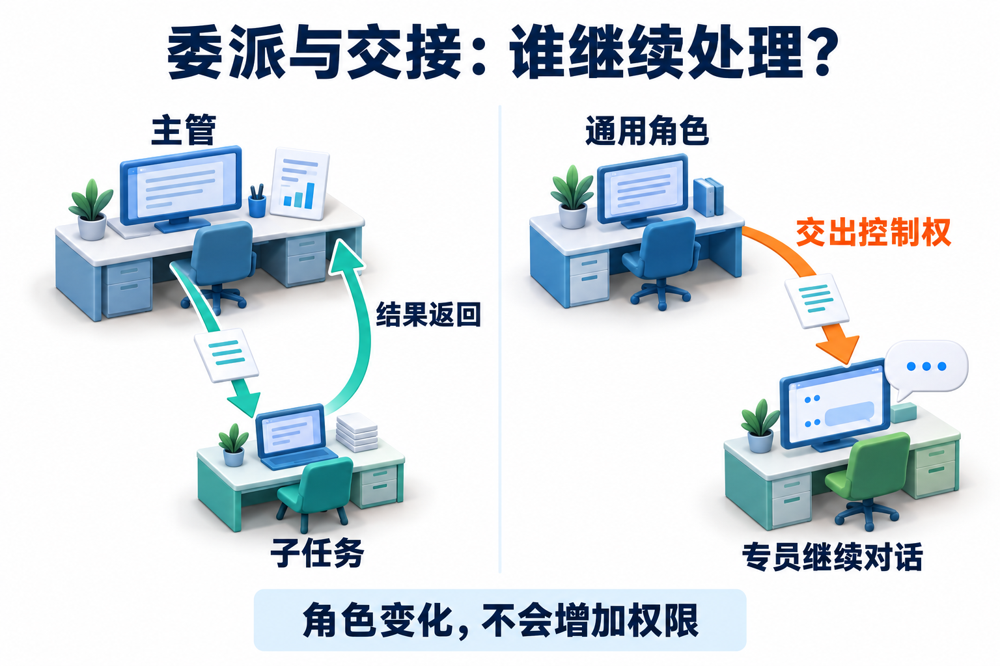

# 07 · 多 Agent 的协作与归并

**多 Agent 需要明确任务控制权、输入隔离和结果归并规则。** 分工只有在减少关键路径等待、提供独立能力或改善质量时才有收益。评估时把交接、失败重试和最终核验一并计算。

## 控制权与委派方式

管理型结构保留一个最终负责人。子任务像工具一样被调用，返回结果后由负责人继续。移交（handoff）则把后续交互或指定任务的控制权转给接收方。约定交接后的完成条件、回退路径和未完成动作由谁处理。

集中调度便于控制预算和校验终态。分散控制可以减少中央协调负担，需要更清楚的一致性和权限规则。结构选择取决于工作能否独立交付。

子任务作为工具时，发出方保持主任务的终态和授权责任。移交之后，接收方拥有明确范围的控制权。交接合同写明用户状态、后续交互归属和未完成动作的处理人。需要返回原处理者时，规定回退入口和可回传的数据。

对上下文隔离与权限隔离分别配置。每个执行者能看到的材料应按任务最小化。它实际可调用的资源则由凭据、工具服务和执行环境约束。统一入口可以减少不同分支绕开校验的机会。

## 计划版本与依赖验收

把分支组织成依赖图。每个分支收到所需输入、权限范围、期限和验收条件。下游等已验收的产物。收到执行完成通知后，还要检查证据是否齐备、版本是否匹配。

任务条件变更后，更新计划版本和受影响输入。旧结果保留在历史，当前计划只接收仍然适用的产物。分支失败时只重试允许恢复且有预算的部分。取消后停止新派发，已经提交的外部动作按独立结果跟踪。

### 分支进入汇总的条件

分支结果应能说明自己使用了哪版输入。接收时分别检查计划版本、语义条件和产物状态。一个分支处理成功，仍可能只有部分材料或出现冲突。下游在必要合同满足后才被调度。

只重算条件变化影响的节点。用依赖关系查找要重验的产物。旧计划的在途结果到达时，先决定是否还满足当前条件。已经派发的外部动作通过自己的操作身份跟踪。

## 结果包与确定性归并

结果包绑定任务、计划版本、输入标识、尝试标识和结果标识。返回直接观察、推导结论、未知项与失败状态。证据包含来源、版本和适用条件，接收方能据此复核。

收集证据时，按稳定标识对不可变条目做集合合并。重复投递不增加条目，乱序到达也得到同一集合。同一标识携带不同内容时，记录冲突。不同证据给出矛盾结论时，核对来源与条件。当前结论、计划和预算交由负责方有条件更新。

### 归并规则的适用范围

对不可变证据项使用集合并，可获得交换、结合和幂等性质。于是消息换序、拆批或重投，仍会得到相同集合。相同标识内容不同应明确报冲突。相同来源被多个分支引用时，只算一个来源。

这种稳定性只保证结构收集一致。对证据冲突，保存双方来源和适用条件。当前结论由负责汇总的一方验收并提交。对计划版本、任务终态和预算，使用单独的条件更新。

## 共享预算与终态

派发前从共享预算原子预留额度。完成后按实际用量结算。只有执行明确结束后，才能释放尚未使用的保留额。重新尝试也从同一个账本扣除。

负责方根据必需分支的验收、截止时间和未确认动作判断结束。允许交付部分结果时，要明确缺失项。子任务只能使用委派范围内的工具、凭据和数据。

### 预留、结算和释放

可派发额度按「上限 − 已确认消耗 − 生效的预留」计算。领取时从权威账本原子预留。结束后用实际消耗替换预留。执行超时但远端仍可能继续使用资源时，先保留相应记录并核实。

汇总设置必需分支和可选分支。必须项达不到验收时，终态明确为部分交付、等待或失败。取消后停止新派发，但仍要核对已经执行的副作用。

## 证明分工产生收益

总工作量是各步骤耗时之和，关键路径是依赖链中最慢的一条。有 `P` 个等速执行槽时，理想完成时间至少为 `max(总工作量/P, 关键路径耗时)`。实际还会增加排队、交接和冲突处理。

固定任务、验收和预算，比较单流程与分支流程。核对任务完成率、总调用与不同请求的等待。多分支引用同一原文时只计一个证据来源。需要独立评审时，评分依据优先来自可核对的产物。

把工具执行、模型等待、交接和整理结果都放进依赖图。并行减少的是依赖允许重叠的等待。调用次数与总工作量可能增加。先固定模型、任务、权限和预算，再比较实际跨度、总费用与验收结果。

评估分支贡献时，检查移除某个分支后哪些证据或结果缺失。核对评审者是否共享输入和结论来源。共同模型、共同资料或共同偏差可能让多个评审得出同一答案。

## 配套阅读

展开面试题、实验与资料

- [配套面试题](../docs/advanced/07-multi-agent-systems.md)
- [并行与预算实验](../examples/advanced/README.md)
- [一手资料](official-learning-map.md#进阶-07-的来源)

[上一章：06 · Agentic RAG](06-agentic-rag.md) · [工程进阶目录](README.md) · [下一章：08 · 编码与计算机操作](08-coding-and-computer-use.md)
