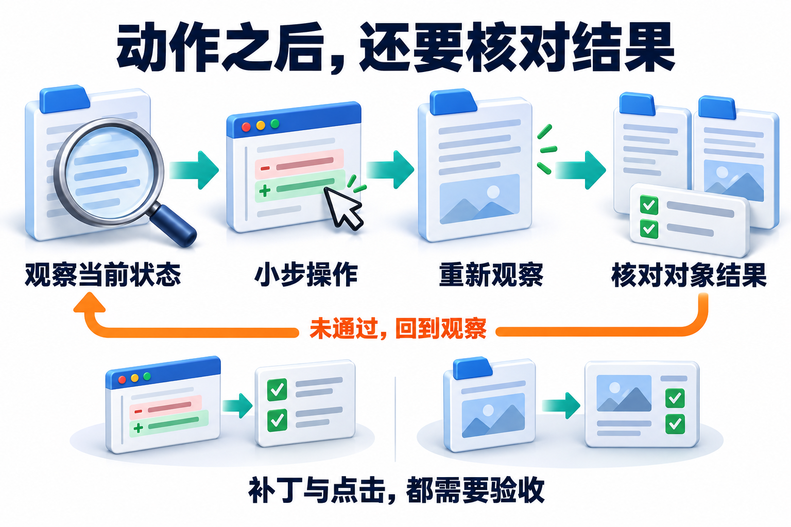

# 08 · 编码与界面操作的反馈闭环

**编码与界面操作都依赖重新观察执行结果。** Agent 根据当前环境提出动作。执行器检查权限和前置条件。动作完成后，读取变更后的资源，验证是否达到了目标。

## 编码改动与可重现验证

先读取文件和调用关系，再确定最小改动范围。记录实际源码版本、未提交修改、依赖、测试输入和运行命令。比较前后结果时，分别重置数据库、文件和缓存到相同初态。

先确认原问题在旧版确实出现。应用改动后用同样条件检查，再运行相关回归。对测试代码的改动单独审查。验收断言应继续覆盖实际行为。测试结果和被验证的源码版本一起保存。

### 运行清单和隔离初态

运行清单记录源码、未提交改动、依赖锁或镜像标识、任务夹具、命令和环境范围。测试依赖时间、随机性或网络时，保存相应控制条件和替身版本。真实外部服务无法冻结时，记录实际返回和不可控差异。

旧版与候选版分别从干净初态启动。不要让前一次留下的缓存、数据库记录和生成文件进入后一次。测试后源码或环境变化时，再跑受影响的检查。把通过结果绑定到实际运行的版本。

重复失败时记录所有尝试和停止原因。出现不稳定通过，先排查夹具污染、等待时序和依赖变化。受保护的验收用例应独立说明规格，防止改动同时把检查条件放宽。

## 执行器的环境和返回状态

执行器要明确工作目录、参数、环境、时间上限与输出范围。区分启动失败、退出码、超时、取消和输出截断。截断时留下可回查的位置。任务结束后还要确认是否有子进程继续改动环境。

文件后端决定文件实际存在哪里。进程隔离决定执行时能访问哪些文件、网络和资源。给命令提供必要目录、最小权限和测试凭据。构建和依赖安装也在相同限制内执行。

### 限制执行和清理资源

命令参数用结构化方式传递。规定可写目录、允许的网络、运行身份和资源上限。访问路径由执行器在实际读写处解析。进程启动后要追踪所属执行单元，超时和取消后检查整组资源是否已经停止。

测试凭据从受限环境提供。日志按固定范围保留。退出时同时返回退出状态、截断信息、产物位置和资源清理结果。涉及后台仍在运行的情况，单独标记状态。

## 浏览器与桌面的观察

网页可以通过元素结构和可访问名称定位控件。桌面通常依赖窗口、截图和坐标。定位要先确认实际对象和当前状态。页面导航、弹窗、重渲染或缩放后，重新读取再操作。

语义定位可以改善对版式变化的适应。页面里存在多个同名控件时，还要核对控件所属的区域与对象。截图定位时同步检查窗口、缩放和坐标范围。

### 观察必须绑定对象和时点

观察记录包含页面或窗口身份、目标对象、当前值和支持动作判断的证据。页面用可访问名称和区域定位控件，再核对它属于哪个对象。桌面坐标依赖窗口位置、缩放和可见范围。画面变化后重新取得这些条件。

对列表、弹窗和多窗口场景，先确认活动对象再操作。遇到未知提示或界面切换，暂停并读取新状态。保存之前的目标标识，便于返回后核对是不是同一资源。

## 操作前后校验

- **操作前**确认当前对象、目标字段、允许动作和预期变化。写入按风险走审批。
- **操作后**重新读取界面和资源状态。需要持久保存时，按对象标识回查服务端。
- **结果不明时**先停在当前状态。保留动作和观察记录，按原操作身份核对，再决定是否继续。

系统出现权限提示、对象无法确认或等待超时时，保留最后一次可靠观察。需要人工接手时，交付当前对象、已完成操作和待确认结果。

### 操作完成和持久结果

执行器可以确认动作已经发送。界面可以提示处理中或保存成功。最终交付要检查目标字段和持久资源。需要外部确认时，用对象或原操作编号回查。回执不明的敏感写入先停止，避免重复点击或重复提交。

停止条件包括目标已验证、所需权限缺失、事实不明、重复失败和达到预算。交给人工时保存当前窗口或项目、已经发生的动作、可回查证据和仍待确认的影响。

## 检查交付证据

代码交付要有补丁、固定的运行条件和可重跑的测试结果。界面交付要有目标对象、动作前后的观察和必要的后端确认。进程退出正常或按钮能点击，只能证明动作走到了对应步骤。

## 配套阅读

展开面试题、实验与资料

- [配套面试题](../docs/advanced/08-coding-and-computer-use.md)
- [配套工程练习](project-workshop.md)
- [一手资料](official-learning-map.md#进阶-08-的来源)

[上一章：07 · 多 Agent 系统](07-multi-agent-systems.md) · [工程进阶目录](README.md) · [下一章：09 · 评测与反馈](09-evaluation-and-feedback.md)
