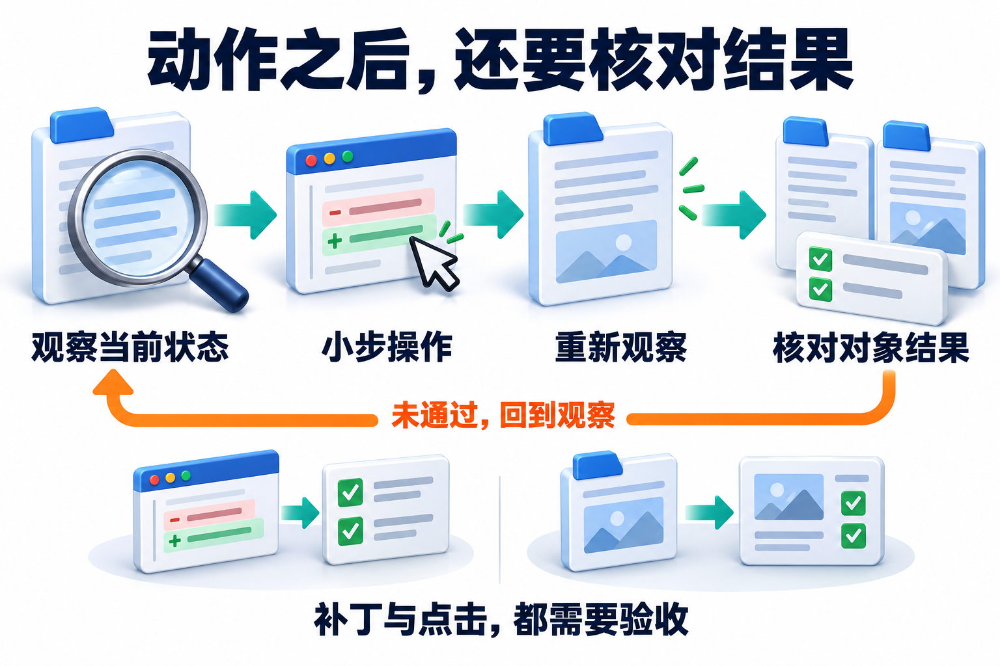

# 08 · Coding 与 Computer Use：让执行环境提供真实反馈

[上一章：多 Agent 系统](07-multi-agent-systems.md) · [工程进阶目录](README.md) · [下一章：评测与反馈](09-evaluation-and-feedback.md)

## 从工具循环走到代码与界面操作

**Coding Agent（编码智能体）** 通过读取代码、提出修改和执行验证来完成开发任务。**Browser Agent（浏览器智能体）** 操作网页，**Computer Use（计算机操作）** 则通过桌面观察与输入动作使用软件。它们把基础原理中的“工具连接外部环境”扩展到了代码仓库和交互界面。

三者共同需要**观察→行动→验证**的反馈过程：先取得当前状态，再执行动作，随后检查环境实际发生的变化。代码补丁需要应用并测试，界面输入需要确认对象和保存结果；模型输出的动作方案与环境中已经完成的动作应分别记录。

不同环境提供的观察能力不同：网页可能提供结构化元素和页面文本，桌面常依赖截图与坐标。因此，本章既关心怎样发出动作，也关心动作依据是否仍然新鲜。

[](../website/assets/diagrams/advanced/A08-action-feedback.png)

从左到右看四步，再看底部两种验收证据。代码任务核对补丁与测试，页面任务核对同一个对象及实际字段；橙色回线提醒我们依据新状态继续，不能沿用失效观察。图中的页面操作为设计示意。

## 补丁与点击都有了，结果却没落地

你让助手修正政策生效日期，再去后台更新草稿。补丁顺利生成，网页也点了“保存”，可测试运行的是旧文件，页面重排后编辑的还是另一份草稿。工具都返回成功，用户目标却没有完成。

Coding Agent 改代码，Browser Agent 操作网页，Computer Use 操作桌面；共同难点是动作依据的世界可能已经变化。Harness 要组织输入、执行工具、收集观察、保存状态、控制预算并验证终态。接下来要学的是怎样让每一步都有新鲜证据。

## Coding Agent 的闭环围绕仓库证据展开

企业政策助手需要修复“跨时区日期让旧政策被错误选中”。首先确定目标行为与工作目录，读取仓库规则和依赖配置，再定位日期解析、版本选择及相应测试。仓库索引可以提供文件、符号和调用关系线索；它若落后于当前 commit，仍要回到真实源码确认，不能直接按索引摘要修改不存在的函数。

一个紧凑闭环是“定位证据→复现问题→提出最小补丁→运行相关测试→分析输出→决定继续或结束”。SWE-agent 1.0 的架构将 Agent 与环境分离：运行环境管理 shell，历史处理器压缩交互记录，动作解析后再交给环境执行，说明这些能力属于系统运行时。[SWE-agent 架构](https://swe-agent.com/latest/background/architecture/)

模型给出 diff，意味着有了一个候选修法。应用前先检查路径范围、基线版本与补丁是否匹配；应用后重新读取实际差异，确认没有误删别人的修改。菜单上写着一道菜，不代表它已经端上桌。

测试结果也要逐项解释：命令退出码、实际运行数量、失败内容和环境错误分别说明什么？日志出现“passed”时，还应确认跑的是相关测试。补丁生成、测试通过和用户目标验收是三个不同的结论。

## 一次修复怎样留下可重现证据

第一步，用确定的时间与政策版本构造失败样例，保存修复前的失败结果；如果测试本来就无法启动，先区分环境故障与业务缺陷。第二步，检查日期比较究竟使用当地日期、UTC 时间还是业务生效时区，明确合同后修改对应模块，而不是在所有调用处随意加一天。

第三步，补充刚好跨日、生效瞬间及无时区输入的案例，运行针对性测试。第四步，按影响范围检查关联功能与实际 diff；若发现新失败，回到具体断言定位原因，不自动删除测试。第五步，交付补丁、复现命令、测试结果和剩余问题，区分“命令已运行”“测试已通过”“用户目标已验收”。

固定仓库版本、依赖锁文件、环境镜像、必要配置和数据快照，有助于重建相同实验。外部服务响应、系统时间与随机性也要控制或记录。重建环境不只是保存一个对话 transcript；没有依赖和数据，重放命令仍可能得到不同结果。

### 复现的单位是运行清单，不是一条命令

一次运行可绑定 `run_id、源码内容哈希、未提交补丁哈希、依赖锁/镜像摘要、输入夹具、命令、环境变量白名单、时区/时钟与随机种子、网络替身版本`。仅保存 commit 会漏掉工作树修改；仅保存镜像标签会漏掉标签重指。外部系统不能冻结时，应记录观测版本与不可控因素，不能承诺逐字节重放。测试夹具用于显式建立初态，测试之间还需隔离可变状态；这是[pytest fixtures 官方文档](https://docs.pytest.org/en/stable/how-to/fixtures.html)所支持的组织机制，而不是任意测试自动具备的性质。

比较补丁前后时，在同一清单下建立两个干净副本：R0 使用旧代码，R1 仅应用候选补丁；分别重置数据库、临时文件、缓存和替身响应。先看目标缺陷是否从失败变为通过，再看原本通过的相关用例是否退步。复用同一脏目录可能让 R0 留下的文件帮助 R1 通过，也可能让一次安装改变后续环境；顺序不同就改变结论，是初态未控制的信号。

测试证据应保存 `源码哈希×环境哈希×输入版本×命令→结果与日志`。测试后再改源码或依赖，旧结果不能证明新产物已验证；若不具备可靠依赖分析，就重跑受影响范围，而不是沿用绿色标记。测试由被测 Agent 同时修改时，也要单独审查断言与预期：删掉断言会让测试变绿，无法提供独立的正确性证据。保留受保护验收用例和人工可读的规格，才能核对“修复了行为”与“降低了要求”的区别。

### 执行器需要返回过程状态与资源状态

命令合同至少包含确定的工作目录、参数列表、环境、期限、输出上限与可访问资源。返回结果区分启动失败、正常退出、超时/取消和输出截断；截断时保留完整日志引用，不能把缺失的末尾当成没有失败。父 shell 结束也不说明它启动的子进程均已停止，执行环境需要按进程组或自身任务边界清理，并确认后台活动是否仍在改变夹具。

沙箱限制一次运行能做什么，清洁重置限制上次运行能给本次留下什么；二者共同支持可解释比较。确定性种子只约束使用该随机源的部分，多线程调度、外部服务或硬件数值差异仍可能变化。对不稳定用例记录重复结果与原因，不能多跑到一次通过就只保留那一次。本章日期模块提供可运行的局部验证，不提供完整仓库沙箱或通用构建复现系统。

## 一个能复现的日期补丁

把业务时区固定为UTC+08:00，政策在当地11月1日起生效。旧写法直接取UTC日历日期：

```python
# 故障样本，勿用于实际模块
from datetime import datetime

wrong = datetime.fromisoformat("2026-10-31T16:00:00+00:00").date()
# 2026-10-31；业务当地此时已经是11月1日
```

正确修法先要求时区信息，再转换到明确业务时区。下面与实际模块同名、同输入输出合同，返回ISO日期字符串：

```python
from datetime import datetime, timezone, timedelta

def business_date(iso_datetime: str) -> str:
    value = datetime.fromisoformat(iso_datetime.replace("Z", "+00:00"))
    if value.tzinfo is None or value.utcoffset() is None:
        raise ValueError("a timezone-aware timestamp is required")
    return value.astimezone(timezone(timedelta(hours=8))).date().isoformat()
```

| 测试输入 | 期望业务日期/结果 | 防止什么 |
| --- | --- | --- |
| 2026-10-31T15:59:59+00:00 | 2026-10-31 | 提前切换新版 |
| 2026-10-31T16:00:00+00:00 | 2026-11-01 | 沿用旧版 |
| 2026-11-01T00:00:00 | 拒绝无时区输入 | 随机器环境猜测时区 |

完成实现见 [date_boundary.py](../examples/policy_agent/date_boundary.py)，针对性测试见 [政策测试](../tests/test_policy_agent.py)。代码修改与版本选择是两个阶段：先得到业务日期，再按半开有效区间选择制度；单个日期修复不等于整个政策助手已可靠。

## 模拟页面：保存前后核对同一个对象

下面是模拟页面的前后状态，用来说明核对方法：

| 时刻 | 同一份目标草稿的状态 |
| --- | --- |
| 保存前 | 当前为第3版，生效日期为2026年10月31日 |
| 修改时 | 先确认仍是刚读取的版本，只把生效日期改为11月1日 |
| 保存后 | 重新读取同一份草稿，确认已变为第4版，新日期正确且仍是草稿 |

核对时确认仍是同一份草稿、目标日期正确、版本已更新。页面重排后应重新定位目标草稿；保存回执丢失时先读取结果，不能重复点保存。如果保存后读到的是另一份草稿，即使日期正确也没有完成目标。

## 文件系统抽象不等于执行沙箱

同样叫 `/workspace`，背后可能是状态中的虚拟文件、真实本地目录，也可能是远程沙箱。先问文件工具最终读写在哪里，再问命令能接触哪些资源；两个问题不能用一个路径名回答。

Deep Agents 的 backend 负责文件映射，执行隔离则决定程序的活动范围。给目录换个整齐的门牌，并不会自动装上门锁；本地 shell 和受隔离执行环境有不同的权限边界。[Deep Agents Backends](https://docs.langchain.com/oss/python/deepagents/backends)

为修复任务挂载必要仓库与临时目录，限制可写路径、出站域名和运行资源。路径检查要考虑规范化、符号链接以及检查后文件变化；只验证字符串以 `/workspace` 开头，不能证明最终写入仍在该目录。依赖安装脚本和仓库测试会执行代码，它们应受同样的环境权限约束。

凭据不应成为仓库索引、模型上下文或一般测试输出的一部分。需要访问服务时，让受控执行器注入最小范围、有限期限的凭据，并对日志脱敏；禁用真实生产密钥后，测试必须明确使用替身还是测试服务。容器是否隔离网络、宿主挂载和特权能力，要由实际配置验证。

## Browser 与 Computer Use 的观察方式不同

网页任务可以利用 **DOM（Document Object Model，文档对象模型）** 中的元素结构，以及可访问性树提供的角色、名称和状态，按语义定位操作对象，必要时结合截图。桌面任务更多依赖截图、窗口状态与坐标。当前 Claude 文档也区分 page-aware 的 browser use 与完整桌面的 computer use；两者工具集的执行合同不能互换。[Browser use](https://platform.claude.com/docs/en/agents-and-tools/tool-use/browser-use-tool)、[Computer use](https://platform.claude.com/docs/en/agents-and-tools/tool-use/computer-use-tool)

对“打开政策后台、更新一份草稿的生效日期”，先确认当前系统、对象 ID、草稿状态和目标字段，再执行单个或短批动作，随后重新读取。导航、弹窗、筛选和虚拟列表都可能使旧观察失效。Playwright locator 会在动作时重新定位匹配元素；这改善重渲染适应性，但仍要确保定位语义对应正确对象。[Playwright Locators](https://playwright.dev/docs/locators)

有些浏览器执行器返回临时元素引用。引用只对对应标签页和有效页面状态成立，页面发生实质变化后需要重读；遇到 stale reference 应返回具体错误并停止依赖它的后续动作，不能继续把键盘输入打到未知焦点。[Browser use 引用与错误处理](https://platform.claude.com/docs/en/agents-and-tools/tool-use/browser-use-tool#handle-errors)

## 视觉定位也要保持观察新鲜

截图坐标依赖窗口位置、缩放、滚动和视口。若刚发生滚动，不能沿用旧图里的按钮坐标；应重新截图，识别目标与遮挡，再行动。表格中每行都有“编辑”时，先确认行标题或对象标识；仅看按钮样式无法区分对象。Canvas 或远程桌面缺少可靠文本结构时，视觉可以补足定位，但不能省略对象核对。

**“保存”点击成功，只能说明输入动作已经发出。** 接着核对目标对象、新日期、保存状态或版本；如果有独立读取接口，再检查持久结果。按钮点击是过程证据，对象变化才接近业务结果。

保存后超时尤其需要停一下：先读当前状态，再决定是否重试。连点两次可能把一次不确定变成两次真实提交。截图、页面文本、工具返回和后端对象各覆盖一部分事实，应把它们连起来解释。

## 用前置条件和后置条件控制每一步动作

截图、DOM和命令输出都是对环境的观察，不是完整环境状态。可以给一次操作保存观察 O、目标对象ID、可见版本或页面代次，以及前置条件 P；动作后再取得新观察 O'，检查期望的后置条件 Q。控制过程是“当前观察足以验证 P 才行动，动作后用新观察验证 Q”；不能仅由动作函数没有抛错推断 Q 成立。

网页执行器的可操作性检查解决一部分 P：[Playwright](https://playwright.dev/docs/actionability)在点击前检查唯一定位、可见、稳定、可接收事件和可用状态，但这些条件不说明“这是用户指定的草稿”或“写入已经持久化”。业务对象身份、字段旧值、允许状态与结果读取需要宿主另验。若后端支持带版本条件的保存，可让旧版本更新被拒绝；只有截图或临时元素引用的环境则无法获得同样的原子保证，动作越重要，越应缩短观察与使用之间的间隔，并核对真实结果。

坐标定位还包含映射条件：截图尺寸、视口缩放、滚动偏移与当前窗口要共同决定点击位置。裁剪图上的 `(x,y)` 不能原样用于全屏，滚动后的旧坐标也失去原来的对象含义。语义定位能重新找元素，但同名控件仍需先缩小到目标行或对象容器；通过角色找到“保存”不代表已经选对那份对象。

连续长批动作属于开环控制：中间状态变了，后续输入仍照旧发出。可以将批次限制在不依赖中间新观察的短操作内，在导航、弹窗、保存、外部响应或条件变化后重新观察；等候应基于目标状态或明确事件，固定睡眠只是在某段时间后再试，不能证明状态到达。Q 无法确认时把结果记为未知，先读取或对账；点击提交可能已有副作用，不能把“重试动作”默认当成幂等操作。

同一机制也适用于编码：补丁针对基线文件内容提出，应用前核对基线，应用后读取实际差异，再在修改后的工作树运行验证。验证记录绑定工作树版本和命令结果，避免把旧测试输出附在新补丁上。迁移检验应同时改变页面布局与对象ID：系统可以重新定位布局变化后的同一对象，遇到对象身份变化则停止；当前页面示例尚未提供真实浏览器自动化实验，这一层仍需在选定执行器上验证。

### 闭环中的停止与恢复规则

下面是本手册的控制合同伪代码，观察、动作与验收三个记录相互关联；不是浏览器 SDK 的新增接口：

```text
observe → 确认对象身份、版本、前置条件 P
P 不成立或观察不足 → 重新观察 / 请求缺失条件；不派发动作
P 成立 → 派发一个动作或不依赖中间反馈的短批次
明确未执行的错误 → 修正定位或参数后重新观察
可能已执行但回执未知 → 读取目标状态 / 对账；不盲目重放
获得新观察 O' → 按对象身份、持久状态检查 Q
Q 成立 → 提交这一步的证据；Q 不成立 → 分类失败并决定继续或停止
```

闭环之所以能纠偏，是因为下一个动作依赖新反馈，而不是只依赖原计划。但观察并不等于真相：列表可能延迟刷新、截图可能没覆盖目标、提示条可能只表示请求已接收。验收应选最接近目标状态的可用观察，明确读到的是缓存、页面还是权威对象；缺少后端可读能力时只能给相应较弱结论。固定等待能减少某些时序竞争，不能替代后置条件。

验证控制器可用故障注入而非更多成功截图：在观察后移动元素应触发重定位；换成另一个同名对象应被身份检查拦下；让保存已生效但丢回执，应先读到新版本且不再写一次。测试同时检查实际对象与调用记录；只检查模型说“我已确认”不能证明闭环工作。这些是待选执行器实现的验收条件，本章未声称已完成真实桌面自动化测试。

## 多模态证据与人工介入

页面文字、图片、注释与仓库文件都属于输入资料，不能自行赋予发送、删除或读取其他数据的权限。工具环境应限制高影响动作，遇到需要用户决策的具体操作时暂停，展示目标对象、字段变化、证据与后果；恢复时重验页面和参数，防止审批等待期间对象被修改。Computer use 文档将低权限隔离环境、网络限制和必要的人类确认列为实施要点。[Computer use 安全考虑](https://platform.claude.com/docs/en/agents-and-tools/tool-use/computer-use-tool#security-considerations)

运行记录保留足以关联动作的证据：仓库 commit、补丁摘要、测试输出，或标签页 URL、对象 ID、动作前后状态与对应截图。截图未显示的隐藏字段不能据此宣称已检查；图片中的文字识别不确定时，应放大或通过另一条可用信息渠道确认。无法稳定定位、出现权限变化或关键结果不确定时，交给人工带着状态继续。

## 设计练习

设计一个流程，先修复日期选择逻辑，再在测试后台更新草稿。注入三个故障：索引指向旧文件、点击前页面重排、保存后响应丢失。验收要求：代码定位回到当前源码；新观察定位正确对象；保存超时先读状态；补丁有可复现测试；任何一步都不把工具动作成功直接当成业务目标完成。

## 自检与答案

<details><summary>1. 仓库索引给出的函数名能否直接当作修改依据？</summary>

需要回到当前源码确认版本、定义与调用关系，索引可能过期。
</details>
<details><summary>2. 用了语义 locator 是否无需重读页面？</summary>

仍需重读关键状态。定位器重解析元素，不保证业务对象、权限与页面含义没有变化。
</details>
<details><summary>3. 保存按钮点击成功后为什么还要验证？</summary>

点击是动作结果；持久化内容、目标对象和任务约束才决定是否完成目标。
</details>

## 参考资料

- [SWE-agent Architecture](https://swe-agent.com/latest/background/architecture/)：环境、模型历史、动作解析与执行闭环。
- [Deep Agents Backends](https://docs.langchain.com/oss/python/deepagents/backends)：虚拟文件、本地文件与执行环境的区别。
- [Claude Browser use](https://platform.claude.com/docs/en/agents-and-tools/tool-use/browser-use-tool)、[Computer use](https://platform.claude.com/docs/en/agents-and-tools/tool-use/computer-use-tool)：观察、动作、错误与环境配置。
- [Playwright Locators](https://playwright.dev/docs/locators)：基于页面语义的重新定位。

[对应面试题：Q078、Q079、Q080](../docs/advanced/08-coding-and-computer-use.md)

## 应用实验延伸

[媒体证据与实时交互继续阅读第18章，区分识别结果、当前条件、实际播放与已确认行动。](18-multimodal-and-realtime-agents.md)
