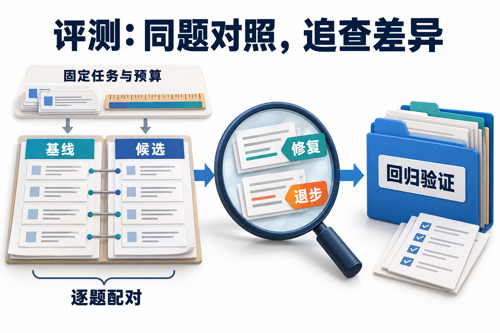

# 09 · 从执行轨迹到评测与反馈闭环

## 评测、执行轨迹与反馈如何连接

**Agent 评测**是把系统的实际行为和最终产物，与预先明确的任务要求进行比较。它要回答能否完成目标、哪里失败，以及完成时用了多少资源，连接了基础原理中的成功标准、执行轨迹和成本记录。

**执行轨迹（trace）** 保留行动与观察的过程，帮助定位错误；固定任务集上的重复评测则帮助比较不同版本。**反馈闭环**把二者连起来：观察失败、定位原因、提出改动，再在可比条件下复测。一次好看的演示提供一个样本，还需要更多任务检验适用范围。

本章还会检查评分器本身，以及多次尝试指标的含义，用它们区分策略变化、尝试次数和评分偏差分别带来的影响。

## 策略变好了，还是多试了几次

新版本助手多查了两次资料，演示时答得更完整，费用也更高。到底是检索策略改善了，还是只给它多试了几次？如果评分器又偏爱长答案，分数上涨可能只是尺子跟着变长。

本章把这几件事拆开：先找真正值得修的错误，再比较多次尝试，最后检验评分器。建议先读[基础评测](../learning/09-evaluation.md)与[多 Agent 协作](07-multi-agent-systems.md)。

阅读到逐题配对表，需要理解成功率和分母；后面的区间与检验为统计选读，按二值结果、组合数和有放回抽样逐步展开。它新增的是“观察到改善后，证据能支持多强的判断”，而不是把基础章的指标再算一遍。

## 先读失败轨迹，再决定优化对象

研究助手需要检索两地政策、比较适用条件并形成申请草稿。一次任务失败可能来自旧索引、工具选错、权限拒绝、错误汇总或用户根本不需要这份报告。把这些情况都算成“模型答错”，下一次更换模型就无法针对问题。

可以先逐条记录观察：“第二次检索仍只查旧版本”“引用存在但金额不适用于该员工”“工具失败后仍输出成功”。再将相似问题归成失效类别，检查首次错误出现的位置，以及其他独立错误。Hamel Husain 的评测实践强调从真实轨迹的错误分析形成评价标准，而不是先选一批通用指标再寻找用途。[AI Evals FAQ](https://hamel.dev/blog/posts/evals-faq/)

这里要同时保留两类规则：事先明确的业务不变量，例如未经授权不得写入；通过观察逐渐细化的质量标准，例如比较结果应解释两地政策为何适用。后者会演化，评分器、标注和数据集也应一起版本化。

## 一个任务，需要四份能关联的记录

| 对象 | 研究助手的记录 | 用途 |
| --- | --- | --- |
| Task | 用户目标、初始资料、允许动作、成功规则 | 固定本次要解决的问题 |
| Trial | 模型/工具/提示版本、随机配置、环境快照 | 区分同题的不同尝试 |
| Trace | 检索、路由、交接、审批、重试和费用事件 | 找到错误发生的阶段 |
| Outcome | 草稿内容、有效引用、实际后端对象 | 判断用户目标是否完成 |

工具事件显示“成功”，可能只是查到了资料，并未说明最终答案正确。把关键主张接到证据 ID，把写入意图接到操作 ID，再关联 Task 与 Trial，才能从用户看到的错误一路追到发生错误的步骤。

这样做也便于比较版本：同一题、同一资料范围，究竟哪一步变了？OpenAI 官方评测路径同样连接轨迹诊断与可重复的数据集评测；实际字段和采集方式应按所选运行时配置。[Evaluate agent workflows](https://developers.openai.com/api/docs/guides/agent-evals)

## 不要把“多试几次”混成一个成功率

**pass@k**关注同一任务的 k 份候选中是否至少有一份成功；要求 k 次全部成功，则是在检查另一种重复交付能力。比较这两个目标前，先固定任务、尝试协议和成功标准。

设同一道题每次独立尝试、成功概率固定为 p。至少一次成功的概率为 `1-(1-p)^k`，k 次都成功为 `p^k`。p=0.6、k=3 时，前者是 0.936，后者是 0.216。前者适合讨论允许候选筛选的能力，后者强调重复交付的一致性；真实系统的相关错误会破坏独立假设。

还有一个容易算错的平均顺序。两题的 p 分别是 0.9 与 0.1，k=2：

```text
至少一次成功的逐题均值 = (0.99 + 0.19) / 2 = 0.59
全部成功的逐题均值     = (0.81 + 0.01) / 2 = 0.41
```

先把两题的 p 平均成 0.5，再计算至少一次成功，会得到 0.75。这个数字对应“每题都像一枚成功率 0.5 的硬币”，已经丢掉一题容易、一题困难的结构。先逐题计算，再按声明的权重汇总，才能回答原来的问题。

在有 n 个已评分样本、其中 c 个成功时，常用 pass@k 估计量为 `1-C(n-c,k)/C(n,k)`，要求 n≥k。它计算从样本中选择 k 个时至少一个成功的比例；5 次中成功 1 次，pass@2 为 0.4。[HumanEval 原论文](https://arxiv.org/abs/2107.03374) 这仍不解决“如何识别正确候选”：若真实用户拿不到可靠验证器，报告至少一次成功时应同时说明筛选成本与交付方式。

## Judge 也需要一套评测集

**模型评审（LLM-as-a-Judge）** 是让大语言模型依据规则评价候选产物的方法。评分器本身也可能误判，因此**评分器需要独立校准**，不能把它的输出直接当成标准答案。

给评分器提供任务、必要证据、最终产物和明确规则，让它判断“是否正确使用有效政策”，比只问“报告好吗”更可操作。校准时保留人工判断和分歧原因，分别观察误放过和误拦截，而不只看总体一致率。

例如人工认为 5 个答案通过、5 个不通过；Judge 正确放行 4 个、误拦 1 个，正确拦截 2 个、误放 3 个。它的真阳性率是 4/5，真阴性率是 2/5；总体准确率 6/10，却把 60% 的坏答案放过。若高风险类别更少，整体分数还可能掩盖更大的问题。位置、冗长和自我偏好等偏差需要通过任务内校准检查。[MT-Bench 原研究](https://arxiv.org/abs/2306.05685)

让不同检查各做擅长的部分：对象数量、必需字段和禁止调用交给确定性规则；证据支持、完整性和语气可由经过校准的 Judge 辅助，争议样本再交人工。Judge 是一把也需要校准的尺子，不是换上模型名称就自动成为标准答案。

汇成总分前，先单独查看关键失败。一次未经批准的写入，不能靠报告的语言质量抵消。

### 先定义标签，再校准评分器

标签应从任务合同拆成可观察判断：事实是否受证据支持、必需输出是否完整、禁止副作用是否发生，再决定是否允许合成一个通过/失败。每个判断保存允许的证据、边界样本与“证据不足”规则；仅凭文风给总分，无法区分流畅的错误和有根据的拒答。人工标注也有误差：可让标注者先独立、盲于版本地判断，再对分歧按原始证据仲裁，保留未决项和标签版本，而不是把多数票自动当真值。

校准集需要覆盖实际版本会生成的输出，包括简短、冗长、拒答、近似正确及格式异常等样式。只在旧版本输出上估计误差，不能保证新版本仍适用；[MT-Bench 原研究](https://arxiv.org/abs/2306.05685)讨论的偏差正说明评分行为与候选呈现有关。确定性业务断言、人工标签和模型评分可以交叉检查，但它们各自需要错误记录，不能因“三者一致”就省掉来源核对。

### Judge 的错误怎样扭曲版本差异

设某版本真实通过率为 p，评分器真阳性率为 s，误放率为 f，则按全概率公式：

```text
观测通过率 q = s×p + f×(1-p) = f + (s-f)×p
若两个版本的 s、f 相同：Δq = (s-f)×Δp
```

这解释了为什么同一把尺子也可能压缩差异：`s=.9、f=.1` 时真实提高10个百分点，只表现为8个百分点。更危险的是误差随版本改变。假设两个版本真实 p 都为.6，旧版 `s=.9、f=.1` 得 q=.58；新版仅因输出风格使 f=.4，则 q=.70，出现虚假的12个百分点提升。数字是手算反例，不是某个 Judge 的实测误差。

因此比较时要混合、打乱并隐藏版本标签，对两版输出分别校准，尤其复查“只在新版被放行”的样本。用 `(q-f)/(s-f)` 反推 p 还要求误差率能迁移、估计可靠且 `s≠f`；分母接近零会放大噪声。不能把十个校准样本算出的比例当作精确修正系数。

## 设计一次能解释的改进实验

假设要比较“固定检索两次”与“证据不足时追加检索”。先冻结任务集合、允许的证据范围与成功标准，再分别记录逐题终态、错误类别、调用量、耗时和总费用。以同一题为配对单位比较，而不是让两种策略各挑容易的题。

开发集用于设计策略，保留集用于检查迁移；同一模板、同一文档的近重复改写应按组切分。任务内重复采样不能当作更多独立用户需求，统计汇总应保留题目这一层。若策略改变了最大尝试次数、模型或工具预算，比较表需要同时展示这些变化。

错误修复后，把具有稳定验收条件的案例加入回归集合；新任务、新资料与新交互仍用于发现新问题。线上观察可以从无副作用的影子运行开始，再小范围发布，保留可回退的模型、提示、工具及索引版本。

[](../website/assets/diagrams/advanced/A09-evaluation.png)

先看左侧逐题配对的基线与候选，再看放大镜标出的修复与退步。两类差异都要留下记录，并进入后续验证；总分上涨，不能让退步样本从表里消失。

### 分层权重和独立单位决定总分含义

若线上任务90%是容易题、10%是困难题，两层通过率分别为.95和.20，目标总体通过率是 `.9×.95+.1×.20=.875`。为了诊断而各抽一半，直接均值却是 `.5×.95+.5×.20=.575`。两者回答不同问题；按线上权重汇总用于总体估计，逐层指标用于发现薄弱处，刻意抽难题不是错，隐去抽样权重才会误导。

独立单位也不一定是一行题目。同一文档的十个改写共享来源缺陷，同一用户的多次运行共享行为与环境；重复次数增加，独立信息未必同比增加。对样本均值：

```text
Var(mean) = [Σ Var(Y_i) + 2Σ_{i<j} Cov(Y_i,Y_j)] / n²
```

把相关行当独立会漏掉协方差。若任务按文档族独立抽样，可按整个文档族重采样，族内保留任务、重复试验和两版本配对；同时声明估计的是按任务还是按族加权的效果。族数很少时，bootstrap 也无法创造独立证据。SciPy 的 [paired bootstrap](https://docs.scipy.org/doc/scipy/reference/generated/scipy.stats.bootstrap.html)保证传入样本共用索引；**选择什么单位作为一个索引仍是实验设计责任**，并不会自动识别聚类。

### 离线回归与线上因果验证各回答什么

配对消除了题目组成差异，却不能单独消除运行顺序、共享缓存、外部资料更新或预算改变。离线比较应固定资料与工具版本、隔离有状态环境，交错或随机化版本顺序，冻结评分协议；先声明主要指标及停止规则，避免看到结果后不停换任务/规则来寻找显著性。局部消融适合回答“哪一步改变了失败路径”，保留集适合检查是否迁移到未用于调参的任务。

线上随机试验则把符合条件的用户、会话或任务分配到并行对照组，估计完整产品干预对用户结果的影响。随机化单位应与作用范围一致：同一会话反复换策略会互相污染；共享容量使一个组挤占另一组资源时，独立性也受破坏。需要同时检查成功、伤害/副作用、延迟和费用，长任务还要等到结果成熟。实验机制与前提见作者一手论文[《Practical Guide to Controlled Experiments on the Web》](https://exp-platform.com/practical-guide/)；随机分组不自动修复漏日志、样本选择或评分器偏差。

离线回归保留可重放的错误诊断，线上验证关注实际人群和系统环境中的效果。两者互补：上线点击率提高不能证明证据更正确，离线固定任务通过也不能证明真实用户收益。本章只运行手写结果夹具上的统计计算，未开展线上试验。

## 一次主要改动的逐题配对表

先用手工可核对的教学基线：“取首次相关结果就回答”；候选改动只增加“核对适用日期，旧结果时读取权威版本”。下面列预期差异，属于预先制定的诊断夹具，不是模型实测提升数据：

| 任务 | 基线可能首次失败点 | 日期核对后仍需检查 |
| --- | --- | --- |
| 当前日期核对 | 正常证据下可答 | 取得的引用与金额一致 |
| 历史日期核对 | 误用最新700 | 是否选旧版600 |
| 经理住宿标准 | 日期对但类别错 | 员工类别仍要独立核对 |
| 两个日期比较 | 用同一版本填两列 | 两份适用条款均保留 |
| 两地住宿比较 | 单一证据覆盖两地 | 两地证据完整 |
| 超标金额与咨询材料 | 未取得咨询材料要求却自行补全 | 两类引用各支持对应主张 |
| 证据冲突 | 拣一条直接回答 | 冲突应交人工 |
| 用户更正城市 | 沿旧城市继续 | 旧待办确实取消 |
| 缺少出差日期 | 自选今天 | 零调用等待 |
| 餐补资料不足 | 用住宿替代 | 明确证据不足 |
| 批准后创建工单 | 文本称成功 | 批准、对象与内容 |
| 工单崩溃恢复 | 新ID重建 | 原意图仅一个对象 |

退步样本应显式保留：如果实现“只保留最新版本”，当前日期查询可能正常，历史日期查询反而从正确变错误；不能用总体平均掩盖。运行新实验全套后，把实际报告按场景接到这张表，填写终态、证据、调用量和错误阶段。未运行的费用与模型表现保持空缺。

裁判错判样本：“答案写700元且语言流畅，但本轮从未取得适用的新版住宿条款”。只看最终文本的裁判可能放行；独立评分应判缺实际证据。再交换答案展示顺序，检查Judge是否改变判断。这里校准的是评分规则，不让候选模型给自己的答案作最终裁决。

## 成功率提高后，还要看配对差异与不确定性

假设固定12个任务，在相同资料、评分规则与尝试协议下，各比较一次基线和候选版本。下面是手工编写的结果标签，用于复算统计方法，**不是本仓库运行模型得到的提升**。

| 基线结果 | 候选成功 | 候选失败 | 合计 |
| --- | ---: | ---: | ---: |
| 成功 | 5：两版均成功 | 1：候选退步 | 6 |
| 失败 | 3：候选修复 | 3：两版均失败 | 6 |
| 合计 | 8 | 4 | 12 |

基线成功率为6/12，候选为8/12，差值为2/12，即约16.7个百分点。再为每个任务定义差值：候选修复记`+1`，退步记`-1`，其余记`0`。这12个差值的均值仍是`(3-1)/12`，但保留了哪些任务变好、哪些变坏。必须先按稳定任务ID对齐；两版各自换一批题，不能放进这张配对表。

### 只看发生变化的任务，检验方向是否对称

**McNemar精确检验**适用于这类配对二值结果，检查两版边际成功概率相等的原假设。给定发生变化的任务数，原假设下每个独立任务朝“修复”或“退步”方向变化的条件概率相同。本例4个任务改变，修复3个、退步1个，采用双侧二项尾概率：

```text
m = 修复数 + 退步数 = 4
p = min(1, 2 × Σ[i=0..min(3,1)] C(4,i) / 2^4)
  = 2 × (1+4) / 16 = 0.625
```

这个p值描述原假设下至少同样极端的不对称程度，**不是“候选无效的概率为62.5%”**。它也不证明两版等价。真实保留集若出现类似少量变化，不能只凭16.7个百分点的表面增幅宣布已经稳定改善；还应查看具体修复、退步及禁止行为。精确二项形式和适用的2×2配对表见[statsmodels官方说明](https://www.statsmodels.org/stable/generated/statsmodels.stats.contingency_tables.mcnemar.html)。

### 按整对任务重采样，观察差值的变化范围

**Bootstrap（自助重采样）**从已有任务对中有放回抽取12对，计算一次成功率差，再重复这一过程。抽到某个任务时，基线与候选的结果必须一起抽取；分别打乱两列会破坏配对关系。这里采用容易复算的百分位法，取重采样差值分布的2.5%与97.5%分位点，分位点之间做线性插值。[SciPy官方文档](https://docs.scipy.org/doc/scipy/reference/generated/scipy.stats.bootstrap.html)说明了配对采样与不同区间方法，实际分析还应根据数据选择方法，不能把教学中的百分位法当作通用最优方案。

运行新实验：

```bash
python3 examples/advanced/evaluation_lab.py
```

默认使用2000次重采样、种子7，得到差值区间约为`[-16.7, 50.0]`个百分点。区间跨过0，也很宽；它显示这组标签的抽样不确定性，不能据此保证总体提升。改变种子或次数可以观察数值稳定性，但不会创造更多独立任务。脚本同时返回具体修复和退步的任务ID，不能只截取候选成功率汇报。

这两种方法都依赖任务抽样和配对协议。12个手写教学标签不支持任何真实能力结论；小样本、近重复任务、挑过的样本和反复查看保留集，也不会因算出区间就自动变得可靠。同一任务的多次尝试有内部相关性，应先定义每题汇总方式或采用保留任务层次的分析，不能把几十条尝试当几十个独立任务。如果所有配对差都为0，这种Bootstrap会给出`[0,0]`，只说明已有样本没有差异，**不证明总体等价或模型没有随机波动**。

迁移到自己的结果时，将明确判定后的标签写成JSON数组，形如`{"task_id":"case-1","baseline":true,"candidate":false}`，每题只出现一次，再运行：

```bash
python3 examples/advanced/evaluation_lab.py --input .local/paired-outcomes.json
```

脚本拒绝缺标签、用数字冒充布尔值或任务ID重复的输入；尚未判定的任务需先单独报告，不能默认为失败或悄悄删掉。它只分析提供的结果，不负责评分、检验任务是否独立，也不证明改动与线上收益之间的因果关系。

## 动手练习

为 8 条研究任务建立逐题表：2 条单文档、2 条跨文档冲突、2 条工具失败、2 条权限/写入请求。先人工标注终态和首个失效阶段，再给其中 4 条做多次尝试。计算至少一次成功、重复一致性、误放过率和每个成功任务成本。用一张差异表解释新增检索到底修复了什么，也记录它增加的费用。

运行概率算例：

```bash
python3 examples/advanced/runtime_lab.py --scenario evaluation
```

再用配对实验找出那1个退步任务，把它与3个修复任务一起交给发布评审。若其中涉及未经批准写入，统计检验不能把该错误抵消；若只是质量取舍，说明合同、差值区间与需要补充的独立样本。

## 自检

<details><summary>1. pass@5 提高，单次交付就更可靠了吗？</summary>

不一定；它允许更多尝试，还需要看 pass@1、候选识别和总成本。
</details>
<details><summary>2. Judge 与人工总体一致 95% 就够了吗？</summary>

仍应按错误类别检查混淆矩阵，尤其关注关键失败被放过的比例。
</details>
<details><summary>3. 一次路由改进应该先改模型还是加测试？</summary>

先读失败证据、明确修复对象，再设计可重复比较；改动可能在数据、工具或交互层。
</details>

## 参考资料

[Hamel：AI Evals FAQ](https://hamel.dev/blog/posts/evals-faq/) · [OpenAI：Agent evals](https://developers.openai.com/api/docs/guides/agent-evals) · [HumanEval](https://arxiv.org/abs/2107.03374) · [MT-Bench](https://arxiv.org/abs/2306.05685)

[上一章](08-coding-and-computer-use.md) · [下一章](10-performance-and-serving.md) · [工程进阶目录](README.md)

[对应面试题：Q081、Q082、Q083](../docs/advanced/09-evaluation-and-feedback.md)

## 应用实验延伸

[把评测门槛连接到任务服务的发布与回退，继续阅读第16章；真实模型能力与本地组件回归分别报告。](16-service-deployment-and-operations.md)
