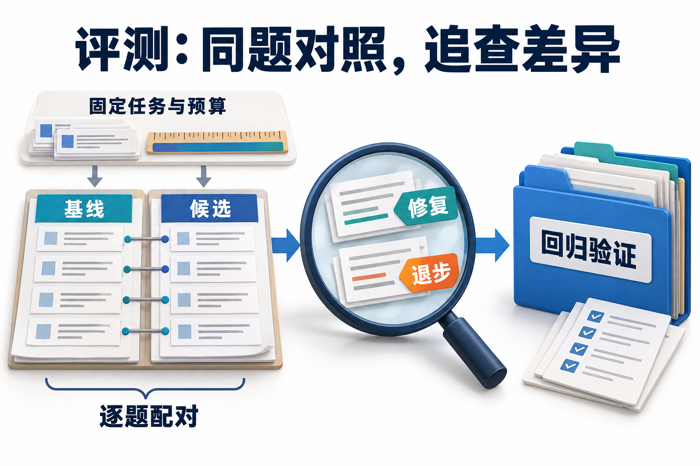

# 09 · 评测、归因与反馈

**评测要说明结果为什么变化。** 单看成功率，无法区分策略进步、尝试次数增加和评分器偏差。先固定验收标准，再按任务对照两版的执行和结果。

## 任务、尝试、轨迹与评分

一项任务包含目标、初始环境和验收条件。每次尝试保存模型、配置、预算和环境版本。运行轨迹记录输入、动作和观察。评分记录使用的标准、证据和终态。用任务编号和尝试编号把四类记录对应起来。

先找失败第一次出现的环节。证据未到模型、动作选错、参数错误和外部结果未确认，分别由不同机制处理。诊断时避免修改多个环节后只比较总分。

固定尝试次数和重置方式。分别报告单次成功、k 次中至少一次成功和 k 次全部成功。正式评测还要记录停止规则，确保失败或超时也进入统计。

### 冻结任务条件与样本构成

任务要声明环境起点、允许动作、目标和禁止结果。一次尝试重置业务状态，并固定模型、知识版本、执行策略和资源上限。多次尝试之间不要共享上一次的临时记忆或写入。允许累积进度的任务用自己的合同统计。

诊断时把失败首次出现的位置和最终结果分别记录。输入缺证据、路由漏工具、权限拦截和评分器误判，可能都表现成同一种失败。记录哪些是执行结果，哪些只是评分结论。人工核查优先看同时改变了阶段和终态的任务。

### 多次尝试指标的条件

同一任务跑 k 次。至少成功一次记为 `pass@k` 的通过。全部 k 次成功记为 `pass^k` 的通过。先对任务计算再汇总。报告 k、重置方式和任务权重。只在同一任务的尝试独立且成功概率固定为 p 时，可用 `1−(1−p)^k` 与 `p^k` 理解两个值的变化。

## 校准评分器

先定义人工可判定的通过条件。结构、引用位置和外部对象可以用程序核对。需要判断文字支持关系时，用人工样本校准模型评分，并覆盖争议结果和各类失败。

设真实通过率为 `p`。评分器对真实通过的检出率为 `TPR`，对真实失败的误判通过率为 `FPR`。观察到的通过率为 `TPR×p + FPR×(1−p)`。两版答案风格变化时，误判率也可能变化。应分别抽核两版的结果，尤其是判定翻转的任务。

### 把评分误差和真实变化分开

用带人工结果的任务构造通过、误放、拒绝和误拒统计。分别检查有证据任务、证据不足任务和有副作用任务。只看全量一致率时，占比低但影响大的错误可能被淹没。

当两版共享相同的误判率时，观察到的通过率变化等于真实变化乘 `TPR−FPR`。两版误判率不同时，这个简化关系失效。新版写法变化后，优先人工复核判定翻转和高风险样本。对开放文本还要检查候选展示顺序、长度和评审细则是否影响评分。

## 对照条件、分层与线上验证

固定任务、环境、真实验收和预算。每轮只改一个主要机制，记录失败分类、质量与成本。按任务类型、风险或入口渠道分层，说明各层样本量和汇总权重。相同来源的任务可能相关，应保留来源组。

离线回归能说明固定任务上的变化。验证真实流量上的效果时，定义分配单位和主要指标，检查流量是否串组。线上观察同时保留权限、延迟和其他运行约束。

### 汇总权重决定总分含义

每层先算通过率，再按预先约定的权重合并。固定权重适合比较同一目标人群下的变化。直接随样本数加权，会连同入口分布的变化一起计入。两种口径都要报告实际样本量和高风险任务结果。

任务来自同一客户、文档或交互时，结果可能相关。切分训练集与保留集时按来源分组。线上随机分配也要选择能减少相互影响的单位。保留固定版本的对照流量，同时记录延迟、副作用与资源消耗。

## 配对差异与不确定性

同一任务在两版各有一个通过或失败的结果。记「由失败转为成功」为 `b`，「由成功转为失败」为 `c`。同样权重下，净通过率变化为 `(b−c)/N`。同时报告 b、c 和 N，可以看清提升是否伴随退步。

在独立配对与原假设成立时，精确 McNemar 检验只使用发生翻转的任务。给定 `b+c`，按成功概率为一半的二项分布检验方向是否对称。双侧精确 p 值取较小方向的累计尾概率乘二，最大为 1。只有少量翻转时，结论的不确定性较大。

估计差值的区间时，按成对任务重采样。任务同源且存在关联时，按来源组重采样。样本分层时尽量保持原设计和权重。区间反映采样假设下的不确定性，仍要看原任务能否代表目标分布。

### 修复、退步、区间一起报告

离线对照在同一任务上得到两次判定。报告两版均通过、两版均失败以及两种翻转。净差只反映最终增减。两个版本净差相同，也可能有完全不同的退步数量。

McNemar 检验针对配对二值结果。翻转少时，结果容易受单个任务影响。配对重采样通过抽取整对任务保留前后的相关性。来源相关时按组抽样。报告区间方法、独立单位、分层权重和样本规模。上线条件还要看高影响失败、成本与实际业务收益。

## 反馈进入后续改动

将失败原因写成可核对的分类。优先修复影响较大的早期偏差。每次改动后先跑对应回归，再检查同一批未参与调优的任务。保留修复与退步清单，作为下次改动的依据。

让失败分类指向能验证的修复位置。检索修复看证据进入输入的变化，调度修复看在途状态与实际派发，评分修复看人工一致性。每个版本保留明确的主改动与回归门槛，方便下一轮沿同一条链排查。

## 配套阅读

展开面试题、实验与资料

- [配套面试题](../docs/advanced/09-evaluation-and-feedback.md)
- [逐题评测与统计实验](../examples/advanced/README.md)
- [一手资料](official-learning-map.md#进阶-09-的来源)

[上一章：08 · 编码与计算机操作](08-coding-and-computer-use.md) · [工程进阶目录](README.md) · [下一章：10 · 性能与推理](10-performance-and-serving.md)
