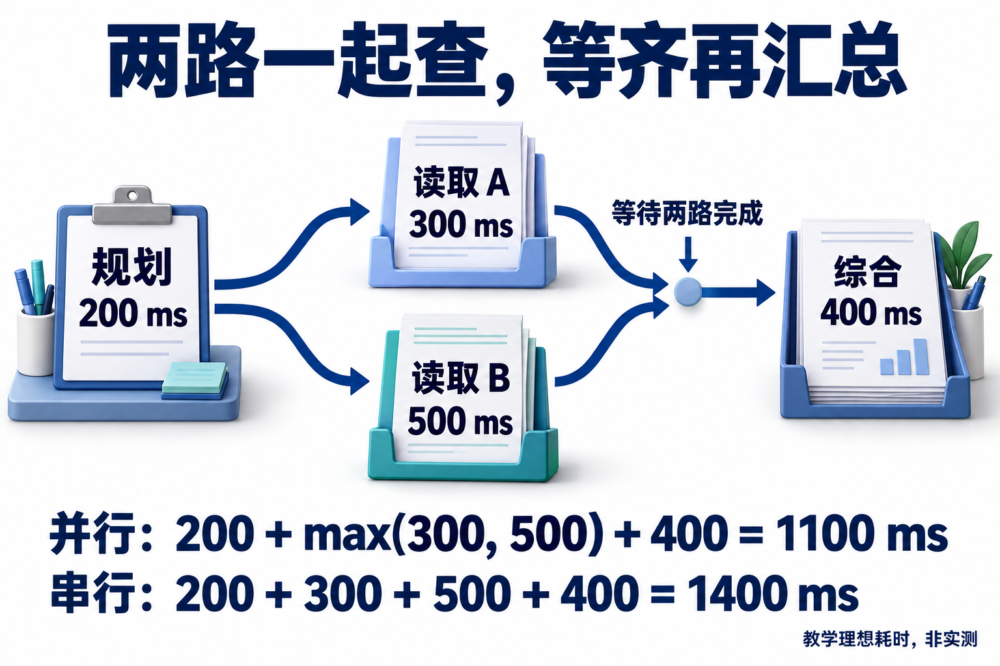

# 10 · 性能、预算与推理服务

## 性能要同时看任务路径和模型阶段

**Agent 性能**描述系统在一定资源条件下完成任务的速度与承载能力。**延迟（latency）** 关注一次请求或任务要等多久，**吞吐（throughput）** 关注单位时间处理多少工作；费用和质量又为优化设定了约束，几个指标需要一起看。

基础原理部分已经区分模型生成和工具执行，本章把它们放回完整任务路径。**关键路径**是依赖图中累计耗时最长的路径，它给出忽略额外资源等待时的完成时间下界。只有互不等待输入的工作才有并行空间。任务预算则由各分支共同消耗，需要统一记录和结算。

模型服务内部也有不同阶段：**prefill（预填充）** 主要处理已有输入，**decode（解码）** 逐步生成新 token；**KV Cache（Key-Value Cache，键值缓存）** 保存可复用的注意力中间表示。后文会说明这些计算复用与检索、工具结果、最终答案缓存分别省掉什么工作。

## 首字更快，报告为什么仍然慢

助手第一句话很快就出现，完整报告却让人等了半分钟。你换了更快的模型，结果数据库开始排队。用户等的是任务完成，服务看板却只庆祝首 token；这两个计时器讲的是不同故事。

本章沿完整路径找耗时：哪些步骤能并行，缓存省掉什么，预算怎样由所有分支共同遵守。建议先读[上下文工程](03-context-engineering.md)与[评测闭环](09-evaluation-and-feedback.md)。

## Agent 延迟是一张依赖图

一次研究任务包括模型规划、两路资料读取和最终综合。假设规划 200ms、读取 A 为 300ms、读取 B 为 500ms、综合 400ms。两路读取都依赖规划，综合又依赖两路结果：

```text
规划 200 ─┬─ 读取A 300 ─┐
          └─ 读取B 500 ─┴─ 综合 400
串行：200+300+500+400=1400ms
理想并行：200+max(300,500)+400=1100ms
```

**1100ms 是固定耗时、资源充足时的关键路径下界。** 真实系统还会排队、建连接、遇到限流或重试，所以它是一条比较基准，不是线上 p95 的承诺。

若 B 要用 A 返回的项目 ID，它们就必须先后执行。增加 Worker 无法让尚未出现的数据提前到场。先画出真实依赖，再决定并行位置，也要观察新增并发是否挤满了同一个下游。

为请求分别记录入队、模型开始、首 token、模型结束、工具开始/结束和最终终态，避免把首字快当任务完成快。p95 应注明统计对象和截止口径；模型阶段变快，也可能把瓶颈转移到数据库或外部搜索。

[](../website/assets/diagrams/advanced/A10-critical-path.png)

从规划处分成两路读取，再看它们汇合的位置：A 虽然更早结束，综合仍要等 B。图中用箭头表示依赖，不以物体大小表示耗时；下方公式使用上面的教学数字，未计排队、限流和重试。

## 区分四类缓存

| 层次 | 缓存什么 | 失效或隔离条件 |
| --- | --- | --- |
| 模型 KV / 前缀缓存 | 已处理前缀的中间表示 | token 前缀、模型与运行配置、实现的共享策略 |
| 检索缓存 | 查询对应的候选或排序 | 索引版本、过滤条件、身份权限、有效时间 |
| 工具结果缓存 | 某次读取的业务结果 | 参数、资源版本、时效与访问范围 |
| 最终答案缓存 | 可直接交付的回答 | 问题等价性、用户范围、证据与业务规则版本 |

**前缀缓存不是省略业务检查的理由。** 相同文本可能由不同用户提交；权限应在组装上下文与使用工具时落实，缓存实现也要按租户和敏感性设计共享范围。

vLLM 的自动前缀缓存复用已有查询的 KV，主要节省共享前缀的 prefill。可以把它记成不用重复阅读前面相同的材料；接下来写新答案的 decode 仍要计算，它不会把整份新报告直接取出来。

稳定公共前缀可能提高复用；输出很长、前缀很少重复，或缓存频繁被逐出时，收益又会不同。测量时把 prefill 与生成阶段分开，才知道省下的时间去了哪里。[vLLM APC](https://docs.vllm.ai/en/stable/features/automatic_prefix_caching/)

## 已填的关键路径与失效表

用两地资料读取做一个手算设计。设海岚读取800ms、云洲1200ms、比较200ms，忽略排队与调度开销；这些是教学输入，不是本仓库或供应商实测。

| 方案 | 关键路径 | 理想完成时间 | 必要条件 |
| --- | --- | --- | --- |
| 串行 | 800+1200+200 | 2200ms | 两地证据都取得 |
| 独立读取并发 | max(800,1200)+200 | 1400ms | 共同条件已知、无数据依赖 |
| 海岚有有效结果缓存 | 0+1200+200 | 1400ms（忽略缓存开销） | 日期、类别、权限、资料版本均匹配 |

缓存不是统一开关。假设海岚条款被撤回：业务检索结果和由其生成的答案须重新验证；与其无关的工具目录schema可以继续使用，模型KV复用则由服务计算合同决定，不能把缓存的旧答案叫作“模型记忆”。

再将用户权限撤回，缓存键相同也不能继续返回受限结果。读取授权应重新检查，失效范围沿证据依赖传播；否则节省的延迟来自跳过必要工作。共享预算按任务扣减，失败分支也耗费配额，不能只记录成功返回的调用。

用`runtime_lab.py --scenario budget`复算理想路径与预算机制；线上优化另测首token、总耗时、排队、工具与重试。下面自部署推理部分是机制选读，本仓库未部署GPU服务，也不将理想1400ms作为线上承诺。

## 自部署时，显存管理怎样影响调度

长上下文与并发请求会增加 KV 占用。PagedAttention 采用类似分页的管理思路，减少动态 KV 分配的碎片与冗余复制，使服务能够更灵活地管理请求；这是内存组织机制，与“返回上一次完整答案”属于不同层次。[PagedAttention 原论文](https://arxiv.org/abs/2309.06180)

批处理和连续调度可以改善设备利用率，但更大的批次也可能改变单请求等待。要同时观察吞吐、排队、首 token 和生成速度，不能只选一个最好看的数字。部署量化、并行和缓存配置时，还应使用自己的任务集检查格式、工具选择和最终结果是否退步。

使用托管模型时，应用仍需处理供应商的请求与 token 限额、429、退避和连接策略。自部署时，则要额外处理模型装载、KV 容量、调度、健康检查和资源竞争。两种模式都需要把失败费用与重试算进任务成本。

## 模型路由应有升级条件

可让较小模型处理有限类别路由、字段提取等任务，将复杂证据冲突交给能力更强的模型。但“模型自称很有把握”不是通用可靠的升级依据。可以结合可验证信号：缺字段、检索覆盖不足、校验失败、规则冲突、预算剩余与任务风险。

例如研究助手先做轻量分类；若任务要求比较多份互相冲突的政策，直接进入复杂路径；若简单路径输出引用无法支持结论，则停止交付并升级处理。评测要统计路由成本、误路由、升级后的额外上下文和两次调用的总费用。大模型也不能补回根本没入库的文档。

同一任务可能通过少调用几次模型获得更大收益：能由确定性代码完成的过滤、去重和聚合，可以在明确合同下由程序处理；仍需判断证据含义时，再交给模型。这样改变的是工作分配，不是把所有模型决策都改成脚本。

## 共享预算，避免每个分支各花一遍

给主任务建立公共账本：最大模型调用、工具调用、预估/实际 token、费用和总期限。子任务创建前预留额度，调用结束后按实际用量结算，失败与重试同样计费。多个服务实例应通过一致性存储或原子预留执行，不能各自维护一个“还剩 1000”的副本。

总额度 1000，A 已预留 600，B 再要 500 就应被拒绝或重规划；改成 400 才能进入。两位 Worker 不能各拿一张“余额 1000”的截图去结账，账本必须共享且能原子预留。

取消也不是退款按钮。已提交的模型或工具仍可能运行并产生费用，未确认的用量应保留待结算状态。最后还要把预留上限、提供方计量与实际账单对起来，避免预算只在自己的日志中成立。

有界队列与背压把超量请求挡在昂贵执行前；超时传播应区分“停止等待”和“远端取消”。局部检索工具重试必须服从主任务剩余期限，而不是每次重新获得一套完整预算。高负载下可缩小候选、减少非关键探索或返回部分结果，但交付范围应与产品合同一致。

## 先做一项改动，再比较完整路径

基线可固定资料量、任务与版本，依次试验：独立读取并发、压缩冗余工具结果、稳定公共前缀、增加路由。每次只改一个主要因素，观察质量门槛、调用量、缓存命中、端到端耗时与成功成本。保留退步样本，尤其检查低频复杂任务是否被优化策略误伤。

## 动手练习

画出一个含模型、三次检索和一次写入的 DAG，为每个节点指定估计耗时、预算与失败行为。给两路检索加入共享额度，再模拟限流和取消。输出理想关键路径、真实需要采集的时间点、预算对账表，以及一条在预算不足时停止探索的规则。

```bash
python3 examples/advanced/runtime_lab.py --scenario budget
```

## 自检

<details><summary>1. APC 命中是否让后续生成全部免费且即时完成？</summary>

不是；它复用前缀计算，输出生成、其他调用和服务计费仍需分别分析。
</details>
<details><summary>2. 两个 Worker 各看到剩余 1000，就能各花 600 吗？</summary>

不能，需要共享且原子的预留/结算，防止共同超额。
</details>
<details><summary>3. 并行下界 1100ms，线上 p95 就应是 1100ms 吗？</summary>

不是；下界来自固定假设，线上还含排队、资源竞争与错误恢复。
</details>

## 参考资料

[vLLM：Automatic Prefix Caching](https://docs.vllm.ai/en/stable/features/automatic_prefix_caching/) · [PagedAttention](https://arxiv.org/abs/2309.06180) · [上下文工程](03-context-engineering.md) · [机制实验](../examples/advanced/README.md)

[上一章](09-evaluation-and-feedback.md) · [下一章](11-security-and-governance.md) · [工程进阶目录](README.md)

[对应面试题：Q084、Q085、Q086](../docs/advanced/10-performance-and-serving.md)
