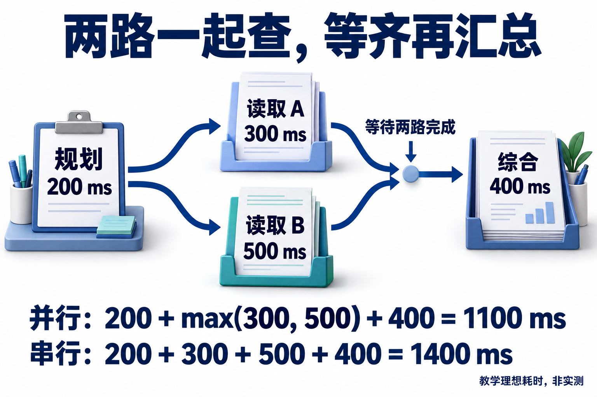

# 10 · 性能、预算与推理服务

## 性能要同时看任务路径和模型阶段

**Agent 性能**描述系统在一定资源条件下完成任务的速度与承载能力。**延迟（latency）** 关注一次请求或任务要等多久，**吞吐（throughput）** 关注单位时间处理多少工作；费用和质量又为优化设定了约束，几个指标需要一起看。

**关键路径**是依赖图中累计耗时最长的路径，它给出忽略额外资源等待时的完成时间下界。只有互不等待输入的工作才有并行空间。任务预算则由各分支共同消耗，需要统一记录和结算。

模型服务内部也有不同阶段：**prefill（预填充）** 主要处理已有输入，**decode（解码）** 逐步生成新 token；**KV Cache（Key-Value Cache，键值缓存）** 保存可复用的注意力中间表示。

## 首字更快，报告为什么仍然慢

助手第一句话很快就出现，完整报告却让人等了半分钟。你换了更快的模型，结果数据库开始排队。用户等的是任务完成，服务看板却只庆祝首 token；这两个计时器讲的是不同故事。

## 用依赖图分析 Agent 延迟

<div id="agent-延迟是一张依赖图"></div>

一次研究任务包括模型规划、两路资料读取和最终综合。假设规划 200ms、读取 A 为 300ms、读取 B 为 500ms、综合 400ms。两路读取都依赖规划，综合又依赖两路结果：

```text
规划 200 ─┬─ 读取A 300 ─┐
          └─ 读取B 500 ─┴─ 综合 400
串行：200+300+500+400=1400ms
理想并行：200+max(300,500)+400=1100ms
```

**1100ms 是固定耗时、资源充足时的关键路径下界。** 真实系统还会排队、建连接、遇到限流或重试，所以它可以作为比较基准，不是线上 p95 的承诺。

若 B 要用 A 返回的项目 ID，它们就必须先后执行。增加 Worker 无法让尚未出现的数据提前到场。先画出真实依赖，再决定并行位置，也要观察新增并发是否挤满了同一个下游。

为请求分别记录入队、模型开始、首 token、模型结束、工具开始/结束和最终终态，避免把首字快当任务完成快。p95 应注明统计对象和截止口径；模型阶段变快，也可能把瓶颈转移到数据库或外部搜索。

[](../website/assets/diagrams/advanced/A10-critical-path.png)

从规划处分成两路读取，再看它们汇合的位置：A 虽然更早结束，综合仍要等 B。图中用箭头表示依赖，不以物体大小表示耗时；下方公式使用上面的教学数字，未计排队、限流和重试。

## 区分四类缓存

| 层次 | 本章关注省掉哪段工作 | 失效或隔离条件 |
| --- | --- | --- |
| 模型 KV / 前缀缓存 | 匹配前缀的重复prefill，仍需动态后缀与decode | token 前缀、模型与运行配置、实现的共享策略 |
| 检索缓存 | 候选取得或排序，仍需内容选择与生成 | 索引版本、过滤条件、身份权限、有效时间 |
| 工具结果缓存 | 对应业务读取，其他依赖仍可能成为关键路径 | 参数、资源版本、时效与访问范围 |
| 最终答案缓存 | 可直接交付时省去生成，仍需当前资格校验 | 问题等价性、用户范围、证据与业务规则版本 |

**前缀缓存不是省略业务检查的理由。** 相同文本可能由不同用户提交；权限应在组装上下文与使用工具时落实，缓存实现也要按租户和敏感性设计共享范围。

缓存的延迟收益取决于命中发生在哪个节点、该节点是否仍在关键路径，以及节省的时间是否被排队或其他依赖覆盖。对vLLM APC也要分别测prefill、decode与逐出情况；不能只拿命中率预测总耗时。[vLLM APC](https://docs.vllm.ai/en/stable/features/automatic_prefix_caching/)

## 关键路径与缓存失效示例

<div id="已填的关键路径与失效表"></div>

用两地资料读取做一个手算设计。设海岚读取800ms、云洲1200ms、比较200ms，忽略排队与调度开销；这些是教学输入，不是本仓库或供应商实测。

| 方案 | 关键路径 | 理想完成时间 | 必要条件 |
| --- | --- | --- | --- |
| 串行 | 800+1200+200 | 2200ms | 两地证据都取得 |
| 独立读取并发 | max(800,1200)+200 | 1400ms | 共同条件已知、无数据依赖 |
| 海岚有有效结果缓存 | 0+1200+200 | 1400ms（忽略缓存开销） | 日期、类别、权限、资料版本均匹配 |

缓存不是统一开关。假设海岚条款被撤回：业务检索结果和由其生成的答案须重新验证；与其无关的工具目录schema可以继续使用，模型KV复用则由服务计算合同决定，不能把缓存的旧答案叫作“模型记忆”。

再将用户权限撤回，缓存键相同也不能继续返回受限结果。读取授权应重新检查，失效范围沿证据依赖传播；否则节省的延迟来自跳过必要工作。共享预算按任务扣减，失败分支也耗费配额，不能只记录成功返回的调用。

用`runtime_lab.py --scenario budget`复算理想路径与预算机制；线上优化另测首token、总耗时、排队、工具与重试。下面自部署推理部分是机制选读，本仓库未部署GPU服务，也不将理想1400ms作为线上承诺。

### Prefill 与 decode 为什么需要不同调度

**Prefill（提示预填充）** 处理已有输入，在各层计算历史位置的 K/V 及后续生成所需状态；**decode（逐步生成）** 在这些缓存上继续生成。以标准全注意力、因果掩码为教学模型，N 个输入位置有 `N(N+1)/2` 个允许的注意力位置对。后续生成一个位置时只需新 query 对已有 K/V 做注意力，长度约为当前上下文；历史位置的 K/V 无需每步重算。[Transformers 缓存机制](https://huggingface.co/docs/transformers/cache_explanation)说明缓存的追加与掩码条件。

注意力位置对不是完整 FLOPs 公式：投影、前馈网络、层数、头数、张量并行与算子实现也影响耗时。长输入 prefill 可并行处理多个位置，decode 则有“拿到上一个 token 才能推进下一个”的依赖；decode 还需访问不断增长的 KV。前者常有较高并行计算量，后者在部分小批量部署受内存带宽影响，但是否计算或带宽受限要看硬件、批量、模型和实测，不能固定贴标签。

把一次生成分解为 TTFT（从请求进入服务到首 token 的时间）与 TPOT（随后每个输出 token 的平均间隔）。对于输出 m 个 token：

```text
模型服务总时长 ≈ TTFT + (m-1)×TPOT
TTFT 包含所定义服务边界内的排队、prefill 与首 token 产生
```

若 TTFT=0.4秒、TPOT=.05秒、m=21，总时长约1.4秒。把 TTFT 减半只省.2秒；若输出变成201个 token，则原总时长10.4秒，同样只省.2秒。这里忽略网络缓冲并假设平均间隔固定，用于解释阶段贡献；Agent 的端到端时间还要包含工具与多轮调用，不能由首字体验代替。

## 自部署时，显存管理怎样影响调度

长上下文与并发请求会增加 KV 占用。PagedAttention 采用类似分页的管理思路，减少动态 KV 分配的碎片与冗余复制，使服务能够更灵活地管理请求；这是内存组织机制，与“返回上一次完整答案”属于不同层次。[PagedAttention 原论文](https://arxiv.org/abs/2309.06180)

批处理和连续调度可以改善设备利用率，但更大的批次也可能改变单请求等待。要同时观察吞吐、排队、首 token 和生成速度，不能只选一个最好看的数字。部署量化、并行和缓存配置时，还应使用自己的任务集检查格式、工具选择和最终结果是否退步。

使用托管模型时，应用仍需处理供应商的请求与 token 限额、429、退避和连接策略。自部署时，则要额外处理模型装载、KV 容量、调度、健康检查和资源竞争。两种模式都需要把失败费用与重试算进任务成本。

### 从整请求批处理到逐迭代批处理

固定整批请求若一直运行到最长序列结束，短序列完成后的槽位无法及时接入新请求。逐迭代调度在每轮生成结束时移出已完成序列、加入可容纳的新序列；一次调度的输出是这一轮各请求的 token 与更新后的 KV/完成状态，再重新选择下一轮。[Orca（OSDI 2022）原论文](https://www.usenix.org/conference/osdi22/presentation/yu)给出 iteration-level scheduling 的设计；它与分页 KV 是相互配合的机制，不能仅由用了 PagedAttention 就推断调度策略或收益。

长 prefill 与 decode 共享设备时，还要分配每轮 token 与 KV 预算。把长 prefill 分成较小块，可以避免单次长计算持续阻塞正在生成的请求；代价是它自己可能要多轮才能完成，TTFT 可能增加。vLLM 的[分块 prefill 文档](https://docs.vllm.ai/en/stable/configuration/optimization/#chunked-prefill)描述这类权衡，默认策略与参数随版本变化，应以实际部署版本核对。更大批量既可摊薄权重读取/调度开销，也会增加本轮工作与等待，最优点不能由“GPU利用率最高”单独决定。

实测应同时固定输入/输出长度分布与到达过程，记录每轮 token 数、活跃序列、KV 使用/逐出、TTFT、TPOT 和完成时间。只用一个同步长请求测试不暴露排队，只有吞吐数字也看不出短请求是否被长请求饿住。本章未运行 GPU 服务，以上是调度机理与测量合同。

## 从 KV 张量大小推导并发容量

先估算一个请求保存多少中间状态，再讨论能同时接多少请求。对各层尺寸相同、完整保留每个历史位置 K/V 的因果注意力实现，设层数 L、KV头数 H_kv、每头维度 D、已缓存长度 T、每个数值 b 字节，单请求的原始 KV 数据量近似为：

```text
KV_bytes = 2 × L × H_kv × D × T × b
           ↑K和V各一份
L=32，H_kv=8，D=128，T=8192，b=2
KV_bytes = 1,073,741,824字节 = 1 GiB
```

这组数仅用于手算张量容量，头数取实际 KV 头而不是查询头；共享KV头、滑动窗口、缓存量化、层尺寸差异或多设备切分需要按实际布局重算。[Transformers 缓存解释](https://huggingface.co/docs/transformers/cache_explanation)给出缓存 K/V 的形状与追加过程。上式未含模型权重、临时激活、调度和内存分配开销；不能把剩余显存除以1 GiB就宣布支持相同数量的线上请求，生成继续增长的 T 也会继续占空间。

分页管理把逻辑连续序列映射到物理块，避免为每条请求预留连续的最大长度区域；块表让注意力找到实际 K/V，未满末块仍可能有内部浪费。共享前缀时多个请求可引用同一块，续写发生分歧则需要各自保存后缀，不能让一个请求改坏另一个请求的缓存。这是[PagedAttention 原论文](https://arxiv.org/abs/2309.06180)的内存管理问题，不是省掉输出生成；[vLLM 缓存设计](https://docs.vllm.ai/en/stable/design/prefix_caching/)进一步描述块哈希、请求到块的映射、引用计数与回收队列。缓存命中后仍需分配可写后缀；逐出与重算会改变实际等待。

## 排队为何会抵消单次调用提速

对固定数量的普通工具Worker，先用简化容量模型：m个并行槽位，每项平均占用时间 `E[S]`，接收速率为每秒 λ 项，平均负载为 `ρ=λE[S]/m`。假设槽位同质、占用时间包含实际服务期间、没有额外共享瓶颈，`ρ<1` 才有长期排空积压的容量余地；它不是尾延迟保证，突发和时长波动仍会产生等待。GPU动态批处理的服务率会随批次与长度变化，不能直接套这个固定槽位模型。

例如两个槽位、每项平均0.5秒，持续容量约4项/秒；每秒接收5项且条件不变、没有取消或丢弃时，长期平均每秒多积压约1项，不可能靠无限加长队列恢复稳定。队列越长，请求轮到执行时越可能已超出期限；如果超时后调用方又重试，额外负载可能挤占真正的新工作。因此应在昂贵执行前限制在途数与队列长度，记录拒绝与等待，对剩余期限已不够的请求停止接单或按合同降级，而不是只调大超时。Google SRE 的[级联失败与队列管理](https://sre.google/sre-book/addressing-cascading-failures/)讨论有界排队与负载削减，[过载处理](https://sre.google/sre-book/handling-overload/)解释客户端节流；这些是容量保护方法，不自动给出本应用的参数。

调优时分别观察到达率、接收率、队列等待、服务时间、在途量和拒绝量。前缀复用减少 prefill，未必减少长输出占用；增加批次可能提高吞吐，同时让某些请求等待更久。应在固定长度分布、质量与负载下比较完整延迟分布；先低负载确认服务本身变快，再逐步加压找出积压起点。本章没有GPU和负载发生器实测，上述容量是明确假设下的推导，不能替代线上p95或显存上限测试。

### Little 定律连接平均在途量与等待

有界队列限制等待数量，满时拒绝/丢弃属于负载削减；背压则通过信号、等待或额度反馈使上游减速。前者保护本服务，后者试图让整条生产速度适应消费能力。返回429只有在调用方遵守退避、总重试预算且不形成同步重试峰值时，才产生有效反馈；无界立即重试可能把拒绝变成更多流量。两者可以配合，但不是同一个机制。[Google SRE 级联故障章](https://sre.google/sre-book/addressing-cascading-failures/)说明队列、过载和重试放大的关系。

在稳定长期窗口内，观察在途请求数 N(t)。曲线下的面积等于各请求在系统内停留时间之和（窗口边界未完成请求需作边界处理）。除以窗口长度，再拆成“完成请求数/窗口长度×平均停留时间”，得到 `L=λW`；相同论证只计算等待阶段则为 `Lq=λWq`。这里 λ 是同一系统边界内长期通过的速率，L、W 是均值，不能用入站含拒绝的速率乘完成请求耗时，也不能把 W 换成 p99。[MIT 排队论讲义中的面积推导](https://ocw.mit.edu/courses/1-225j-transportation-flow-systems-fall-2002/55cc67c8b32d96052f72a4a7ead51393_lec8queues.pdf)

例如稳定完成10项/秒、平均排队.2秒，对应平均排队2项。若队列持续增长，说明稳态前提不成立，直接套这个等式预测延迟会失真。这个关系可用来交叉检查监控口径，但没有给出等待分布；到达突发、服务时长波动和调度优先级不同，即使均值相同，尾部也可能很不同。服务入队与资源预算实现见[第16章](16-service-deployment-and-operations.md)。

### 并行与高命中率为什么仍可能拖慢 p99

等待所有分支的汇总时间取决于最大值。仅在 n 个分支耗时相互独立且同分布为 F 时，`P(max≤t)=F(t)^n`。10 个分支各有99%概率在 t 前完成，整项任务按时的概率仅 `.99^10≈90.44%`；整项要99%，每支需要约 `.99^(1/10)=99.8995%` 的按时概率。共享GPU、网络或限流通常使分支相关，此时不能套独立公式，应从关联 trace 计算；不要求独立的保守检查是“任一支超时概率≤各支超时概率之和”。这是[《The Tail at Scale》](https://research.google/pubs/the-tail-at-scale/)讨论的大规模扇出尾延迟问题，数值为本节假设下推导。

缓存也改变整个分布。教学分布设95%请求命中、耗时.1秒，其余5%未命中、耗时1秒，均值是 `.95×.1+.05×1=.145秒`，p99却仍是1秒。命中率很高不能推出 p99 达标；冷启动、逐出和重试还可能聚集在同一时段。串行阶段的 p99 也通常不能直接相加，应对每次请求的完整路径先求总耗时，再取分位数。

## 模型路由应有升级条件

可让较小模型处理有限类别路由、字段提取等任务，将已取证后的复杂推理交给能力更强的模型。但“模型自称很有把握”不是通用可靠的升级依据。先分类缺口：输入中已有日期但小模型漏提取，可在预算内升级提取；用户根本没有给日期，应澄清；资料未读到，应补读；同级权威来源在相同条件下真实冲突，应保留冲突并请求裁决，不能靠更大模型猜出唯一值。升级触发应是可验证的能力不足，如已给完整材料仍不能满足推理/校验合同，并结合预算与任务风险。[工具路由的待补参和冲突分流](05-tool-routing-and-mcp.md)采用相同边界。

例如研究助手先做轻量分类；多份条款需要按日期和适用条件联合解释时进入复杂路径。若简单路径输出引用无法支持结论，先停止交付，查明是漏取已有证据、尚未取得证据，还是证据真实矛盾，再选择升级、补读或冲突处理。评测要统计路由成本、误路由、升级后的额外上下文和两次调用的总费用。大模型不能补回根本没入库的文档，也不能代用户提供缺失条件。

同一任务可能通过少调用几次模型获得更大收益：能由确定性代码完成的过滤、去重和聚合，可以在明确合同下由程序处理；仍需判断证据含义时，再交给模型。这样改变的是工作分配，不是把所有模型决策都改成脚本。

## 共享预算，避免每个分支各花一遍

给主任务建立公共账本：最大模型调用、工具调用、预估/实际 token、费用和总期限。子任务创建前预留额度，调用结束后按实际用量结算，失败与重试同样计费。多个服务实例应通过一致性存储或原子预留执行，不能各自维护一个“还剩 1000”的副本。

总额度 1000，A 已预留 600，B 再要 500 就应被拒绝或重规划；改成 400 才能进入。两个 Worker 不能各按“余额 1000”独立扣减，必须通过共享账本原子预留额度。

取消也不是退款按钮。已提交的模型或工具仍可能运行并产生费用，未确认的用量应保留待结算状态。最后还要把预留上限、提供方计量与实际账单对起来，避免预算只在自己的日志中成立。

有界队列与背压把超量请求挡在昂贵执行前；超时传播应区分“停止等待”和“远端取消”。局部检索工具重试必须服从主任务剩余期限，而不是每次重新获得一套完整预算。高负载下可缩小候选、减少非关键探索或返回部分结果，但交付范围应与产品合同一致。

## 先做一项改动，再比较完整路径

基线可固定资料量、任务与版本，依次试验：独立读取并发、压缩冗余工具结果、稳定公共前缀、增加路由。每次只改一个主要因素，观察质量门槛、调用量、缓存命中、端到端耗时与成功成本。保留退步样本，尤其检查低频复杂任务是否被优化策略误伤。

### 缓存失效要沿依赖和权限传播

缓存记录不仅有 key/value，还要保存生成它的模型/适配器、输入或前缀、来源版本、工具合同、权限域等依赖。读取时先核对当前依赖与披露权限，不匹配则视为未命中；更新依赖后，旧结果可以留作历史，但不能继续进入新请求。TTL 只限制最长期限，不能保证政策更新或权限撤销后立即失效。前缀 KV 与最终答案各自的依赖不同，不能用同一失效规则概括。

验证缓存的收益应分开冷/暖请求，并固定任务、到达率和输出预算；同时记录合法命中率、失效后误用率、端到端 p99 与后端负载。若缓存命中带来更快入站、却使后续瓶颈排队增加，局部服务变快也未必改善用户完成时间。实验要核对结果/引用未退步，不能用返回快但错误的命中计作收益。

## 动手练习

画出一个含模型、三次检索和一次写入的 DAG，为每个节点指定估计耗时、预算与失败行为。给两路检索加入共享额度，再模拟限流和取消。输出理想关键路径、真实需要采集的时间点、预算对账表，以及一条在预算不足时停止探索的规则。

```bash
python3 examples/advanced/runtime_lab.py --scenario budget
```

## 自检

<details><summary>1. APC 命中是否让后续生成全部免费且即时完成？</summary>

不是；它复用前缀计算，输出生成、其他调用和服务计费仍需分别分析。
</details>
<details><summary>2. 两个 Worker 各看到剩余 1000，就能各花 600 吗？</summary>

不能，需要共享且原子的预留/结算，防止共同超额。
</details>
<details><summary>3. 并行下界 1100ms，线上 p95 就应是 1100ms 吗？</summary>

不是；下界来自固定假设，线上还含排队、资源竞争与错误恢复。
</details>

## 参考资料

[vLLM：Automatic Prefix Caching](https://docs.vllm.ai/en/stable/features/automatic_prefix_caching/) · [PagedAttention](https://arxiv.org/abs/2309.06180) · [上下文工程](03-context-engineering.md) · [机制实验](../examples/advanced/README.md)

[上一章](09-evaluation-and-feedback.md) · [下一章](11-security-and-governance.md) · [工程进阶目录](README.md)

[对应面试题：Q084、Q085、Q086](../docs/advanced/10-performance-and-serving.md)

## 对照案例：模型路由与模型客户端分工

[NVIDIA NeMo Switchyard](https://github.com/NVIDIA-NeMo/Switchyard)把路由决策与宿主模型客户端的执行职责分开。选择模型之后，消息历史、工具调用ID、供应商原生内容、错误处理与任务预算仍要保持完整；路由器返回一个模型名字，不会替应用完成这些合同。具体接口按采用版本核对，其演示服务也不能直接当作本手册的生产服务保证。

沿同一任务集比较固定模型与路由策略，报告最终成功任务、升级次数、整轮调用费用与延迟。便宜请求如果导致更多失败和重试，不能只凭单次token价格宣布节省。[第13章](13-model-api-and-output-contracts.md)实际拆解协议完整性，[第16章](16-service-deployment-and-operations.md)再绑定运行版本和服务状态。
