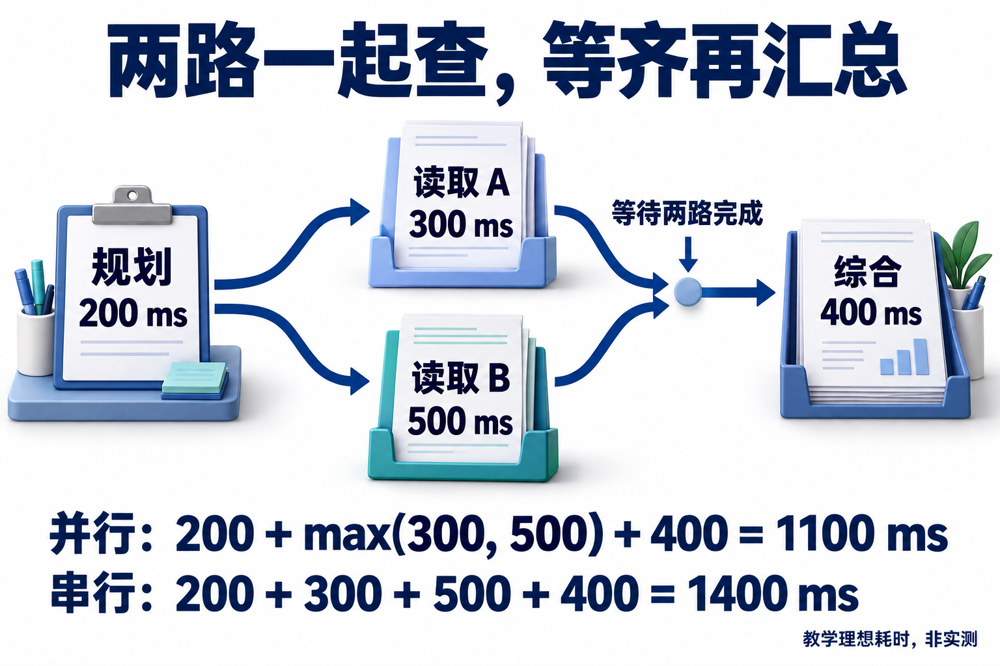

# 10 · 性能、预算与推理服务

**Agent 延迟由整条任务路径决定。** 模型、检索、工具和队列各占一部分。优化时先量等待发生在什么阶段，再看这一阶段是否卡住最终交付。

## 延迟边界与关键路径

分别记录接收、排队、模型首 token、生成结束、工具调用和可验收终态。流式输出还要区分模型首 token 与用户看到的首个内容。重试和等待审批的时间按清楚的口径记录。

依赖图中必须串联的步骤耗时相加。独立分支都要交付时，要等最晚的一条。用同一任务的实际轨迹计算路径，再汇总分位数。各阶段的 p95 通常来自不同任务，不能直接加成总 p95。

### 从轨迹定位该优化的等待

为每一步记录入队、实际开始和完成。用关联标识还原串行依赖与并行汇总。每条任务路径上，最晚结束的必要分支决定下一步何时能开始。同一个环节在有些任务上位于关键路径，在其他任务上可能被并行工作遮住。

把首内容、任务完成和外部写入确认分别统计。对等待用户的任务，可以另报机器活跃耗时。统计中断、超时和拒绝也要说明口径。比较两个版本时保持任务和负载一致。

## 缓存的用途与失效

| 缓存 | 复用的内容 | 要核对的条件 |
| --- | --- | --- |
| **单次生成的 KV 缓存** | 已处理位置的 Key 和 Value。 | 当前序列与缓存位置。 |
| **跨请求前缀缓存** | 共享前缀的中间计算。 | 模型与前缀是否可复用，隔离规则是否匹配。 |
| **检索缓存** | 查询候选和排序。 | 索引、范围、权限与查询条件。 |
| **工具结果缓存** | 已读取的外部数据。 | 资源版本、有效期和调用身份。 |

执行阶段的计算复用和业务数据复用各有失效条件。前缀命中通常能减少输入处理，不会省去新 token 的生成。资料撤回后要清理受影响的业务缓存，读取时仍按当前权限判断。

### 命中率和实际节省

记录命中覆盖了多少输入 token、避免了多少外部读取，以及失效多久才传播完成。一个高命中率的缓存如果只覆盖短前缀，对任务的总等待影响可能有限。长输出仍要逐步生成。

业务缓存键包含资料版本、查询条件、权限范围和必要的工具合同。授权更新时先挡住无权内容，再清理派生缓存。需要支持新版本快速读到时，测量发布到读路径生效的耗时。

## Prefill、Decode 与显存

Prefill 处理已有输入，通常更容易并行。Decode 逐步生成，需要反复读取已缓存的状态。逐迭代批处理可以让已完成请求离开，让新请求进入下一轮。要用实际负载观察吞吐、首 token 等待和生成速度。

常见因果模型每条序列的 KV 数据量可估为 `2×L×H_kv×D×T×b`。2 对应 Key 与 Value，L 是层数，H_kv 是键值头数，D 是头维度，T 是缓存位置数，b 是每元素字节数。实际还受分块、缓存精度、并行和其他显存开销影响。容量应按长度分布测量。

### 迭代批处理的调度方式

Prefill 一次处理多位置，计算可并行。Decode 每轮推进有限的新位置，频繁访问 KV。长输入的预填充可能在共享资源上推迟短生成请求。调度器可以分块预填充，并在生成迭代之间接纳或移除请求。应实测吞吐、TTFT 和 token 间隔。

KV 可以按块分配，再用映射找到每段序列对应的存储块。这样减少按最大序列长预留导致的浪费。可以逐步申请新的块，还要处理最后一块余量、元数据和并发内存峰值。估算公式从模型形状得出单条下界，整机仍需扣掉权重、临时张量和预留。

推算容量时，把每条活跃序列的真实缓存长度乘以每 token 的 KV 字节数，并加上其他开销。不同租户的复用也受隔离要求约束。显存压力过高时，关注换出、排队和重新计算对延迟的代价。

## 排队与尾部延迟

在稳定窗口内，Little 定律给出 `L=λW`。平均在途量等于同一边界的通过速率乘平均停留时间。只计算排队时，用平均队列长度和平均等待。持续积压时先处理过载，别用稳态等式预测尾部。

等待全部分支时，完成时间取各分支的最大值。若 n 个分支的耗时独立且同分布，全部在 t 前完成的概率是 `F(t)^n`。共享算力、网络或限流会让耗时相关。线上应从关联轨迹直接计算。

### 过载时控制进入速度

持续到达快于服务能力时，队列会扩大。加长超时只会让更多请求等在系统里。分别观察进入速率、完成速率、拒绝、队列深度和服务时间。用接收限制、队列上限和预算保护在途任务。把允许重试的信号和剩余期限一起返回。

Little 定律中的速率和停留时间必须来自同一个系统边界。计算平均排队量时，用实际进入队列并按定义离开的工作，避免把拒绝流量乘上完成任务的等待。均值只能交叉检查口径。尾部分位数还受突发负载和调度影响。

对扇出路径，在无法假定分支独立时，可以用「任一分支超时的概率不超过各分支超时概率之和」作为保守上界。实际尾部优先用同一次任务的联动轨迹测量。

## 模型路由与共享额度

为轻量路径写清升级条件。证据不足、校验失败或任务超出范围时，再升级模型或转人工。记录升级触发、回退次数和最终质量。

并发分支从同一预算预留额度，用完后按实际消耗结算。期限从同一个起点扣减。单机用单调时钟测经过时间。跨进程恢复时用明确的持久截止规则，避免直接搬用旧进程的时钟读数。

预算在派发前预留。重试、并行和升级模型都会消耗剩余额度。候选路径定价与调用计量要用同一口径。看升级之后是否提高完成率，以及成本主要花在成功、返工还是失败任务。

分开记录总期限、单次服务超时和累计活跃耗时。重启要能恢复剩余时间。调用取消可能只停止本地等待，实际在途资源要等服务端确认后再结算。

## 验证性能改动

用相同负载、长度分布、质量标准和权限比较。分别读队列等待、首 token、完整任务耗时和失败类型。先确认单环节提速，再验证整条链路的吞吐、费用和尾部有没有改善。

## 配套阅读

展开面试题、实验与资料

- [配套面试题](../docs/advanced/10-performance-and-serving.md)
- [机制实验](../examples/advanced/README.md)
- [一手资料](official-learning-map.md#进阶-10-的来源)

[上一章：09 · 评测与反馈](09-evaluation-and-feedback.md) · [工程进阶目录](README.md) · [下一章：11 · 安全与治理](11-security-and-governance.md)
