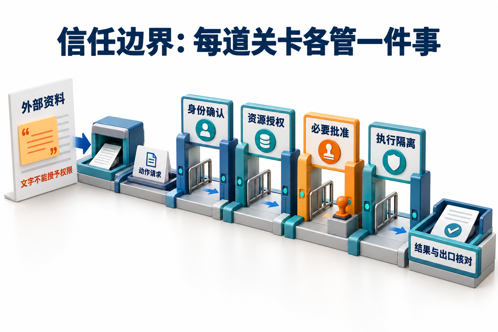

# 11 · 安全边界、授权与治理

**Agent 安全要控制数据流和实际动作。** 模型可以读取不同来源的信息，也可以提出工具请求。执行边界要按可信身份和当前规则判断能读什么、能改什么，以及结果可以交给谁。

## 信任边界与威胁结果

标出用户输入、外部资料、工具回包、任务状态和动作请求分别由谁控制。对不可信内容保留来源。进入摘要、记忆或其他 Agent 后，它的授权等级仍由可信系统决定。

安全验收需要可观察的条件。检查是否发生越权读取、外部披露、未批准写入、重复写入或策略越界。验证时也要检查授权内的工作是否还能正常完成。

### 不可信内容进入执行前的路径

跟踪原文从检索、摘要、记忆到下一轮上下文的过程。保存每次派生的来源和可信级别。摘要里的指令仍来自外部资料。把它转交给其他执行者时，也要带上来源。这样才能在新的会话继续区分操作要求和待分析数据。

分别确定每层应该拦住的行为。数据层控制可读范围，执行层控制能做的动作，交付层控制允许披露的内容。测试要读取受保护资源和实际外部结果，确认控制在哪一步生效。

## 逐层控制数据与动作

| 关口 | 要确认的内容 |
| --- | --- |
| **身份** | 当前请求实际代表哪个用户或服务。 |
| **授权** | 该主体可否对具体对象执行这项动作。 |
| **审批** | 指定动作和参数是否已获得有效批准。 |
| **隔离** | 执行器能访问的文件、网络和资源范围。 |
| **披露** | 输出是否允许交给当前接收方。 |

模型指令可以帮助识别不可信内容。即使模型判断失误，执行器仍按真实身份和资源范围检查。对需要人工批准的动作，展示实际变更和接收方。输出交付前再核对接收方是否有读取权限。

## 执行关口与委派

真实执行入口校验可信身份、动作、目标对象和当前条件。模型填写的身份和权限字段只当普通输入。恢复、直接调用和重试都经过同一关口。审批绑定具体对象、参数和版本。

委派范围取父任务权限、本次授权范围和接收服务策略的交集。凭据核对签发者、接收方、有效期及资源范围。连接通过后，服务仍要执行对象授权。输出给下游前，再检查内容是否可以传递。

### 约束可以逐级收窄

可信执行入口先确认动作类型，再将资源解析成服务能核对的对象。使用当前主体、对象状态与策略版本决定是否允许。缺少必要条件时拒绝执行，返回能复查的理由。

委派中的范围由真实凭据和下游规则共同决定。即使传入的任务说明要求更多动作，接收方仍只能使用已有能力。凭据范围要能落到实际资源。复核最小权限时，检查执行器能访问的最大范围。

## 授权检查与提交的一致性

权限检查通过后，对象可能换版，访问资格也可能被撤回。若业务对象与授权位于同一存储，要用合适的事务、版本条件或锁，让检查和写入遵守同一份规则。

远端服务不一定共享事务。提交前复核、短有效期和版本标记能缩小窗口。要求撤权后阻止新动作时，要从真实派发入口协调策略更新。已经派发的动作仍按外部回执核对。

### 先定义撤权从哪里生效

若检查与写入分开，中间可能发生权限撤回或对象换版。数据库内可通过锁或条件提交让两步遵守同一版本。资源服务在远端时，需要把检查放到它实际接收动作的位置，或通过统一执行入口控制提交。

明确撤权后是否禁止新的派发，以及如何处理已经受理的请求。停止本地等待后，保留需要查询的外部操作。审计同时保存策略生效时间和派发确认，以便判断动作属于哪个阶段。

## 工具与技能的来源

接入工具和技能前核对来源、版本、脚本与依赖。运行时只装载审过的版本。文件、凭据和网络使用最小范围。版本变化时重新检查访问和执行规则，再放到目标任务中验证。

### 升级时核对运行能力

把工具定义、脚本、依赖和运行身份作为同一交付检查。改动说明也可能改变路由选择和动作范围。升级后重跑允许与拒绝的同一批任务，检查选用路径和实际副作用。

撤回版本时停止新装载，核对在途执行和外部结果。对需要保留的证据记录来源、摘要和时间。日志的留存范围和读取权限同样要可解释。

## 审计、恢复与验收

记录动作标识、策略版本、审批依据、允许或拒绝原因，以及可核实的结果。敏感正文按访问规则处理，用证据标识支持回查。

验收覆盖撤权后的任务恢复、审批后参数变化、不可信资料进入任务，以及回执丢失后的执行状态。达到阻断条件时停止派发，保留允许恢复的入口和待确认操作。最后用可信后端核对影响。

为每项控制留独立验收条件。资格撤回后检查直接调用、计划恢复和旧缓存读取。审批变化后检查实际写入有没有发生。对正常工作同时量误拒绝与完成率，避免将所有操作拦下后误判防护提升。

## 配套阅读

展开面试题、实验与资料

- [配套面试题](../docs/advanced/11-security-and-governance.md)
- [政策实验](../examples/policy_agent/README.md)
- [一手资料](official-learning-map.md#进阶-11-的来源)

[上一章：10 · 性能与推理](10-performance-and-serving.md) · [工程进阶目录](README.md) · [下一章：12 · Agent 训练](12-agent-training.md)
