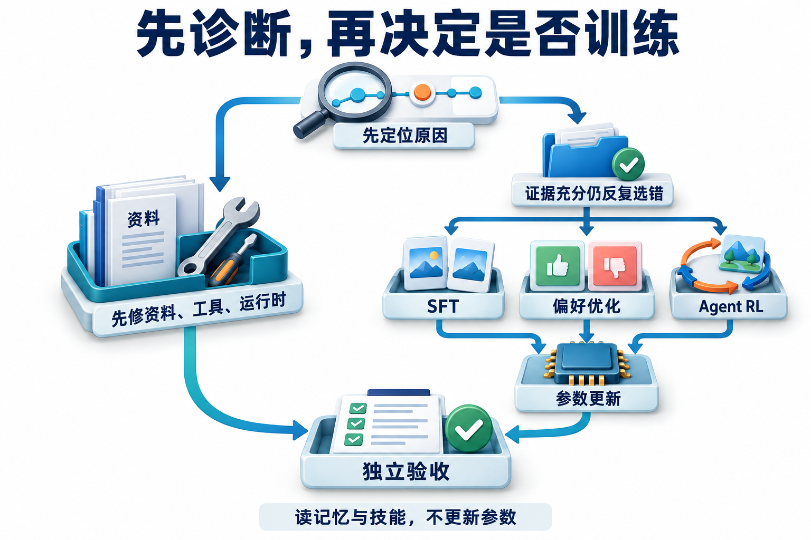

<div id="12--agent-优化与训练从失败证据到参数更新"></div>
<div id="参数训练改变什么策略又是什么"></div>
<div id="反思让答案变好是否已经训练"></div>
<div id="先确认你在优化哪一层"></div>

# 12 · Agent 优化与参数训练

**参数训练通过数据和目标函数改变模型的动作概率。** 优化前先定位失败。资料缺失要修检索，执行错误要查工具，条件丢失要改输入。模型在条件已齐全时仍反复做错，才有理由评估训练。

[](../website/assets/diagrams/advanced/A12-training.png)

<div id="用一条轨迹理解训练样本"></div>
<div id="两轮动作之间工具观察怎样进入-sft"></div>
<div id="从损失到一次小策略参数更新"></div>
<div id="一条动作与观察分开的候选训练样本"></div>
<div id="sft偏好与强化学习怎么选"></div>
<div id="行为克隆为什么会在自己的错误后失去方向"></div>

## 轨迹、监督目标与动作掩码

训练记录保留任务条件、模型动作、环境观察和真实结果。工具观察能影响后续动作，应作为上下文保留。只监督动作的配置中，工具观察位置从损失中排除。掩码与被预测的目标 token 对齐，也要处理填充和角色标记。

监督微调（SFT）从示范学习。示范通常提供正确的历史。模型部署后遇到自身动作造成的错误状态时，可能缺少恢复经验。训练数据也要覆盖失败后的纠正和停止。

### 从监督目标到参数更新

令 `mₜ` 表示当前位置是否计入损失。对一个批次，动作 NLL 可写为 `−Σ mₜ log πθ(yₜ|hₜ) / Σ mₜ`。hₜ 包含预测动作前实际可见的历史。没有有效目标的位置不贡献梯度。一个批次完全没有有效目标时，应明确跳过或报告数据错误。

同一段工具结果可以作为后续动作的输入，又在损失里被排除。构造标签时，对齐输入和下一个 token 的位置。检查训练模板、终止标记、截断方向和动作边界。错一位会把观察当成要模型模仿的输出。

对单个有效目标，写 `L=−z_y+log Σ exp(z_j)`，其中 z 是词表得分。对 z 求导会得到「预测概率减目标指示值」。这说明损失通过相对得分提高目标概率。语言模型共享参数，同时更新后还要检查其他任务的影响。

<div id="dpo-的比较量是相对参考策略的响应概率"></div>

## 偏好优化的比较量

DPO 在同一输入下比较偏好响应和另一条响应。分别计算当前策略与固定参考策略对两条响应的对数概率，再比较两者的差距。

```text
差距 = [log πθ(优选) − log πref(优选)] − [log πθ(另一项) − log πref(另一项)]
损失 = −log sigmoid(β × 差距)
```

响应对数概率是各目标动作 token 条件对数概率之和。按长度取平均会改变目标。

### 参考策略提供比较基准

两条响应在参考策略里原本就可能有不同概率。分别减去参考概率，可比较训练后相对原基准增加了多少偏好差距。β 调节这一差距的尺度。实际效果还取决于数据质量和训练配置。

共同输入包括指令、权限、资料与环境观察。比较多轮轨迹时，要明确哪些动作参与响应概率。不同外部条件形成的结果差异，先在偏好数据里拆开，否则会把取证难度和动作质量混成同一个标签。

<div id="从轨迹概率推导-return-与信用分配"></div>

## 强化学习与信用分配

策略按历史选择动作，环境返回观察和奖励。训练目标基于整条轨迹的回报。令 `Gₜ = Σᵤ≥ₜ γ^(u−t) rᵤ`，它表示从当前动作向后累计的折扣回报。对从起点计算折扣的目标，动作的梯度权重还包含 `γ^t`。

单条采样轨迹的梯度贡献为 `Σₜ γ^t × ∇log πθ(aₜ|hₜ) × (Gₜ−b(hₜ))`。基线 b 只依赖已有历史。给定历史时，对动作概率求和恒为 1，对应梯度的期望为 0。因此减基线可以降低估计波动，期望梯度保持不变。计算时将回报和基线作为已给数值。

终态失败未必能定位哪步出错。需要更细的过程反馈时，要验证这个反馈是否真的改善交付。用动作、观察和外部结果对照奖励，防止训练只提高评分信号。

### 环境的结果也会影响后续动作

轨迹概率由初始状态、策略选择动作的概率和环境转移概率组成。环境概率与 θ 无关时，对数概率求导只剩策略项。工具观察仍改变下一轮历史。训练时既要记录实际观察，也要保证动作能和随后状态对应。

回报从当前动作向后累积。终态奖励会分配给多个此前动作。仅有一次好的或坏的结果，无法判断这些动作单独是否有效。对比相同状态下的可执行选择、检查结果和证据，可以协助判断要收集哪类样本。真实信用分配还取决于目标和估计方法。

<div id="grpo-的组内相对信号"></div>
<div id="旧策略新策略与正负优势如何进入裁剪项"></div>
<div id="加入明确方向的-kl算出完整教学目标"></div>
<div id="旧轨迹什么时候能用于新策略"></div>

## GRPO、裁剪和旧轨迹

常见 GRPO 做法对同一输入采样多条输出，用组内相对得分估计优势。可以先减去组内奖励均值，再按组内标准差缩放。组内分数一致时，要按实现约定处理零方差。

旧策略生成样本，并提供原动作概率。当前策略与旧策略的概率比值记为 `r`，优势记为 `A`。常见裁剪代理项为 `min(rA, clip(r,1−ε,1+ε)A)`。

### 正负优势触发不同的裁剪边界

对正优势，概率比高于上界后，继续提高动作概率不会增加该项代理收益。对负优势，概率比低于下界后，继续压低动作概率也不会增加该项收益。反向变化仍可能保留梯度。KL 项还可能继续推动参数变化。

比率分母来自采样时的旧策略。与参考分布的 KL 则用于度量当前策略偏移。两者可以来自不同版本。要保存采样 log 概率、动作位置和参考版本。拿更新后的参数重算旧概率会让比率失去原来的参照。

### 从可枚举分布核对 KL

直接枚举当前分布 P 与参考分布 Q 时，`KL(P||Q)=Σₐ P(a) log(P(a)/Q(a))`。某个状态只有两种动作时，可用概率 p、q 表示。枚举两项得到 `p log(p/q) + (1−p) log((1−p)/(1−q))`。

这可单独验证 KL 方向与系数。原始 GRPO 用采样估计，按同题输出与各自长度归一。核对实现时，分别检查 KL 方向、估计方式和均值单位。

### 旧轨迹的支持范围

用其他行为策略生成的轨迹估计当前策略，要求目标动作在行为数据的支持范围内。完整轨迹比是各动作比率的乘积。轨迹长时，估计容易被极少数权重很高的样本主导。裁剪能控制一部分波动，同时会改变估计目标。

<div id="新方向让部署时的-harness-参与训练"></div>

## 从运行框架取得训练记录

执行框架仍负责工具、上下文和环境交互。训练侧从留存的模型请求、响应和任务结果里构造样本。记录每次独立推理及动作边界。具体训练管线按自己的采样和筛选规则入训。Agent Lightning v1.0 技术报告按同次任务采样和相同提示，只把最后一次模型请求用于组装训练样本。审计记录仍要能追溯各次独立推理和最终取用结果。

采集时保留原始模型调用、工具观察和实际被采纳的输出，再决定怎样组装动作序列。重新分词可能改变前缀；裁剪历史可能让训练环境和真实运行不一致。构造完样本后核对任务、动作掩码、行为概率和结果是否仍对应。

<div id="防止模型学会骗过检查"></div>
<div id="动手练习"></div>
<div id="自检"></div>

## 独立验证训练结果

训练验证区分离线目标下降、独立任务改善和真实部署表现。固定验收条件，重置任务环境后执行新尝试。检查外部结果、禁止行为和成本。权限和执行边界照常生效。配套数值实验可以复算掩码、损失和参数更新，真实模型的能力需要独立运行验证。

验证器读取权威对象、证据和执行记录，按冻结规则判断。开放式质量可以辅助评分。权限和副作用采用单独的验收，避免高分抵消越界。按来源分组留出任务，也保留能暴露常见评分误差的回归集。

<div id="参考资料"></div>

## 配套阅读

<details><summary>展开面试题、实验与资料</summary>

- [配套面试题](../docs/advanced/12-agent-training.md)
- [实验说明与复算](../examples/advanced/training-objectives.md)
- [一手资料](official-learning-map.md#进阶-12-的来源)

</details>

[上一章：11 · 安全与治理](11-security-and-governance.md) · [工程进阶目录](README.md) · [下一章：13 · 模型 API 与输出合同](13-model-api-and-output-contracts.md)
