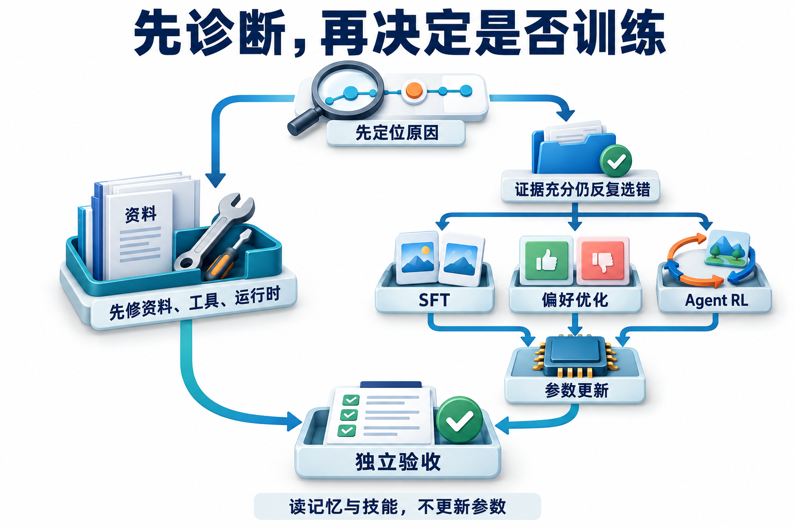

# 12 · Agent 优化与训练：从失败证据到参数更新

## 参数训练改变什么，策略又是什么

**Agent 优化**包括改进资料、工具、运行机制、提示和模型，使系统更好地完成任务。**参数训练**是其中一类方法，通过训练目标与优化过程更新模型参数；读取新记忆、修改提示或升级技能，也能改变行为，但改变的是另一层对象。

几种训练方法使用不同学习信号。**SFT（Supervised Fine-Tuning，监督微调）** 用示范学习目标行为；**DPO（Direct Preference Optimization，直接偏好优化）** 比较同一任务的候选输出哪个更符合偏好，让模型在训练中更倾向于被偏好的输出。

**策略（policy）** 描述模型面对当前信息时怎样选择回答、工具和参数等动作。**RL（Reinforcement Learning，强化学习）** 利用交互得到的奖励，调整模型在不同状态下怎样选动作。讨论 Agent RL 时，还要把工具交互、环境状态和轨迹纳入学习过程。

**能够改变行为，不等于已经发生训练。**

<div id="反思让答案变好是否已经训练"></div>

## 先确认你在优化哪一层

先固定输入和任务要求，检查实际改变的对象：资料是否可用、工具合同是否正确、运行时是否传入必要条件，以及参数是否确实更新。环境或证据缺失时，应先修对应环节；在条件充分时仍反复出现稳定行为错误，才有依据评估参数训练。

| 改动 | 改变的对象 | 需要的证据 |
| --- | --- | --- |
| 修索引、过滤和工具 | 环境与执行合同 | 文档是否可见、版本是否有效、结果是否正确 |
| 改提示、技能或记忆 | 推理时可读取的信息与过程知识 | 相同任务上的行为变化、失败与回归 |
| SFT | 参数对示范行为的拟合 | 高质量示范、独立集合表现 |
| 偏好优化 | 参数对候选相对质量的偏向 | 同任务可比较的偏好数据和评价规则 |
| Agent RL | 参数在环境交互与奖励下的策略 | 完整轨迹、奖励、行为概率和训练稳定性 |

模型读了反思文字后改变回答，不足以证明权重更新；一次自动修改提示也不等于 RL。讨论“自进化”时，先指出被修改的文件、参数、工具或策略，再说明如何验收和回滚。

[](../website/assets/diagrams/advanced/A12-training.png)

先看上面的分叉：缺资料、工具错误，应先修对应环节；环境与证据充分后仍反复出现策略错误，再考虑参数学习。三种训练路线依据信号选择，不是必须依次走完；本章的小实验用于理解目标与梯度，未提供真实 LLM 参数训练管线。

## 用一条轨迹理解训练样本

**交互轨迹（trajectory）** 按顺序记录任务中的决策、工具调用和返回信息。训练时尤其要区分**动作**与**观察**：前者由策略产生，后者由工具或环境提供；哪些内容作为输入、哪些内容作为学习目标，需要明确标注。

把“检索→发现版本冲突→再次检索→比较→生成草稿”这条轨迹拆开看：哪些 token 是模型做出的动作，哪些是工具返回的观察，哪些消息由运行时插入，奖励又从哪里来？先标清角色，训练目标才有依据。

工具回包可以是模型决策的条件，却不能因为出现在同一份日志里就都变成待生成目标。像排练时演员要学习自己的台词，不必把舞台管理员的报时也背成角色独白。

给每次调用记录任务/轨迹/请求 ID、模型与采样版本、输入、输出、工具观察和奖励来源。若只保存最终漂亮回答，就失去工具选择、错误恢复和行为概率的上下文；若无区分拼接全部日志，又可能把工具回包当成模型动作。

清洗时检查错误证据、敏感信息、重复模板、近重复任务以及可被模型修改的评分结果。训练与测试应按任务、文档或环境场景分组切分，不能把同一轨迹的不同切片随意分到两边。

### 两轮动作之间，工具观察怎样进入 SFT

把一次正确查询压缩成两轮模型动作。下表的“查、制度、未、超标”是四个**教学词元**，不是任何真实分词器的切分；模型先请求查制度，工具返回上限，模型再回答。真实训练还要校验工具调用格式、角色模板和分词结果。

| 顺序 | 产生者与内容 | 作为后续条件输入 | 本例目标掩码 `m` | 正确目标的条件概率 |
| --- | --- | --- | --- | --- |
| 用户问题 | 用户：650 元是否超标 | 是 | 0 | 不计目标损失 |
| 第一次动作 | 模型：`[查, 制度]` | 是 | `[1,1]` | `[0.5,0.25]` |
| 环境观察 | 工具：`[上限,700]` | 是 | `[0,0]` | 不计目标损失 |
| 第二次动作 | 模型：`[未, 超标]` | 是 | `[1,1]` | `[0.8,0.5]` |

监督微调在给定正确历史的条件下，增加正确动作 token 的概率。下面使用**负对数似然（Negative Log-Likelihood，NLL）**：正确目标概率越小，`-ln(p)` 越大。本例选择“只学习模型动作”的目标，`h_t` 是预测目标 `y_t` 前可见的历史，`m_t` 决定该目标是否计入损失；角色标记和填充位置也应按训练合同处理。掩码要与**被预测的目标 token**对齐，不能把输入与下一 token 标签错开一位。

```text
L_SFT = -sum_t[m_t × ln πθ(y_t | h_t)] / sum_t m_t
      = -(ln 0.5 + ln 0.25 + ln 0.8 + ln 0.5) / 4
      = ln(20) / 4 ≈ 0.748933
```

分母是四个动作目标，不是两次模型调用。**目标掩码不是注意力掩码：工具观察仍在后续历史里，只是不要求模型把它当自己的台词生成。** 在固定动作概率的前提下，给被忽略的位置填不同目标不会直接改变此损失；真实模型若读到不同工具内容，后续动作概率仍可能改变。[TRL SFT 文档](https://huggingface.co/docs/trl/sft_trainer)的 assistant-only loss 需配合能提供相应 generation mask 的聊天模板，不能只设置角色名称就假定掩码正确；本例是明确选择的训练合同，不是所有 SFT 数据的统一默认值。

### 从损失到一次小策略参数更新

自然对数的导数为 `d ln(p)/dp=1/p`，梯度下降按 `参数←参数−学习率×梯度` 更新参数。

先用每个动作位置各有一个参数 `z` 的二选一表格策略代替 LLM。`p=sigmoid(z)=1/(1+exp(-z))` 是候选 1 的概率，候选 0 的概率为 `1-p`；四个位置的目标标签取 `[1,0,1,0]`，初始 `z=[0,ln3,ln4,0]`，所以正确目标概率恰好是上表四个数。这里的 0/1 是各位置候选的标号，不能当成真实模型全局词表 ID。

单个位置的二元交叉熵为 `-[y ln p+(1-y) ln(1-p)]`。利用 `dp/dz=p(1-p)`，四个位置均值损失的梯度是 `dL/dz_j=(p_j-y_j)/4`，得到 `[-0.125,0.1875,-0.05,0.125]`。取教学学习率 0.4，更新后 `z≈[0.05,1.023612,1.406294,-0.05]`；程序复算同一批目标的损失约为 `0.721668`，低于更新前的 `0.748933`。

这个例子确实更新了四个数值参数，但各位置参数独立，没有 Transformer、共享表示或环境采样。它只验证这一固定样本目标的一步下降，不证明新问题、工具调用或真实语言模型表现改善。[实验说明与复算](../examples/advanced/training-objectives.md)

## 一条动作与观察分开的候选训练样本

以“批准后创建咨询工单”为例，把记录拆成四部分。下面是教学示意；真实样本必须来自对应的执行过程。

| 部分 | 应记录什么 |
| --- | --- |
| 当前输入 | 用户要求、出差条件、已取得的住宿条款，以及针对具体草稿的有效批准 |
| 候选动作 | 按已批准草稿请求创建咨询工单 |
| 环境观察 | 工具返回的真实结果，例如创建成功及可重新查询的工单对象 |
| 结果核对 | 同一操作只对应一份工单，且内容与批准时一致 |

候选动作来自策略，环境观察必须由工具记录。批准、身份和操作标识由运行时提供，不能训练成模型可以自行授予的内容。SFT可以使用合格动作示范；构造偏好对时应固定相同输入，例如在“尚未取得批准”的条件下，比较“暂停等待”和“擅自调用或声称成功”。不能把批准条件不同的两次尝试直接配成一对。真实 Agent RL 还需要交互环境、奖励和训练实现，本章的小策略计算不提供这些真实模型训练管线。

奖励漏洞示范：若只奖励答案含“已创建”，不调用工具也能得分。若只奖励对象数1，却不检查内容，错误金额的对象也会得分。改为先检查授权、证据、参数一致性、对应意图对象数，再在合格任务内比较成本；关键失败直接不通过。变式是650改800但未重新批准：正确行为为暂停，不能因少创建了一张就罚成失败。

训练决策应由稳定失败类型驱动：没入库先改资料，工具参数模糊先改合同；充分证据下仍反复违反稳定行为才考虑参数学习。组内信号算例只演示相对奖励计算，不证明已经实现完整GRPO。

## SFT、偏好与强化学习怎么选

有稳定成功轨迹时，可以用 SFT 学习工具选择与输出行为，但要保留失败条件和场景覆盖。只训练最短的成功样本，可能让模型学会忽略边界或不再澄清。

### 行为克隆为什么会在自己的错误后失去方向

**行为克隆（behavior cloning）**是在示范历史 h 上学习示范动作 a，SFT 是实现这种目标的一种方式。训练最小化 `E_(h,a)~D_demo[-log πθ(a|h)]`；部署时历史却由模型自己的先前动作与工具反馈产生，分布成为 `d_π`。示范中每步都走对的历史，未必覆盖模型误选工具后遇到的历史；即使每步平均错误较小，也不能从示范分布上的损失直接推出长任务成功率。

数据构造要保留决策时真正可见的前缀，把正确动作设为目标；不要把后续才读到的答案提前塞进输入。按整条任务/来源族划分训练与保留集，覆盖澄清、拒绝、读取失败后的恢复及正常完成，避免同一轨迹的多个前缀跨集合泄漏。成功样本筛选可以去掉错误示范，但只留下顺利通关的样本又会删除恢复状态；这是数据覆盖的取舍，不是再训练几轮就能修好。

[DAgger 原论文（AISTATS 2011）](https://proceedings.mlr.press/v15/ross11a.html)针对这种由策略诱导的分布偏移，迭代收集当前策略实际访问的状态、请参考策略给动作标签，再聚合数据训练。对 Agent 可据此设计受限环境中的纠错采样，但人工/参考策略可能无法可靠标注所有状态，真实副作用也不能为收集数据而随意执行。本章没有实现 DAgger；验证应分别测示范样式任务与偏离后恢复任务，而不只报 teacher-forcing loss。

同一请求下有两个可比较候选时，可以建立偏好对。先说清为什么一个更好：是引用有效、条件完整，还是只是语言更顺？“引用完整但稍慢”和“很快却缺证据”怎样排序，应由任务标准决定，不能交给字符串长度投票。

DPO 用偏好数据与参考策略关系优化参数，将偏好直接写成模型训练目标，不需要先拟合单独的奖励模型，再用该模型进行强化学习更新。省去奖励模型并不会省掉数据判断：候选质量与偏好标准仍决定学习方向。[DPO 原论文](https://arxiv.org/abs/2305.18290)

### DPO 的比较量是相对参考策略的响应概率

固定同一输入 x、偏好响应 `y_w` 和被拒响应 `y_l`，原始 DPO 的单对目标为：

```text
z = β × [(log πθ(y_w|x) - log πref(y_w|x))
       - (log πθ(y_l|x) - log πref(y_l|x))]
L_DPO = -log sigmoid(z)，β>0，πref 固定
```

参考策略提供两种响应原本的相对概率基准。DPO 增加的是相对该基准的偏好差距；从带 KL 约束的奖励目标和 Bradley–Terry 偏好模型出发，响应共同的归一化项在两者相减时消掉，得到上式。该推导有偏好模型与支持集等假设，不是任意偏好排序都等于真实任务奖励。[DPO v2 §4、式7及附录A](https://arxiv.org/html/2305.18290v2#S4)

这里 `log π(y|x)` 是响应动作 token 的条件 log 概率之和，包含选定序列结束方式；原始目标没有随意按长度取平均。长响应含更多项，换成长度平均就改变了目标，需另说变体依据。多轮样本还要定义共同历史、哪些 token 是模型动作、工具观察如何固定；工具返回属于环境，不能当成策略输出的概率连乘项。偏好对若用了不同资料、权限或环境，学到的差异就不只来自行为质量。

手算一个仅有两种响应的二元小策略：`πref=(.5,.5)`，`πθ=(.6,.4)`，β=1，第一种为偏好响应。于是 `z=ln(1.5)`、`sigmoid(z)=.6`、损失 `-ln(.6)≈.510826`。令 `πθ(y_w)=sigmoid(θ)`，则 `∂L/∂θ=sigmoid(z)-1=-.4`；学习率.2使 `θ` 从 `.405465` 变成 `.485465`，新损失约 `.479589`。这是两种响应互补、参考均匀时的解析算例；真实语言模型共享参数，不能假定每对响应都有一个独立 logit。

Agent RL 进一步让策略与环境交互后接受奖励。长任务可能只有最终奖励，导致一次失败究竟该归因给检索、计划还是汇总难以判断；这就是信用分配问题的一部分。工具不可用、评测规则错误或环境状态变化，也会污染奖励解释。

### 从轨迹概率推导 return 与信用分配

设有限任务轨迹为 `τ=(h0,a0,r0,h1,a1,r1,...)`，h 包含截至此刻可用历史，a 是模型动作。若环境转移 P 与参数 θ 无关：

```text
pθ(τ) = p(h0) × Π_t [πθ(a_t|h_t) P(h_(t+1),r_t|h_t,a_t)]
∇θ log pθ(τ) = Σ_t ∇θ log πθ(a_t|h_t)
J(θ) = E_τ[Σ_t γ^t r_t]，0≤γ≤1
G_t = Σ_(u≥t) γ^(u-t) r_u
∇J = E_τ[Σ_t γ^t ∇log πθ(a_t|h_t) (G_t-b(h_t))]
```

第一行取 log 后，环境项对 θ 的导数为零，因此工具观察影响后续决策，却不成为策略动作目标。用未来 return `G_t` 替代整条奖励，是因为过去奖励不能被当前动作改变；减去只依赖历史、不依赖当前动作的 baseline b 不改变期望梯度，因为 `Σ_a π(a|h)∇log π(a|h)=∇Σ_aπ(a|h)=0`。计算策略梯度时把采样得到的 return 与 baseline 视为已给数值、停止对它们反传；价值模型可有独立损失，不能把上式误读为对整个 `logπ×(G-b)` 连同 b 求导。

这里外层 `γ^t` 对应从起点折扣的 J，不能在保留同一个目标时无说明删掉；有的实现采用不同状态权重或不折扣任务目标，需要单列定义。[策略梯度原论文](https://proceedings.neurips.cc/paper_files/paper/1999/hash/464d828b85b0bed98e80ade0a5c43b0f-Abstract.html)给出价值/优势辅助估计的理论依据，本节是有限轨迹下的直接推导。

例如三步奖励 `[0,0,1]`、γ=.9，return 为 `[.81,.9,1]`。终态奖励会传向早期动作，但一次采样的失败不能证明每一步都错；baseline 降低噪声也不自动找出真正原因。更细的过程奖励能提供局部信号，却必须验证这些中间指标确实服务最终目标，否则会鼓励重复搜索或伪造进度。可用同状态不同动作的受控比较、工具结果检查和失败分段帮助诊断；它们是奖励/评测设计，不能冒称已完成因果信用分配。

## GRPO 的组内相对信号

**GRPO（Group Relative Policy Optimization，组相对策略优化）** 的原始设计使用同一问题的一组输出作为比较基准，减少对单独价值模型的依赖。[DeepSeekMath](https://arxiv.org/html/2402.03300v3) 看一个简化的标准化步骤：同题四条轨迹奖励为 `[0,0,1,1]`，均值 0.5、总体标准差 0.5，得到相对值 `[-1,-1,1,1]`。

这一步像看同场选手相对组均值的位置，得到的是比较信号，还没有完成训练。真正更新参数时，还要计算策略概率比、裁剪、正则以及具体实现使用的归一化。**把四个奖励标准化，不能称为已经跑通 GRPO。**

若同组全为 0，相对差异也为零，说明这组样本没有提供区分信号；其他损失项仍需单独分析，不能由此推断全部梯度为零。此时先检查任务是否过难、奖励是否失灵，比机械增加采样更有信息。

有时更该修任务难度与奖励：必要资料缺失或工具确定不可用时，重复采样不能补足这些条件；但当前一组全失败，也不能推出后续采样必定失败。应先区分结构性缺口与低概率成功，再决定改任务、奖励还是采样预算。组内输出长度差异、不同轨迹的调用数和 token 数，也影响如何公平归一化与分配最终奖励。

### 旧策略、新策略与正负优势如何进入裁剪项

优势 `A` 表达一个已采样动作相对基准好多少；正值希望提高它的概率，负值希望降低。采样时的**旧策略** `π_old` 在本次更新中冻结；**当前策略** `πθ` 随参数改变，同一动作、同一历史上的比值为 `r=πθ(a|h)/π_old(a|h)`。优势在求这一轮梯度时也作为已给定数值，不能一边更新参数一边悄悄改基准。

[DeepSeekMath v3 §4.1、式(3)](https://arxiv.org/html/2402.03300v3#S4.SS1) 使用的裁剪代理项可单独写成下面的 `s`；优化器若做梯度下降，要最小化其负值。`ε=0.2` 是本例的教学设置，不是所有任务的最佳值。

```text
s(r,A) = min(r×A, clip(r,1-ε,1+ε)×A)
L_policy = -mean(s)
```

下面四行是四个**不同状态**里的固定动作样本，每个状态只有一个动作位置，优势已经给定；不是把上一组奖励自动变成这四个优势。旧策略对已采样动作的概率均为 0.5，当前概率与计算如下：

| 状态 | 当前动作概率 | `r` | `A` | `r×A` | `clip(r)×A` | `s=min(...)` |
| --- | ---: | ---: | ---: | ---: | ---: | ---: |
| S1 | 0.7 | 1.4 | +1 | 1.4 | 1.2 | 1.2 |
| S2 | 0.3 | 0.6 | -1 | -0.6 | -0.8 | -0.8 |
| S3 | 0.3 | 0.6 | +1 | 0.6 | 0.8 | 0.6 |
| S4 | 0.7 | 1.4 | -1 | -1.4 | -1.2 | -1.4 |

S1 已把好动作提高得较多，代理项不再奖励继续提高；S2 已把坏动作降低得较多，代理项不再奖励继续降低。S3 把好动作降了、S4 把坏动作升了，这两个不利方向仍保留梯度。因此不能把裁剪理解为“比值出了区间就一律无梯度”。四项之和为 -0.4，故 `L_policy=-(-0.4)/4=0.1`；它是代理损失，可以为负，不是正确率或概率。

### 加入明确方向的 KL，算出完整教学目标

**参考策略** `π_ref` 用来限制当前策略偏离选定基准，它与生成样本的旧策略承担不同职责，两者不必相同。**KL 散度（Kullback–Leibler divergence）**在这里度量两个完整概率分布的偏离，方向不能交换。为能完整复算，本例每个状态都用独立二元分布，四个已采样动作都标为候选 1；参考策略的候选 1 概率 `q` 也取 0.5。这里计算 `KL(当前 || 参考)`，不是仅比较已采样动作的两个概率。

```text
D_j = p_j ln(p_j/q_j) + (1-p_j) ln[(1-p_j)/(1-q_j)]
L_toy = -(s1+s2+s3+s4)/4 + β(D1+D2+D3+D4)/4
β = 0.1
D_j = 0.7 ln(1.4)+0.3 ln(0.6) ≈ 0.082283（四个状态相同）
L_toy ≈ 0.1 + 0.1×0.082283 = 0.108228
```

这个**完整的小策略目标**规定了方向、系数和均值单位：四个状态等权，每个状态一个动作。DeepSeekMath v3 原式按同题输出及各自输出长度平均，并使用其采样 KL 估计；真实带工具实现还需规定哪些位置属于动作、哪些属于观察，以及截断和多轮调用怎样归一化。本例改用可枚举的精确二元 KL，没有复现其采样、优势估计或完整优化过程；[TRL 的 Loss Types](https://huggingface.co/docs/trl/grpo_trainer#loss-types)也区分多种归一化，不能把本例写成唯一 GRPO 公式。

把四个二元分布写成 `p_j=sigmoid(z_j)`。未触发平坦裁剪时，`ds_j/dz_j=A_j×(dp_j/dz_j)/0.5`；S1、S2 的代理项在当前点为平坦段，导数为 0。精确 KL 的导数是 `dD_j/dz_j=p_j(1-p_j)×[z_j-logit(q_j)]`，其中 `logit(q)=ln[q/(1-q)]`；两项组合后还要除以四。

程序得到 `dL_toy/dz≈[0.004448,-0.004448,-0.109448,0.109448]`。仍取学习率 0.4，沿负梯度更新后，同一目标约从 `0.108228` 降到 `0.098556`。S1、S2 仍可能因 KL 项移动，这也解释了为何“相对奖励项没有信号”不能推出“总梯度为零”。恰好在裁剪拐点处没有唯一普通导数；实验选择平坦侧的 0 作为次梯度，有限差分检查避开拐点。

### 旧轨迹什么时候能用于新策略

**On-policy（同策略）**用当前采样策略产生的数据估计其目标；**off-policy（异策略）**的数据来自另一行为策略 μ。若环境相同且目标策略可能选择的轨迹在 μ 下都有正概率，可用轨迹比 `w(τ)=Π_t πθ(a_t|h_t)/μ(a_t|h_t)` 把 μ 下期望改写为目标策略期望。两个动作比为1.2和.8，整条比是.96；长轨迹连乘可能产生极大或极小权重，导致估计方差很高，缺失支持则无法靠权重补回未见动作。重要性采样及其方差问题见[Thomas 与 Brunskill，ICML 2016 §2](https://proceedings.mlr.press/v48/thomasa16.html)。

PPO/原始 GRPO 通常先用固定旧策略采一批，再以存下的旧动作 log 概率计算比率，做有限轮更新后重新采样。[PPO 原论文](https://arxiv.org/abs/1707.06347)说明交替采样与多轮代理目标优化。前面的逐 token 裁剪代理项并不等于整条轨迹的无偏重要性采样；裁剪有意改变目标，限制部分更新收益，也不保证全局 KL 或所有概率比都落在边界。把旧概率随新参数重算会让比率恒为1，丢掉这个参照。

日志因此要绑定行为模型、分词器、prompt、实际动作 token、采样/掩码规则与旧 log 概率。离线日志缺这些信息、工具环境已经变了或只保留成功轨迹时，不能直接当作新策略的同策略样本。恢复观察 token、动作边界和样本选择合同见下一节；离线拟合分数提高仍需新 rollout 和独立验证，本章没有这些真实模型实验。

## 新方向：让部署时的 Harness 参与训练

Agent Lightning 原始论文强调将执行与训练解耦，并把复杂轨迹转换为可训练的交互数据。[原始论文](https://arxiv.org/abs/2508.03680) v1.0 则进一步围绕 harnessed agentic RL：部署用的 harness 继续拥有工具、上下文与环境交互循环，训练系统通过请求/响应边界获取样本，而不是另写一套完全不同的交互循环。[v1.0 论文](https://arxiv.org/abs/2608.17528)

这让训练更接近实际使用，也带来新的数据问题：重新分词可能破坏 token 前缀一致性；多次模型调用怎样合并为训练样本；同题不同轨迹如何算优势与损失。**具体实现要与设计建议分开：** [Agent Lightning v1.0 技术报告 v1 §3.2](https://arxiv.org/html/2608.17528v1#S3.SS2) 写明，组装样本时对同一 rollout 中相同 prompt 的 `model_request` 事件只保留最后一次，将此前的重试或被替代调用舍弃。这是该报告的样本选择规则，不等于网络重试天然幂等。

本手册的一般数据管理建议是：同次推理被重复上报时按事件去重；新推理尝试保留独立输入输出及是否被 harness 采用的状态，再按轨迹和奖励合同决定入训。保留审计记录与选入训练样本是两个步骤，这项建议不是声称 v1.0 已实现该策略。[官方 README](https://raw.githubusercontent.com/microsoft/agent-lightning/main/README.md)说明 v1.0 已整体重构，旧版（legacy）见 [`v0.x` 分支](https://github.com/microsoft/agent-lightning/tree/v0.x)；README 是 2026-11-05 核对的可变入口，机制依据则固定为上面的 v1 技术报告。

学习这类系统时，应同时看运行时和训练端：调用代理怎样关联 rollout（一次任务采样，可包含多轮模型调用与工具观察），控制器怎样管理任务生命周期，训练器怎样消费轨迹。接入一个代理只提供数据通路，还需要任务环境、奖励、模型后端和评测来形成可解释训练。

## 防止模型学会“骗过检查”

设一条轨迹“正确且引用充分”得 1 分，否则 0 分。若评分器只检查是否包含 `[source]`，模型就可能增加无效引用来得分。若只奖励工具返回成功，模型可能创建无用对象；若只惩罚调用数，它可能在证据不足时过早结束。

把最终结果、证据支持、禁止副作用和成本拆开记录。关键规则由隔离的验证器检查，训练中的 Agent 不应修改测试或评分逻辑。对高风险错误可设硬约束，再在允许集合里优化成功率与资源消耗，避免用微小的成本奖励抵消严重错误。

每轮训练产物与其模型、分词器、工具、数据、奖励和 harness 版本绑定。先在保留任务和坏例集合上比较，再做小范围部署；参数训练、技能更新与索引变更最好有各自可定位的版本，便于判断收益来自哪一层。

验证器应读取任务前后权威对象、原始来源与动作日志，按冻结规则算奖励；不相信候选答案自报的“已成功”。把格式检查与语义/副作用检查拆开，加入格式正确但事实错误、对象正确但未经授权等反例。训练用与保留验证器都需限制 Agent 写入，任务/来源族留出，并对固定奖励漏洞集反复回归；若验证器本身误放过，更多策略优化可能放大漏洞。奖励是可学习的代理指标，部署验收仍要报告正确性、合法动作、成本与评分器错误，不能只给一个越来越高的 reward。

## 动手练习

为同一个政策任务写四条轨迹：正确引用、旧版引用、缺条件却结论明确、正确澄清。先定义各自终态，再分别设计 SFT 选择规则、偏好对与最终奖励。故意制造一个“格式很好但证据错误”的样本，检查评分器是否会上当。最后列出日志中哪些 token 属于模型动作，哪些只是环境观察。

```bash
python3 examples/advanced/training_objectives.py --section all
python3 examples/advanced/runtime_lab.py --scenario evaluation
python3 -m unittest discover -s tests -p 'test_training_objectives.py' -v
```

先合上计算结果，手算 SFT 的目标数与 `ln20/4`，再算四个裁剪项；把 S2 的优势改为正，预测它为何重新出现代理项梯度。运行 `training_objectives.py` 核对目标值、梯度和一次更新；测试用中心有限差分检查解析梯度，也检查工具观察不作监督目标。

`runtime_lab.py` 中的组内奖励标准化仍只演示相对信号。新增实验只更新独立二元小策略，未调用真实模型、未做 GPU 训练、未采样新 rollout，也不报告泛化收益。[实验合同与来源](../examples/advanced/training-objectives.md)列出了本例与真实 GRPO 的差别。

## 自检

<details><summary>1. 反思后回答更好，证明发生训练了吗？</summary>

没有；上下文改变也会影响输出，应看参数是否被实际更新。
</details>
<details><summary>2. 最终奖励为 0，是否应该惩罚轨迹中每一步？</summary>

不能直接这样归因；部分步骤可能正确，需要结合信用分配与环境证据。
</details>
<details><summary>3. 训练集分数提高，下一步先扩大部署吗？</summary>

先检查保留任务、奖励漏洞、能力回归和成本，再按发布策略推进。
</details>

## 参考资料

[TRL SFT 的目标掩码](https://huggingface.co/docs/trl/sft_trainer) · [DPO](https://arxiv.org/abs/2305.18290) · [DeepSeekMath v3 / GRPO §4.1](https://arxiv.org/html/2402.03300v3#S4.SS1) · [TRL GRPO 的 Loss Types](https://huggingface.co/docs/trl/grpo_trainer#loss-types) · [Agent Lightning 原论文](https://arxiv.org/abs/2508.03680) · [Agent Lightning v1.0 v1](https://arxiv.org/html/2608.17528v1) · [项目仓库](https://github.com/microsoft/agent-lightning)


[对应面试题：Q090、Q091、Q092](../docs/advanced/12-agent-training.md)

[上一章：11 · 安全与治理](11-security-and-governance.md) · [工程进阶目录](README.md) · [下一章：13 · 模型 API 与输出合同](13-model-api-and-output-contracts.md)
