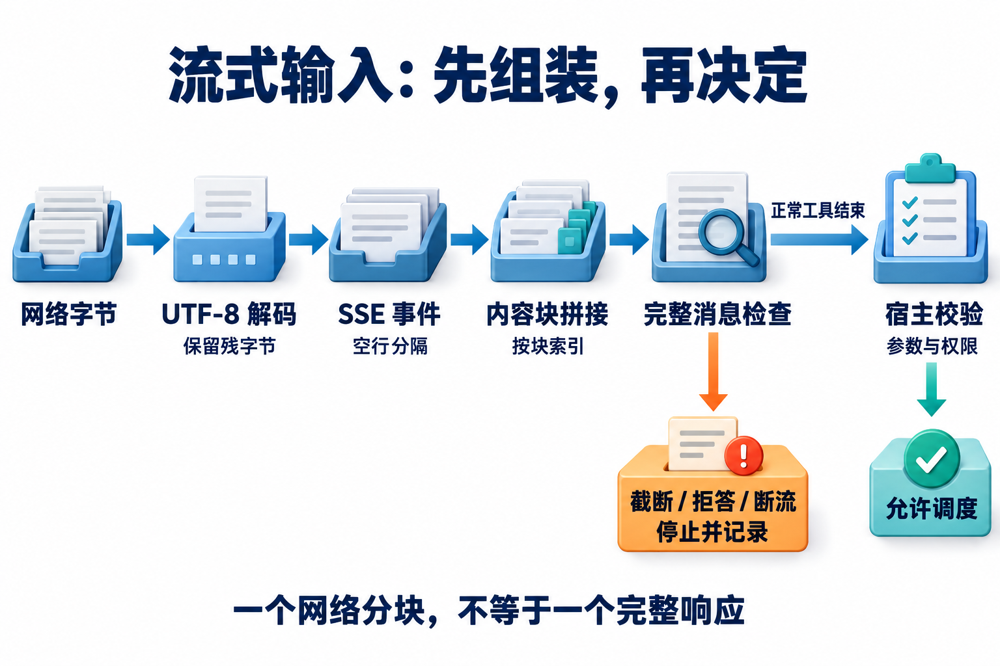
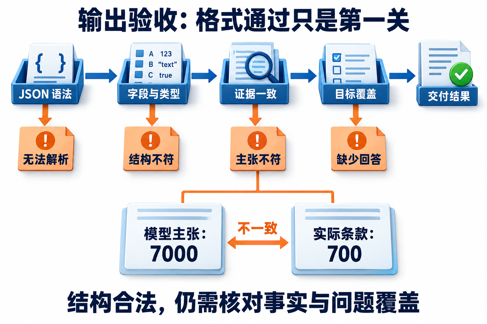
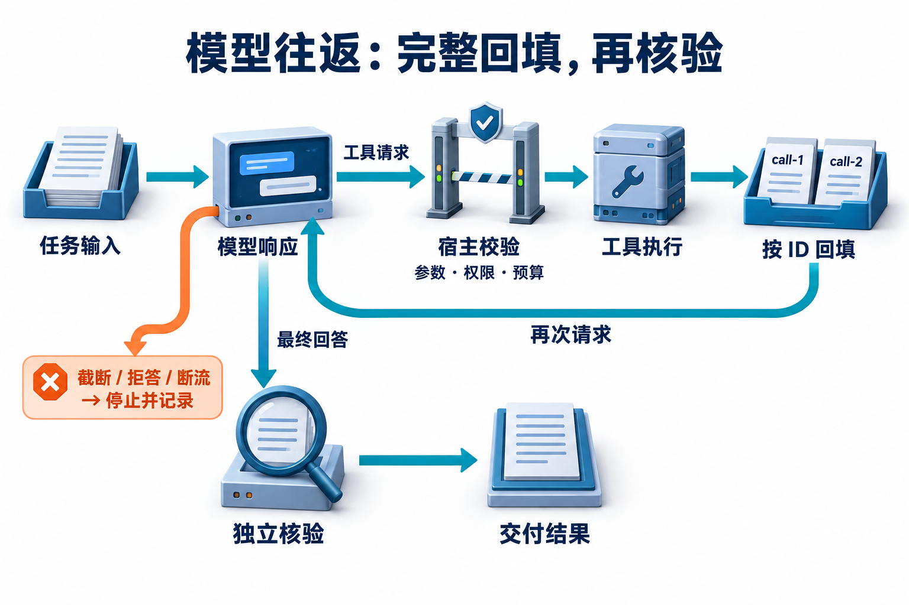

# 13 · 模型 API 与输出合同

**模型的流式响应要经过组装和校验，才能交给执行器。** 网络字节、协议事件、工具参数和业务动作各有自己的边界。这几层分别记录状态，才能区分网络断流、格式错误与动作被拒绝。

## 接入层的职责

| 部分 | 负责什么 |
| --- | --- |
| **SDK** | 管理认证，发送请求并接收原始事件。 |
| **适配器** | 把具体 API 的消息转换为运行时认可的结构。 |
| **运行时** | 维护消息、调用及任务状态，决定什么时候交给执行器。 |
| **执行器** | 验证参数、对象权限和业务条件，执行工具并返回观察。 |

不同供应商的事件名、并行块规则和停止原因有差异。适配器要按采用的协议版本解析，并留有原事件引用。

为适配器定义统一终态、调用标识和不可用原因。供应商新加字段时，按字段语义决定能否忽略。影响消息边界或动作含义的事件必须可识别，避免宿主把未知状态当成功。

## 从网络字节到完整参数

网络块可能在字符或消息中间切开，先做增量解码。使用服务器发送事件（SSE）时，按事件边界和字段规则还原消息。再解析供应商事件，按内容块身份收集模型输出。工具参数的 JSON 片段要等所属块结束后再组合解析。

### 四层解析边界

| 层 | 跨网络读取保留的信息 | 交给下一层的条件 |
| --- | --- | --- |
| **字节解码** | 残缺字符的字节。 | 解出完整字符。 |
| **SSE 分帧** | 当前行、行结束状态和多行数据。 | 按协议结束一条完整事件。 |
| **内容组装** | 消息阶段、内容块索引和增量。 | 收到完整的块与消息终态。 |
| **应用验收** | 已解析调用、身份和处置结果。 | 校验通过后再派发。 |

流结束时，检查是否还有未完成字符、事件或内容块。SSE 用空行结束事件。EOF 不能用来补齐缺失边界。控制事件和心跳按协议处理，保持现有内容状态。

## 响应状态与终态

消息和内容块分别维护开始、增量和结束状态。拒绝未开始就收到的增量，以及已经结束的块继续追加。允许忽略的控制事件按协议处理。出现不支持且影响语义的事件时，交给明确的错误路径。

完整调用还要检查消息的停止原因。正常结束、达到长度上限、拒答和断流要分开记录。截断或断流留下的半个参数不能派发。每个服务的停止原因与重试条件，从实际 API 合同核对。

### 明确允许的状态变化

适配器要维护整条消息和每个块的状态。消息开始后再允许新块。增量必须有已经打开、类型匹配的块。结束后的块不再接受同一索引的增量。供应商允许并行块时，独立保存它们的顺序和状态。

内容收齐后还要读到合法停机原因。模型正常完成、输出限制、拒答和网络断开应进入各自的终态。允许重试时按错误类型和剩余预算处理。对新工具调用，只有完整消息和应用校验都成功才派发。

总响应、单事件、块数量和参数长度分别设上限。不同阶段保存错误位置，帮助判断是网络、协议还是模型响应出了问题。

## 调用身份与回填

同一响应可能提出多个工具调用。每个调用记录模型调用标识、工具名和参数。回包可以乱序到达，按标识配对。并行批次需要等齐时，先记录已收到哪些结果，超时或缺失按状态处理。缺少一个回包时，不能用推测补齐它。

同一批调用可能关联不同工具或对象。回填时保存工具是否成功、是否为空、是否超时和原调用标识。发生重试时，新尝试标识还要关联原来的逻辑调用。涉及写入时，再用独立业务操作编号核对最终结果。

## 结构、权限与业务验收

JSON 解析确认语法。Schema 校验确认字段与类型。动作还要核对请求身份、资源和业务状态。生成回答时，关键事实需落在实际工具结果内。结构完整与结论成立分别验收。

## 整轮往返验证

按「提出调用、完整组装、校验、执行、回填、验收」检查整轮。故障测试覆盖不完整字符、参数截断、重复调用标识、回包缺失和模型结论与工具结果分歧。离线协议实验检验宿主解析和校验，模型选择质量需要另外测试。

把同一段合法流按不同位置切分。解析结果应一致。再检查重复块、超出预算、没有最终事件、并行结果乱序和部分成功。宿主验收结果应指出哪个状态导致拒绝，并验证拒绝路径没有派发受保护动作。

## 配套阅读

展开面试题、实验与资料

- [配套面试题](../docs/advanced/13-model-api-and-output-contracts.md)
- [政策助手](../examples/policy_agent/README.md)
- [实验合同与命令](../examples/model_protocol_lab/README.md)
- [一手资料](official-learning-map.md#进阶-13-的来源)

[上一章：12 · Agent 训练](12-agent-training.md) · [工程进阶目录](README.md) · [下一章：14 · 知识摄取与索引生命周期](14-ingestion-and-index-lifecycle.md)
