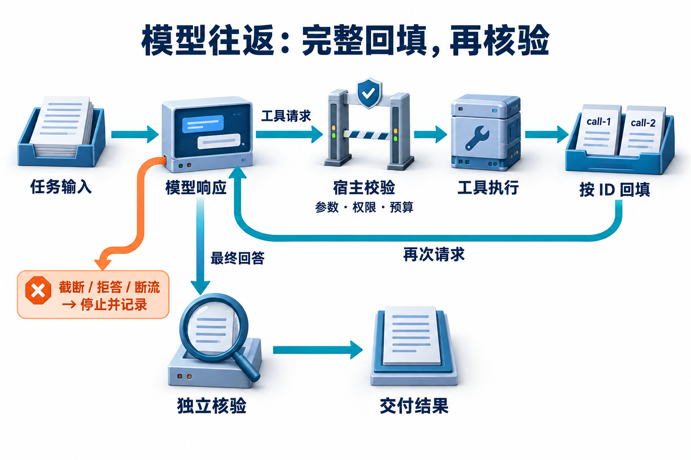

# 13 · 模型 API 与输出合同

[工程进阶目录](README.md) · [下一章：知识摄取](14-ingestion-and-index-lifecycle.md)

## 一次模型调用怎样变成可处理的下一步

**模型 API（应用程序接口）**让应用发送输入、接收模型输出。输出可以是回答文本，也可以是调用工具的请求；后者仍需宿主程序判断能否执行。**输出合同**规定接收方怎样识别完整响应、解释结束原因、校验结构与业务含义，以及失败后能确认什么。

建议先读[Agent 循环](../learning/04-agent-loop.md)和[工具调用](../learning/05-tools-and-mcp.md)，了解“模型提出动作，宿主执行动作”的边界。本章先读完整往返，再拆流式字节；完成后应能对应两项工具结果、重组被任意切开的中文参数，并解释为什么网络断开不能标成任务成功。

本章默认实验不联网。它真实执行字节解析、调用对应和校验，模型响应使用作者编写的夹具；因此可以验证协议处理，不能测量真实模型是否会选择正确工具。可选模型入口沿用[政策助手](../examples/policy_agent/README.md)的显式 live 模式。

## SDK、适配器、运行时与执行器怎样分工

**SDK（软件开发工具包）**通常包装 HTTP、认证、响应对象和流事件，也可能提供工具循环便利接口。**模型适配器**把业务输入转换为具体供应商消息，并将响应交给运行时。**运行时**安排下一轮、累计预算和等待状态；**执行器**落实允许的工具、身份、参数、授权与业务校验。

SDK 能减少协议代码，却不能替业务决定“这份制度适用于哪个日期”。即使用工具 runner 自动处理往返，仍须知道消息历史、错误和执行动作由谁保存。[Claude 工具调用生命周期](https://platform.claude.com/docs/en/agents-and-tools/tool-use/handle-tool-calls)区分 client tools 与 server tools；本章只实现由应用执行的 client tools，不把它推广为所有工具的唯一形式。

| 组件 | 本例输入 | 本例输出与责任 |
| --- | --- | --- |
| 适配器 | 用户问题、可信条件、工具声明 | 供应商请求及完整响应块 |
| 运行时 | 两项工具请求及当前预算 | 合法调度，或等待/停止 |
| 执行器 | 完整参数与可信身份 | 真实读取观察及其调用 ID |
| 结果校验 | 模型主张、实际观察 | 可交付结论或明确错误 |

## 先读完两地住宿查询的完整往返

小明问：“2026 年 11 月 12 日，海岚和云洲普通员工的住宿金额上限分别是多少？”模型在同一条 assistant 消息中提出两个 `lookup_policy`，调用标识为 `call-1` 和 `call-2`。宿主在这个固定夹具的允许范围读取，得到海岚 700 元、云洲 650 元及各自条款；金额属于虚构教学制度。

```text
应用 → 模型：问题 + 工具输入合同
模型 → 应用：assistant[tool_use(call-1), tool_use(call-2)]
应用 → 工具：分别校验并读取
工具 → 应用：两份观察，保留原调用 ID
应用 → 模型：保留完整 assistant，再回填全部 tool_result
模型 → 应用：带两条来源的结构化主张
应用 → 用户：校验金额、城市和实际取得的引用后交付
```

[](../website/assets/diagrams/advanced/A13-model-protocol.png)

沿主线区分“模型请求了工具”和“宿主实际执行了工具”，再看结果如何按调用ID回到下一次模型输入。两次模型响应都要检查完整性和结束原因；即使正常结束，最后仍需核对金额、引用与问题覆盖，才能交付成功答案。

工具结果靠 ID 对应，不能靠数组位置猜测。两路读取可能倒序返回；`match_results` 检查请求与结果集合一一对应，再按原请求顺序排列。少一个结果、同 ID 重复两次，或多出未请求的 ID，都应在下一轮之前停止并修复记录。

实验 `result.json` 的 `next_request.messages` 保存完整 assistant 内容与对应结果，便于检查“工具观察何时进入下一次模型输入”。最终回答也是另一份原始 SSE 响应经过同一解析器得到的文本，再接受业务校验。本例工具只支持固定日期与两座城市；改变日期应扩充数据合同，不能让固定观察冒充任意历史查询。

## JSON、Schema 与业务事实分别保证什么

**JSON**是一种数据表示语法，合法 JSON 可以是数字、数组或字段错误的对象。**Schema（结构约束）**规定对象形状、类型、必填项及部分取值；模型的约束输出能力和宿主校验器能支持的关键字，还要按实际接口核对。提示“只输出 JSON”、启用供应商 JSON 模式、启用受支持的 Schema 约束，是不同强度的措施。

| 这一层通过 | 可以确认 | 仍需检查 |
| --- | --- | --- |
| 文本能解析为 JSON | 语法成立 | 是不是所需对象 |
| 对象符合合同 | 字段与类型成立 | 金额、引用、权限是否正确 |
| 主张与实际观察一致 | 当前证据支持结论 | 用户目标及副作用终态 |

本例故意将海岚写成 7000 元：它仍是合法整数，结构也完整，却与实际取得的 700 元条款矛盾。`validate_answer` 会检查城市、金额、引用及覆盖，不能因为文本流畅而放行。更一般的授权与执行检查见 [Q027](../questions/Q027.md)，本章不把这些责任交给输出格式。

供应商的结构化输出也有异常分支。Claude 当前文档分别说明拒答和 token 上限可能导致输出不符合预期；HTTP 成功不能抹去这些情况。使用前重新核对[结构化输出文档](https://platform.claude.com/docs/en/build-with-claude/structured-outputs)中的支持范围与异常，而不是假设所有版本、所有供应商都提供相同合同。

## 从网络字节逐层重组成工具参数

**UTF-8**以一到多个字节编码字符，中文字符可能被拆在两次网络读取之间。**SSE（服务端发送事件）**则在文本上用行字段和空行组织事件。一次 `read()` 既不保证给出完整字符，也不保证给出完整 SSE 事件，更不保证给出完整工具参数。

实验先用增量 UTF-8 解码器保留未完成字节，再识别 CR、LF 或 CRLF 行结束符。`data:` 多行用换行连接，空行才派发一条事件；注释不成为内容。没有结束空行的残留事件不会在 EOF 时被当作完整对象。该传输规则来自 [WHATWG SSE 标准](https://html.spec.whatwg.org/multipage/server-sent-events.html#parsing-an-event-stream)。

接着，供应商事件状态机检查 `message_start → 内容块 → message_delta → message_stop`。工具块的 `input_json_delta.partial_json` 只是 JSON 字符串片段，需要按内容块索引拼接；块结束后仍要检查整条消息的结束原因。工具索引负责组装块，工具 ID 负责往返对应，不能把这两个标识混用。[Claude 流式事件](https://platform.claude.com/docs/en/build-with-claude/streaming)给出具体事件形式；它不是跨供应商统一标准。

```text
网络片段：... E6 | B5 B7 ...       → 同一个“海”字
SSE行：event: ... / data: ... / 空行 → 一条协议事件
工具增量：{"city":"海 | 岚",...}   → 一个完整参数对象
消息结束：stop_reason + message_stop → 决定是否允许调度
```

本例只支持 text 与 client tool_use 两种内容块，不实现 thinking、服务端工具或全部未来事件。遇到未支持的有意义事件会停止并报告协议不支持；`ping` 可以忽略。完整 SDK 一般覆盖更多事件，因此本实验是用来观察边界的教学解析器，不应直接替换完整供应商 SDK。

## 正常结束、截断、拒答与断流怎样区分

| 观察 | 本实验终态 | 是否执行新工具 |
| --- | --- | --- |
| 完整消息，结束为 `tool_use`，参数通过 | `tool_calls` | 通过宿主校验后允许 |
| 完整消息，结束为 `end_turn` | `model_finished`，再验业务 | 没有工具请求 |
| `max_tokens` | `truncated` | 不执行残缺调用 |
| `refusal` | `refused` | 不执行 |
| 连接结束但未收到完整消息终止 | `transport_failed` | 不将半条消息派发 |
| ID、块顺序或参数违反合同 | `protocol_error` | 不执行 |

完整 `end_turn` 只说明这次模型生成结束；引用缺失或业务检查失败，任务仍未完成。断流后也不能简单重跑整个业务循环：本地未收到结果，远端读取或写入可能已经发生。模型请求重试与业务副作用恢复应分别记录，后者沿稳定操作意图查询或对账，具体机制见[持久执行](02-durable-execution.md)。

期限与用量同样分层。记录协议/模型版本、请求 ID、输入输出计量、开始结束与取消状态；失败请求也可能消耗额度。本实验报告 `model_requests=0`，夹具里的 usage 仅用来验证解析字段，不能当成真实调用账单。

## 运行后先预测失败，再核对证据

```bash
python3 -m examples.model_protocol_lab.lab --scenario all --output .local/model_protocol
python3 -m unittest discover -s tests -p 'test_model_protocol_lab.py' -v
```

`normal` 运行真实字节解析、两项工具回填和引用核验；其余场景注入缺结果、重复 ID、截断、拒答、断流和金额错误。`final-truncated`与`final-refusal`另外验证工具全部返回后的最后一轮，确保每一轮都先检查终态，再读取业务内容。各场景保留 `raw.sse`、`answer.sse`、`trace.jsonl`、`result.json` 和独立 `grade.json`。测试还枚举原始字节流每个可能的两段切分点，验证网络边界变化不会改变重组结果。

先遮住 `missing-result/grade.json`，预测下一次模型请求能否发出；再把 `call-2` 的结果放到第一位，预测是否合法。前者必须停止，后者只要 ID 对应就可接受。迁移练习把城市、条款 ID 与金额一起改变；验收器应依据新观察检查，不能只记住“海岚 700”这一个答案。

## 自检与答案

<details><summary>1. 为什么把每个网络分块直接交给 json.loads 会失败？</summary>

网络分块可能包含半个 UTF-8 字符、半行 SSE 或半段 JSON。应按字节、行、事件、内容块逐层重组，再在合同允许的边界解析参数。
</details>

<details><summary>2. 两项工具只回了一项，模型能否自己补完？</summary>

不能用模型猜测替代实际工具结果。先完成缺失结果或记录明确失败，再按供应商合同完整回填，不能伪造观察。
</details>

<details><summary>3. 这组测试全过，是否证明真实模型会正确比较两地制度？</summary>

没有。它证明固定协议与宿主逻辑通过了所列变式；真实模型选择、端到端质量和费用需要显式 live 运行及独立任务集。
</details>

## 配套面试题与资料

- [Q093 输出约束的层次](../questions/Q093.md)、[Q094 多工具完整回填](../questions/Q094.md)、[Q095 流式响应完整性](../questions/Q095.md)。
- [本章合订题源](../docs/advanced/13-model-api-and-output-contracts.md) · [实验合同与命令](../examples/model_protocol_lab/README.md)。
- 一手资料核查日期：2026-10-31。供应商字段以采用时文档为准，本地夹具范围与真实调用结果分别记录。
