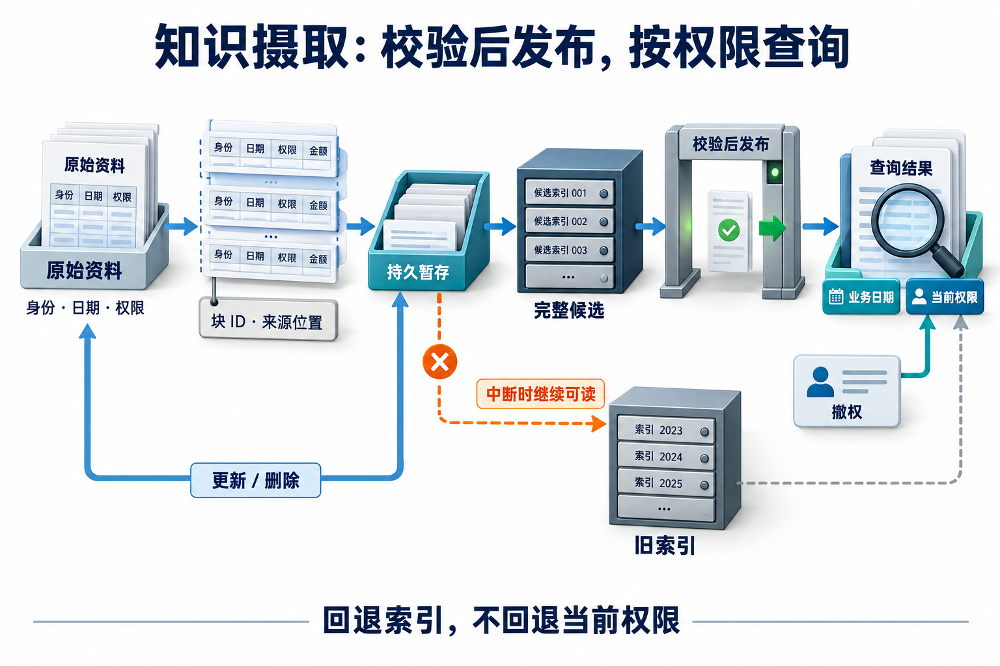

# 14 · 知识摄取与索引生命周期：让变化真正进入查询

[上一章：模型 API 与输出合同](13-model-api-and-output-contracts.md) · [工程进阶目录](README.md) · [下一章：Text-to-SQL 与数据分析](15-text-to-sql-and-data-analysis.md)

## 从“能搜到”走到“搜到适用版本”

**知识摄取（ingestion）** 是把原始资料读取、解析、分块、附上元数据并建立查询索引的过程。**索引生命周期** 继续处理资料修改、删除、撤权、处理失败和索引切换；它决定昨天建好的资料库在今天是否仍可使用。

员工小明问：“2026 年 11 月 12 日去海岚，普通员工住宿每晚 650 元，是否超标？”同一资料库有两版政策：11 月 1 日前上限 600 元，之后上限 700 元。两段文字都很相关，但只有一段适用于出差日期。新版进来后，不能直接删除旧版，因为历史申请仍需要旧标准；源资料被撤回时，也不能只删原始文件，让旧片段继续进上下文。

建议先读 [基础 RAG 与检索](../learning/06-rag-and-retrieval.md) 和 [证据驱动的 Agentic RAG](06-agentic-rag.md)。本章在它们的入库与来源原则上，完成一条真实可查询、可更新和可重跑的本地链路。完成后应能解释一个金额从哪一版源文档、哪一行进入哪份索引，并证明变更已经影响后续查询。

## 先看一份已完成的查询结果

配套实验实际读取 Markdown 和简单表格，返回的条款包含以下信息。下表省略哈希的完整字符串，具体值以运行结果为准。

| 字段 | 示例含义 |
| --- | --- |
| `doc_id` / `version` | `lodging-hailan` / `v2`，业务文档与版本身份 |
| `block_id` | 根据文档版本、块标识和条款行 ID 派生，改金额不换身份 |
| `text` | 城市：海岚；类别：普通员工住宿；金额上限：700；单位：元/晚 |
| `valid_from` / `valid_to` | 2026-11-01 起有效，截止为空 |
| `source_location` | `fixture://policies/hailan/v2#L7-L9`，指向样例文件表头与条款行 |
| `generation` | 本次使用的完整索引版本 |
| `policy_revision` | 本次查询采用的访问目录修订号 |

据此可以回答：650 元低于该日期适用的 700 元每晚上限；若询问 10 月 31 日，则 650 元高于 600 元。这里的 `fixture://` 是本地教学来源标识，不是可打开的官方政策网址。实际业务回答还需要可访问的来源入口、真实身份与适用条件，本实验没有创建咨询工单或替用户取得批准。

## 一份资料需要几种身份

**文档 ID** 表示“这是哪份资料”，不能只用文件名；文件重命名后不应当被当成新制度。**版本 ID** 表示这份业务资料的某个版本。**内容哈希** 是原始内容计算出的指纹，用来发现内容是否变化；它不解释变化是否具有业务效力，也不能代替授权。

一个版本内部再用稳定块 ID 跟踪条款。实验要求正文有 `<!-- block: scope -->` 这样的显式标识，表格第一列为 `条款ID`。于是同一版本的 `lodging/R1` 始终对应同一条款；把金额从 700 更正为 720 时，块身份保持，内容哈希改变。若把每次内容哈希直接用作唯一身份，就难以说明“旧条款被哪条新内容替代”。

索引 generation 是另一层身份：它绑定解析规则、所有源指纹、块和倒排表的一份完整快照。业务版本 v2 的文字被更正时会产生新的索引 generation；这不自动表示新政策正式生效。是否应另建业务版本，由资料管理合同决定。本实验允许在 v2 内修正文本，用来观察身份与内容指纹的区别。

## 生效时间与系统记录时间不能混用

本章采用左闭右开的业务区间：

```text
v1: 2026-01-01 <= 出差日期 < 2026-11-01
v2: 2026-11-01 <= 出差日期，截止为空
```

查询日历日期按出差日期匹配版本，不按“哪份文件最新上传”挑选。源元数据和查询入口都要求规范的 `YYYY-MM-DD` 字符串；只检查日期能否解析还不够，`20261031`或ISO周日期与带连字符日期混用时，字符串比较可能选错版本。对于同一文档，同一日期若同时匹配两版，实验拒绝发布，要求先解决清单歧义。真实业务也可能有叠加规则、例外优先级和地区条件，本实验没有把这些复杂规则塞进一个简单日期比较。

**业务有效时间** 回答政策何时适用；**系统记录时间** 回答系统何时获知或修正记录。双时间模型需要同时保存并查询这两个维度。本实验保存索引快照，能够按业务日期选版，但没有系统时间查询合同，不能称为双时间数据库。9 月收到一份追溯到 8 月生效的制度时，单凭有效日期无法回答“8 月的系统当时知道什么”。

## 解析最容易丢掉的是条件

解析不只是把字符提出来。下面两行如果被拆开，“700”就失去城市、员工类别和单位：

| 条款ID | 城市 | 类别 | 金额上限 | 单位 |
| --- | --- | --- | --- | --- |
| R1 | 海岚 | 普通员工住宿 | 700 | 元/晚 |

实验把每行转成带字段名的片段，并保留标题和源行范围。例如 `城市：海岚；类别：普通员工住宿；金额上限：700；单位：元/晚`，而不是只索引裸金额。多行表格各自以行 ID 建块，因此另加一条云洲规则，不会改掉海岚条款的身份。

解析器只支持明确标记的段落和简单竖线表格，遇到转义竖线、合并单元格、多行单元格或代码围栏会拒绝。这个限制让信息损失可见。扫描 PDF、OCR（光学字符识别）、公式和复杂版式需要另接提取器，再用原图与结构检查验证；预先写好的 Markdown 不能作为 OCR 准确率证据。

**血缘（lineage）** 是派生块与源身份、版本和位置的关系。没有血缘时，管理员删掉文件，很难找到由它生成的片段、摘要、向量和缓存。本实验只派生块与词项索引，因而可完整列出需要失效的对象；图索引或总结缓存要额外记录自己的依赖，不能假设只删这一张表就够了。

## 建一份可以手算的真实词项索引

**倒排索引** 把“哪个词项出现在哪些块里”保存为映射。实验将 ASCII 连续字母数字看作一个词项、汉字拆成单字；查询“海岚 住宿 上限”时对这些词项的候选集合求交，再按命中词频与块 ID 排序。金额 `700` 和 `720` 是两个不同词项，更改金额后可以检查旧 posting 是否消失。

这是真实索引查询，不是给固定问题直接返回答案。但单字拆分会丢失词序、语义和同义词信息，不能把它与中文分词、BM25 或 Embedding（语义向量表示）效果混同。它承担的教学任务是让身份、变更和来源可复算；检索质量需换一份未泄题查询集、明确相关性标签后单独测量。

**增量处理** 根据内容和元数据指纹，只重新解析受影响源文件。默认三份记录中仅改 v2 金额，实验会重新解析一份、复用两份。它随后仍重建完整倒排表，属于增量解析加整表发布，不是大规模索引的原地 posting 增量更新。这个取舍用更多重建工作，换取简单的完整性边界。

## 在最后一步才让新索引可见

摄取中断可能留下半成品。假设刚生成新片段，还没写完倒排表，就把指针换成“新版已上线”，读者会遇到源清单与检索结果不一致。实验采用下面的本地单写者过程：

[](../website/assets/diagrams/advanced/A14-ingestion-lifecycle.png)

主线第二站的表格片段表示解析分块，下面的块ID与来源位置用于追溯原文。暂存只保存处理进度，完整候选通过校验后才替换可见指针；中断不会让半成品进入查询。旁路标出更新、删除和撤权影响的位置：即使读取或回退旧索引，仍要经过当前访问目录，不能恢复已经撤回的使用资格。

staging 是未发布的暂存区，记录已解析对象及其源指纹。故障注入在写完一份变化源后中断；此时读者仍沿旧 state 查询，既看不到新金额也看不到半张新索引。创建新的 `Pipeline` 实例后，它从磁盘读取暂存对象，仅对剩余变化源继续处理。

generation 完成并校验后，才用 `os.replace` 原子替换同一文件系统上的状态文件。读者读一次 state，再读该 state 指定的完整索引。这能验证进程中断、重试和发布可见性；没有实现多个写者并发竞争、跨机器事务或断电后的端到端持久性保证。需要这些能力时，应把存储和发布合同重新放进有相应保证的系统中。

## 删除、撤权和回退必须一起验证

实验的 `publish` 接受完整清单，遗漏的版本在最新 catalog 中消失，成为查询意义上的删除。保留 v1、删除 v2 后，11 月查询为空，10 月查询仍有 v1。若源系统发的是“变更事件”，必须先维护完整 catalog，再调用此接口；不能把一次只含一份增量的事件误当完整清单，把其他资料全部删掉。

**撤权** 改变当前 principal（这里是教学访问身份）对文档的读取资格。`revoke` 原子修改当前 catalog；查询即使指定旧 generation，也要经过当前 catalog。这样回退索引不会恢复已撤回的员工权限，旧快照也不能绕过新删除状态。`activate` 只切索引，不切回历史授权目录。

这份授权目录由可信宿主维护，不是生产身份系统。重新发布的完整清单也是可信授权输入，若其中再次允许 employee，就会重新授权；需要防止意外重新授权的服务，应设计单独的权限版本和审批合同。已返回的文本、在途模型上下文和磁盘旧文件不会自动消失，本实验也没有外部查询缓存；真实系统需要在上下文组装与结果返回等边界重新确认授权，并沿血缘失效缓存。

## 索引迁移改变了什么

本实验 schema 为 `lexical-v1`。激活一个不兼容 schema 会失败，不能把“有这个文件”当成“当前读取器能理解”。若将分词规则或索引结构改版，应生成候选索引、跑固定查询与权限测试、明确回退读取兼容性，再切换指针。

未来接真实 Embedding 时，还要固定模型、维度、归一化与距离计算规则；重嵌入会影响整批向量和排序，旧向量不能因为维度看起来相同就与新向量混算。这里没有实现向量迁移，也没有使用确定性假向量伪装语义实验。

LlamaIndex 的摄取管线把转换步骤、缓存和文档管理组合起来，可以作为可选实现对照；它不会代替本手册定义来源、权限和业务时间合同。[官方摄取管线](https://developers.llamaindex.ai/python/framework/module_guides/loading/ingestion_pipeline/) LightRAG 的选择性删除还涉及受影响实体和关系重建，可用于观察更复杂派生血缘的维护代价。[LightRAG 源码说明](https://github.com/HKUDS/LightRAG) 这些入口核查于 2026-10-31，配套实验没有安装外部框架；选做时固定包版本和源码提交再验证。

## 动手：先预测，再查看轨迹

在仓库根目录执行：

```bash
python3 -m examples.knowledge_pipeline_lab --scenario all --output .local/knowledge_pipeline_lab
python3 -m unittest discover -s tests -p 'test_knowledge_pipeline_lab.py' -v
```

先预测三件事：改金额是否改变块 ID；中断后新查询应看到 700 还是 730；撤权后切回旧索引能否再读。再分别打开 `update`、`interruption`、`revoke` 子目录中的 `trace.jsonl`、`result.json` 和 `grade.json`，核对 staged、published、query 与 access_revoked 的实际顺序。

评分器在执行结束后读取独立预期，检查正常日期、变更、删除、撤权、中断恢复、重复处理、切换和无效输入八类场景。单元测试还会更换金额与输入条件，避免只检查函数是否返回 success。它们证明这些本地合同成立，不证明真实 OCR、语义召回或生产权限系统已经完成。[实验接口与产物说明](../examples/knowledge_pipeline_lab/README.md)

进一步迁移：复制数据目录，新增一条云洲表格行，换一个稳定 `条款ID`，再修改同一行金额。验收要求新旧身份关系清楚、表头语义保留、受影响源被重处理，且撤回该版本后指定旧 generation 也不能返回它。不要只把隐藏预期改成新的金额就宣布通过，应另用人工可复算的查询检查来源与日期。

## 自检与答案

<details><summary>1. 为什么内容哈希不能同时承担全部身份？</summary>

哈希擅长发现字节内容改变，无法单独表达同一条款的延续关系、业务版本和权限。稳定文档/块 ID 提供对应关系，哈希提供变化证据，generation 提供完整发布边界。
</details>

<details><summary>2. 保留旧政策和保留撤回资料是不是同一件事？</summary>

不是。旧政策可以仍被授权用于历史业务日期；撤回或删除意味着当前使用资格改变。查询需同时满足日期适用和当前访问条件，索引快照不能绕过后者。
</details>

<details><summary>3. 中断重跑通过，是否就证明支持并发发布？</summary>

没有。暂存复用与原子指针只验证本地单写者合同。多个写者可能相互覆盖状态，需要另外的互斥、版本比较或事务设计和故障验证。
</details>

## 参考资料与延伸阅读

- [LlamaIndex Ingestion Pipeline](https://developers.llamaindex.ai/python/framework/module_guides/loading/ingestion_pipeline/)：转换、缓存与文档管理。
- [LightRAG](https://github.com/HKUDS/LightRAG)：文档删除与图派生数据维护。
- [Python os.replace](https://docs.python.org/3/library/os.html#os.replace)：同一文件系统上的替换行为与平台条件。
- [本地知识摄取实验](../examples/knowledge_pipeline_lab/README.md)：已实现合同、CLI、来源格式与限制。

[配套进阶面试题：Q096–Q098](../docs/advanced/14-ingestion-and-index-lifecycle.md)
