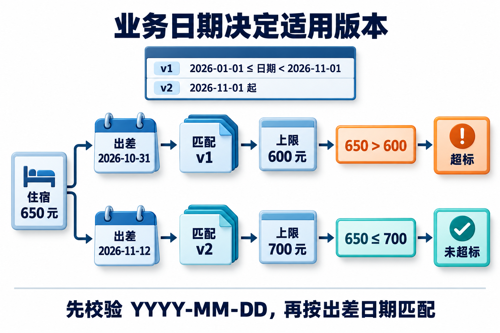
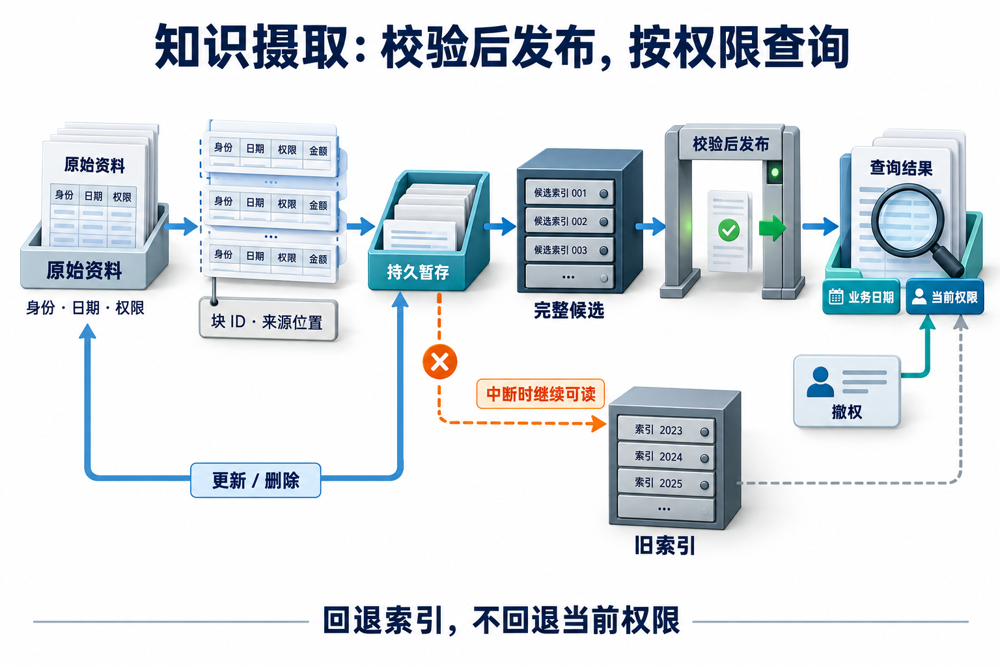
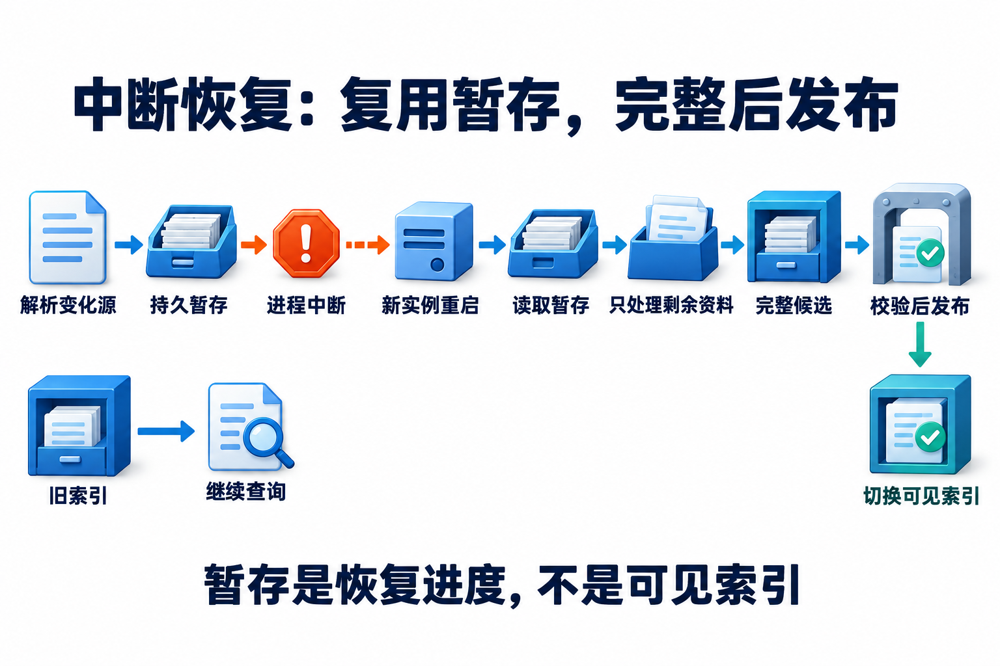

# 14 · 知识摄取与索引发布

**摄取把原始资料加工成可查询、可追溯的数据。** 查询需要知道命中的是什么对象、哪一版内容，以及它是否适用于当前业务日期。更新时先构建一批完整索引，再让读者切换。

## 文档、版本和索引代次

| 标识 | 作用 |
| --- | --- |
| **文档标识** | 稳定定位同一业务资料。 |
| **版本及内容哈希** | 分别标记业务版本和内容变化。 |
| **片段标识** | 关联具体版本、原文位置与切分规则。 |
| **索引代次** | 标记一次完整发布的资料和构建配置。 |

内容相同的原文也可能有不同归属和权限。更新解析器、切分器或向量模型时，保留这些版本，使重建和回查可解释。

### 派生版本的身份

来源对象的稳定标识用于跟踪修订和撤回。内容哈希适合查变更和复用处理。资料可能内容相同但来源、权限或有效期不同，因此保留各自的业务身份。处理配置变化后，也要区分新旧派生对象。

每个片段记录原文版本、位置和切分器版本。需要定位表格时，保存页、行、列和正文上下文。索引清单记录所含文档版本和配置，查询结果才可以还原到发布当时。

## 生效时间与记录时间

业务条件决定适用日期。生效区间可约定为「包含开始，排除结束」，避免同一时点重叠。没有明确截止时按业务合同解释。系统记录时间另存，用来复盘当时可见的信息。

多份资料同时适用时，按已定义的例外和取代规则判断。没有规则就保留冲突。先规范时区与日期表示，再做比较。

同一资料可以按业务日期保留多版。更新日期、采集日期和生效日期分别记录。查询时先按业务日期选择，再核对对象和例外。需要复盘时，结合系统记录时间找到当时已经发布的版本。重叠无法裁决时，保持争议状态。

## 解析、切分与构建

先从原文提取段落、标题、表格和位置。切分时保留会影响含义的范围、单位和表头。每段都能定位回原文，并记录由哪个解析器和切分器产生。

词项索引存词与片段的命中关系。向量索引存编码器产生的表示。两者都要核对索引、内容和派生记录的完整性。增量构建按内容哈希和处理配置复用结果。权限、来源和有效期仍要按当前版本更新。不一致时先修索引构建或输入材料。

### 沿派生关系更新

一份源版本可能派生多个片段、向量、摘要和缓存。保存它们的依赖关系。源变化时，先找直接派生对象，再扩展到间接产物。多源摘要失去一份必要材料时，重新生成或标记失效。

增量构建前对比内容和处理指纹。保留未变的解析结果，同时更新来源与授权元数据。检查倒排记录都指向存在的块，各块都能找到源版本。向量还要核对编码器、维度和度量配置。

## 暂存、校验与发布

在读不到的区域构建新代次。核对条目数、版本、来源和必要查询后，再一次性切换当前指针。读请求开始时固定一代，结束前都读这一代。切换时旧查询仍能完成。

### 切换一致性与恢复

原子指针避免读者看到半批数据。候选数据应先写完整，多个发布者还要有互斥或版本比较。关注断电时，验证持久化和恢复顺序。文件的原子替换与断电后的数据保留是两个独立条件。

### 读请求的使用周期

发布指针绑定一份完整清单。多写者提交时带上预期旧版本，过期写者不能覆盖更新的发布。服务读到指针后固定索引代次，在同一次查询里继续使用。资质校验另外读取当前状态。

旧代次要保留到已有读者结束。可用引用计数、租约或明确的保留期协调。进程中断测试验证的是可见性和重试。要求掉电恢复时，还要核对数据文件和目录的持久化顺序。

## 删除、撤权和索引迁移

文档删除要沿派生关系处理片段、向量、摘要与缓存。允许历史查询的旧版本按业务有效期使用。撤权由当前访问规则生效。切回历史索引后，也照常执行当前授权。

变更索引配置时，分开构建新代次。固定任务与资格域比较检索质量、延迟和成本。保留读者使用的旧代次，直到无人再用且满足回收条件。

### 当前访问控制独立于历史内容

撤权后立即依靠当前权限挡住旧资料。后台清理索引与缓存。撤回记录要能覆盖迟到构建、历史回退和备份恢复。业务允许查询某一时期的旧文档时，仍按当前主体权限判断。

索引迁移用同一批有版本和权限标注的查询对照。先看新代次是否完整，再比较证据覆盖、重排输入和端到端延迟。记录回退只切换哪一层，以及当前撤权还在哪里生效。

## 发布验收

核对命中能否找到原文、版本和适用期。再检查构建中断、查询与切换并发、删除传播及撤权后回退。进程级故障恢复的结果，用于判断这一层的合同是否成立。

## 配套阅读

展开面试题、实验与资料

- [配套面试题](../docs/advanced/14-ingestion-and-index-lifecycle.md)
- [实验接口与产物说明](../examples/knowledge_pipeline_lab/README.md)
- [一手资料](official-learning-map.md#进阶-14-的来源)

[上一章：13 · 模型 API 与输出合同](13-model-api-and-output-contracts.md) · [工程进阶目录](README.md) · [下一章：15 · Text-to-SQL 与数据分析](15-text-to-sql-and-data-analysis.md)
