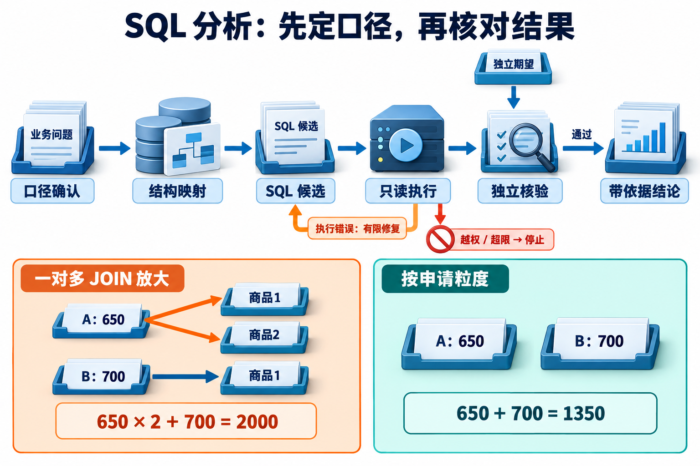

# 15 · Text-to-SQL 与数据分析：先定口径，再让数字说话

[上一章：知识摄取与索引生命周期](14-ingestion-and-index-lifecycle.md) · [工程进阶目录](README.md) · [下一章：Agent 服务交付与运维](16-service-deployment-and-operations.md)

## 能执行的 SQL，也可能回答了另一个问题

**Text-to-SQL** 是把自然语言问题转换成结构化查询语言 SQL。应用中的完整任务还包括澄清指标、选择允许访问的表列、执行查询、检查结果，再把结果写成可追溯结论。SQL 语法正确只是其中一步。

小明问：“10 月申请了多少差旅费，有多少超标？”助手连接申请表和费用明细表，得到 2000 元；但两笔申请分别只有 650 元和 700 元，总额应为 1350 元。数据库没有报错，错误发生在“每行代表什么”被连接操作改变以后。

建议先了解 SELECT、WHERE、JOIN 和 GROUP BY 的基本作用，再读 [Agentic RAG 的结构化数据段](06-agentic-rag.md)。完成本章后，应能把一句问题写成明确口径，识别一对多连接放大，给候选 SQL 设实际访问与资源限制，并用独立结果判断业务语义。配套实验真实执行 SQLite；默认预制候选用于验证流程，不报告自然语言模型准确率。

## 先完成一张指标口径卡

“10 月”需要说明年份、时区和使用哪一个日期字段；“多少”需要说明金额、数量、状态和范围。对于“超标占比”，分母究竟是全部申请、已审批申请，还是已知金额和标准的申请，必须先约定。

本章固定以下教学合同：

| 项目 | 本次选择 |
| --- | --- |
| 日期 | 申请日期 `submitted_at`，2026-10-01 起至 2026-11-01 前 |
| 可见范围 | 可信测试用户所属租户的申请 |
| 状态 | `submitted`、`approved`；撤销 `cancelled` 排除 |
| 金额 | 整数分存储，展示时换成元 |
| 数据粒度 | 一笔申请一行，而非一条明细一行 |
| 超标分子 | 金额严格大于给定适用上限的申请数 |
| 超标分母 | 金额和上限都已知的申请数 |
| 未知项 | 另报可比较数量，不能把未知上限当作未超标 |

实验 `metric_card` 在日期依据、金额单位、状态或分母缺失时返回 `needs_clarification`，不静默替用户选择。本例日期已经是规范化的业务日期字符串，未实现时间戳时区换算；真实系统若存 UTC 时间，应先确定本地业务窗口对应的边界，不能只按字符串截取月份。

## Schema linking：把业务词连到真实结构

**Schema** 是数据库表、列及关系的结构说明。**Schema linking（结构映射）** 是把问题中的“申请金额”“申请日期”“明细”分别对应到允许访问的 `applications.amount_cents`、`applications.submitted_at` 和 `expenses`，而不是凭熟悉的业务名编造列。

本例只有三张业务表：员工 `employees`、申请 `applications`、明细 `expenses`。员工 ID 唯一，申请通过 `employee_id` 属于员工；明细通过 `application_id` 属于申请，一笔申请可以拥有多条明细。候选应看到必要的列含义、单位、枚举及关联键，不需要知道源员工表的薪资字段。

结构映射正确也不等于口径正确。`approved_at` 是真实存在的列，但把“申请于 10 月”写成“审批于 10 月”仍会得到错误集合。权限控制与统计解释要分开记录，不能用“Schema 校验通过”盖掉后续问题。

## 用两笔申请看清 JOIN 放大

**粒度（grain）** 表示一行记录对应哪个业务对象。申请表的两行分别为 a1、a2：

| 申请 | 申请金额 | 明细数量 |
| --- | ---: | ---: |
| a1 | 650 元 | 2 |
| a2 | 700 元 | 1 |

申请金额总和是 `650 + 700 = 1350`。连接明细后 a1 出现两次，申请金额序列成为 `650, 650, 700`；直接 SUM 得到 `2000`。明细费用本身可以相加，但不能把已经属于申请粒度的总额再按每条明细累加。

若只问申请总额，直接聚合申请表即可；明细筛选只承担存在条件时，可用 EXISTS。若需要同时比较申请总额与费用分项，先把明细按申请 ID 聚合成一行，再与申请表连接，并检查两边的键是否唯一。具体选择取决于要回答的指标，不能一律“加 GROUP BY”就结束。

`SUM(DISTINCT amount_cents)` 也不是通用修复。DISTINCT 去掉的是相同数值：把 a2 改为 650 元，两笔真实申请应合计 1300 元，DISTINCT 却只剩 650 元。[SQLite 聚合语义](https://www.sqlite.org/lang_aggfunc.html) 配套 `duplicate-amounts` 数据集正是为了让这种在第一份数据上碰巧正确的修复失败。

## 空值、撤销和比例怎样共同影响结果

SQL 的 `COUNT(*)` 计算行数，`COUNT(column)` 忽略该列为 NULL 的行，SUM 也忽略 NULL。[SQLite 聚合函数](https://www.sqlite.org/lang_aggfunc.html) **NULL** 表示缺失或未知，不能简单解释为金额为零或已经未超标。

第三份实验数据中，范围内有三笔非撤销申请：650 元且上限 500 元、一笔金额未知、一笔 100 元但上限未知。已知金额合计 750 元，申请数 3，可比较申请数 1，超标数 1，按本次合同超标比例为 100%。如果把所有三笔塞进分母，33.3% 是另一个指标，不能无说明替换。

需要同时输出 `application_count` 与 `comparable_count`，让读者知道覆盖范围。若没有一笔可比较，比例返回 NULL，解释为数据不足以计算该比例；不能用 0% 暗示都合规。申请和撤销记录的去重、有效状态与分母必须使用同一合同，否则两个时间窗口的数字看似可比，实际上对象集合不同。

## 让数据库执行层约束候选

参数化查询把日期、对象 ID 等值交给数据库绑定，能够避免把值拼成 SQL 语法；它不会自动限制模型生成的表名、列名、JOIN 或扫描规模。因此真实执行路径要决定候选能够接触哪个连接、哪些数据，以及能够执行什么操作。

[](../website/assets/diagrams/advanced/A15-sql-validation.png)

图把执行反馈与独立语义核验分成两条路径：语法或字段错误可在预算内修复，日期、粒度和分母错误却可能在 SQL 正常执行后才被发现。独立期望只进入核验器，下方两种计算方式用于解释统计口径，不能作为隐藏标准答案反馈给候选生成器。

本实验没有 PostgreSQL 的用户角色或行级策略。可信宿主用本地 alice/bob 测试身份映射租户，通过固定参数化查询从只读源文件复制允许行，创建各自独立的内存 SQLite 快照。候选不能取得源连接或自行选租户，即使写 `WHERE 1=1`，快照里也没有其他租户行。源表薪资列根本不复制；快照中另有一列演示列访问拒绝。

这是一种小数据实验的行范围边界，代价是复制和快照新鲜度。生产服务要把测试身份换成认证身份，确认权限和数据快照时点；不能让普通请求自由传 `user='bob'`。它不是数据库原生 RLS，也不是操作系统沙箱，拥有宿主进程或源文件访问权的代码仍属于可信计算基。

随后分层限制候选：

1. 宿主只接受长度受限、以 SELECT 或 WITH 开头的单条 SQL，数据库 `execute` 拒绝多语句。
2. SQLite `set_authorizer` 在编译阶段检查读取表列、函数和操作，未允许的动作拒绝。`WITH ... DELETE` 不会因前缀看起来像查询就获准。
3. 连接设置 `query_only=ON`；候选不能自己发 PRAGMA 关闭它，也不能 ATTACH 新数据库或加载扩展。
4. 进度回调按约 100 个虚拟机指令检查步数及期限；结果超过行预算时作为超限，不能用截断结果冒充完整统计。

authorizer 是编译期授权回调，不会替宿主自动选行。它也会对 COUNT(*) 触发表读取，列名可能为空，回调必须按允许表的实际语义处理。[SQLite authorizer](https://www.sqlite.org/c3ref/set_authorizer.html) 进度回调只能提供 SQLite 执行过程中的中断点，不能声称精确 CPU/内存硬限制；本地运行时若支持 `setlimit`，实验还会降低长度、列数与表达式深度上限。[进度回调](https://www.sqlite.org/c3ref/progress_handler.html)

## 修复要有反馈，也要有终点

列不存在、语法错误和不支持的方言通常可以通过执行反馈修复。未授权读写应明确拒绝，不能鼓励候选不断变形绕过控制；资源超限应缩小任务或停止，而非无限增加时间。实验把候选分为可执行、SQL 无效、访问拒绝和资源超限，最多尝试两次。

`schema-repair` 先提交包含 `invented_amount` 的候选，收到列不存在反馈，再提交下一份预制候选。它证明反馈记录、第二次执行与上限工作正常，没有证明模型自主理解了错误。`bounded-repair` 连续给五份无效候选，但只执行两份后停止。

更难的是 SQL 已经运行成功，却用了审批日期或错误分母。数据库通常无法知道用户问题原意，因此不能只等报错。本次独立评分在执行后读取预期结果，能发现该错误；运行策略拿不到隐藏答案，避免把标准结果作为“反馈”喂给候选，再宣布它修好了业务语义。

## 从返回表到文字结论

正常数据返回 `total_cents=135000`、`application_count=2`、`comparable_count=2`、`over_count=1`、`over_rate=0.5`。可以写成：“在当前可见租户范围，按 2026 年 10 月申请日期及指定状态统计，已知申请金额合计 1350 元；两笔均可比较，其中一笔超标，占 50%。”每个数字都能回到具体列及 SQL。

若查询零行，只能说明当前数据快照、权限和条件下未找到；不能宣布现实中不存在申请。若金额缺失，应保留覆盖说明。若比例变化与新版政策时间相邻，也只提供关联线索，不因此证明政策导致风险变化；归因仍需要额外研究设计与证据。

**语义评测** 比较查询在数据实例上的行为，而非要求输出字符串完全相同。不同表别名、谓词顺序、等价子查询可以得到同一结果。多实例测试能够击穿某些偶然一致，例如同金额数据击穿 DISTINCT；有限实例仍不能证明任意 SQL 等价。[Distilled Test Suites 原论文](https://arxiv.org/abs/2010.02840)

## 动手：把“看起来正确”变成可核验结果

在仓库根目录运行：

```bash
python3 -m examples.sql_agent_lab --scenario all --output .local/sql_agent_lab
python3 -m unittest discover -s tests -p 'test_sql_agent_lab.py' -v
```

先手算普通数据的 2000/1350，以及两个 650 时 DISTINCT 的错误结果。再查看 `join-amplification/result.json`，确认这些 SQL 确实在不同数据库上执行。然后查看 `semantic-error`：场景整体 passed 表示独立评分**识别了错误日期**，不是那条错误 SQL 获得业务通过。

八类场景同时检查正常结果、粒度、修复上限、语义错误、访问控制、资源限制和澄清入口。`result.json` 保存口径、SQL 和返回表，`trace.jsonl` 保存执行观察，`grade.json` 记录独立断言；每份 `.sqlite` 可以另行只读核对。外部模型产生的完整 SQL 也能通过 `--scenario candidate --candidate-file` 放进同一执行与评分入口。[实验说明](../examples/sql_agent_lab/README.md)

迁移练习：新增一笔没有任何明细、但符合状态与日期合同的申请。预测直接聚合、INNER JOIN 和 EXISTS 分别会统计什么，再根据指标修复。验收不仅看金额，还要看申请数、可比较数与权限范围；不要为使旧查询通过而把新申请从独立预期删掉。

## 自检与答案

<details><summary>1. 加了 DISTINCT 为什么仍不能保证申请总额正确？</summary>

DISTINCT 按金额值去重，不按申请身份去重。两笔不同申请可以金额相同；正确方法应保持申请粒度，并根据是否需要明细选择直接聚合、EXISTS 或先按键聚合。
</details>

<details><summary>2. query_only 是否已经解决了租户隔离？</summary>

没有。只读仍可读取其他租户。本实验通过可信宿主预先复制允许行建立范围，再用 authorizer 限表列和操作；认证、行范围和写权限是不同条件。
</details>

<details><summary>3. 三份数据库都通过是否说明模型 SQL 能力足够上线？</summary>

没有。默认候选是预制的，三个实例只验证教学合同。需要真实模型、未泄题任务集、固定版本、预算及更多代表数据，分别报告模型生成与执行控制的结果。
</details>

## 参考资料与延伸阅读

- [SQLite authorizer](https://www.sqlite.org/c3ref/set_authorizer.html)：编译期访问检查及回调参数。
- [SQLite query_only](https://www.sqlite.org/pragma.html#pragma_query_only)：只读连接限制的实际范围。
- [SQLite progress handler](https://www.sqlite.org/c3ref/progress_handler.html)：按指令周期中断执行。
- [Distilled Test Suites](https://arxiv.org/abs/2010.02840)：多数据实例的 SQL 语义核验。
- [Spider 2.0](https://github.com/xlang-ai/Spider2)、[BIRD-Interact](https://github.com/bird-bench/BIRD-Interact)：更复杂企业与交互任务；本章未复现完整基准，外部入口核查日 2026-10-31，选做需固定数据版本和执行环境。

[配套进阶面试题：Q099–Q101](../docs/advanced/15-text-to-sql-and-data-analysis.md)
