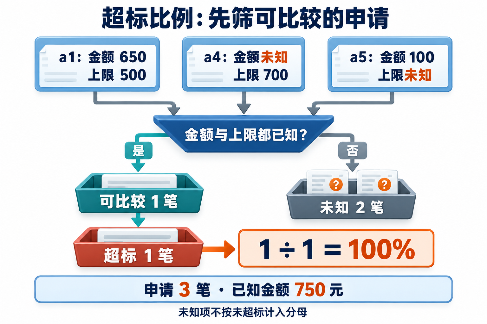
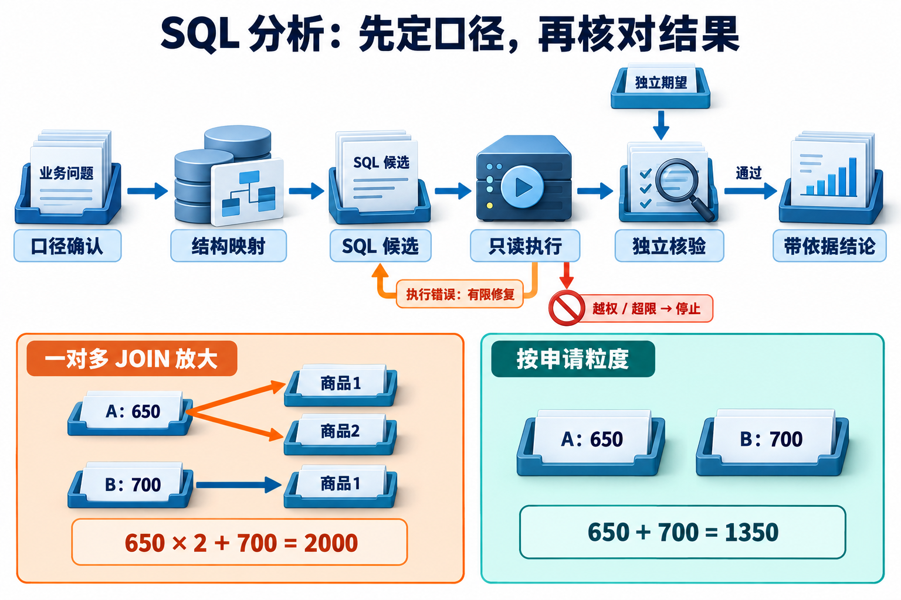
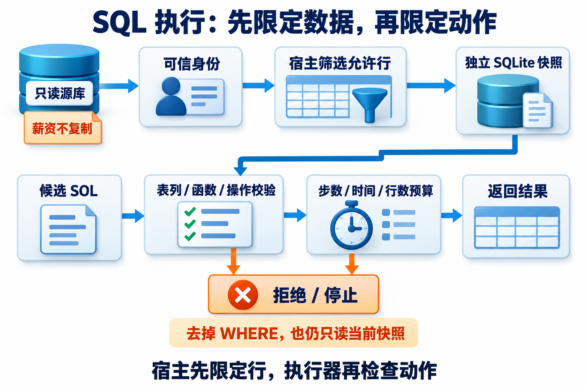

# 15 · Text-to-SQL 与指标核验

**SQL 能运行，只能说明查询通过了执行阶段。** 数字能否回答用户需求，要看统计对象、时间范围、行粒度和指标定义。先写清口径，再检查 SQL 各步保留了什么。

## 指标合同与数据结构

定义统计对象、对象的一行代表什么、时间字段和业务状态。比例要写清分子、分母和缺失值的处理。表和列映射从可信数据字典和业务定义取得，也要明确连接键与关系基数。

把有权限的数据范围作为执行边界。查询只使用当前允许的表、列与对象。字段名称接近时，按定义核对，不用字面相似度选择指标。

### 明确对象和统计口径

指标先写成可复算的关系。记录统计粒度、时间边界、状态、金额单位和是否允许缺失。模型选择表列时，核对主键、外键和连接基数。数据字典还要说明逻辑字段与物理字段的映射。

如果同一对象可以有多版，先按业务规则确定该用的版本，再进入统计。撤销、补录和迟到数据如何计入，也应写入指标定义。这样才能说明两次查询是否使用同一分母。

## SQL 的逻辑处理顺序

读查询时，先推导 `FROM` 和 `JOIN` 生成的行，再看 `WHERE` 过滤。随后检查分组、聚合、分组过滤和输出字段。最后看去重、排序与截断。数据库可在保证语义的前提下选择不同物理计划。

按关系变化一步步检查。连接生成行集合，WHERE 缩小范围。分组后计算聚合，HAVING 再过滤组。窗口函数对已有结果行计算排名或累计。最后检查输出列、排序和截断是否影响用户看到的范围。

CTE 可帮助表达阶段和粒度。引擎可能内联或物化它。安全边界由身份和执行层控制，性能用实际执行计划与测量判断。

## 连接后的行粒度

一对多连接会把主表对象复制到多行。聚合主表金额前，要先把明细归并到目标粒度，或按对象核对基数。对金额直接去重会丢掉金额相同的独立对象。只需要判断明细存在时，可以使用存在性条件。

左连接的匹配条件决定哪些右表行能附到结果上。连接后的筛选再作用于整行。对右表字段施加会排除空值的条件，可能删掉那些无匹配的左表对象。

### 连接对聚合的影响

主表对象 i 的金额为 `aᵢ`，连接后匹配数为 `nᵢ`。直接对内连接结果求金额，会变成 `Σ aᵢ×nᵢ`。要统计每个对象一次，应先将明细压回对象粒度，或仅筛选是否存在匹配。

保留无明细对象时，检查外连接和条件所在位置。先在明细分支筛选再连接，可以控制附带行；连接后按空值不通过的条件筛选，会移除无匹配的主表行。检查结果中的唯一对象数和总行数，再判断聚合有没有改变统计范围。

## 空值、分母与比率

SQL 条件有真、假和未知。普通比较遇到空值时可能产生未知，筛选只保留真。核对选择的聚合函数是否计入空值。总数、有效值数和可比较对象数要各自统计。

比例只按约定的对象集合计算。分母为零时返回未定义，按产品合同显示。把缺失金额当作已知零值，会改变合计和可比较范围。

### 三值逻辑到统计列

`COUNT(*)` 数结果行。针对一列的计数排除该列空值。金额合计常只包含已知值。存在记录但金额未知，与金额明确为零有不同含义。范围内记录总数、已知值数和可比较数都可以同时返回。

比例先按逐行条件生成可比较和达标标识。可比较标识要求必要字段齐全，再按定义聚合分子分母。用 `分子 / NULLIF(分母, 0)` 留住零分母的未定义状态。实际查询还要确认除法类型，避免整数截断。把缺失数和可比较比例一起交付。

## 执行层限制

执行前用适合数据库方言的解析器检查语句和引用对象。数据库再用受限身份、只读路径和资源上限执行。需要租户隔离时，使用数据库或可信服务落实行范围。只读配置限制写入，也要限制读取范围、输出规模与耗时。

### 对生成语句和连接分别约束

值使用绑定参数。表名、列名和可用运算由可信结构校验。执行时只提供允许读取的连接与行范围。资源控制覆盖超时、返回规模与扫描成本。执行结果中不需要的字段也不交给模型。

测试权限时检查受限数据实际是否可达。测试业务正确性时，用独立的期望结果核对粒度、日期和聚合。语法反馈可以帮助修正查询，独立验收使用的数据与期望留在验证侧。

## 修复与结果回查

错误反馈应区分语法、权限、字段含义和运行成本。允许修复时设尝试上限。修复后重新走结构和授权校验。

生成文字时，逐项把数值对回结果列。保留单位、时间范围、统计对象和未知条件。结果有缺失或分母很小时，明确适用范围。

## 语义验收

用重复明细、空值、无匹配、日期边界和不同租户的数据分别检查。核对每类结果的对象集合、聚合与比例。验证独立数据上的结果，避免把某一份样本刚好算对当作口径正确。

对同一查询构造能区分不同统计定义的输入。检查一对多重复、无匹配行、空值、零分母和边界日期。验证查询对允许的范围正确，对不允许的范围无法读取。最后由文字结论指回具体结果列与口径版本。

## 配套阅读

展开面试题、实验与资料

- [配套面试题](../docs/advanced/15-text-to-sql-and-data-analysis.md)
- [实验说明](../examples/sql_agent_lab/README.md)
- [一手资料](official-learning-map.md#进阶-15-的来源)

[上一章：14 · 知识摄取与索引生命周期](14-ingestion-and-index-lifecycle.md) · [工程进阶目录](README.md) · [下一章：16 · 服务交付与运维](16-service-deployment-and-operations.md)
