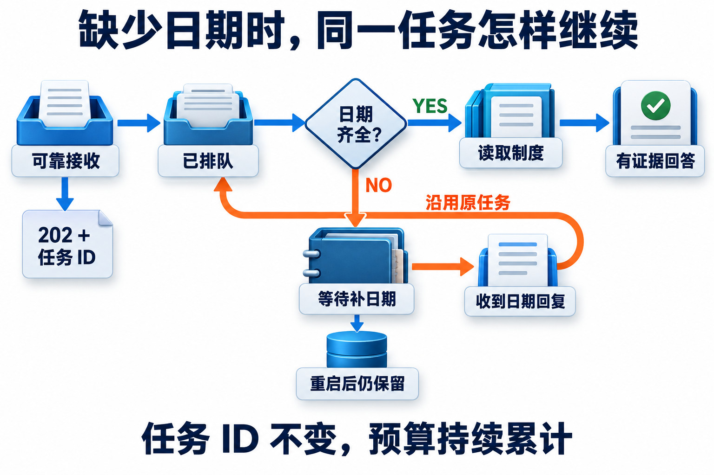
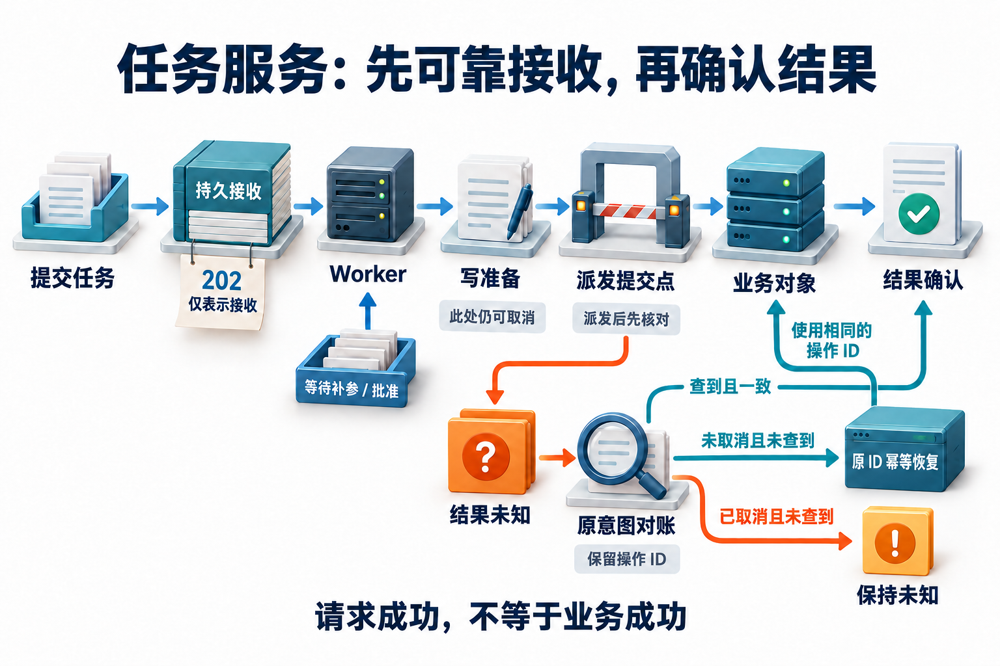
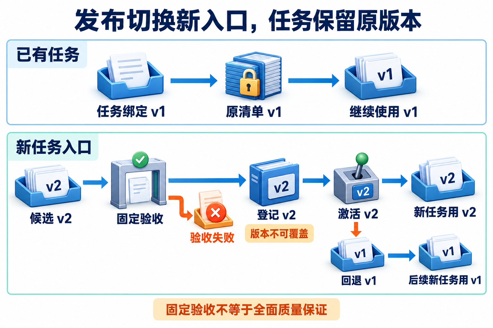

# 16 · Agent 服务交付与运维


## 把一次运行交付成可继续的任务

**任务服务**接收目标、保存任务身份，在后台推进工作，并提供等待、补充信息、批准、取消与查询结果的入口。**HTTP（超文本传输协议）**回答这一次请求有没有被处理；任务状态回答业务工作进行到哪里。服务把这两个生命周期分开，用户关掉页面以后，任务仍有可查询的身份和可靠记录。

**本服务仅在接收账本提交后返回202；202状态码本身不保证持久接收或最终执行。** [RFC 9110 §15.3.3](https://www.rfc-editor.org/rfc/rfc9110.html#name-202-accepted)将其定义为已接受但处理尚未完成，可靠接收来自本服务的持久化合同。

本地实验使用 Python 标准库和 SQLite，由一个后台工作线程（Worker）推进任务；模型决策使用有限规则。它复用政策助手的虚构资料、适用日期与授权函数；工单是独立 SQLite 服务对象。Python 官方明确[http.server 不用于生产部署](https://docs.python.org/3.10/library/http.server.html)，本章用它暴露机制，生产认证、多实例、高可用与公网部署需要额外设计。

## 16A：先交付最小只读任务服务

接收、调度与交付属于不同阶段：API先持久保存接收意图并返回任务身份，Worker只推进可执行工作；缺必要输入时保存等待原因并释放执行槽，输入到来后继续原任务。进程重启依靠可靠记录恢复，不能把内存回调当作唯一进度。

```text
用户请求 → HTTP API → SQLite接收账本 → 202 + task_id
                           ↓
                       单Worker扫描
                           ↓
                 读取制度 / 等待输入 / 准备批准
                           ↓
用户查询 ← 状态与事件 ← SQLite任务与可靠事件
```

内存 `Event` 只用来唤醒 Worker；进程重启后，通过数据库中的 `queued` 找回未完成工作。若内存通知丢了，定期扫描仍会继续。任务在接收事务提交之前不会创建运行目录，避免API还没可靠接单，后台就已经行动。

### 任务入口、身份与幂等键

**可信身份**来自服务识别的测试 Bearer token，不能来自模型或请求体中的 `user_id`。公开演示凭据 `demo-alice` 对应普通员工，`demo-bob` 对应同租户经理；每项任务还记录所属用户（owner），并单独校验访问权限。经理能读不同制度，不意味着他能查看另一位用户的任务；跨owner读取、事件查询或操作统一返回404。

**幂等键**将网络重发对应到原来的接收意图。服务在同一事务里保存 `(owner, Idempotency-Key)`、初始请求规范化hash与task ID；同键同内容返回原任务，同键异内容返回409。同一键在不同owner下属于不同任务；它与后续业务操作ID解决的不是同一个层次。

| 标识 | 回答的问题 | 本例约束 |
| --- | --- | --- |
| owner / user_id | 谁在调用，适用什么身份 | token映射，客户端不能自填 |
| Idempotency-Key | 这是不是同一次接收重试 | 每owner唯一，核对初始内容 |
| task_id / run_id | 找回哪项任务与运行目录 | 接收后稳定保存 |
| revision | 这份条件与证据属于哪一版 | 更正后递增，旧结果失效 |
| operation_id | 独立工单服务中的同一写意图 | 恢复沿用，不能重新生成 |
| access_revision | 本次读取或返回采用哪份当前文档授权 | 独立于release，撤权后递增 |

### 固定内容版本，仍使用当前文档授权

[14章](14-ingestion-and-index-lifecycle.md#删除撤权和回退必须一起验证)把索引generation与当前catalog分开。本服务沿用这项合同：release保存不可覆盖的内容，独立SQLite表`document_access`按稳定`policy_id`保存当前允许角色，`access_revision`记录修改代次。同一制度的P17-v1、P17-v2都属于P17，撤回P17不会因换一版正文而失效。

读取制度、返回任务或历史事件、接受批准、准备写入派发以及恢复后重新提交，都核对当前目录与当前测试用户。实际权限取内容快照原有范围与当前目录的交集，目录不存在或无法核对release时默认拒绝。`GET`、重复提交返回的旧任务和各动作响应统一返回过滤后的视图：`access_status=blocked`时清除旧证据、草稿、批准和政策派生结果；已发生业务对象只保留对象ID、原意图ID和租户，不继续返回制度金额或引用正文。历史执行状态和当前内容可见性分别展示。

修改权限由受信宿主调用`Engine.set_document_access("P17", [])`，没有新增公开HTTP管理接口。这个入口使用服务已打开的Engine；同root单进程约束仍成立。显式重新授予角色才可恢复读取，登记或回退release均不改目录。新policy_id也需宿主明确配置权限，不因新资料进入release就自动可读。

权限修改、批准与派发边界都通过任务库事务串行化。撤权先于派发提交则阻止新写入；派发先提交，后来的撤权不能宣称在途动作已撤销。恢复仍可沿本人原意图查验已有对象，但撤权时不得因查无对象重新创建；未知保持未知。目录是本地教学授权源，没有实现远程ACL同步、已经返回数据的收回或磁盘安全擦除。

### API与Worker如何避免覆盖彼此的更新

即使只有一个后台工作线程，API 线程仍可能与它同时修改同一任务。若两者各自读取旧JSON再覆盖保存，刚保存的取消可能被旧Worker状态覆盖。实验用 `BEGIN IMMEDIATE` 串行化“读当前任务→验证允许转换→写状态与事件”，所有修改入口都遵守同一个事务边界。

[SQLite事务文档](https://www.sqlite.org/lang_transaction.html)说明同时只能有一个写事务，IMMEDIATE会尝试先取得写事务。它能保护本地状态转换，不能把另一个数据库或远程API并进事务。本例还用POSIX文件锁限制同一数据目录只有一个服务进程；不提供多副本Worker抢占与分布式租约。

### 扩展到多Worker时，领取必须是条件状态转移

以下是**扩展设计**，未由本地单Worker实验实现。输入是一项已可靠接收的任务；输出是某Worker在有限时间内推进该任务的资格，不是业务成功。任务记录需要额外保存领取者 `claim_owner`、领取代次 `claim_epoch`、租约截止时间、任务条件revision与取消标记。`owner`仍表示任务所属用户，`claim_owner`表示当前领取工作的Worker；领取或转交工作不能改变用户归属与访问权限。

**租约**是有期限的所有权。先SELECT一项queued，再无条件UPDATE为running，会让两个Worker同时领到它。领取应在事务或等价的条件写中完成：

```text
claim(task, expected_revision, worker):
  在短事务中读取数据库时间 now
  要求：可执行，未取消，revision仍相同，且未被领取或旧租约已过期
  原子写：claim_owner=worker，claim_epoch+=1，lease_until=now+租期，state=running
  返回新 epoch、条件revision与固定运行清单；受影响行数必须为1
```

多个领取者只能有一个成功；失败者重新选任务，不能继续使用刚才读到的旧行。可以用队列表行锁配合 `SKIP LOCKED` 降低领取竞争，但跳过被锁行得到的是队列消费视图，并非任意业务查询的一致快照。[PostgreSQL 17 SELECT 锁定说明](https://www.postgresql.org/docs/17/sql-select.html#SQL-FOR-UPDATE-SHARE)，核查于 2026-11-05。这里不提供可直接替换 SQLite 实验的 PostgreSQL 代码。

事务提交后才做网络调用，不能持有数据库写锁等待模型或用户。等待输入/批准时保存等待状态并释放执行槽；租约用于正在推进的短执行阶段，不宜让一条长租约覆盖用户数天的等待。

### 续租、迟到完成与取消分别检查什么

续租与完成都带 `task_id + claim_owner + claim_epoch`，要求记录中的领取者和代次匹配、`lease_until > 数据库权威now`且未取消；完成还要检查它计算所依据的条件revision与允许状态。这里核对的是Worker执行资格；用户请求的访问检查仍用任务的`owner`。

本设计中即使尚无人接管，租约过期后也不能直接提交完成，需重新取得资格。条件写失败表示失去资格，不能覆盖新状态。领取、续租与完成使用同一权威时钟，不能拿两个Worker各自的墙钟直接比较。

| 数据库时间 | 变化 | 允许的后续行为 |
| --- | --- | --- |
| 0秒 | A领到epoch=7，租约截止10秒 | A可以推进并按条件续租 |
| 10秒后 | A停顿未续租，B领到epoch=8 | 只有B可提交当前推进结果 |
| 12秒 | A带epoch=7返回 | 条件提交影响0行，记录迟到观察，不覆盖B |
| 13秒 | 用户取消，与B提交竞争 | 在同一状态转换边界决定谁先提交 |

递增代次可用作 **fencing（隔离过期执行者）**的凭据，但只在任务库拒绝迟到完成，并不能阻止A已经发出的外部请求。外部资源怎样原子核对代次与执行，见[持久执行](02-durable-execution.md)；业务幂等键仍用于识别同一写意图，两种机制不能互换。资源不支持隔离时，必须保留迟到副作用和结果未知的核对路径，不能把“任务更新失败”报告成“外部未执行”。

取消也不只是一个布尔值。取消先提交且尚无派发权时，应让续租、领取和派发都失败；派发先提交时，只能阻止后续步骤并核对已有动作。完成若晚于取消，应保存可审计的真实对象观察，按取消合同展示，不能以一次无条件 `state='succeeded'` 覆盖取消。批准写入路径中的`dispatch_committed`是本地实现采用的派发竞争边界；多Worker设计需把领取资格检查一并纳入该事务。

<div id="启动并走完缺日期路径"></div>

### 本地实验：提交任务、等待与补参

用缺日期的只读查询检查上述合同：提交海岚住宿金额650元后，任务应等待明确日期；补上2026-11-12后，沿原任务读取虚构的700元条款。这里验证等待与恢复，不判断真实报销资格。

在仓库根目录运行，看到`ready`与本地URL后保持终端开启。另一个终端使用curl；下面的token是公开测试身份，不是真实密钥。

```bash
python3 -m examples.service_lab.lab serve --root .local/service_lab/server --port 8765
```

```bash
curl -s http://127.0.0.1:8765/health
curl -s -X POST http://127.0.0.1:8765/tasks \
  -H 'Authorization: Bearer demo-alice' \
  -H 'Content-Type: application/json' -H 'Idempotency-Key: lodging-1' \
  -d '{"city":"海岚","amount_cny":650}'
```

读取返回的 `task.id`，把后续URL中的 `TASK_ID` 替换为实际值。查询会看到 `clarification_required`；补参后再查询，才会看到 `answered`。

```bash
curl -s http://127.0.0.1:8765/tasks/TASK_ID -H 'Authorization: Bearer demo-alice'
curl -s -X POST http://127.0.0.1:8765/tasks/TASK_ID/reply \
  -H 'Authorization: Bearer demo-alice' -H 'Content-Type: application/json' \
  -d '{"trip_date":"2026-11-12"}'
```

`reply` 只补当前缺失日期。`correct` 可以更正城市、日期、金额和事由，递增revision、清掉旧证据与草稿，并重新排队；不会重置累计预算。不能把缺参补全、修改业务目标与批准混成一条含糊的“继续”消息。

[](../website/assets/diagrams/advanced/A16B-task-clarification.png)

等待补参时，Worker 可以处理其他就绪任务，原任务的身份和状态仍保留。回复日期重新推进的是原任务，重启和补参都不能成为清零预算的理由。

## 16B：加入批准、写入与恢复

写入需将“批准具体内容”与“实际派发”分开。服务先保存待批准草稿及其条件revision，返回绑定完整内容的`request_id`和`payload_hash`；只有相同owner针对当前草稿提交这些字段，批准才能被接受。

配套接口将`mode=ticket`映射为政策例外咨询工单，草稿字段包含城市、日期、金额、事由与条款。这里的字段合同实现具体业务，批准与派发的状态边界则由下列接口共同维护。

| API | 合同 |
| --- | --- |
| `POST /tasks` | 接收查询或咨询任务；需Idempotency-Key |
| `GET /tasks/{id}`、`/events` | 查询本人状态、结果或持久事件 |
| `POST /tasks/{id}/reply` | 仅给等待日期的任务补日期 |
| `POST /tasks/{id}/correct` | 可改城市/日期/金额/事由；在途写与已创建对象不可改 |
| `POST /tasks/{id}/approve` | 当前request_id与payload_hash，且owner一致 |
| `POST /tasks/{id}/cancel` | 空对象；停止未提交工作，已提交写入继续对账 |
| `POST /tasks/{id}/resume` | 空对象；继续排队、结果未知或明确重新授权后的 `access_blocked` 原任务，执行前仍检查当前权限 |

批准绑定的任一业务条件改变，旧批准与相关证据就必须失效。更正先提交时不能派发旧内容；外部对象已提交后，也不能只修改本地文字来假装完成更正。批准后的派发分为两个阶段：

1. 批准验证后进入 `write_prepared`，此时尚未派发，仍可取消或更正。
2. Worker通过独立事务提交 `dispatch_committed` 并进入 `writing`，才取得派发权。

**派发提交是取消与派发的本地线性化边界。** 取消或更正先提交，Worker不会新建；派发提交先发生，请求可能继续完成，此后拒绝直接修改并保留原意图核对。

`writing`表示派发已由执行器接管，不表示远端已提交。业务对象是否已提交，由独立业务数据库中的记录证明；取消到来后不能倒推它没发生。已成功对象的撤销属于新业务动作，本例不实现自动补偿。

[](../website/assets/diagrams/advanced/A16-task-service.png)

先看202回执与业务成功之间隔着哪些持久状态，再找到准备派发和实际取得派发权的提交边界。取消在该边界前提交，就不会新建对象。

读图中的恢复路径时，还要检查当前权限：**仅在未取消、当前授权仍有效且符合幂等合同时，才允许重试原意图；已取消或已撤权时，只查询、不新建。** 取消或撤权后的单次查询为空仍然是未知，不能当作远端没有提交。图展示原意图的恢复路径，当前授权关卡由本章的独立目录落实。

### 外部已提交，本地未确认的真实故障窗口

本地任务数据库提交派发边界，保存 `writing`、原操作ID和获批的完整参数；独立业务数据库再创建工单。若业务提交后进程退出，对象存在，本地却没有成功确认。这两个数据库没有共同事务，不能因为各自用了SQLite就宣称原子提交。

第二进程启动时，将未确认的 `writing` 展示成 `write_outcome_unknown`，等待沿原意图恢复。业务服务以租户+operation ID原子去重，核对规范化参数hash；相同意图返回已有对象，不同内容拒绝。

恢复先查对象，再按取消状态与当前授权处理：

- **未取消、当前授权仍有效且查不到：** 可按本地业务服务的幂等合同提交原意图。
- **已取消或已撤权：** 只查不新建；查无对象也保持未知，因为单次缺失不能证明先前派发不会迟到。

恢复不重新领取决策和逻辑工具预算。其原理见[持久执行](02-durable-execution.md)，本章补的是跨HTTP与进程的实际交付路径。

取消同样区分位置。排队任务立即终止，清掉当前结果；已经派发的写意图保留取消标记，仍需确认对象。当对象实际已创建，返回 `cancelled` 及真实对象和 `cancel_requested=true`，不会声称工单消失。界面应把“停止后续工作”和“已有对象”同时展示。

### 任务状态如何对应用户界面

| 任务状态 | 用户应看到 | 能否算任务成功 |
| --- | --- | --- |
| queued | 已接收，待执行 | 否 |
| clarification_required | 请补具体日期 | 否 |
| approval_required | 可核对的完整草稿，等待批准 | 否 |
| write_prepared | 已批准，尚未派发，可取消或更正 | 否 |
| writing / reconciling / write_outcome_unknown | 已接管派发 / 正在核对 / 结果仍未知 | 否 |
| answered / write_succeeded | 有证据的回答 / 已确认业务对象 | 是 |
| cancelled | 后续停止，另列已有对象与未知项 | 否 |
| blocked_version / budget_exhausted | 需迁移 / 预算耗尽 | 否 |
| access_blocked | 当前文档资格不足；显示access_revision，等待可信处理 | 否 |

`GET /metrics`按owner分别统计接收、成功、等待、排队及累计决策，不把HTTP状态码当作质量指标。它是最小计数看板，尚未实现生产p95、账单和告警系统。要增加计时，分别记录接收、入队、执行、工具与终态，并沿[性能章](10-performance-and-serving.md)的口径计算；等待人工的时长不能偷偷从产品延迟定义里消失。

已经完成后才撤权的任务仍保留历史执行终态；`access_status`另外说明当前是否可看结果。成功计数是历史交付计数，不代表旧政策今天仍可读取，也不能代替内容过滤。

### 接收、排队与执行槽需要不同预算

可靠接单不能等同于无限接单。服务至少要分别约束待执行任务数、活跃模型/工具并发数、每owner占用及下游速率；等待人工的任务释放执行槽，但仍占用持久状态与保留空间。调度器只选择就绪且有预算的任务，某租户的大批量请求不应耗尽全部槽位。优先级与公平份额由产品合同决定，不能靠扫描顺序碰运气。

一个可手算的容量模型：4个执行槽，每项活跃阶段固定耗时2秒，则理想饱和能力为 `4/2=2项/秒`。按忽略起步、整数波次和现有在途的**流体近似**，持续接收3项/秒时净增约1项/秒，60秒净增约60项；停止接收后按同一理想能力还需约30秒清空这些工作。有限时刻的精确排队数另取决于到达时刻与在途口径。若改为4槽起初空闲、瞬间接收24项，每项恰好2秒且无额外开销，则分6波完成，最后一波从第10秒开始、第12秒完成。提高HTTP接收速度不会消除这些等待。

这个模型只用于说明队列预算，不是实测吞吐或尾延迟。实际任务时长不均、重试和工具限流都会改变结果。监测应分别记录排队时长、活跃时长、队列年龄和拒绝/延后数量；过载时限制接收或延后执行，不能通过无限重试把下游进一步压满。具体计时与并发评测接[性能章](10-performance-and-serving.md)，本地实验尚未实现这套生产调度器。

## 运行版本、发布与回退怎样一起管理

每项任务在接收时固定运行清单（manifest）：运行状态schema、离线策略模型标识、提示hash、工具合同hash、索引内容hash及release ID。已发布的release保存完整政策快照且不可覆盖；现有任务继续使用它绑定的版本。`runtime_schema`不兼容时进入 `blocked_version`，不会静默重置或把旧动作当新任务执行。

`POST /releases`只允许单独的公开测试操作员 `demo-operator`，它不能读取用户任务。候选版本按以下门槛验收：

1. 验证所有条目的必要元数据、日期和条款结构。
2. 用Alice的可信身份沿实际 `core.applicable` 路径运行三项金额固定的独立验收用例。失败返回422，不切换active；仅保留正确金额却移除Alice权限，也不能通过这组预期成功任务。

**撤权发布需要不同的验收预期。** 合法撤权发布应另建明确预期拒绝的验收集，本例不在发布时静默修改成功预期。

正常版本可以先登记而不activate，再切换。**回退只影响新任务入口，在途任务保持原manifest；两者都仍服从当前文档访问目录。** 新任务入口指回的必须是已验证的旧release。文档授权不属于可随内容回退的历史快照。

[](../website/assets/diagrams/advanced/A16C-release-binding.png)

两行分别表示已有运行与新任务入口。切换或回退入口不会改写在途任务的manifest；不兼容状态仍需显式迁移。

多Worker部署还要把运行版本接到领取条件：新代码只能领取它能读取并继续推进的状态，旧执行者的迟到提交仍受claim_epoch与revision检查。停机发布先停止新领取，再等待或持久保存当前阶段；“进程已经退出”不能代替远端动作核对。迁移必须保存操作身份、批准绑定和累计预算，不能为了适配新字段而把任务重置为未执行。此处给出升级边界，本地实现仍是单进程固定manifest，不包含滚动部署控制器。

本例的固定门槛能拦住海岚700被改成7000，以及缺元数据的条目，**不能证明所有新资料的语义正确或检索质量**。影子与灰度的完整方法仍见[评测闭环](09-evaluation-and-feedback.md)；实验实际完成候选检查、版本固定、切换与回退，不宣称模拟了生产流量灰度。

## 有界验收与一次故障处置

```bash
python3 -m examples.service_lab.lab --scenario all --output .local/service_lab/checks
python3 -m unittest discover -s tests -p 'test_service_lab.py' -v
```

七组自检使用操作系统分配的临时端口，真实发送HTTP，完成后关闭服务与Worker。除原有读取、隔离、补参重启、批准更正、故障恢复与发布回退，`authorization-revocation`还让旧任务等待→撤权→补参，检查旧草稿不可见、旧批准被拒绝、回退v1仍不可读。测试另覆盖重开同一目录、准备派发后撤权，以及撤权后对账已有对象或保持未知；均检查实际业务对象而非只看拒绝文字。

取消的并发屏障与真实跨进程退出73测试继续保留：派发先提交时记录取消意图与真实对象；第二进程沿同一操作ID核对对象数和累计预算。新增权限检查没有把两个数据库变成共同事务。

各组保留 `http.jsonl`、`result.json`、`grade.json` 与数据库；任务运行目录另有 `manifest.json`、`trace.jsonl`、`result.json`。数据库事件是可靠记录，导出文件是可重新生成的观察副本。`--scenario all`每次使用新的批次目录，服务启动则明确指定要继续的root，不会靠删除旧数据“恢复”。

故障处置演练：看到Worker未就绪时，先检查可靠任务状态与业务对象，再决定重启。若业务对象已存在、本地为结果未知，保留原root、操作ID和参数；恢复后核对对象ID、内容、owner和累计预算。若是版本不兼容，停止新派发并选择兼容运行器或经过验证的迁移，不用重建任务掩盖问题。

## 自检与答案

<details><summary>1. POST返回202后响应丢失，客户端应该换键再提交吗？</summary>

应该使用原幂等键和相同初始内容重试，找回已持久接收的任务。换键会表达另一份接收意图，不能自动去重。
</details>

<details><summary>2. 为什么经理也不能查小明的任务？</summary>

角色决定制度适用与业务权限，任务owner决定本服务中的私有运行访问。两者不能混用；测试刻意使用同租户不同角色验证这一点。
</details>

<details><summary>3. 回退active版本会让旧工单自动撤销吗？</summary>

不会。回退影响新任务采用的release，在途任务仍固定原manifest；已创建对象需要独立授权的补偿，本例没有实现自动撤销。
</details>

## 配套面试题与资料

- [Q102 接收账本与后台恢复](../questions/Q102.md)、[Q103 联合版本与在途任务](../questions/Q103.md)、[Q104 HTTP与任务指标](../questions/Q104.md)。
- [本章合订题源](../docs/advanced/16-service-deployment-and-operations.md) · [实验README](../examples/service_lab/README.md)。
- [Python SQLite接口](https://docs.python.org/3/library/sqlite3.html) · [SQLite事务](https://www.sqlite.org/lang_transaction.html) · [Python HTTP服务器](https://docs.python.org/3.10/library/http.server.html)。一手资料核查日期：2026-10-31。

[上一章：15 · Text-to-SQL 与数据分析](15-text-to-sql-and-data-analysis.md) · [工程进阶目录](README.md) · [下一章：17 · 事件驱动与主动任务](17-event-driven-and-proactive-agents.md)
