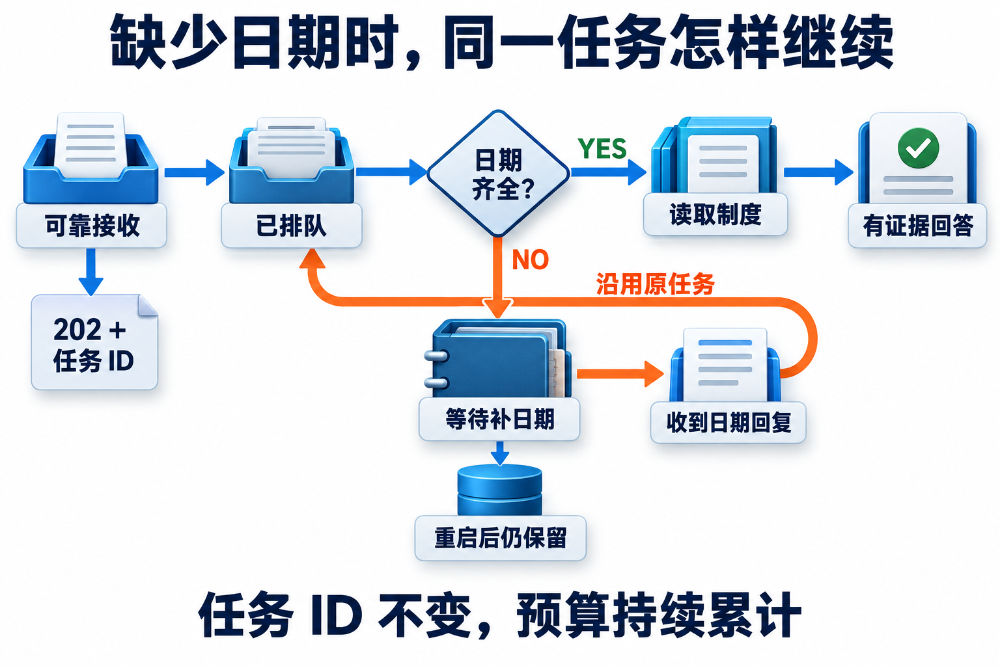
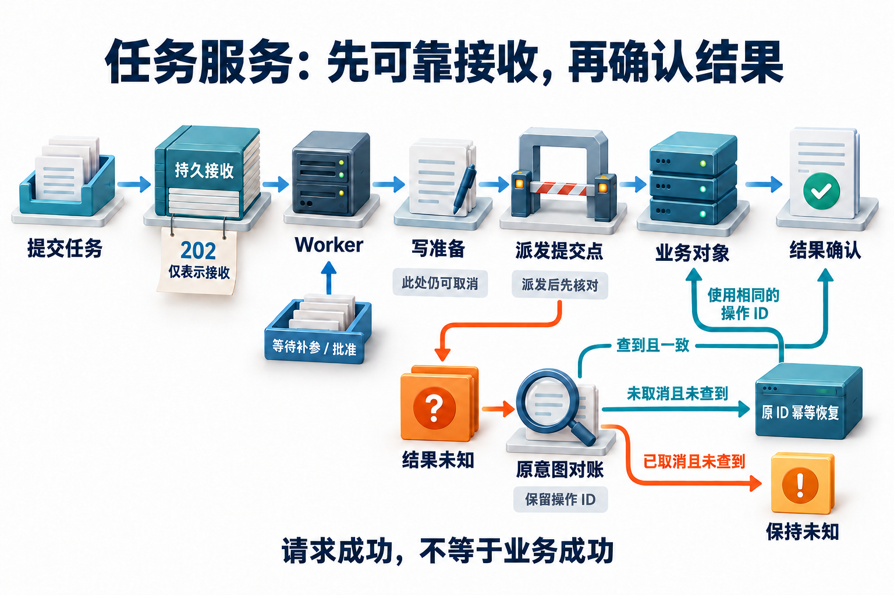
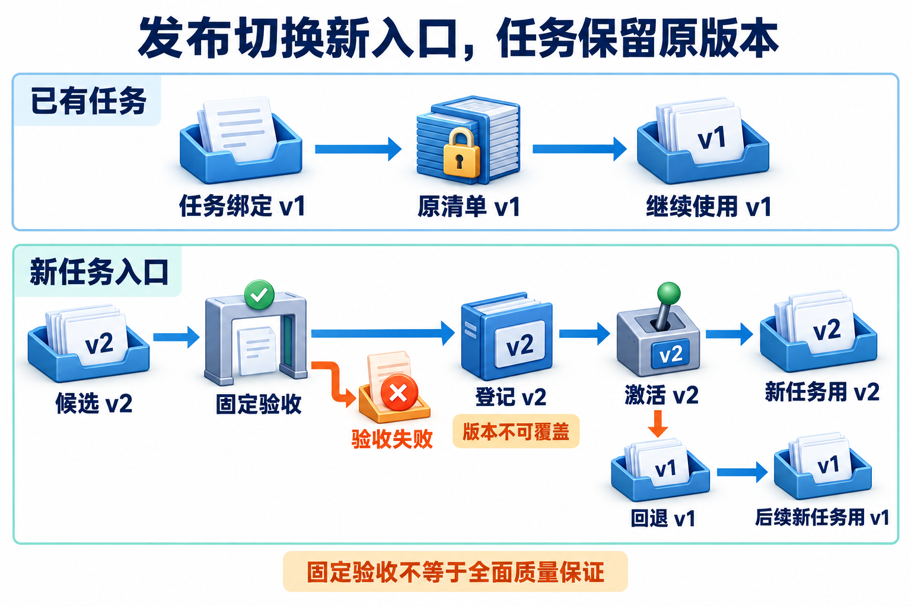

# 16 · Agent 任务服务与运维

**任务服务把一次请求交付成可查询、可暂停和可恢复的任务。** 返回接收回执前，先持久保存任务身份和请求。执行过程另行保存进展。用户用同一个任务编号查询、补参或取消。

## 16A · 持久接收与只读任务

### 身份、接收与请求幂等

用可信会话确定任务归属。持久保存任务编号、同一主体的幂等键和规范化请求。相同键与相同请求返回原任务。请求内容不一致时报告冲突。

HTTP 202 表示请求已接受处理。只有服务把接收记录提交后才返回，才能兑现持久接收的保证。它还未代表业务已经完成。读取、补参和取消都核对任务归属。

接收记录、幂等键与任务编号应在同一事务提交。网络响应丢失时，客户端沿用原键查询或重发。服务用身份和原请求指纹找到原任务。相同键但字段不同，返回明确冲突，防止把一次新业务意图关联到旧任务。

任务接收只解决 API 层的重复提交。一个任务可以派发多次外部动作。每个写入另外记录稳定操作编号，服务端按这个编号确认效果。

### 固定内容与当前授权

内容或模型版本随任务绑定，恢复时可找回具体输入。访问凭据和文档权限按当前状态验证。内容回退或任务重启后，原撤权结果继续生效。

任务恢复时从绑定版本读取资料和配置。读取受限资源前，再查当前主体、范围与授权版本。已读取但未交付的产物也要受最新披露规则约束。允许继续复用的证据与必须重新核实的证据，应可直接从记录区分。

### 任务领取、续租与取消

让 API 和执行者按期望状态、行版本或租约代次提交更新。任务领取是条件状态转换。同一条可执行记录只由一个领取者成功更新。未领取成功的进程重新选择任务。

续租检查持有者和代次。旧持有者迟到时，提交检查应拒绝旧代次。取消请求改变当前任务状态，与派发竞争时按明确的提交边界判断。已经派发的远端动作还要查询状态。

#### 原子领取和迟到提交

选择可执行记录后，按原行版本和可领取状态做条件更新。领取成功时写入执行者、租约到期和新代次。提交产物时校验当前代次。旧执行者即使完成了本地计算，也不能覆盖新执行者的状态。

取消分为等待中、准备派发和已经派发。前两类可以通过条件提交阻止新写入。派发权提交后，远端仍可能执行。取消标记要和操作编号一起保存，等待外部状态核对。

### 等待与补参

缺少必要条件时，保存待补字段与恢复位置，释放执行槽。收到补充后，校验任务身份、等待状态和提交版本。接受后给原任务重新排队。任务编号和累计预算继续沿用。

补充回复绑定原任务、当前等待节点与所需字段。回复重复时复用第一次接受结果。状态已经继续或条件换版时，告知旧回复不再适用。对同一等待条件只释放一次执行资源，并从剩余预算继续。

## 16B · 批准写入与恢复

### 外部写入与结果确认

批准绑定具体对象、参数和版本。先持久记录外部意图。执行器通过条件更新取得派发资格，再用原操作编号提交。确认后保存回执和对象标识。提交后回执丢失时，先在外部按编号核对。

取消或撤权后，只做已允许的状态查询，停止新写入。单次查无对象时保留未知状态。符合当前审批、授权和幂等合同的待确认动作，才考虑按原意图恢复。队列状态与业务对象状态都要记录。

#### 准备、派发提交与业务落账

先写入准备状态和批准后的完整意图。执行者在提交派发权前再验权限、版本与取消状态。派发权提交后把同一操作编号交给服务。服务端落账与本地记录回执各有各的事务边界。

恢复先查询远端。如果结果已经确认，补记本地状态。只有仍获准写入且服务支持安全重放时，才能继续同一意图。服务端按主体范围、操作编号和参数指纹做原子去重。超时后不能把待执行重新当作一笔新请求。

### 状态、排队与容量

界面显示已接收、等待、运行、完成、失败和结果未知。等待审批或补参可释放计算槽，持久任务仍需管理。接收上限、等待队列、并发槽和外部调用预算分别配置。负载超出时提前拒绝或按产品约定降级。

区分持久任务数量、等待执行数量和活跃执行槽。等待用户的任务不占运行槽，也会占用存储和后续恢复资源。按租户及全局限制接收量，按任务优先级和剩余期限安排队列。记录长期等待和队列满时的处置。

## 发布绑定与回退

记录任务绑定的代码、配置、模型与资料版本。发布只改变新任务的默认版本。在途任务要能继续用原版本、按规则迁移或安全暂停。回退默认版本时，再检查持久状态兼容、审批和外部写入。

新任务的默认版本、已有任务的绑定版本和存储版本分开管理。发布前用旧版等待记录测试新运行时能否读取。迁移时保留原版本、审批身份和业务操作编号。必须暂停时，让界面显示具体阻塞原因和恢复条件。

## 服务验收

验证重发接收请求、进程重启、重复领取、补参竞争、取消和回执丢失。验收核对任务版本、用户看到的状态，以及外部对象和重复操作数量。负载测试另外记录排队、拒绝和用户端完成时间。

## 配套阅读

展开面试题、实验与资料

- [配套面试题](../docs/advanced/16-service-deployment-and-operations.md)
- [实验README](../examples/service_lab/README.md)
- [一手资料](official-learning-map.md#进阶-16-的来源)

[上一章：15 · Text-to-SQL 与数据分析](15-text-to-sql-and-data-analysis.md) · [工程进阶目录](README.md) · [下一章：17 · 事件驱动与主动任务](17-event-driven-and-proactive-agents.md)
