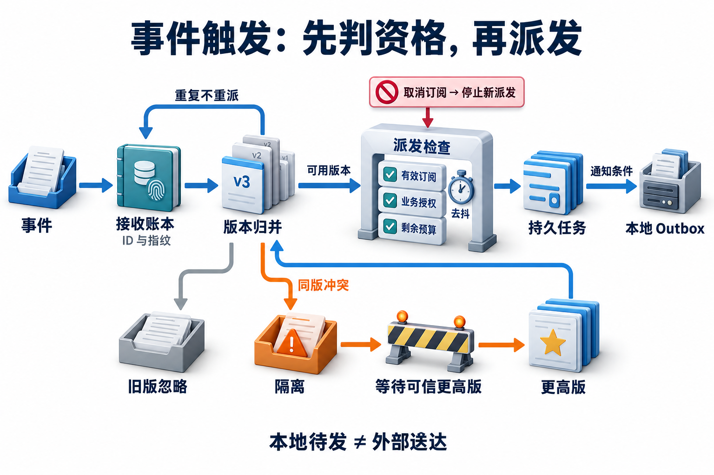
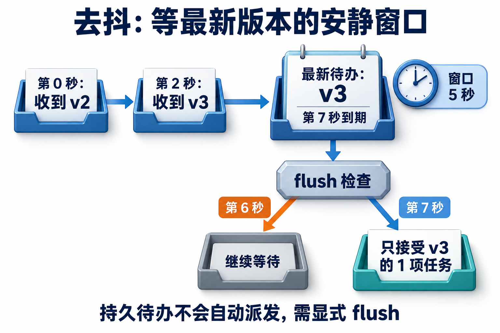
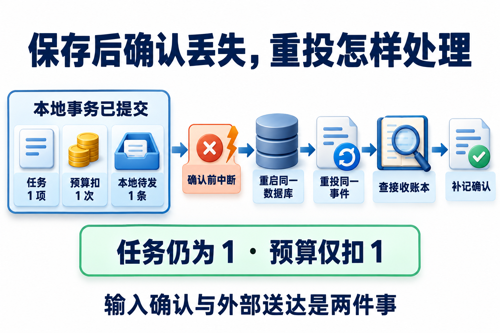

# 17 · 事件驱动与主动任务

**事件提供变化的事实。订阅决定什么变化可以产生任务。** 订阅应明确主体、对象范围、触发条件、频率和允许动作。每次派发仍要检查当前权限与订阅状态。

## 事件接收、派发与通知

| 记录或动作 | 工程责任 |
| --- | --- |
| **事件标识** | 识别同一次来源事件的重复投递。 |
| **业务意图标识** | 识别同一订阅对同一版本要做的工作。不同事件也可能指向同一意图。 |
| **运行标识** | 追踪一次实际执行和结果。 |
| **通知意图** | 记录拟通知的对象、渠道和内容。区分已提交、服务已接收和已确认送达。 |

接收先验证来源和可接受范围。到期准备派发时，再验订阅、对象版本、权限与预算。通知是额外的外部动作，仍按接收人、内容和渠道检查。

### 三次判断使用不同的依据

接收时核对来源、结构、重复事件和对象版本。生成任务前再次核对订阅是否启用、当时条件是否仍适用，以及是否还有预算。通知前核对接收方、内容权限和发送状态。三步分别保存决定及拒绝原因。

## 分区顺序与业务版本

事件日志通常只对同一分区提供顺序。并行处理时，完成顺序也可能和读取顺序不同。确认读取位置时，只越过已连续提交的记录，避免重启后跳过尚未完成的事件。

对象状态按可信来源版本更新。晚到的旧版本留在历史，不覆盖当前状态。同一版本内容不同，要记录冲突并暂停使用。业务生效期与事件到达时间也分别保存。

并行处理会使较晚读取的事件先提交。消费进度记录的是下一条待处理位置，推进前检查此前是否仍有缺口。按分区保存确认位置和未完成项。业务版本仍用于确认对象的当前状态。

处理同版异内容时保留双方来源，记录冲突并暂停相关派发。后续来源提供能确认的新版本时再恢复。原版本的重复事件不会清除已记录的冲突。

## 事件时间与迟到修订

时间窗口按事件发生时间聚合。水位线估计处理到了哪个事件时间。允许固定范围乱序时，可把分区进度设为「已见最大时间减去乱序容差」。合并活跃分区时，通常使用最慢进度。

水位线越过窗口边界可以触发输出。允许迟到修订时，保存窗口状态和结果版本。超过保留条件后，按约定丢弃、记录或补偿。空闲分区会影响推进，恢复时也可能带来迟到事件。

### 水位线、窗口和结果版本

每份聚合结果绑定窗口范围、聚合键与修订号。首次输出时记录当时的水位线。迟到事件还在允许保留期内，就更新对应窗口并生成新修订。下游用同一结果身份处理更正，避免把修订当作新的独立通知。

处理时间决定系统何时触发检查。事件时间决定事件归属。迟到保留期和空闲分区规则要一起核对。新数据可能推进窗口读数，却仍保留一段允许修订的时间。

## 去抖、合并与循环控制

去抖等待变化稳定后再派发。记录待办版本和到期条件。只对允许合并的变化保留最新状态，需要逐笔处理的业务继续保留单独记录。

保存可信的根事件和因果关系。限制派生次数、深度和订阅预算。回写没有实质变化时，避免产生新的业务任务。取消或禁用订阅后，新任务不再派发。

去抖到期前如果有实质变化，按策略更新待办和期限。去抖主要减少重复派发。业务需要记录每一笔变化时，保留事件并按允许范围聚合结果。定时触发也要能在重启后发现已到期的待办。

自动回写会形成多步因果链。来源标识只说明直接发送者。再记录可信的根事件和父事件，用于限制派生深度与整链预算。重投不能重新增加任务额度。

## 提交、确认与重投

把输入去重记录和本地状态变更放在同一事务。提交完成后，再确认已消费。若确认丢失，来源可能重投。消费方读取原记录，复用已提交的决定。

外部任务或通知需要持久派发意图。回执未到时按业务标识查询。验收分别覆盖重复投递、乱序、迟到版本、订阅撤回和确认丢失。核对业务对象和派发次数。

本地事务同时保存输入回执、对象状态、待办和额度变化。回执只有在提交以后发出。若外部任务服务另外接收意图，使用自身的接收幂等和查询。测试提交前后中断，分别核对事件是否丢失、任务是否重复和通知是否真的被服务接收。

## 配套阅读

展开面试题、实验与资料

- [配套面试题](../docs/advanced/17-event-driven-and-proactive-agents.md)
- [实验说明与源码](../examples/event_agent_lab/README.md)
- [一手资料](official-learning-map.md#进阶-17-的来源)

[上一章：16 · 服务交付与运维](16-service-deployment-and-operations.md) · [工程进阶目录](README.md) · [下一章：18 · 多模态与实时语音](18-multimodal-and-realtime-agents.md)
