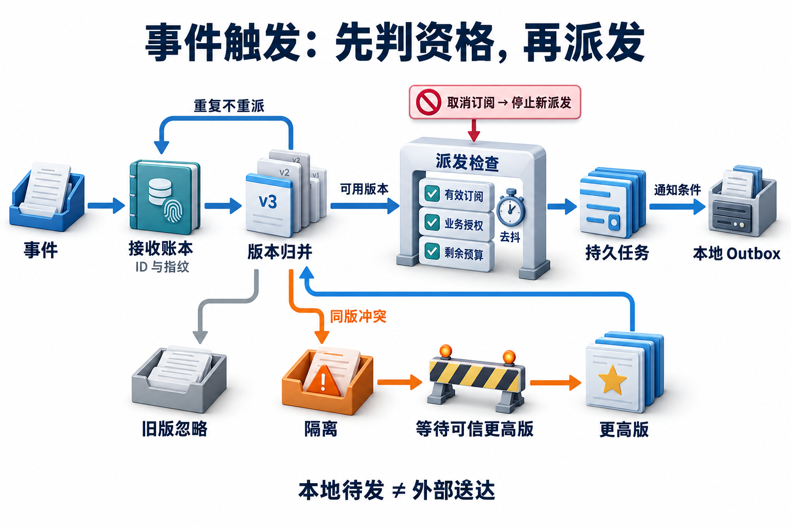

# 17 · 事件驱动与主动任务：没有新消息，也有明确的工作边界

## 订阅的不是“永远替我做决定”

员工订阅了海岚住宿政策变化。制度从700元更新为750元，系统应复核受影响申请并准备一份比较说明；如果制度只修正标点，就不应连续发送“有更新”。用户取消订阅后，一条网络中迟到的旧事件仍可能送达，系统需要决定是否继续接受任务。

**事件（event）**是某件事已经发生的记录，例如“政策对象发布了第3版”。**主动任务**是系统依据已建立的订阅和授权，在没有新聊天消息时启动的工作。事件提供触发原因，不能代替业务执行授权，也不自动授予通知用户的权限。

本章学会定义触发、版本、预算与通知合同，并用真实SQLite账本检验重复、乱序、取消和中断。建议先读[持久执行](02-durable-execution.md)、[知识生命周期](14-ingestion-and-index-lifecycle.md)及[任务服务](16-service-deployment-and-operations.md)：这里复用恢复与服务合同，重点放在“何时开始下一项工作”。

## 从一个事件到一个可解释的任务

一个完整入口至少包含订阅对象、可信用户、事件身份、业务版本、允许动作、最大工作量和通知条件。**订阅（subscription）**保存用户关注的范围与有效状态；**接收账本（inbox）**保存已收到事件的处理决定，避免网络重复投递制造另一份业务工作。

[](../website/assets/diagrams/advanced/A17-event-dispatch.png)

沿主线看，接收记录、任务接受和通知意图是三个不同结果；重投沿账本查原决定，不再重复派发。分支中的同版冲突会清除待派发项，只有可信更高版才能重新建立候选；取消阻止后续任务，已有任务及外部送达仍按各自合同核对。

正常路径可以分成五步：

1. 验证事件来源，读取事件ID、对象ID、版本和条文。真实Webhook的签名与发送方需要在宿主边界验证；载荷里的`origin`不是身份证明。
2. 对照接收账本核对事件ID和内容指纹。同ID同内容是重投；同ID换内容是冲突，不能覆盖原记录。
3. 比较对象版本，保存新对象，忽略迟到旧版；对同版不同正文记录冲突，等待来源澄清。
4. 为有效订阅合并待处理工作，检查复核授权和持久预算，再接受一项任务。
5. 只有符合通知条件时写入本地Outbox，记录输入确认。后续发送器及外部送达是另一条合同。

SQLite把同一事务中的修改一起提交或回滚，为本实验提供可检查的原子边界。它不自动替外部HTTP服务或消息渠道提供相同保证。[SQLite事务](https://www.sqlite.org/lang_transaction.html)

## 三类标识为何都要保留

| 标识 | 识别什么 | 本章示例 |
| --- | --- | --- |
| 事件ID | 来源的一次事件；网络可能重复投递 | `policy-event-203` |
| 业务意图ID | 用户希望完成的同一项复核 | `review:s1:policy-hailan:v3` |
| 运行ID | 实际接受后的执行记录 | `run-…` |

来源可能以两个事件ID重复报告同一个政策版本，因此仅按事件ID去重不够。复核意图还应绑定订阅、对象和版本。同一意图的任务接受需要唯一键和参数核对；重新尝试执行也不应随意换意图ID绕过去重。

运行ID帮助追踪执行，不能被拿来当所有业务动作的幂等键。若服务崩溃后为同一复核建立新运行，仍需通过业务意图找到原任务与已有对象。与[16的任务合同](16-service-deployment-and-operations.md)接入时，将意图ID映射到接受幂等键，可信订阅用户映射到任务所有者，版本和条文固定为输入。实验只建立本地`accepted`任务，没有偷偷调用HTTP服务或完成实际复核。

## 时间与版本各管一件事

**事件时间**是来源声称事情发生的时间，**处理时间**是接收器处理它的时间。网络延迟和重投会使两者不同；不能凭“最后到达”选择最新制度。实验用单一可信对象的递增整数版本比较，先收到v3再收到v2，当前对象仍是v3。

版本比较也有适用条件：多来源编辑、并行分支或制度生效日期不一定能塞进一个整数。生产系统要明确来源版本合同与业务生效时间；检索历史差旅适用哪个政策，继续由[14的时间和索引规则](14-ingestion-and-index-lifecycle.md)处理，不能用消息顺序替代政策适用性。

同版正文不同会持久标记冲突，并清除该版本尚未派发的工作；重复投递或再次收到原正文都不能解隔离。等待可信来源给出更高版本后，才重新建立复核候选并引用新版本，即使新正文与最早保存的正文相同。已接受任务与既有Outbox不在本实验中自动追溯撤回，需由消费端另按16的取消或补偿合同处理。没有冲突时，同样正文的新版本可以更新版本记录，同时保持安静；但这只是本实验用正文相等定义“无实质变化”的教学简化。实际制度的适用对象、日期或权限改变，即使正文相似也可能必须通知。

## 去抖、合并、循环和预算

**去抖（debounce）**是在短时间内持续收到变化时，等一个安静窗口再派发。实验设5个逻辑秒：v2在第0秒到达，v3在第2秒到达，第6秒还不派发，第7秒只接受v3的一项复核。待处理记录放在数据库，重启不会因为内存队列消失而丢失工作。

合并必须符合目标。如果用户需要每一笔交易的审计事件，不能只留最后一个；本例只需要当前制度的复核，所以同订阅可合并成最新版本。去抖改变何时派发，不证明所有工作都应合并。

系统自己的同步回写可能再触发事件，形成循环。实验将可信宿主标记为本实验来源的事件跳过，并对订阅设置“最多接受几项复核”的持久预算。真实系统还需定义因果链、最大深度或事件类型过滤；简单来源标记不是跨系统循环检测的完整实现。预算用尽应记录停止原因，不能重启后清零。[Cloudflare调度入口](https://developers.cloudflare.com/agents/api-reference/schedule-tasks/)

## 三道门分别做决定

**触发资格**回答“这条事件是否匹配仍有效的订阅”；**业务授权**回答“这个用户是否允许进行这类复核”；**通知条件**回答“是否值得生成通知，以及允许通知到哪里”。订阅被匹配，不代表可以执行付款、批准申请或广播消息。

实验把复核授权设为可信配置`review_allowed`，把本地通知开关设为`notify`。一个用户可以允许复核但要求安静；另一个用户仍有订阅，却已失去复核资格。取消订阅同时清除待派发项，派发时再次检查有效状态，防止等待窗口内取消后继续新增任务。

已经接受的任务如何取消，是另一层竞争合同。本实验取消不追溯撤销已接受任务，也不删除审计记录；若用户要求停止在途执行，应连接16的取消接口并说明已发生副作用的处理。

## 处理成功但确认丢失

**Outbox（待发送箱）**是在本地事务中记录准备发送的消息，之后由独立发送器取出并发送。它解决的是数据库变更和“发送意图”之间的一致性；发送器仍可能重试，外部收件端是否去重需另外核实。[Transactional Outbox模式](https://docs.aws.amazon.com/prescriptive-guidance/latest/cloud-design-patterns/transactional-outbox.html)

实验在保存任务、预算和通知后，故意在输入确认前抛出故障。关闭数据库再重新打开，来源重投同一事件时，账本找到已处理决定，补记确认，任务数和通知数仍各为1。另一个场景在接收提交后、任务派发前中断：重投先派发数据库中已到期的待处理项，再确认；若去抖尚未到期，明确由定时入口`flush(now)`在到期后派发，本实验不运行常驻定时进程。通知正文带政策版本和条文；`local_pending`只表示本地对象存在，不能报告“邮件已送达”。

## 动手：先预测失败，再读结果

```bash
python3 examples/event_agent_lab/lab.py --scenario all --output .local/event_agent_lab/all-report.json
python3 -m unittest discover -s tests -p 'test_event_agent_lab.py' -v
```

运行前预测三种情况：同一事件投递两次会扣几次预算？v3后到v2时通知应引用哪版？处理完但未确认就重启，是否需要重新复核？运行后打开报告中的真实数据库快照，再对照独立`expected.json`，不要只看最终`passed`。

10个场景实际操作SQLite、事务与重开文件；逻辑时间由输入控制，未启动真实队列、模型、调度器或消息发送器。测试另换事件ID、金额与版本，并检查取消发生在待派发期间。下一步可将任务接受替换成16的HTTP接口，但仍使用同一意图键，并验证接受后响应丢失的路径。[实验说明与源码](../examples/event_agent_lab/README.md)

## 自检

<details><summary>1. 两个不同事件ID指向同一对象版本，必然要执行两次吗？</summary>

不必。事件ID处理投递重复，业务意图与版本规则处理业务重复；本例同版同内容不新增任务。
</details>
<details><summary>2. 第6秒没有任务，说明去抖失败了吗？</summary>

若第2秒收到变化且窗口为5秒，第7秒才到期；应对照逻辑时钟和最新待处理版本。
</details>
<details><summary>3. 本地Outbox有一条记录，可以报告通知已送达吗？</summary>

不能。还需发送尝试、目标渠道回执及其语义；本实验只证明本地通知意图被持久保存。
</details>

## 参考资料

[Cloudflare主动调度](https://developers.cloudflare.com/agents/api-reference/schedule-tasks/) · [SQLite事务](https://www.sqlite.org/lang_transaction.html) · [AWS Outbox](https://docs.aws.amazon.com/prescriptive-guidance/latest/cloud-design-patterns/transactional-outbox.html)。动态文档核查日期：2026-10-31；本文机制以仓库本地实现为准，厂商调度只作为对照。

[上一章](16-service-deployment-and-operations.md) · [下一章](18-multimodal-and-realtime-agents.md) · [工程进阶目录](README.md)

[对应面试题：Q105、Q106、Q107](../docs/advanced/17-event-driven-and-proactive-agents.md)
