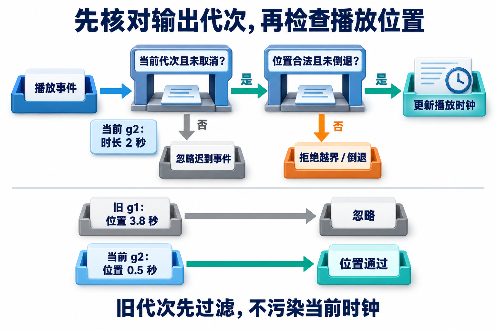
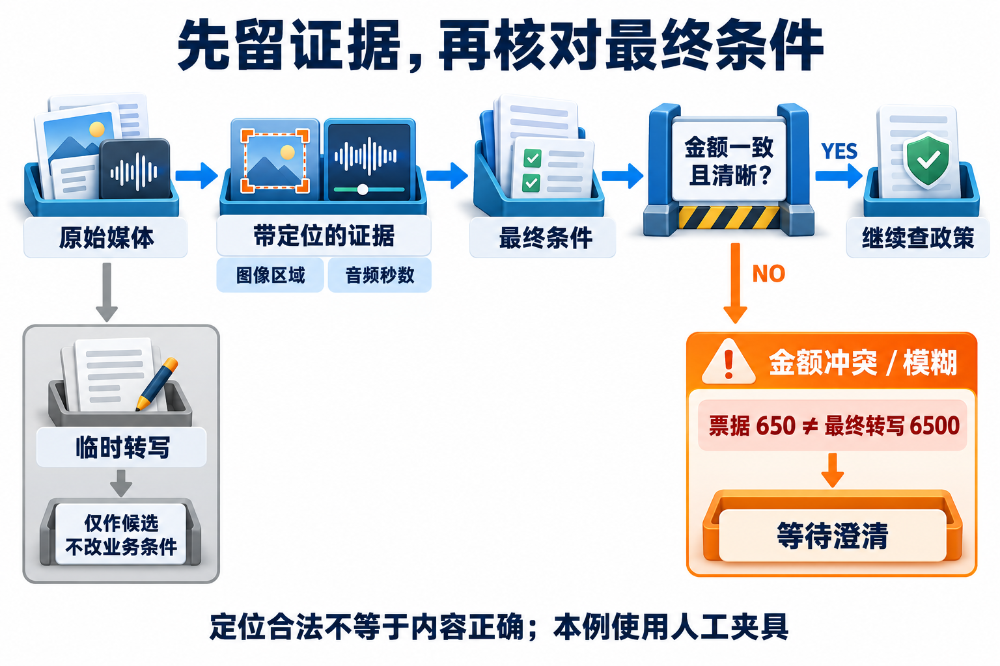
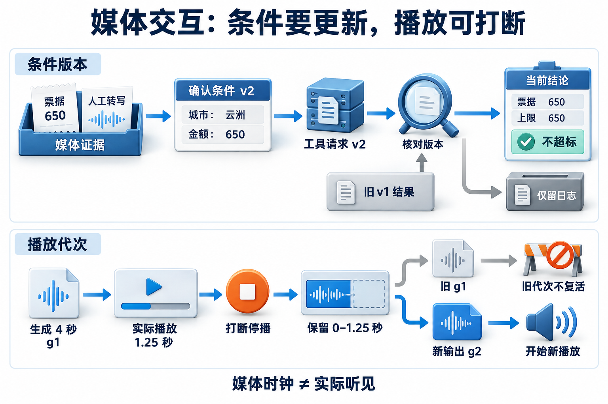

# 18 · 多模态证据与实时语音

**多模态系统把图像和音频变成模型可用的表示。** 识别结果还要和原始媒体、用户确认及业务记录对照。实时语音还必须跟踪已经生成、待播放和已播放的进度。

## 18A · 媒体证据与条件核对

### 视觉表示与流式识别

一类视觉语言模型先把图像划成小块，编码空间信息，再把视觉向量投影到语言模型可用的维度。识别文字时，原图位置和可见范围仍要保留。

流式语音识别会先给出临时结果，再根据后续音频修订。等待更多后续音频可能改善判断，也会增加延迟。应在目标语言、噪声和任务条件下对照准确率与等待时间。

视觉表示和 OCR 输出承担不同工作。向量供模型理解画面与上下文。文字识别提供可回查的文字和位置。遇到裁切、模糊或遮挡时，记录可见范围和未知项，保留取回原始媒体的路径。

流式识别按音频段推进。服务可以多次修订同一段，并依次提交多个最终段。保留段标识、修订号和结束位置。重连后按源媒体位置换算，防止把新的流偏移直接当作连续时间。

### 识别终态与源位置

「最终转写」表示识别服务结束对这一段的临时修订。用户仍可纠正，业务条件也要另行确认。图像证据保存页码、边框与坐标系，音频证据保存源时间区间和片段编号。

裁切、缩放、旋转或重新采样后，保留转换信息。复核时把位置还原到原始媒体。媒体时间、客户端播放位置、绝对日期和本机耗时各自记录。

#### 预处理坐标和原始坐标

裁切记录原始偏移，缩放记录比例，旋转记录方向。核对位置时按变换的逆序还原。音频重新采样时统一按采样率和起始偏移换成源时间。提交关键结论前检查位置是否仍指向相同版本的媒体。

识别置信度表达服务对当前输出的估计。临时结果的稳定程度表达它是否还可能变化。业务确认则取决于用户、证据和规则。将三项分别保存，下游才知道还需要哪种核验。

### 条件更新与旧结果

关键条件被更正时增加版本。让依赖旧条件的待办和结论退出当前路径。已经派发的读取结果按请求版本校验。迟到结果可以保留在历史，只有仍适用的证据才继续使用。已提交的写入另查外部状态。

把关键条件版本放进工具请求、结果包和回答。接收回包时先核对版本，再判断结果可否纳入。更新条件时废弃旧待办，也明确哪些旧事实仍可保留。等待确认的写入用操作身份跟踪，避免和旧查询结果一起丢掉。

## 18B · 语音链路与播放控制

分段链路把识别、文本决策和语音合成拆开。可以独立检查每段输入和产物。端到端语音模型可以直接处理音频交互，仍要提供用户轮次、工具请求、证据和实际播放状态的可查记录。

选择语音链路时，同时考虑首段发声、识别可解释性和工具动作的控制。分段链路更容易定位识别、推理与合成各段的故障。直接音频链路需要额外确认事件是否可用、打断如何传递、历史怎样裁剪。用同一任务测完整交互。

### 生成、入队、播放与打断

同一输出代次没有跳播时，应当满足 `已播放 ≤ 连续入队 ≤ 已生成`。收到网络数据只推进接收状态。连续入队后才增加待播范围。播放器按输出代次回报已播位置。历史只纳入已经确认播放的部分。媒体位置反映播放进度，用户实际听见多少还取决于客户端环境。

缓冲达到上限时，减慢上游或按合同停止本代输出。打断时先停止客户端播放，清除未播放缓存，再按服务能力停止生成。迟到事件先查代次和取消状态，再校验位置。下一段输出使用新代次。

#### 连续缓冲与反压

每个音频块记录输出代次、序号和媒体时间范围。乱序块先等待缺口补齐。连续入队的上界减去已播位置，就是当前待播长度。要按媒体时间或采样帧数计量，避免把块数当作固定播放时长。

缓冲达到高水位时降低上游速度。降到低水位后再恢复。上游不支持暂停时，按合同停止或取消本次输出。随意丢掉中间块会造成播放缺口，也会让历史和用户实际听到的内容错位。

先按输出代次处理播放确认。旧代次或已取消的帧不再推进当前历史。网络已接收、播放器已入队和已确认播放三种进度分别记录。打断后回查是否仍有语音继续播放，以及旧响应是否重新进入队列。

## 核对媒体、条件与播放记录

核对识别证据能否回到原始媒体。条件修订后，验证旧回包是否被排除。语音打断后，检查已确认播放位置、清理的缓存和新输出的代次。外部动作仍按自己的确认状态处理。

## 实时验收

分别评估从用户停止到首段可听输出的等待、转写修订、工具正确性和打断后的停止时间。固定媒体、噪声与网络条件。离线夹具和文件播放器验证状态规则。识别与合成质量需要用真实链路实测。

测量轮次结束到首段播放的耗时、打断到停止播放的耗时、旧数据被丢弃的比例，以及用户更正后的结果正确性。分开记录断网、重连、迟到回包和客户端缓冲。把故障发生的阶段与最终交互结果一起验收。

## 配套阅读

展开面试题、实验与资料

- [配套面试题](../docs/advanced/18-multimodal-and-realtime-agents.md)
- [对应离线源码](../examples/multimodal_lab/README.md)
- [播放与打断演示](../examples/multimodal_lab/player.html)
- [一手资料](official-learning-map.md#进阶-18-的来源)

[上一章：17 · 事件驱动与主动任务](17-event-driven-and-proactive-agents.md) · [工程进阶目录](README.md) · [下一章：19 · 故障排查与发布验证](19-incident-review-and-release.md)
