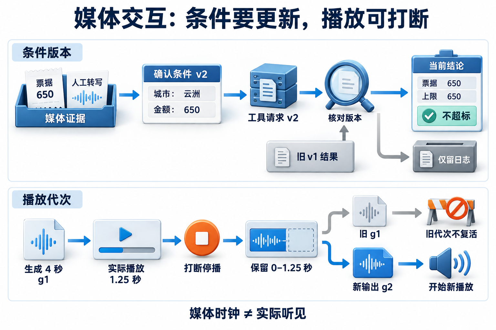
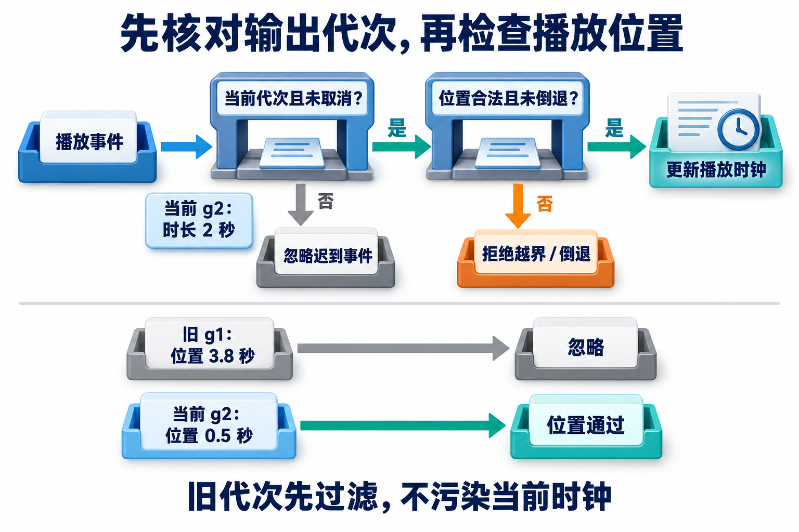

# 18 · 多模态与实时交互：证据、条件和播放进度要对得上

## 一张650元票据与一句“是云洲”

图像像素和语音采样怎样进入模型？模型返回的观察又怎样对应原图、业务条件与实际播放？本章先解释表示与识别过程，再把这些输出接到可回查证据、条件更正和实时交互状态。沿用票据和城市更正夹具，但不把多模态理解简化为这一个业务故事。

**多模态（multimodal）**指系统处理文字、图像、音频等不同形式的信息。输入形式增加后，需要区分原始媒体、识别候选、用户确认和实际行动；一张图片出现在上下文里，不表示模型准确看清了金额。

本章分两层：**18A媒体事实与证据**是基础路径，学习区域/时间定位、冲突与更正；**18B实时播放与打断**是选修，学习生成、播放、会话历史和在途工具如何同步。建议先读[模型协议](13-model-api-and-output-contracts.md)、[任务服务](16-service-deployment-and-operations.md)及[计算机操作证据](08-coding-and-computer-use.md)。

## 18A · 媒体不等于已核实事实

**OCR（Optical Character Recognition，光学字符识别）**从图像提取文字；**ASR（Automatic Speech Recognition，自动语音识别）**把语音转换成文本；**TTS（Text-to-Speech，文本转语音）**从文字合成音频。它们分别可能出错，不应共享一个“模型已成功”的标记。

保留四层对象：原始票据和音频；识别或人工构造的候选；可信用户确认后的业务条件；根据有效政策作出的结论。票据可能模糊，将650误识别为6500；转写可能缺标点、临时猜词或把城市识别错。遇到冲突时应保留来源并澄清，而不是挑一个听起来合理的数字继续创建草稿。

### 图像怎样成为模型可以使用的表示

以原始LLaVA论文的架构为具体例子，而非所有视觉模型的统一协议：图像经缩放等预处理后送入CLIP视觉编码器，编码器把图像划成小块 **patch** 并形成带空间位置信息的向量，再用Transformer让这些表示交换上下文。投影层把视觉特征映射到语言模型的嵌入维度，形成可与文本条件共同使用的视觉token；它们不是先识别出的自然语言句子。[LLaVA论文v2，4.1节](https://arxiv.org/html/2304.08485v2#S4.SS1)，版本日期2023-12-11。

若把每个视觉特征放在矩阵Z的一行，`Z∈R^(N×d_v)`，投影参数为 `P∈R^(d_v×d_l)`，则 `H=ZP∈R^(N×d_l)`。N表示视觉特征数，d_v和d_l分别是视觉与语言嵌入宽度；这个乘法只完成表示空间的连接，不产生“已核实金额”标签。语言模型根据视觉表示与提问预测回答；训练使这种条件关系有用，但不能保证每个小字、单位或关系都读取正确。其他模型可以采用重采样、交叉注意力等连接方式，视觉token数量也不能直接由上传图片文件大小推断。

传统OCR流水线则通常先**检测文字区域**，再对区域做方向/几何处理并**识别字符**，输出文字、区域和识别分数。可分别检查漏检、框错和字符误识别；VLM（视觉语言模型）直接根据视觉和文本生成解释，未必天然给出可靠的逐字区域对应。两者可以组合，但生成一句“金额650”不能自动补出可验证的检测框。参见[PaddleOCR 3.0.3流水线示例](https://www.paddleocr.ai/v3.0.3/en/quick_start.html)，本章未安装或运行该模型。

图像压缩、缩小或裁剪会改变可见信息：字被丢掉以后，后续语言推理不能恢复原始证据。识别分数衡量的是相应模型/阶段的预测，不等于“这份票据真实、适用且可报销”的业务概率。应把文字准确性、定位准确性和业务事实核验分别评测。

### 流式ASR为何会修改已经显示的文字

语音输入是按采样率排列的波形。识别器通常把短时音频转换成声学特征，由编码器结合已到达的上下文形成表示，再由解码过程预测字词序列。流式系统只能看到当前已到达的部分；同音词、词边界和后续限定尚不明确时，新的音频会改变较早片段的最佳假设，因此临时转写不是可追加不改的日志。

**右上下文**指当前识别位置之后的音频。按块处理时多等一些右上下文，可能帮助消歧，却增加等待；减少它可降低部分延迟，也可能牺牲准确性。Transformer Transducer论文给出了可变右上下文的具体架构与取舍，不代表所有ASR都使用同一编码器或相同延迟。[论文，2020](https://arxiv.org/abs/2010.03192) 最终效果必须用目标语言、噪声和任务测量，不能把论文结果或本地人工夹具当作已接入识别器的成绩。

本章提供原创SVG票据，金额650元清楚可见。区域观察来自人工编写夹具，没有执行视觉模型或OCR；音频是4秒数学合成提示音，**其中没有说出转写夹具的文字**。固定转写只用于状态机制教学，不是ASR准确性证据。

### 用位置让证据可以回查

媒体证据需要指向原始对象，并说明坐标或时间单位。图像区域可记`media_id`、页码、画布尺寸、`[x,y,width,height]`和观察值；音频可记原始文件、开始/结束秒、说话者及转写阶段。缩放、裁剪或重采样之后，应保存坐标转换与来源版本，不能只留一张无出处的截图。

| 对象 | 本地素材或定位 | 可核查的内容 |
| --- | --- | --- |
| 原始图片 | 640×360的`receipt.svg` | 自绘票据的日期、城市与金额文字 |
| 金额观察 | 区域`[80,180,460,70]` | 坐标在画布内，指向金额框 |
| 原始音频 | 16kHz单声道、4秒WAV | 实际媒体长度与播放时钟 |
| 转写夹具 | 时间片`[0.2,1.8]`与人工文字 | 状态关联；不证明提示音包含这些话 |

实验对图像区域越界和音频时间越界报错。**位置合法仍不证明内容正确**：一个在图内的框也可能框错位置，一段在时长内的转写也可能不是原话。真实识别评测需要人工核对、识别输出与源媒体一起检查。

### 把预处理位置还原到源媒体

例如先从原图 `(x0,y0)=(40,80)` 裁剪，再放大2倍；处理图中的框为 `[80,40,200,60]`，原图坐标应为 `[40+80/2, 80+40/2, 200/2, 60/2]=[80,100,100,30]`。只除以2会漏掉裁剪偏移。缩放、旋转、裁剪组成多步变换时，保存每步参数和源版本，按逆序还原；旋转框应映射四个角或多边形，不能只变换左上角就沿用原宽高。若某步不可逆地丢失内容，应保留原图，不把插值放大当作新增真实细节。

音频也有坐标：采样率16kHz表示每秒16000个采样帧，片段 `[0.2,1.8)` 秒对应帧范围 `[3200,28800)`。重采样到48kHz后，同一时间片对应 `[9600,86400)`；时间意义保持，帧编号改变，不能只改文件头里的采样率。多声道的一帧包含各声道采样，声道数改变不应被误算成录音时长翻倍。

至少区分四种时间坐标：**源媒体时间**定位原始录音，**播放时间**表示客户端当前播放到哪里，**墙钟**记录绝对日期时间，**单调时钟**用于本机耗时。墙钟会受校时影响，单调时钟不随系统墙钟调整而倒退，不能将二者当同一种计时。[Python monotonic合同](https://docs.python.org/3/library/time.html#time.monotonic) 暂停、重采样、流重连和设备时钟差异使这些数值不能直接混减。适配器需保存流的起点/偏移映射，计延迟尽量用同一单调时钟或明确同步误差；Web Audio的时间坐标也不保证与系统其他时钟同步。[W3C Web Audio时间定义](https://www.w3.org/TR/webaudio/#dom-baseaudiocontext-currenttime)，核查于2026-11-05。本地演示用HTML媒体元素，不实现跨设备时钟同步。

[](../website/assets/diagrams/advanced/A18B-evidence-confirmation.png)

定位字段让观察可回查，不能替代内容核对。临时转写不直接改业务事实，最终条件仍要与清晰的票据金额比较；人工夹具也不构成识别准确性的证据。

### 临时转写与最终条件

**临时转写（interim transcript）**是识别过程中的候选，后续可能修改；**最终转写（final transcript）**是当前转写段的最终版本，也仍可能被用户更正。临时“6500元”可以显示为暂定文字，但不能立刻成为批准草稿或提交动作的业务事实。

真实流接入可维护一份**转写片段账本**：稳定片段身份、源时间范围、文本、修订号、interim/final和流身份。适配器将供应商更新归并到同一片段，以新候选替换旧候选；final固定的是该段识别结果，下一段仍可继续。可将已final前缀与可修订尾部分开显示，不能把每次interim都追加成新一句话。供应商未提供稳定片段ID时，适配器需按其文档的段序与时间合同分配，不能假设任意字符串重叠就是同一段。

以Google Speech-to-Text v1为例，`is_final`表示不会再修改这部分识别结果，连续流可以有多个final；`stability`估计临时假设是否还会变化，**不是识别正确率或业务可信度**。`result_end_time`相对该流音频起点，重连后的偏移也需显式转换。[v1流式结果合同](https://docs.cloud.google.com/speech-to-text/docs/reference/rpc/google.cloud.speech.v1#streamingrecognitionresult)，核查于2026-11-05。账本是此处建议的宿主结构，本地夹具仅验证有限条件变化，未接这份供应商协议。

每次有效最终条件变化，实验递增`condition_version`，清空依赖旧条件的政策结论。发起工具查询时绑定当前条件版本、城市和调用ID；结果返回时核对这三者。旧结果可以留在轨迹用于审计，但不能继续支撑当前城市的回答。

[](../website/assets/diagrams/advanced/A18-media-interruption.png)

上行核对的是业务条件版本：海岚旧结果不能支撑已经更正为云洲的草稿，本例票据650元与云洲上限650元比较不超标。下行核对的是输出代次和播放器位置：生成4秒、在1.25秒处打断时只保留对应媒体范围，不能把未播放部分写入历史。两组数值用于教学，媒体时钟不证明用户实际听见，固定转写也不证明识别效果。

正常流程是：登记媒体→记录金额区域及音频时间片→收到最终条件→发起海岚查询→取得当前版本制度→生成带来源的只读咨询草稿。更正流程在查询中间插入“云洲”：版本从1变2，海岚结果标为迟到旧结果，再查询云洲，最后依据云洲政策判断。

识别段结束、用户轮次结束和业务条件确认是三个决定。即使收到final，用户仍可能接着说“日期改一下”；即使VAD发现静音，也可能只是思考停顿。应用应按风险决定何时显示候选、何时可做可弃用的只读预取、何时必须确认后才能批准写入。预取结果仍绑定条件版本，不能因“已经查过”而强迫接受旧条件。

本实验只检查票据金额与最终转写金额的冲突。完整应用还应核查日期、地点、票据类型和人员条件，保存确认依据；不能把本例的金额检查包装成完整票据审核系统。[对应离线源码](../examples/multimodal_lab/README.md)

## 18B · 两种语音链路如何选择

**级联链路**按ASR→语言模型决策→TTS分阶段处理，便于分别检查转写、工具和语音输出，也会叠加各阶段等待。**原生实时链路**可以在一个实时会话中处理音频输入输出，但仍需处理轮次、工具、播放和历史一致性，不能因为接口返回音频就省掉运行合同。

**VAD（Voice Activity Detection，语音活动检测）**判断有没有人声，不直接等于一句话已经结束。**轮次检测**判断用户什么时候完成一次表达；用户说“嗯”可能只是附和，并非要求停下。固定静音阈值、语义轮次模型和服务端实时轮次各有适用条件，需按语言、噪声、延迟与误打断成本评测。[LiveKit轮次与打断](https://docs.livekit.io/agents/logic/turns/)

选择链路时先固定任务和约束：是否要展示可校正转写、工具查询是否较慢、是否必须中文、弱网表现怎样。不要只用一次理想环境下的首音时间宣布一种架构普遍更好。

### 已生成、待播放、已播放是三个进度

生成器可能已产出4秒音频，浏览器缓存中仍有2秒待播，当前媒体时钟只到1.25秒。**打断（barge-in）**需要同时停止当前播放、取消不应继续的生成，并把历史约束到播放位置；仅停止服务端生成，客户端缓存仍可能继续说完。

实验用`generation`标识一次输出代次，并在会话内保留已见代次与取消记录。同一ID不能再次通过`audio_generated`重开，避免迟到生成事件抹掉打断历史；新输出必须使用新ID。浏览器在重置时递增代次，再开始新的输出。

收到播放或打断事件时，**先判定输出代次，再校验播放位置**：

1. 按代次及取消状态分流，旧代次直接忽略。
2. 对当前且未取消的代次，校验位置与时长。

例如g1长4秒、g2长2秒时，g1迟到的3.8秒进度应直接忽略，既不能污染g2，也不应被误当作g2越界。

这里的取消是本地播放器与离线状态机的合同，没有宣称已实现远程模型流取消。工具是否取消还要看业务：只读查询可以弃用结果，已提交动作需要按16的真实终态核对，不能把“用户打断”当成“业务未发生”。

[](../website/assets/diagrams/advanced/A18C-generation-routing.png)

判断顺序本身就是合同的一部分。迟到g1的3.8秒既不能推进g2，也不该触发g2的时长错误；只有当前且未取消的输出才进入位置校验。

浏览器的`currentTime`是媒体位置，近似反映播放进度，并不能证明人实际听见或理解。LiveKit会按已播放内容裁剪历史；本地演示只记录保留的秒数，不执行语音字词对齐或真实会话文本裁剪。[WHATWG媒体时间](https://html.spec.whatwg.org/multipage/media.html#dom-media-currenttime)

### 缓冲、反压与已播确认怎样连成一条链

真正的流式播放还需区分生成端已产出的范围G、客户端连续已接收并入队的范围E、播放器可核实的已播范围A；在无跳播的同一代次里应满足 `0 <= A <= E <= G`。每块至少关联代次、序号和媒体时间范围，客户端据此发现重复或缺口。网络“收到了”只推进E，不能推进A；向服务端回报播放进度还要带代次和递增确认序号，防止旧回执倒退或复活已取消输出。

以48kHz单声道为例，生成3秒、连续入队3秒、已播1.2秒，待播缓冲为 `3−1.2=1.8秒`，即86400帧。若上限为2秒，应在接近上限时暂停/减缓上游，在低水位恢复，这就是**反压**：下游消费能力影响上游生产，而不是无限堆积。供应商不能暂停时，可取消本代输出或按合同失败；随意丢中间音频会造成缺句和历史错位，不能当作无损限流。这里的流式队列、确认和反压是扩展设计，文件播放器没有实现它们。

一次打断可按以下顺序核对：

```text
客户端停止播放并记录当前代次的媒体位置
将该代次标记取消，清掉待播范围；发出带代次的打断/进度确认
服务端停止继续入队，按接口能力取消生成；迟到块仍按代次丢弃
按可核实已播位置修整历史，旧条件工具结果按条件版本处理
新回答使用新代次，已发生业务动作另核对终态
```

历史裁剪依赖TTS的字词/句段时间对齐，不能用“播了25%”直接截掉25%的文字；语速、停顿和标点并不均匀。播放器报告A只能证明指定客户端的媒体进度，确认丢失时服务端应保留不确定性，也不能说用户已听见。静音、设备输出与真人理解仍是不同证据层级。

### 打开真实播放演示

打开[播放与打断演示](../examples/multimodal_lab/player.html)，或按[实验README](../examples/multimodal_lab/README.md)启动本地HTTP服务。点击播放，观察进度增长；暂停后继续，再在中途打断。页面应保存小于4秒的历史范围，拒绝继续已取消代次，重置后才允许新播放。

提示音由Python标准库生成，没有第三方录音或真实个人数据。页面JS读取真实音频元素的播放事件和时间，下载按钮导出浏览器日志；页面不发送数据到外部服务。这条路径能验证本地播放与取消，不证明识别质量、TTS自然度或网络延迟。

## 故障变式与独立验收

```bash
python3 examples/multimodal_lab/lab.py --scenario all --output .local/multimodal_lab/all-report.json
python3 -m unittest discover -s tests -p 'test_multimodal_lab.py' -v
```

先预测：临时转写6500会不会改业务金额？海岚结果在更正云洲后到达，会不会进入草稿？4秒音频在1.25秒打断，迟到的3.8秒进度还能增加历史吗？运行后核对报告与独立期望，分别查看最终城市、政策来源、旧结果计数和历史秒数。

5个离线场景覆盖正常、临时转写、更正、金额冲突和打断；额外测试改变城市、日期与工具返回，不让实现只记住固定650元答案。真实模型接入后，另建图像清晰度、中文数字、噪声、口音、轮次更正和网络条件测试集，将识别正确率、首音时延、误打断、任务成功与费用分开报告。

## 自检

<details><summary>1. 转写段标为final，用户之后还能改吗？</summary>

能。final只说明该识别段的阶段；用户更正需要更新业务条件版本，并使旧依赖失效。
</details>
<details><summary>2. 旧城市工具返回成功，可以用来回答新城市吗？</summary>

不能。工具成功只说明那次调用完成，参数和条件版本不匹配时不构成当前结论的证据。
</details>
<details><summary>3. 4秒音频播放到1.25秒后被打断，历史应保留多少？</summary>

本地演示保留0至1.25秒的媒体范围；真正文本历史还需词句对齐，不能据此声称用户听见整段或已裁好真实转写。
</details>

## 参考资料

[LiveKit轮次与打断](https://docs.livekit.io/agents/logic/turns/) · [LiveKit事件](https://docs.livekit.io/reference/agents/events/) · [WHATWG媒体元素](https://html.spec.whatwg.org/multipage/media.html#media-elements)。动态文档核查日期：2026-10-31；实现与验收范围见实验说明，供应商版本需在真实接入时固定。

[上一章](17-event-driven-and-proactive-agents.md) · [工程进阶目录](README.md)

[对应面试题：Q108、Q109、Q110](../docs/advanced/18-multimodal-and-realtime-agents.md)
