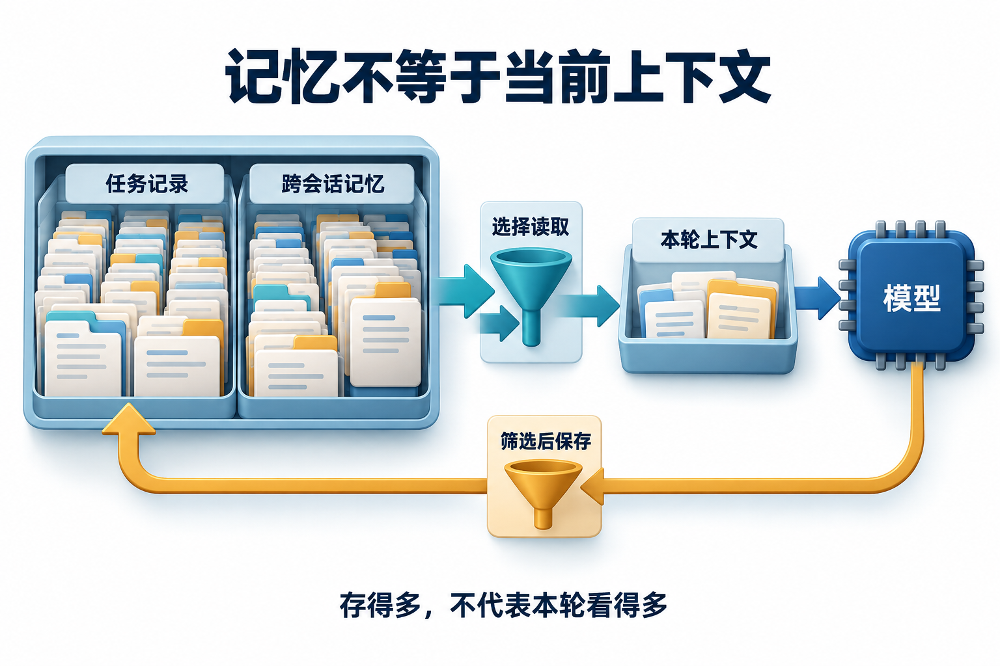

# 03 · 上下文工程面试题

政策助手的输入塞满了材料，却漏掉“仅限已批准培训”这个条件。面试官追问怎样缩短输入又保住证据时，可以先记住：上下文像随身行李，原文可以托运，登机证不能压没了。

配套 [学习章：上下文工程](../../advanced/03-context-engineering.md)，本章覆盖 Q063–Q065，分别讨论信息选择、计算复用和长任务预算。

### Q063 上下文选择、外置与摘要应该怎样配合？

**优先级：P0**

[Q031](../../questions/Q031.md)检查一份摘要是否保住任务；这里给定三次信息转换，要求诊断条件在哪一步丢失，并处理来源撤权。这是设计题，表中内容不是已经运行的摘要器日志。

| 产物 | 内容与关联 |
| --- | --- |
| 原文 `D:v2#L8` | “仅限已批准的外部培训”，当前用户起初可读 |
| 第一轮摘要 `S1` | “外部培训可报销”，关联 `D:v2#L8` |
| 第二轮摘要 `S2` | “培训可报销”，只关联 `S1` |
| 外置结果预览 `P1` | 显示前10条培训记录，`truncated=true` |

发布前收到对D的撤权。你会让哪些产物退出新输入，在哪里回查，能否把预览中没有的记录判为不存在？

**30–60 秒回答：**

先定位转换损失：S1丢了“已批准”，S2再丢“外部”。外置原文可以支持回查，摘要不能恢复自己删掉的条件；`truncated=true`也不能被改写为完整结果。来源D撤权后，沿D→S1→S2的依赖停止新选择，回查入口同样执行当前权限。无法取得允许使用的依据时，保留缺口并停止发布，不能借旧摘要绕过撤权。

展开详细答案、追问与案例

**详细答案：**

图中“保存→选择→本次输入”的边界仍然成立；本题要继续追踪一个判断经过多份产物后是否保真。先逐项对照原文：报销范围必须同时满足“培训”“外部”“已批准”。第一轮已经丢失必要条件，不应等到第二轮回答错误时才归因给最后一个模型。

修订时，当前任务保留这三个条件及未知状态，长原文留在外部并附文档ID、内容版本和位置。S2沿S1应能追到D的具体版本；题面的关联若可靠保存，就可以沿依赖传递失效。只有无法解析的“来源：上一次总结”则不足以完成这件事。依赖可以存在单独索引中，不要求每份摘要复制原文或把整条血缘都塞进模型输入。[上下文组织与回查](https://www.anthropic.com/research/effective-context-engineering-for-ai-agents)

选择、外置和摘要在这里有不同验收：选择保证本次需要的条件都被覆盖；外置保证允许时能解析到完整原文；摘要保证重写后没有把必要条件、否定或未知项改掉。P1则必须保留筛选范围、总数信息与截断标记，必要时继续读取允许范围内的剩余记录，不能从前10条推出全集结论。[外置与摘要机制](https://docs.langchain.com/oss/python/deepagents/context-engineering)

撤权通知到来后，先将D及其派生产物标为不可用于新请求，再重建本轮输入。已保存的历史记录按审计和删除合同管理；停止新选择不等于所有磁盘副本已被清除。关键动作前重新验证依据，若找不到独立且有权使用的新来源，就交付缺口而不是原结论。比较方案时同时记录条件遗漏、原文回查次数、证据覆盖和输入量，避免只优化字数。

**常见追问：**

1. **S2只保留S1的标识，可以支持撤权传播吗？** 可以，前提是可靠依赖记录还能从S1追到D的具体版本。无需复制D全文；若中间关联丢失，只剩无法解析的“上次总结”，就不能可靠找到全部派生产物。
2. **工具返回空数组，能否总结为没有相关政策？** 先检查实际返回的状态、查询范围和截断标记。权限过滤后的空集未必能与不存在区分，只能陈述当前可访问范围内未找到；明确的权限拒绝或解析失败应单独报告，不能越权探测来补全原因。
3. **摘要已准确，为什么发布前还读原文？** 准确只对应生成时的材料。来源可能更新或撤回，发布还依赖特定适用条件和当前权限，应核对真正支撑动作的条款。

**实战案例：**

用题面中的三份产物重建一张转换表：S1缺批准条件，S2又缺类别条件。修订后，已批准/未批准与内部/外部四种组合只有满足原文条件的对象可进入候选；这仍不代替其他报销资格检查。再注入D撤权，确认S1、S2和待发布结论均退出新输入，原文回查被当前权限拦住，其他无关且有效的证据仍可使用。这是设计验收，不宣称仓库已实现摘要血缘服务。

**常见误区：**

认为外置就是删除；认为摘要是无损压缩；把片段相关性、来源有效性与可见性合成一个分数，允许高相关材料越过硬条件。

**微练习：**

为D、S1、S2、P1画依赖，逐条标出损失和修订动作。再把D从“撤权”改为“发布v3、v2仍可读”，区分权限失效与版本适用性；验收不能把所有更新都处理成删除，也不能因历史可读就继续用v2支持只适用于v3的结论。

**学习与参考：** [配套学习章](../../advanced/03-context-engineering.md) · [上下文工程](https://www.anthropic.com/research/effective-context-engineering-for-ai-agents) · [Deep Agents 上下文机制](https://docs.langchain.com/oss/python/deepagents/context-engineering)

### Q064 怎样区分 KV、前缀、检索与最终答案缓存？

**优先级：P0**

这里按“复用的对象”分类，并检查跨用户和版本变化的边界；端到端节省多少时间、哪一层值得优化，由[Q085](../../questions/Q085.md)给定阶段耗时后计算。

**30–60 秒回答：**

KV 保存注意力计算需要的中间表示，前缀缓存可跨请求复用匹配前缀的相关计算；检索缓存复用候选材料，答案缓存复用最终回答。前两者不会直接把旧答案交给新问题。每层都有不同匹配和失效条件，租户隔离、权限与证据更新仍须执行，缓存命中率不能直接换算成端到端加速比例。

展开详细答案、追问与案例

**详细答案：**

**缓存（Cache）** 保存已经算过的中间结果或已经取得的资料，以便后续复用。**KV（Key/Value，键和值）缓存**属于模型计算层，跨请求的前缀缓存尝试复用匹配输入前缀的计算；检索与答案缓存则保存业务内容。先认清复用对象，才能判断命中后到底省了哪一步。

先按复用对象而非产品名称分类。常见因果注意力模型在生成后续位置时可复用既有位置的 KV；自动前缀缓存进一步寻找请求之间匹配的输入前缀，减少重复 prefill。模型和计算配置、缓存生命周期、实现支持都会影响可复用性。新问题的动态后缀与新输出仍需处理，因此它与直接返回旧回答的答案缓存有本质不同。

检索缓存要关联查询条件、索引和文档版本、权限范围及有效期；答案缓存还要判断问题、日期、人员类别等业务条件是否等价，并跟踪证据变化。即使两个人文字提问完全相同，可见材料不同也可能需要不同答案。缓存键只解决识别一部分条件，真正读取时仍应按当前访问合同验证，不能因为曾经命中就跳过对象授权。

性能评估要拆开排队、前缀处理、后缀处理与输出生成。两个请求前 6000 token 相同、后 2000 不同，不等于总延迟必定下降某个固定百分比。稳定前缀可减少无谓变动，但正确性优先，不能为命中率保留旧政策。共享缓存还可能涉及侧信道；例如 vLLM 支持按请求加 salt 限制复用范围，隔离组应由可信应用分配，而不是允许客户端自称属于其他租户。

**常见追问：**

1. **把时间戳放输入最前面会怎样？** 它可能缩短匹配前缀，具体取决于实现。可以把真实稳定说明放前面、动态信息后置，但不能删除任务确实需要的时间条件。
2. **前缀缓存能降低生成长度吗？** 不能由缓存本身推导。它主要复用前缀计算，输出仍由当前请求生成；若要降低输出成本，应另行调整任务和输出合同。
3. **权限撤回后清掉答案缓存就够吗？** 不够。检索结果、摘要和派生索引也可能包含相关材料。应沿来源依赖使相关派生产物失效，并在使用时再次执行可见性检查。

**实战案例：**

按本题的四类缓存检查研究助手：一次生成中保存已有位置的Key和Value，是KV缓存；新请求复用匹配输入前缀的已有计算，是前缀缓存；复用“海岚、11月12日”查询得到的候选文档，是检索缓存；直接复用“650元未超限”的完整回答，是答案缓存。前缀缓存可以复用KV块，两者有关联，但使用范围不同。

住宿标准被撤回后，依赖它的检索候选与答案都要重新核验。KV和前缀计算缓存是否仍可复用由服务合同决定，不能因此继续把撤回的正文当成当前依据。

**常见误区：**

把 KV 看成知识库；把前缀缓存看成答案缓存；认为隔离 salt 是业务授权；只比较命中率而忽略错误复用与端到端延迟。

**微练习：**

为上述四类缓存分别写“复用什么、哪些条件需要一致、住宿标准撤回后怎样处理”。合格答案区分计算与业务结果；较好答案指出权限、适用日期与来源依赖。新条件：两位用户提问文字相同而可见域不同，不能仅凭文字相同复用业务结果。

**学习与参考：** [配套学习章](../../advanced/03-context-engineering.md) · [vLLM 自动前缀缓存](https://docs.vllm.ai/en/stable/features/automatic_prefix_caching/) · [vLLM 缓存设计与隔离](https://docs.vllm.ai/en/stable/design/prefix_caching/)

### Q065 长任务怎样分配上下文预算并传播证据失效？

**优先级：P1**

**30–60 秒回答：**

先为输出、固定约束和任务状态预留空间，再按当前证据缺口加载材料，目录和原文分层保留。预算不足时优先减少无关证据，而不是截掉关键条件。**每个摘要、结论和缓存都应关联来源版本**；政策撤回后沿依赖标记失效，重建受影响的输入，保留无关已完成工作，并明确哪些结论仍缺证据。

展开详细答案、追问与案例

**详细答案：**

预算需要先统一口径。若输入输出共用 32000 token，预留输出 4000，就不能将剩余以外的内容塞进输入；还要计算固定说明、任务状态、工具信息和证据。24 段各 1800 共 43200，尚未加说明就已超限。可以先按权限、适用期和待决问题筛选，再选六段各 1500，共 9000，加固定说明 3000、状态 1000、工具 1000，输入合计 14000，其余留在可回查索引。

加载顺序由判断依赖决定。先提供任务范围和材料目录，再展开相关流程、具体条款与必要原始轨迹。当前证据只能支持一般规则，却缺少例外适用条件时，应沿指针补读，而不是让模型补猜。渐进加载减少无关信息干扰，也增加一次检索或读取的时延；可以预取明确依赖，但不应把所有目录一次展开回原来的大输入。

长任务还需要失效传播。来源与内容版本连接到摘要、比较结论、报告段落和答案缓存，撤回时标记受影响产物，恢复会话不能继续装入它们。事实更新与权限撤回的处理条件不同，但都不能由旧摘要绕过。无关地区的有效证据可继续复用，避免全部重做。评估时同时观察预算、有效证据覆盖、漏条件和恢复成本；输入更短却失去决定性条款，不能算优化完成。

**常见追问：**

1. **预留输出 4000 是否就是要求生成 4000？** 不是。它是本例的容量规划，实际输出由内容和限制决定。不同模型窗口和计费口径应分别核对，不把这一数字当通用配置。
2. **预算只够读一份资料时怎样选择？** 看当前结论缺哪项必要证据，优先正式且适用的来源。若无法覆盖关键条件，就给出局部结论和未决项，而非靠多篇弱相关资料凑数量。
3. **撤回一份来源需要删除全部历史吗？** 新选择必须排除失效内容，历史审计按保存规则管理。用来源依赖定位受影响判断，保留无关有效产物，避免把更正和历史追溯混为一谈。

**实战案例：**

助手完成甲乙两地比较后，甲地一份政策撤回，而丙地例外仍待查。初版切换会话只带“甲乙已完成”，继续生成含旧结论的报告。处理时让完成项关联证据版本，撤回触发甲地摘要及段落失效，乙地保留，丙地仍显示缺口。验收核对 14000 的输入构成与回查清单，确认恢复没有重查全部乙地材料，也没有继续引用撤回文件；报告明确甲地重核与丙地缺项状态。

**常见误区：**

把窗口大小当成实际可用证据容量；用统一尾部截断代替选择；认为来源表已更新，摘要和答案就会自动同步。

**微练习：**

复算本题预算并为六段证据建立依赖表。验收：撤回其中一段后列出失效摘要、报告段落和缓存，说明下一次输入保留哪些内容、必须补读什么。

**学习与参考：** [配套学习章](../../advanced/03-context-engineering.md) · [上下文工程](https://www.anthropic.com/research/effective-context-engineering-for-ai-agents) · [Agent Skills 渐进加载](https://agentskills.io/specification#progressive-disclosure) · [Deep Agents 上下文机制](https://docs.langchain.com/oss/python/deepagents/context-engineering)

[返回进阶题库目录](README.md)
