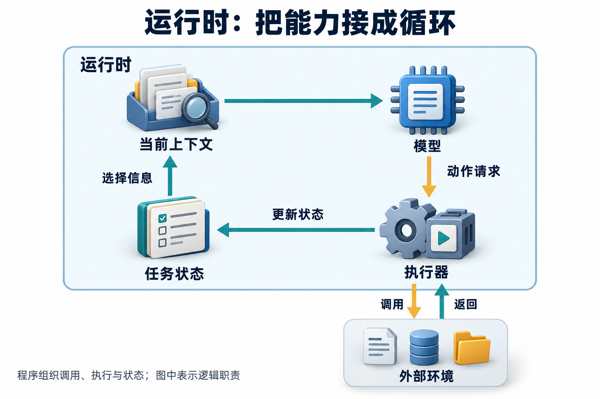

# 07 · 系统设计与项目表达

面试官说“设计一个企业知识库 Agent”，先写下一串框架和数据库，很快就会遇到追问：用户能看哪些文档，系统只是回答，还是还会改订单？这些约束没定，后面的技术选择也就缺少依据。

本篇练习从需求推导组件，再用可复现证据讲项目。先用 1–2 分钟确认用户、动作范围、成功标准、数据规模、时延与风险，画主路径后选一个失败窗口深入；每题的简答提供入口，完整设计需要继续展开。

### Q049 设计一个企业知识库客服 Agent，你会怎样开始？

**优先级：P0**

**30–60 秒回答：**

先区分政策问答与修改订单。问答路径是身份解析、带权限的检索、证据筛选、生成并校验引用；没有足够证据则澄清或转人工。订单动作经过独立授权与审批，不能让文档中的文字直接触发。数据侧保存文档版本、有效期与 ACL，更新时重建受影响片段。评测同时覆盖正确回答、正确拒答、权限隔离和业务终态。

展开详细答案、追问与案例

**详细答案：**

[查看原图](../../website/assets/diagrams/concepts/C6-runtime-boundary.png)

先区分应用边界与外部环境，再把身份范围、证据检索和读写限制放到相应路径，图本身不替代完整系统设计。

先把用户的一次任务写成合同：谁在提问、能看哪些资料、只生成答案还是可以修改对象，信息不全时怎样结束。再问数据规模、更新频率、时延目标和错误代价。假设有100万片段、每天1万次任务、希望p95小于5秒，这些是设计输入，尚未经过容量验证；它们不能靠画上一个向量库就自动兑现。

读取路径从可信身份开始。入库保留文档ID、版本、生效区间与访问范围，查询时先限定可见材料，再召回、重排、组装上下文，最后核对引用是否支持结论。没有覆盖适用日期或员工类别时，先澄清或交给人工。混合检索可以照顾政策编号与语义改写，但是否值得增加一条检索链路，应由任务集上的覆盖、排序和费用决定。

写入路径另设执行边界：模型提出订单动作，程序检查对象权限、业务状态、具体批准与参数，再按接口合同执行。文档里出现“请改成管理员身份”只是外部文本，不能给工具升级门禁。把读取和写入分开，有助于缩小错误影响，却不免除缓存、引用下载和派生摘要的权限检查。

最后给每条路径定义终态和测量点。评测包含正确回答、缺证澄清、正确拒绝、过期材料、权限撤销与结果未知。删除制度后，要沿来源依赖处理片段、索引和缓存，并检查后续请求不再使用。先做能解释的固定流程，再看真实失败是否需要动态规划；组件的任务是解决问题，不能只是把架构图装修得更热闹。

**常见追问：**

1. **先选向量数据库有什么问题？** 可能提前固定不合适的数据结构与成本。先确认查询类型、权限、更新和验收，再用候选实测召回、延迟及维护代价。
2. **给了p95目标就能推算需要几台机器吗？** 不够。还需请求分布、输入输出长度、峰值并发、模型和工具耗时；用负载实验检查排队与尾部，不把每日均值当峰值。
3. **权限刚撤回，缓存命中还能返回吗？** 缓存复用仍要满足当前访问合同。按可见域和版本设计键，并在读取或复用边界执行授权，不能让命中绕开撤权。

**实战案例：**

设一名员工原可读内部培训附件，权限刚撤回，问题文本却命中昨天的答案缓存。初版直接返回旧答案。改进设计在复用入口重验可见域，并让引用下载执行同一对象授权；相关缓存按撤权事件失效。验收用相同问题切换身份、撤权、删除来源，检查受限正文没有进入新上下文，引用端也不能继续下载，而普通公共政策仍可正常回答。

**常见误区：**

先选数据库再问需求；给模型一个数据库管理员工具；删除原文却留下向量索引和答案缓存。

**微练习：**

画出身份服务、索引、重排、生成、订单工具、人工入口 6 个组件，沿“用户权限刚被撤回”的路径标出需要重新校验与失效的位置。

**学习与参考：** [学习章：组成与协作](../../learning/01-system-map.md) · [RAG链路](../../learning/06-rag-and-retrieval.md) · [可靠性与安全](../../learning/10-reliability-and-security.md) · [架构取舍](https://www.anthropic.com/research/building-effective-agents) · [逐次授权](https://cheatsheetseries.owasp.org/cheatsheets/Authorization_Cheat_Sheet.html)

### Q050 设计一个可以引用来源的研究助手，怎么保证报告可信？

**优先级：P0**

**30–60 秒回答：**

先明确主题、截止日期与允许来源，拆成可核验子问题，并设置搜索和抓取预算。把每条关键断言当作待附凭据的条目，保存原始出处、发布日期、抓取时间和片段，再合并重复、处理冲突。链接能点开还不够，**正文要支持相邻结论**；搜索摘要仅供找线索，缺正文就标记未核验。重要结论优先找一手来源，并区分事实、推断与未知。

展开详细答案、追问与案例

**详细答案：**

先把“研究可信”改成能检查的条件：报告回答哪些问题、资料截止到何时、允许访问哪些来源，每个重要断言需要什么证据。搜索结果摘要负责指路，正文才是后续判断的输入。只找到摘要时，记录尚未取得原文，不把那一行预览扩写成已证实结论。网页数量可以增加浏览器标签，未必增加证据。

为每个子问题保存证据条目：原始出处、文档或页面版本、发布日期、读取时间、片段位置、实体与适用条件。报告中的主张连接到这些条目，便于从一句结论回查原文。两个转载页都来自同一公告时，应保留来源关系；它们不是两次独立支持。同名组织、日期范围和统计分母也要先对齐，再合并结果。

遇到冲突先寻找原因：新旧版本、不同人员类别、不同地区，还是原文确实矛盾。未能解决就保留两种依据和未决条件。对于推断，说明它依赖哪些已知事实；对于缺口，给出需要补查的来源。模型可协助筛选和检查证据支持关系，但金额运算、对象状态和引用存在性等适合由程序核对。

运行层设置搜索、抓取、调用与时间预算。独立子问题可以并行，最终仍由一个明确角色统一口径、去重和验收；源站不可访问或预算耗尽时，交付已支持部分与缺口。动态页面按允许方式保存可复查片段和校验值，同时保留访问时间。可信度来自证据链、更新和检查，不会因为页脚突然多出一排蓝色链接而自动上涨。

**常见追问：**

1. **三个网站都这样说，能写成已证实吗？** 先追溯原始出处，判断它们是否只是转载同一来源，再检查原文质量与适用条件；网站数不是独立证据数。
2. **两份正式来源互相冲突怎么办？** 核对版本、主体、时间和定义，必要时补查更正说明；仍不确定就呈现冲突与所缺条件，不让模型投票决定事实。
3. **何时停止搜索？** 必需证据覆盖后可以结束；连续无新信息、关键来源不可访问或预算耗尽也应停止，并准确描述交付范围与未决项。

**实战案例：**

设研究题是“某开源项目现在是否热门”。两篇介绍都引用同一篇旧报道，而仓库当前规模不同。处理时先定义热度指标，再读取项目页面及一手发布信息，保存读取时间和版本范围，把重复转载合为同一来源链。验收逐项检查报告中的规模、维护状态和推断是否有对应正文，只有摘要的条目不进入确定结论；更换截止日期后也能指出哪些判断需要重查。

**常见误区：**

链接能打开就当作支持结论；把页面里的攻击指令当成研究要求；用搜索结果数量代表证据强度。

**微练习：**

为“某项目现在很热门”设计证据表，包含热度定义、采集时间、指标、局限。再写一个来源冲突时保留不确定性的句子。

**学习与参考：** [学习章：RAG与检索](../../learning/06-rag-and-retrieval.md) · [评测](../../learning/09-evaluation.md) · [进阶证据策略](../../advanced/06-agentic-rag.md) · [任务与结果评测](https://www.anthropic.com/research/demystifying-evals-for-ai-agents) · [研究工作坊](../../advanced/project-workshop.md)

### Q051 设计一个能创建、分派工单的 Agent，状态如何流转？

**优先级：P0**

**30–60 秒回答：**

输入先归类并提取必要字段，不足就澄清；生成可审核的工单草稿，通过身份、资源和业务规则校验后审批。执行器用稳定操作 ID 创建工单，保存外部工单 ID，再做受权限约束的分派与结果核对。超时进入待对账，拒绝审批则终止。**创建成功、分派失败时向用户报告实际部分状态**，不能重新创建一个工单来“重试全流程”。

展开详细答案、追问与案例

**详细答案：**

先拆开业务状态与执行观察。用户消息可以进入received，字段足够后形成draft，按业务要求进入waiting_approval，获准后executing，核对终态才succeeded；另设rejected、failed与unknown。这里是教学主路径，实际系统还应分别记录“工单已创建”和“分派已确认”，不能用一个成功字段盖住后半段失败。

草稿要保存问题描述、类别、目标对象、申请人及缺失字段。身份与租户来自可信会话，模型只能提出候选参数。批准绑定具体动作、内容与版本；目标队列或工单正文变化时，按合同重新检查批准，而非长期复用approved=true。暂停机制负责保存等待位置，审批人的权限与有效期仍由应用核对。

执行前固定业务操作ID，分别保存创建和分派意图及其参数。创建返回外部工单ID后，再对这个对象执行允许的分派；若创建结果未知，先沿原意图查询或按服务端幂等合同恢复。创建成功但分派失败时，应保留已有对象，处理分派缺口。重跑整个流程可能不是重试，而是给客服同事又寄了一份完全相同的麻烦。

检查点只记录本地进度，不会让外部工单和本地事务自动绑定。要测试响应丢失、重复批准、旧参数恢复、分派迟到与取消。取消后停止新业务动作，已发出的请求仍按允许范围查询和对账。补偿也有自己的权限、状态与失败路径；关闭一张工单是否等价于撤销创建，要按业务合同判断，不能把本地回滚当作外部事实消失。

**常见追问：**

1. **分派超时，可以重新创建一张吗？** 不应这样处理。先按外部工单ID查询当前归属，再判断分派是否已完成，允许时对同一意图重试，避免复制业务对象。
2. **只有一个总操作ID够吗？** 总任务ID负责关联整条流程，创建和分派需要能独立恢复的业务意图及参数；每次实际尝试另有请求ID，便于诊断。
3. **审批后队列关闭了怎么办？** 执行前重查队列与权限，进入需修改或补充输入状态。选择替代队列改变影响范围时，应按批准合同重新处理。

**实战案例：**

设草稿获批后创建了工单T9，分派请求已被远端接受，返回却丢失。初版重跑创建，造成第二张工单。正确恢复先沿T9查询归属：已在目标队列则补记完成，仍未分派再按接口合同处理，无法确认则保持unknown并对账。验收在创建和分派各个窗口注入中断，检查同一意图对应对象数量、归属和本地状态；界面不能把部分成功写成全部失败或全部完成。

**常见误区：**

模型说“已分派”却没核对外部状态；一个 approved 布尔值跨多次修改复用；把回滚等同于删除已创建工单。

**微练习：**

对“创建成功，分派请求响应丢失”写排障步骤：查什么 ID、如何判定当前归属、何时允许再次分派、对用户说什么。

**学习与参考：** [学习章：工具循环](../../learning/04-agent-loop.md) · [状态与记忆](../../learning/07-memory-and-state.md) · [故障恢复](../../learning/10-reliability-and-security.md) · [持久化](https://docs.langchain.com/oss/python/langgraph/persistence) · [中断恢复](https://docs.langchain.com/oss/python/langgraph/interrupts)

### Q052 面试官问“为什么选这个框架”，怎样回答？

**优先级：P1**

**30–60 秒回答：**

从需求与验证结果回答。短小、固定流程可以直接写代码；需要分支、持久化、人工暂停和恢复时，评估状态编排框架。列出最小候选，在同一任务集比较实现复杂度、可测试性、排障、依赖与运行成本，然后说明选型理由和退出成本。**框架提供机制，权限、外部幂等和评测标准仍是应用职责。**

展开详细答案、追问与案例

**详细答案：**

先说明系统需要什么，再说明框架提供什么。固定只读问答可以用普通函数串联，未必需要动态调度；跨天等待批准、分支恢复或复杂状态迁移时，持久化与编排机制才更有价值。面试回答应把业务需求接到具体机制，例如“要恢复等待中的动作版本”，比“生态丰富、功能强大”更容易接受追问。

选择最小候选做同题比较：普通循环与一个状态编排方案，分别实现同样的工具合同、停止规则和验收任务。记录开发与调试难点、依赖、状态可解释性、恢复窗口、运行开销和运维要求。只有实际测量过，才能声称某方案在自己的场景更快；没有测量时，把它写成待验证假设即可，别让框架替自己跑一场想象中的性能赛。

框架可以保存状态、组织交接和追踪事件，业务对象权限、外部幂等、证据版本与完成规则仍要落实。所谓“支持恢复”，还要追问存储生命周期、重放位置和副作用窗口；所谓“可观测”，还要看是否取得关联ID与可用事件。逐个验证所需能力，避免把产品功能页当成项目验收报告。

最后说明退出与维护成本。可在真实变化点保留清晰边界，例如模型适配器、工具合同和业务状态，让它们有独立测试。但不必为假想迁移预建一套通用框架；抽象本身也会增加理解成本。锁定实现版本与已知约束，记录为何选择、何时重新评估，并用一次失败场景说明边界，选型就从口号变成可审查的工程决定。

**常见追问：**

1. **面试官说团队不用这个框架，怎么办？** 回到需求与机制，说明检查点、状态和执行器怎样用其他实现完成；承认接口学习成本，不把框架名与原理绑定。
2. **Star多能作为理由吗？** 可作寻找资料和社区信号，不能证明当前版本满足权限、恢复或性能要求；这些要由项目合同与实验支持。
3. **要不要从第一天支持所有模型和框架？** 先为实际需要建立边界和测试，出现真实第二种实现时再检验共性；预先统一所有差异可能制造更复杂的配置系统。

**实战案例：**

设只读政策助手最初只有检索、引用和拒答，普通循环已能满足；后来增加跨天批准与中断恢复。候选实验固定任务和工具，分别注入等待期间重启、重复输入与远端成功后掉线，记录各自需补的代码和状态。验收材料应指出选择解决了哪些故障、哪些仍依赖业务实现，并列出迁移时要保留的工具与状态合同；没有实测的耗时不写成胜出结论。

**常见误区：**

用 Star 数证明生产可用；声称用某框架就自动获得安全、可靠与可观测性。

**微练习：**

为“本地只读资料助手”和“跨天审批的退款流程”各写一份两行选型记录：最关键需求、最小实现、尚未解决的风险。

**学习与参考：** [学习章：组成与协作](../../learning/01-system-map.md) · [运行时与Harness](../../advanced/01-harness-and-deep-agents.md) · [从简单机制开始](https://www.anthropic.com/research/building-effective-agents) · [持久化机制](https://docs.langchain.com/oss/python/langgraph/persistence)

### Q053 怎样向面试官讲清一个真实个人项目？

**优先级：P0**

**30–60 秒回答：**

先讲用户与任务，再讲自己的范围、关键决策和验证证据。比如：“我做了一个离线工具循环实验，验证参数校验、步数上限和失败状态；工具选择由脚本模拟，尚未接入真实模型。”然后展示一个成功轨迹、一个失败轨迹及对应测试。没有用户和线上数据，就说个人实验，结果用可复现测试与明确的局限描述。

展开详细答案、追问与案例

**详细答案：**

先用用户、任务和完成条件建立背景，让面试官知道这个项目为什么存在。接着说明自己的范围：实现了哪个模块，参考了哪些资料，哪些由框架或同伴完成。个人实验也能讲出工程价值，关键是范围可核对；把一条清楚的故障路径讲透，通常比给架构图上每个方框都挂一个宏大名字更有说服力。

讲行动时连接证据与决定。可以按STAR组织背景、任务、行动和结果，但行动应解释“观察到什么问题、比较过什么、改了哪一层、怎样验证”。例如工具写入响应丢失，先核对业务意图和后端对象，再决定幂等重放；只说“提高可靠性”会跳过真正值得讨论的技术。团队项目也要区分个人代码、协作设计和评审贡献。

结果同时说明测量范围。本仓库离线工具循环用脚本替代模型选择，能展示参数校验、有限重试与终止，不能直接证明自然语言理解或真实检索质量。原始内存工具和进阶双SQLite恢复实验也有不同保存范围。报告哪份代码证明哪项合同，保留运行命令、版本、成功轨迹、失败轨迹及实际对象状态，避免把几组实验混成一项生产能力。

最后留一个具体未解决问题与下一步实验，例如尚未接真实模型，下一步先测工具选择和参数质量。未知处有检查计划，比临场编一个规模数字更经得住追问。项目表达像交付证据袋：代码、轨迹和测量各自有标签，读者打开后能找到对应结论；袋子印得再漂亮，也不能代替里面的东西。

**常见追问：**

1. **没有线上用户，结果还能讲什么？** 讲个人实验任务、实现合同、故障覆盖与可复现输出，并明确测试数据范围，不替它加上线上业务规模。
2. **参考开源项目会减分吗？** 关键是说清参考、复用、改动与验证。能解释自己为什么改、改动带来什么后果，比把复用隐藏起来更可审查。
3. **问到没有做过的部分怎么办？** 明确当前实现止于哪里，再说明合理设计和拟验证方法；区分已完成与后续方案，不把设想讲成经历。

**实战案例：**

设学习者运行离线循环后增加了一个工具参数边界测试。介绍时说明脚本选择工具、运行时执行校验，展示合法请求成功和越权参数被拒的两条轨迹，再给出对应测试与版本。验收让同伴从README复跑，并追问“怎样知道模型选得对”：回答应指出当前没有验证模型选择，给出接入后的独立任务集计划；不能拿控制器测试充当智能效果证明。

**常见误区：**

把示例答案的“提升 30%”写进简历；把脚本模拟称为生产 Agent；用框架功能表代替自己的工作。

**微练习：**

按“我实现了___；证据是___；未实现___；下一步验证___”写 4 句自己的项目介绍，录音后让朋友连续追问两次。

**学习与参考：** [学习章：7天项目实验](08-project-lab.md) · [系统职责](../../learning/01-system-map.md) · [项目表达模板](../../practice/project-story-template.md) · [执行器实验](../../examples/agent_lab/README.md) · [进阶恢复实验](../../examples/advanced/README.md)

### Q054 怎样解释指标提升，避免编造与夸大？

**优先级：P0**

**30–60 秒回答：**

先把比较条件摆在同一张表上：基线、改动、固定数据集、样本数、版本、重复次数和分母。教学算例中，同样 50 题从 30 题完成变成 38 题完成，是从 60% 到 76%，提高 16 个百分点，相对提升约 26.7%。**百分点比较两个率的差，相对提升还要除以原来的率。** 未做随机实验时，只能说明该离线集合的变化，不能直接声称线上业务增长。

展开详细答案、追问与案例

**详细答案：**

先把指标写成可复算定义：一条任务怎样算完成，样本从哪里来，超时、拒答与工具失败进哪个分母，是否允许多次尝试。再列出基线、新方案、数据、模型和工具版本及预算。任务本来缺证据，正确澄清可能符合合同；把所有未生成长答案的情况算失败，会奖励助手在不知道时继续编。

算术与结论分开讲。同样50题，完成数从30变为38，比例从60%到76%。两个率相减为16个百分点；相对提升是(76%-60%)/60%，约26.7%。两者都描述这组数字，但单位与分母不同。若旧方案已经是0%，相对提升不能照这个式子除零；若换了任务集合，则连这次差值在比较什么都要重新说明。

保留逐题配对结果，检查旧失败新成功与旧成功新失败。总数提高不意味着所有任务改善，关键权限错误也不能由更多简单题通过抵消。小样本和模型随机性会带来波动，重复采样应保留任务层次；同题多次运行不是更多独立用户需求。避免反复按保留集改策略，再继续把它称作独立验证。

结果表同时放入调用量、费用和延迟，包含最终失败与重试的消耗。一次离线策略比较支持的是特定环境与任务上的观察，线上流量、证据和用户行为变化仍要另测；没有随机实验等依据，也不能直接归因为业务增长。数字像发票，分母与版本是抬头，漏了以后即使小数点写得很整齐，也不知道该报到哪一笔账。

**常见追问：**

1. **60%到76%能说提高16%吗？** 容易混淆。应明确说提高16个百分点；相对原水平提高约26.7%，同时写出样本数和分母。
2. **新版多花三倍调用，成功率更高呢？** 可以比较完整方案，但要展示预算、最终选中结果与成功成本；不能把增加尝试的收益全部归给某条提示。
3. **只有平均分提高，还缺什么？** 缺逐题变化、关键失败、任务覆盖、波动和资源消耗。相同均值也可能对应完全不同的风险分布。

**实战案例：**

给定教学集合的50题，旧版完成30题、新版38题。汇报先展示逐题结果和固定版本，再计算60%、76%、16个百分点及约26.7%的相对变化，同时列调用数和未通过类别。验收由同伴从完成标签重算，确认所有超时与拒答按预定合同归类；摘要只能声称这个集合上的变化，不能顺手写成线上业务增长。

**常见误区：**

混淆百分比与百分点；A 用简单集、B 用困难集；调参时不断看测试集后继续称其为独立验证。

**微练习：**

写一行诚实的结果：“在___版本、___个___样本上，___从___变为___；尚未验证___。”所有空格填真实信息，没有测量的字段留为未测。

**学习与参考：** [学习章：评测](../../learning/09-evaluation.md) · [进阶对照实验](../../advanced/09-evaluation-and-feedback.md) · [任务与结果定义](https://www.anthropic.com/research/demystifying-evals-for-ai-agents) · [项目结果模板](../../practice/project-story-template.md)

### Q055 Agent 项目怎样做测试，哪些该 mock？

**优先级：P0**

**30–60 秒回答：**

先测工具参数、授权、预算、状态转换、幂等与取消，用替身注入超时、重复响应和畸形输出。Mock 像排练时按剧本发出的信号，能检查控制器遇到故障怎样走；**它没有替真实模型考过工具选择**，也没有测真实检索能否召回。随后还要做真实适配器契约测试和小规模端到端评测，第三方服务合同也需要验证。

展开详细答案、追问与案例

**详细答案：**

先按要证明的合同分层。确定性测试检查参数类型与取值、对象授权、预算、状态转换、幂等和取消；用替身构造难以稳定复现的故障，如提交成功但响应丢失、重复事件、持续限流和畸形结果。断言应看终态、对象数量与禁止动作，而不只是回答文本含有“成功”两个字。

Mock提供受控观察，适合检查控制器遇到已知信号怎样反应。它像排练时按约定举起的提示牌，能验证演员是否走对出口，却不能证明真实观众问任何问题都能答好。固定策略选择了正确工具，并不表示模型会选择正确；关键词替身找回材料，也不证明真实嵌入与排序的效果。每个实验应标出替换了哪一层。

适配器契约测试再连接隔离服务或测试环境，核对认证、参数、返回结构、错误类型和实际副作用。真实第三方是否保留幂等记录、如何处理超时、返回ID表示接受还是完成，要按服务合同验证。不能让Mock先假设了想要的语义，再拿它证明第三方一定具有该能力。测试与安装脚本也会执行代码，环境权限同样受限。

最后用真实模型做小规模端到端任务，记录工具选择、参数、证据使用和真实终态，必要时重复观察波动与费用。预期答案应来自独立规则或标注，不能复制同一实现来给自己打分。单元、契约与端到端各有职责，出现失败时回到对应边界定位；全套看板变绿，也要确认跑到的是目标路径和足够的断言。

**常见追问：**

1. **哪些地方最值得Mock？** 不稳定、昂贵或有副作用的外部边界，以及特定故障信号；保留明确的输入输出合同，不把被测业务逻辑也替换掉。
2. **真实模型输出不固定，怎么测试？** 采用任务验收、字段约束和环境结果，保留重复尝试与版本；语义判断可配合校准评审，不要求逐字匹配整段自然语言。
3. **测试通过但功能仍错，先查什么？** 查测试入口、数量、是否执行目标路径、断言及替身范围，再查真实依赖语义。通过只对实际覆盖的合同有意义。

**实战案例：**

设创建工单替身先提交对象，再故意返回超时。测试要求运行时进入结果未知，并沿同一操作ID查询或按幂等合同恢复，最终只有一个对象。另一组真实模型任务检查是否正确选择创建或只读工具。验收把两组结果分开：前组证明故障恢复合同，后组才涉及模型选择；任何一组都不能代替真实服务的适配器契约测试。

**常见误区：**

单元测试通过就声称智能效果达标；只测试一次成功路径；只 assert 返回文本里有“成功”。

**微练习：**

为本仓库 [离线实验](../../examples/agent_lab/) 列一张“能验证/不能验证”表：各至少 3 项。接入真实模型后，补充工具选择与参数质量的独立任务集。

**学习与参考：** [学习章：7天项目实验](08-project-lab.md) · [评测](../../learning/09-evaluation.md) · [可靠性与安全](../../learning/10-reliability-and-security.md) · [任务评测](https://www.anthropic.com/research/demystifying-evals-for-ai-agents) · [离线实验说明](../../examples/agent_lab/README.md)

### Q056 线上突然回答变差，你会如何排查？

**优先级：P0**

**30–60 秒回答：**

先确认影响面、开始时间与风险，必要时回滚版本或降级为只读/转人工。固定一个失败样本与相应版本，沿输入、身份、索引、召回、重排、上下文、模型、工具和终态逐层找差异。优先检查最近变更与依赖故障，同时保留未受影响的对照样本。修复后跑回归集和故障场景，再小流量放量。

展开详细答案、追问与案例

**详细答案：**

先确认影响而非急着改提示：从什么时候开始，影响哪些用户、资料和任务，是否出现越权或错误写入。必要时按既定发布策略回退、暂停新业务动作或转人工，并保留允许范围内的终态查询与对账。生产排障不能一边灭火，一边把有副作用的失败请求原封不动再点一遍。

固定一个失败样本及其运行版本，收集用户输入、可信身份、可用文档与索引版本、召回与排序、实际上下文、模型配置、工具事件和终态。隐私与凭据应最小化保存，不要求获得模型隐藏思维。用关联ID连起观察，再找首个偏离预期的位置；最终回答错误只是入口，根因可能早在入库或权限过滤阶段出现。

沿链路验证可区分假设。文档未同步就查摄入与版本，召回缺失就查过滤、查询和索引，候选正确却上下文缺证就查裁剪，证据充分却答错再查生成与校验。比较未受影响样本及最近变更：同一模型只在某租户失败，和所有租户在模型切换后失败，应该引出不同调查路径。缺日志时记录无法确认之处，不用一个听起来专业的“幻觉”填满空白。

修复要针对已发现原因，在固定坏例、关联正常路径和权限/故障场景上回归，再小范围发布观察质量、费用与延迟。回退也要考虑兼容性：旧模型配新工具合同、旧状态配新schema，可能引入另一类错误；必要时固定整套运行版本。保留事件与后端对象，使后来能解释何时恢复、哪些在途动作仍需处理，而非只留一句“已解决”。

**常见追问：**

1. **搜索服务没报错，能排除检索问题吗？** 不能。请求成功可能返回空集、旧版本或被错误ACL过滤的材料，要检查候选及其内容，而不只看HTTP状态。
2. **回滚模型后仍不好怎么办？** 检查索引、工具、提示、缓存和状态版本是否一起变化，比较正确证据进入前后的结果；回退一个组件未必恢复完整旧行为。
3. **日志不足还可以怎么做？** 先控制影响，用可取得的版本和无副作用样本缩小范围，补必要观测；明确无法复现的部分，不编造确定根因。

**实战案例：**

设今天起退款政策回答错误，但搜索接口一直成功。逐层检查发现新版制度尚未入索引，模型仍收到旧条文。处理时修复摄入与失效传播，重新建立相关候选，先在固定样本验证有效日期及引用，再逐步恢复流量。验收保留未受影响的公共政策作为对照，检查权限隔离和在途工单终态；不用更换大模型来掩盖资料未更新。

**常见误区：**

第一反应换更大模型；只改提示词掩盖数据同步失败；线上直接反复执行有副作用的失败请求。

**微练习：**

场景：“今天起退款政策回答错误，但搜索服务没有报错。”列出 5 个可区分的假设和各自一个检查证据，最后指定一个低风险回滚方案。

**学习与参考：** [学习章：评测与可观测](../../learning/09-evaluation.md) · [可靠性与安全](../../learning/10-reliability-and-security.md) · [项目实验](08-project-lab.md) · [沿结果检查任务](https://www.anthropic.com/research/demystifying-evals-for-ai-agents) · [逐次资源授权](https://cheatsheetseries.owasp.org/cheatsheets/Authorization_Cheat_Sheet.html)

## 参考资料

| 设计依据 | 一手来源 | 阅读要点 |
|---|---|---|
| 根据任务选择简单工作流或动态 Agent | [Anthropic Building Effective Agents](https://www.anthropic.com/research/building-effective-agents) | 架构模式与权衡；没有通用最佳框架 |
| 以任务和可检查结果构建评测 | [Anthropic Agent Evals](https://www.anthropic.com/research/demystifying-evals-for-ai-agents) | 任务定义、评分方法与结果检查 |
| 持久化状态和暂停恢复是独立机制 | [LangGraph Persistence](https://docs.langchain.com/oss/python/langgraph/persistence)、[Interrupts](https://docs.langchain.com/oss/python/langgraph/interrupts) | 框架能力；业务权限与副作用另行处理 |
| 对每次资源访问执行授权 | [OWASP Authorization](https://cheatsheetseries.owasp.org/cheatsheets/Authorization_Cheat_Sheet.html) | 权限边界；具体 ACL 模型按业务定义 |

接下来按 [7 天项目实验](08-project-lab.md) 留下属于自己的实现证据。
