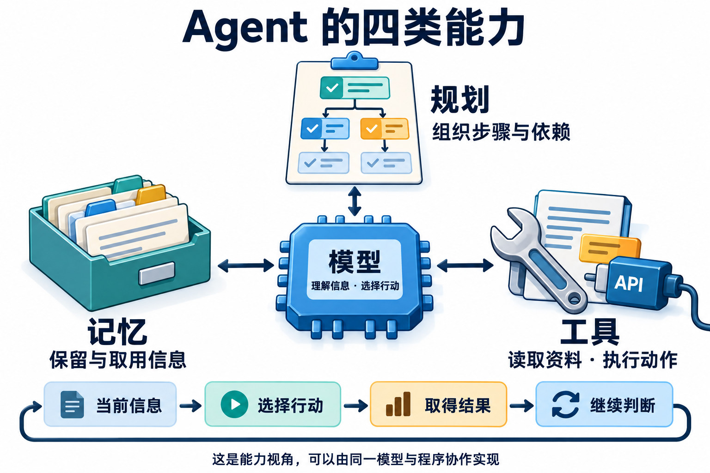
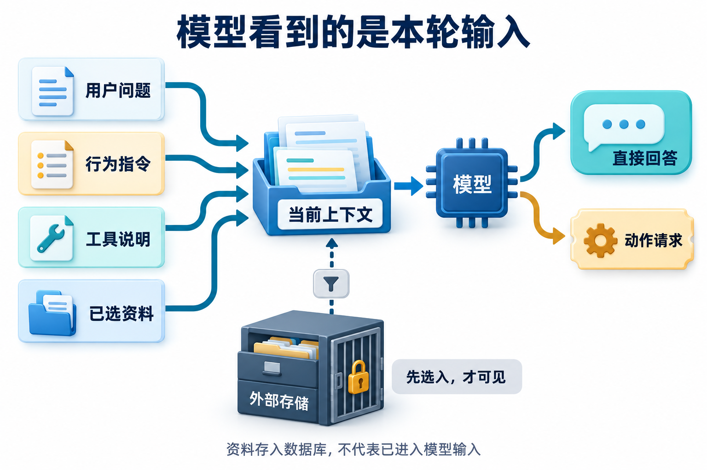
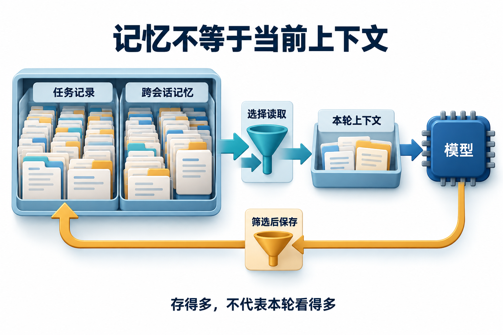
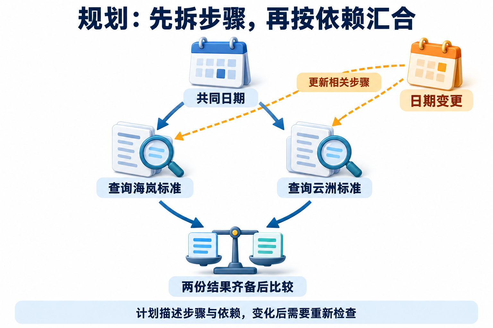

# Agent 与大模型基础

助手说“订单已经处理”，你却不知道它只是生成了这句话，还是确实调用了订单服务。理解 Agent，可以先沿着这条缝往里看：模型生成了什么，运行时执行了什么，哪份证据说明任务完成。

本篇先分清系统边界，再看生成、缓存、训练和检索分别改变哪一层。练习口述时，用一个具体故障解释机制，再补自己的实现证据；这样遇到追问时，能沿执行链继续讲下去。

先限时口述短答，再打开详细答案回答三个追问，最后画出案例的失败分支并完成微练习。

### Q001 什么是 Agent，和普通 LLM 调用有何区别？

**优先级：P0**

本题导航：[口述短答](../../questions/Q001.md#简要回答) · [概念与机制](../../questions/Q001.md#详细解析) · [三个追问](../../questions/Q001.md#常见追问) · [完整案例](../../questions/Q001.md#实战案例) · [动手练习](../../questions/Q001.md#动手想一想)

**30–60 秒回答：**

**智能体（Agent）是围绕目标，根据当前信息选择行动，再利用结果继续推进的系统。** 本题讨论以大语言模型（Large Language Model，LLM）为决策核心的 Agent。单次模型调用接收一次输入、产生一次响应；固定工作流主要由程序安排步骤和分支；Agent 则让模型根据中间观察动态决定下一步。它常用模型、工具、记忆和规划来完成工作，运行时负责把决定、实际执行和反馈连接起来。是否需要动态选择，要看任务的信息会怎样逐步出现。

展开详细答案、图解、追问与案例

**详细答案：**

#### 单次模型调用、固定工作流与 Agent 的区别

以一份虚构的住宿制度为例。小明准备2026年11月12日去海岚出差，问助手："酒店每晚650元，超过公司的住宿上限吗？" 本例的普通员工类别由可信用户档案提供，不能让模型自行猜测。

模型读懂这句话并不难。可要回答准确，它还得找到制度，判断适用日期和员工类别，把查到的金额与650元比较。如果小明接着说"改去云洲了"，助手又得沿着新的条件继续。

这几个看似自然的动作，背后涉及不同能力。理解 Agent 架构，可以从一个问题开始：模型已经能说话，应用还要补上什么，才能让它持续完成一项任务？

同样的问题，可以采用不同组织方式。一次调用把已提供的材料交给模型，直接生成回答；一个固定流程可以先查询、再比较、最后生成；Agent 方式则允许模型根据新观察决定先问日期、补查资料，或者已经可以回答。区别要看下一步怎样确定。

| 组织方式 | 下一步由谁安排 | 住宿问题中的表现 |
| --- | --- | --- |
| 单次模型调用 | 应用发出一次请求，模型产生一次响应 | 提供制度与问题，生成本次答案或动作请求 |
| 固定工作流 | 程序预先定义阶段和条件分支 | 确认日期后查询，按规则比较，再组织回答 |
| Agent | 模型在程序允许范围内依据观察动态选择 | 查到旧资料后决定补查，缺条件时决定澄清 |

固定工作流同样可以包含模型、工具和条件分支；一次模型响应也可能提出工具请求。工具是否出现，不能单独区分这三种组织方式。按主要控制路径理解它们，更容易说清具体架构。[架构区分参考](https://www.anthropic.com/research/building-effective-agents)

#### 用一张图认识四类能力

模型理解信息并提出决定，工具提供查询和操作能力，记忆保留前后步骤需要的信息，规划组织目标、子任务与依赖。下面先逐项解释，再看运行时怎样让它们配合。

图中的四类能力，分别回答四个问题：怎样理解与选择、能做什么、保留什么、步骤怎样组织。它们会互相配合。例如，规划提出先查制度，模型选择查询工具；工具返回材料，应用保存结果；下一次模型调用读取这些信息，决定能否回答。

| 能力 | 在住宿问题中做什么 |
| --- | --- |
| 模型 | 理解小明问的是金额上限，发现还需要制度依据 |
| 工具 | 查询制度库，取得指定日期适用的条款 |
| 记忆 | 保留出差条件、已查资料和仍缺的信息 |
| 规划 | 安排确认条件、取得资料、比较与回答的顺序 |

这些是理解架构的能力视角。一个应用可以由同一个模型承担决策与规划，也可以用程序规定部分步骤。简单查询只需当前任务信息；需要在后续任务中复用偏好或经验时，再考虑长期记忆。先看任务需要哪些能力，再决定代码怎样分模块。

#### 模型：把当前信息变成下一步选择

大语言模型从训练中学习语言与知识，能够解释问题、归纳材料，也能按要求生成结构化内容。在 Agent 中，我们还会让它判断下一步：现在能回答吗？要先问用户一句，还是调用某个工具？这使模型从回答生成器变成了控制过程中的决策者。

模型作决定时，需要拿到与当前问题有关的信息。小明给出的城市、日期和金额属于任务条件；从制度库取出的条款属于外部证据；可用工具的用途与参数说明告诉模型有哪些行动可以选择。应用把这些信息组织成当前上下文，模型才能据此决定。

系统提示词也在这里发挥作用。它可以说明助手负责哪类问题、回答怎样组织、信息不足时怎样处理。例如让政策助手先查清适用条件，再回答金额问题。这样的指令帮助约束生成行为，执行程序仍要负责真正的工具调用。

模型学过的知识和这次任务的资料需要分清。即使它了解差旅制度通常怎样写，也不能由此知道某家公司的最新上限。一次调用里没有提供新制度，流畅的回答也可能沿用错误前提。应用通过工具取得当前资料，再把资料交给模型，补上这一信息缺口。

选择模型时也要回到具体任务。能否读懂条件、选对工具、遵守输出要求，以及调用耗时与费用，都会影响系统体验。模型怎样生成输出，可以接着读 [Q002：自回归预测](../../questions/Q002.md)；哪些材料应进入本次输入，在 [Q031：上下文压缩](../../questions/Q031.md)中继续解释。

#### 工具：把语言请求接到真实能力

工具是应用向 Agent 开放的一项可调用能力。查询制度、读取文件、计算金额和创建工单，都可以封装成工具。工具背后的实现可能是普通函数，也可能访问数据库或远程服务。模型接触的是这项能力的说明和调用结果。

理解工具调用，要分清声明、请求和执行。声明像一份接口说明：这个工具叫什么，适合做什么，需要哪些参数。模型阅读说明后提出调用请求，例如按海岚和11月12日查询住宿制度。运行时接到请求，才调用相应函数，把返回资料送回来。[工具交互参考](https://modelcontextprotocol.io/specification/2025-11-25/server/tools)

因此，模型生成一段查询参数时，制度还没有被读取。只有执行函数取得结果，新的资料才进入系统。如果模型写了"工单已创建"，应用也仍需查看创建工具返回了什么。把生成文字和实际行动分开，后续的循环就容易理解了。

工具描述会影响模型的选择。一个工具只写"查询数据"，读者也难判断它查的是员工、订单还是制度。改成"按城市和出差日期查询住宿标准，返回条款及生效时间"，使用范围就明确了。参数同样需要有清楚含义：出差日期与查询当天日期，可能指向不同版本的制度。

读取和写入也有不同作用。查询资料让系统知道更多；创建工单会改变外部系统。它们适合分别提供接口，让选择动作时就能看清后果。工具数量增加后，还需要发现和连接这些能力。**MCP（Model Context Protocol，模型上下文协议）**在这里提供协议层的连接与交互约定，其角色与调用过程放在 [Q025：工具由谁执行](../../questions/Q025.md)和 [Q028：MCP的角色](../../questions/Q028.md)详细说明。

检索又是工具中的一个常见方向。政策库怎样分段、怎样找到相关条款、怎样把资料交给生成步骤，属于 [Q017：RAG的作用](../../questions/Q017.md)。本章先记住：工具提供能力，实际执行带回观察，观察会影响下一步。

#### 记忆：让前后步骤接得上

假设助手查到了海岚的制度，小明接着问："那我这个650元算超了吗？" 这句话省略了城市、日期和制度。要接着回答，应用得保留前面确认的条件与查询结果，再把必要部分提供给下一次调用。记忆解决的就是信息怎样跨步骤保留和复用的问题。

这里有三个相近概念。Context 是本次模型调用实际可见的输入，相当于这次摊开阅读的材料。任务状态保存当前目标、已知条件、查到的证据和进展，应用可以从中选出下一轮所需内容。跨会话记忆则保留以后任务可能复用的信息，例如用户明确表达的语言偏好。

它们之间的关系是保存、选择和读入。状态里保存了某份制度，应用可能只把相关条款放进本次上下文；旧资料和无关历史继续留在存储中。因此，存储容量很大，模型本次可见的信息仍然可能很少。排查"明明记下了却没用到"，要看信息有没有被选入当前调用。

短期记忆通常围绕当前会话或任务，长期记忆则面向跨会话使用。这个区分主要说明使用范围，实际保存多久取决于应用设计。任务状态可以持久保存以便稍后继续，长期记录也可以设置有效期；两者都需要明确的读取方式。[记忆范围参考](https://docs.langchain.com/oss/python/concepts/memory)

保存形式也有选择。明确的城市、日期可以用字段记录；一段经历可以写成带来源的摘要；处理某类问题的方法可以整理成步骤说明。向量检索适合寻找语义相关内容，关系表、文件或键值记录也能承担相应存储。把信息写入应用记录，与训练模型、修改模型参数是两种不同操作。

按记忆内容，还常见三种分类。事实和偏好属于语义记忆，例如“用户希望用中文回答”；一次任务的经历属于情景记忆，例如“上次用户更正了城市，助手重新查了制度”；可复用的方法属于程序性记忆，例如“比较两地标准前先确认共同日期”。这里分的是保存什么，文件、关系表和向量索引分的是怎样存取，两组分类不能直接画等号。

小明把海岚改成云洲时，当前城市应更新，旧查询仍可以作为历史保留，但后续回答要使用云洲资料。这说明记忆还涉及更正和取舍。所有历史都原样堆进上下文，反而可能让旧条件继续影响决定。信息的写入、读取与更新，在 [Q030：上下文与记忆](../../questions/Q030.md)继续展开。

#### 规划：把目标拆成有关系的工作

查询一个城市的金额上限，下一步通常很清楚。现在把目标换成："比较海岚和云洲在同一天的住宿标准。" 回答需要覆盖两个城市，并保证比较条件一致，规划便有了更明显的作用。

规划首先把目标拆成可处理的子任务：确认出差条件，查询两地标准，最后综合比较。接着还要识别依赖。两地查询都需要共同的出差日期；综合回答则依赖两份查询结果。只列出几个动词，还没有说明工作之间的关系。

有些应用先生成显式计划，再按计划执行。这样容易检查目标是否被覆盖，也便于理解当前进度。有些应用每取得一次观察，就决定下一步；常见的 **ReAct** 名称取自 Reasoning（推理）与 Acting（行动），用来组织两者交替推进。显式计划与局部动态选择可以组合：先确定需要比较两地，再根据检索情况决定是否补查。[ReAct原论文](https://arxiv.org/abs/2210.03629)

计划还会遇到新情况。查到的资料没有当前日期的版本，原定"直接比较"就需要延后，先寻找有效制度；用户更改目的地，也会改变相关工作。规划因而包括根据反馈更新后续步骤。已经适用的结果可以保留，依赖旧条件的部分再调整。

规划能力可以由模型生成任务清单来实现，也可以体现在程序预设的依赖中，或由下一动作选择逐步体现。单独命名一个 Planner，主要是实现组织上的选择。几种方式怎样取舍、多任务何时值得并行，在 [Q010：ReAct与先规划后执行](../../questions/Q010.md)讨论。

#### 运行时与环境：让能力真正协作

前面解释了系统具备哪些能力，现在看它们怎样接在一起。运行时是负责组织执行的程序：准备本轮输入，调用模型，接收动作请求，执行工具，记录返回结果，再安排继续或结束。框架可以封装其中一些步骤，应用也可以自己实现。

环境指系统实际交互的对象。对政策助手来说，制度库提供资料，用户补充条件，工单服务保存申请。环境会返回新信息，也可能发生变化。模型依据输入作出的决定，需要通过工具和消息才能作用到这些对象。

这就把能力视角和落地视角接起来了：模型、工具、记忆、规划说明系统怎样完成工作；运行时说明谁组织这项工作；环境说明工作发生在哪里。它们可以共享进程或存储，逻辑职责仍能分别解释。

运行时反复组织决定、行动与观察，构成了后续要学习的 Agent Loop。循环怎样实现，接着读 [Q009：最小Agent循环](../../questions/Q009.md)；复杂的失败恢复与安全边界，留到相关工程题继续展开。

**实战案例：**

#### 回到小明的650元问题

小明给出城市、日期和金额后，应用先保存这些任务条件。模型看到问题与可用工具，判断回答需要公司制度，于是提出查询请求。这个决定使用了模型的理解与选择能力。

运行时执行查询，工具带回11月起适用的住宿条款：海岚普通员工每晚700元。应用保留这份资料，并把条款连同小明的条件送进下一轮输入。650元和700元此时才有了可比较的依据。

模型根据新信息组织回答：在给定日期与员工类别下，650元未超过700元金额上限，并说明所依据的制度。这次任务只问金额条件，查询与比较就足够；进一步创建咨询申请，需要新的用户目标。

如果小明没有说日期，下一步会先补充日期；如果改去云洲，就更新城市并查询新资料。四类能力在这些变化中协作，运行时把一次次决定、行动和反馈连成过程。

#### 面试时怎样把架构讲清楚

先定义Agent，再用控制路径区分它与单次调用、固定工作流。解释组成时，说明模型、工具、记忆和规划各自解决什么问题，随后补上运行时怎样组织执行。最后用一个例子串起来：模型发现需要制度，工具查到条款，任务状态保留条件与结果，规划安排后续比较，运行时推动整个过程。

**常见追问：**

1. **模型已经生成查询参数，为什么还没有取得制度？** 参数是动作请求。运行时还要调用相应函数，取得返回材料；生成请求与实际执行分别发生。
2. **制度存在数据库中，为什么模型这次仍可能没有看到？** 数据要经过读取、选择，进入当前上下文。存储中的全部内容不会自动成为一次调用的输入。
3. **用户把城市改了，计划、状态和工具调用分别会怎样变化？** 状态保存新城市，规划调整受影响的工作，工具查询新城市资料；仍适用的历史信息可以保留。

**常见误区：**

把Agent等同于一个更长的提示词，或只凭是否调用工具判断架构，都会漏掉控制路径。另一种误解是要求四类能力必须各有独立模块：模型可以同时承担规划与决策，简单任务也可以只使用当前状态。跨会话记忆用于后续任务复用偏好或经验；恢复同一任务，则要看任务状态怎样保存。

**微练习：**

针对小明的住宿问题，分别画出单次模型调用、固定工作流和Agent的处理过程，标明谁决定下一步。然后把城市改为云洲，解释哪些信息需更新、为什么要重新查询，以及哪份新材料会进入后续输入。可以用纸笔完成，重点是把概念关系讲清楚。

**学习与参考：** [完整讲解：Agent组成与协作](../../learning/01-system-map.md) · [基础原理](../../learning/README.md) · [可选：观察一次完整任务](../../learning/00-first-agent.md)

### Q002 自回归语言模型到底在预测什么？

**优先级：P0**

**30–60 秒回答：**

典型自回归模型**根据已有 token 预测下一个 token 的分布**，再按解码策略选出一个并继续。token 不是固定一个汉字或一个单词。训练时常用真实前缀计算预测误差，推理时则依赖自己已生成的内容，因此错误可能沿后续输出扩散。“下一 token 预测”描述计算目标，不意味着它只能做简单补全；系统能否完成任务仍要通过实际评测判断。[生成机制参考](https://huggingface.co/docs/transformers/llm_tutorial)

展开详细答案、追问与案例

**详细答案：**

先区分文本与计算输入。分词器按词表和规则把字符串编码成 token ID，模型再处理这些 ID 对应的表示；一个词可能拆成多个片段，中文、标点与代码也没有统一的字符换算比例。讨论长度或费用时，应使用匹配的分词器或服务用量，记录模型版本，不能把肉眼数出的字数直接当容量合同。

典型自回归生成以已有 token 为条件，计算下一位置的分布，经解码选择后把结果加入前缀，再重复。假设某两步选择的条件概率分别为 0.6 和 0.7，该路径概率为 0.42；这是文字路径的概率，不能读成报销结论有相同的正确概率。系统还需要当前有效的制度、适用人员与日期，才能检查这条语言输出是否成立。

训练时常用真实前缀计算误差，推理时则会接上自己生成的内容。开头误写了政策年份，后文可能围绕这个年份继续组织解释，甚至生成互相呼应的错误细节。调采样可以改变选择方式，却补不回未提供的证据。分析时把编码、生成策略和事实验收分开：格式稳定、重复结果相似和任务正确，分别需要对应证据。

**常见追问：**

1. **温度降低为什么仍然会答错？** 温度改变从已有分布选 token 的方式。若证据缺失或模型误读了条件，更集中的采样也可能稳定输出错误；应固定材料再观察解码变化，不能把参数调低当成事实校验。
2. **温度为零能保证每次完全相同吗？** 不能据此承诺跨版本、跨服务一致。还要固定模型、输入、工具结果及实现条件；服务端计算与外部环境也可能引入差异，复现记录应覆盖这些因素。
3. **为什么一个 token 不能按一个汉字算？** 切分取决于词表与规则，同一字符串在不同分词器下可能形成不同序列。实际测试应保存原文、编码结果和版本，再按服务计量口径核算预算。

**实战案例：**

政策助手把未给定的年份先写进回答，后面引用和解释都围绕该年份展开。处理时把适用日期设为明确输入，缺失则澄清，并固定证据与提示后重复生成。验收分别记录格式通过与事实通过：字段齐全但年份错误仍判失败，引用必须回到对应版本。再改温度比较输出分布，观察语言是否更集中，同时确认正确性没有被格式成绩代替。

**常见误区：**

把“概率最高”当成“事实最真”，或把温度为零当成跨版本可复现保证。文字之间自洽，也可能只是后续生成沿用了前面的错误前提。

**微练习：**

对同一问题连续运行十次，记录格式通过率与事实正确率。验收：两项指标独立统计，并注明模型、参数、日期。给部分请求故意缺少日期，检查系统是否澄清；不要把十次重复尝试当成十种独立用户需求。

**学习与参考：** [大模型最小原理](../../learning/02-llm-primer.md)

### Q003 Transformer 的 Attention 在做什么？

**优先级：P2**

**30–60 秒回答：**

注意力从当前表示生成 Query、Key、Value：**Query 与各 Key 算匹配权重，再按权重混合 Value**。可把 Key 暂记为匹配标签、Value 暂记为被取用的内容；它们实际都是数值表示。缩放点积注意力写成 `softmax(QKᵀ/√d_k)V`，其中 `d_k` 是每个注意力头的 Key 维度；因果语言模型还要屏蔽未来位置。多头在不同投影中建立关联，权重本身不能直接当作可验证的因果解释。[原论文](https://arxiv.org/abs/1706.03762)

展开详细答案、追问与案例

**详细答案：**

标准缩放点积注意力先把表示投影为 Query、Key 和 Value。当前 Query 与可见 Key 的匹配决定分数，按维度缩放后通过 softmax 形成权重，再对 Value 加权求和。Key 可以暂记成用于匹配的标签，Value 暂记成参与混合的内容；实际都是数值表示，并不存在人工维护的标签表。

用一头一维的小例子看：Query 为 1，两条 Key 为 0 与 ln(2)，Value 为 3 与 9。缩放因子为 1，指数权重为 1 与 2，归一化后为 1/3 与 2/3，输出就是 7。若某位置属于尚未允许看到的未来，应在归一化前排除其影响，不能先给它分配权重，再把对应 Value 随手置零而不重算。

算例的权重只在当前可见集合内比较；换了集合，同一 Key 的归一化权重也可能改变。因此不能跨样例只凭权重大小比较某条款的重要性。

这个局部加权只是网络中的一部分。多头使用不同投影建立关联，位置相关设计表达顺序，完整模型还包含残差、前馈等计算。注意力权重大，只说明这次混合在相应位置分配了较大权重，不能直接推断它是答案的唯一原因，更不能据此认定一条政策为真。面试中能把输入、权重、输出和遮罩解释清楚，比用一张热力图宣称模型已经给出因果解释更可检验。

**常见追问：**

1. **所有 Transformer 都按这一个公式实现吗？** 这里说明标准机制。现代实现可能改变位置设计、注意力布局和缓存组织；估计显存与延迟时要读取具体架构和服务配置，不能仅凭这一公式给所有模型套性能结论。
2. **既然注意力能关联词，顺序信息还从哪里来？** 位置相关设计让模型区分顺序，不能因为注意力并行计算就断言没有位置。讨论时指出目标架构如何表达位置；本题不要求把某一种位置方案推广到全部模型。
3. **某条款权重最高，可以当作可信引用吗？** 不能。权重服务于内部表示混合，引用可信度还需核对原文、版本、适用条件及结论支持关系。解释模型与验证业务事实，需要各自的检查方法。

**实战案例：**

给一个合成注意力算例加入未来位置，初版把三条记录都参加归一化，导致当前输出受未见答案影响。处理时先确定可见位置，再应用遮罩并计算权重。验收手算与程序结果一致，可见权重和为一，被屏蔽位置不影响输出；改变未来 Value 后当前结果保持不变。这个实验检查注意力局部计算，政策答案是否正确仍要另验来源与生成。

**常见误区：**

“Transformer 完全没有顺序信息”；实际上顺序需要通过位置相关设计表达。遮罩限制可使用的位置，不会自动完成资料权限或事实核验。

**微练习：**

用三段向量手算一次加权和，再遮住最后一个位置。验收：被屏蔽位置不参与有效权重分配，剩余权重重新归一化。再改变一个可见 Value，解释输出为何变化；说明该实验没有检查整层 Transformer 的哪些部分。

**学习与参考：** [大模型最小原理](../../learning/02-llm-primer.md)

### Q004 Prefill、Decode 与 KV Cache 为什么影响延迟？

**优先级：P0**

**30–60 秒回答：**

**Prefill 处理已有输入；Decode 逐步生成新 token。** 对常见因果注意力模型，KV Cache 保存前面位置的 Key 和 Value，后续生成复用它们，从而减少重复计算。缓存会占显存，上下文越长、并发越高，容量压力通常越大。因此首 token 延迟和后续生成速度要分开测，不能只比较一次请求的总耗时。[缓存机制](https://huggingface.co/docs/transformers/cache_explanation)

展开详细答案、追问与案例

**详细答案：**

拆延迟时，先分已有输入处理和新输出生成。政策助手的问题很短，附带制度可能很长，Prefill 要处理这些输入位置；开始回答后，Decode 再逐步产生后续 token。首 token 之前的等待可能包含排队、网络和输入处理，不能把全部时间都归给同一个模型阶段。

对常见因果注意力实现，后续位置仍需利用过去位置的表示，KV Cache 保存相应 Key 和 Value，减少重复计算。可以把它想成保留已经算好的工作底稿，继续往后算时复用；底稿会占空间，且必须与对应模型、前缀和配置匹配。这个类比不表示保存了业务真相，也不表示后续生成不再读取历史信息。

缓存层次还要分开。一次生成中的 KV、跨请求可复用的前缀，以及直接返回成品的最终答案缓存，匹配条件与失效方式不同。答案缓存还涉及当前权限、证据版本和问题是否等价。长输入、高并发会给缓存容量带来压力，但具体能服务多少请求、快多少，取决于实际实现和负载。测试时分别记录输入与输出长度、首 token 和结束时间，控制任务内容，才能判断优化发生在前缀处理、输出生成还是排队。

**常见追问：**

1. **有 KV Cache 后生成是否不再看历史？** 仍要使用缓存中的历史 Key 和 Value。它减少部分重复计算，历史信息并没有被扔掉；如果改变前缀或模型配置，应按实现规则判断原缓存是否还能复用。
2. **前缀缓存与答案缓存如何区分？** 前者复用匹配前缀的中间计算，新后缀与输出仍需处理；后者直接复用回答。答案命中还要核对身份、适用日期与证据失效，不能把相同文本当作相同访问范围。
3. **为什么总耗时相近也可能体验不同？** 一个请求可能很快出首字却生成很久，另一个先等输入处理、随后快速完成。要结合用户目标分别看首字和终态，并保留排队与网络信息，避免误归因。

**实战案例：**

同一政策助手分别输入短摘要和完整制度，输出要求保持可比。初版只看总时长，误把长回复的生成时间归因于检索材料。改为保存输入 token、实际输出 token、首 token 和完成时间，并记录并发与排队条件。验收能区分首字等待和生成阶段，说明长输入为何可能影响前者；再引入重复前缀，观察复用而不预先承诺固定倍数，也不跳过权限检查。

**常见误区：**

“KV Cache 保存了模型学到的新知识”或“有缓存后生成不再读取历史表示”。缓存命中不授予对象访问权，也不能证明回答依据仍然有效。

**微练习：**

固定输出上限，分别测试短输入与长输入。验收：记录首 token 时间、输出 token 数、总时间；说明网络和排队是混杂因素。再加入同前缀、不同问题的请求，说明哪些计算可能复用，哪些结果必须重新生成与核验。

**学习与参考：** [大模型最小原理](../../learning/02-llm-primer.md)

### Q005 预训练、SFT、偏好优化、LoRA 分别是什么？

**优先级：P2**

**30–60 秒回答：**

预训练学习广泛的数据规律；[SFT](https://huggingface.co/docs/trl/sft_trainer) 用示范输入输出调整行为；[偏好优化（如 DPO）](https://huggingface.co/docs/trl/dpo_trainer)利用偏好信号改善输出选择。LoRA 讨论怎样适配参数，常冻结基础权重、训练低秩增量；SFT 讨论用什么示范和目标训练，两者可以组合。**把“学什么”和“改哪些参数”分开**，就不会把它们排成互斥选项。选型仍要检查知识、行为或偏好缺口，以及数据和验证集。[LoRA 原论文](https://arxiv.org/abs/2106.09685)

展开详细答案、追问与案例

**详细答案：**

这几个词回答的维度不同。预训练描述模型从广泛数据学习规律的过程；**SFT（Supervised Fine-Tuning，监督微调）**用示范输入输出塑造目标行为；偏好优化利用候选之间的相对质量信息，**DPO（Direct Preference Optimization，直接偏好优化）**是其中一种方法。讨论它们时，先说数据和目标，再说更新了什么参数，避免把一串名称背成固定产品流水线。

**LoRA（Low-Rank Adaptation，低秩适配）**关注参数适配方式，常见做法冻结基础权重，训练低秩增量。它可以与某些微调目标组合，所以“采用 SFT 还是 LoRA”这个二选一少了一层条件：前者说明用示范学什么，后者说明怎样限制可训练的改变量。可训练参数少不意味着不需要高质量样本，也不能直接推导完整训练和部署一定省多少资源；仍需看任务、配置与测量口径。

应用选择从失败证据出发。新版制度没有进入输入，先修更新和检索；证据齐全却总漏员工类别，可以收集正确比较与澄清示范；候选都可读但质量偏好不同，再研究偏好数据。参数改动要记录模型、数据、训练配置和产物版本，用保留任务检查目标行为与基础能力，防止只在训练样本上变好。普通工具调用、写偏好记录和保存反馈只是运行时操作，只有实际训练流水线执行了参数更新，才有相应训练产物可验。

**常见追问：**

1. **LoRA 的参数少，数据要求也会自动降低吗？** 不会自动降低。示范错误、分布偏窄或偏好标准冲突仍会影响结果；要比较相同任务上的数据质量、目标表现和回归，再讨论参数与资源取舍。
2. **SFT 后还必须做偏好优化吗？** 取决于剩余问题和可用数据。若示范已能满足目标，额外阶段可能没有值得支付的收益；若问题在候选相对质量，需要先明确偏好规则，不能把阶段越多当成效果越好。
3. **用户纠正一次答案，算在线训练了吗？** 通常只改变当前输入或反馈记录。要证明训练，需要看到数据处理、实际参数更新与新模型产物，并在独立集合验证；日志被保存不代表梯度更新已经发生。

**实战案例：**

设想助手输出字段齐全，却在比较政策时持续漏掉人员类别。团队先确认正确条款确已进入输入，再建立含类别缺失、类别已知和来源冲突的示范集合；用参数高效适配作为一个候选，而非默认结论。验收在保留问题上检查遗漏、无效澄清和错误动作，同时跑原有问答回归。新政策更新仍走检索链路，不能用一次训练实验承诺永久掌握每天变化的制度。

**常见误区：**

把“会调用 API”归因于运行时自动更新模型参数；普通推理与应用记忆不会自动执行梯度训练。把预训练、训练目标和参数适配方式排在同一条互斥清单上，会掩盖组合条件和真正的数据需求。

**微练习：**

将“输出格式不稳”“内部政策每天变化”“领域术语理解差”各提出一个先做的实验。验收：说明数据、基线、成功指标和失败后的下一步。写清哪些输入已经齐全、哪些是模型行为问题，并给每个候选保留一个可能退步的反例。

**学习与参考：** [大模型最小原理](../../learning/02-llm-primer.md)

### Q006 Prompt、RAG 与微调如何选？

**优先级：P0**

**30–60 秒回答：**

先用最小基线定位问题：要求没说清或格式不稳，改提示与校验；每天更新的制度要能查到、追溯到，考虑检索；大量稳定示例能够定义目标行为时，再评估微调。RAG（检索增强生成）像为这次作答取来资料，微调会改变模型参数，这个类比只帮助区分改动位置。三者可以组合，最终仍要评测，不能用“上了 RAG”代替正确率证据。[RAG 原论文](https://arxiv.org/abs/2005.11401)

展开详细答案、追问与案例

**详细答案：**

**Prompt（提示）** 是本次交给模型的指令和示例；**RAG（Retrieval-Augmented Generation，检索增强生成）** 先从外部资料中取回相关内容，再把材料放入这次输入，供模型生成回答；**微调（Fine-tuning）** 则通过训练改变模型参数。三者改变的位置不同：输入要求、输入证据、模型参数。先辨认缺口，再选办法，避免为了查一条新制度，先把模型送去重读大学。

先固定一个失败问题及它应该满足的条件，再做最小对照。把正确且完整的证据直接提供给模型：若仍误读，检查指令、示例、上下文冲突和输出行为；若能正确回答，再往上游找资料更新、过滤与召回问题。这个对照只能帮助定位，不足以单凭一个样例宣布哪种方案普遍更好。

提示适合表达目标、边界、示例和输出合同，程序校验补上可确定的约束。RAG 将外部材料带进当前调用，适合需要更新和追溯的依据，但新增解析、索引、权限、选择与引用链路。微调改变参数，可以从稳定样例学习行为，却不能代替当前对象权限或保证逐条记住业务记录。三者分别像交代任务、提供资料和训练技能；这个类比只对应改动位置，不能由此推导某方案必定正确。

选型还要考虑维护成本。制度每天变化，要问新版何时可检索、旧版怎样撤回、缓存与摘要如何失效；如果需要调整稳定表达方式，要检查是否有覆盖边界的示范和独立验证。私有材料也不意味着必须训练，权限和敏感数据使用应先确定。最后在相同任务和可比预算下比较证据覆盖、事实错误、拒答、延迟与成功成本，保留能失败的样例，避免只挑最顺的演示。

**常见追问：**

1. **私有知识一定要微调吗？** 先看更新频率、引用和隔离要求。可受控检索的材料可以按请求提供；是否训练要由稳定行为需求与数据合同决定，不能用“私有”两个字跳过方案比较。
2. **加 RAG 后仍答错，接下来做什么？** 沿解析、索引、召回、证据选择和生成找最早偏差。用人工正确证据替换候选做对照；若仍误读，继续调检索参数可能无效，应检查后半程。
3. **三个方案可以一起用吗？** 可以。提示约束回答合同，检索提供当前证据，微调塑造稳定行为；要分别记录版本并做消融，避免多项同时变化后无法判断收益来源，也要统计额外费用。

**实战案例：**

教学场景中，住宿规则刚更新，助手仍回答旧标准。先固定问题、日期和正确条款，确认直接提供新版后能回答，再修复入库与版本过滤，而不立刻训练。验收让旧版、新版和无权材料同时存在，检查当前任务只取得可见且适用的证据；随后测试缺人员类别的请求，应该澄清。若改提示、检索和训练中的某一项，再使用同一保留集比较，不把不同样本上的分数相减。

**常见误区：**

把检索当成永久写入模型，或承诺微调能准确记住每条业务记录。格式改善与事实改善要分别验收，合法 JSON 可以照样引用旧版制度。

**微练习：**

为“每天更新的报销政策问答”写三个候选方案。验收：解释过期政策如何撤回，以及回答如何定位到有效版本。给每个方案补一个最小基线、维护动作和退出条件，并说明一次失败怎样定位到具体层次。

**学习与参考：** [大模型最小原理](../../learning/02-llm-primer.md) · [提示与上下文](../../learning/03-context-and-prompts.md) · [RAG 与检索](../../learning/06-rag-and-retrieval.md)

### Q007 为什么模型会给出流畅但错误的回答？

**优先级：P0**

**30–60 秒回答：**

输出流畅只说明语言形式合理，不足以证明事实。可能是知识过时、输入缺失、证据冲突、问题歧义，也可能是检索正确而生成时误读。排查要保存用户问题、可见证据、工具结果与最终回答，找到错误首次出现的位置。减少错误需要来源核验、结构化校验、适当拒答和评测，单加一句“请勿幻觉”通常不足以形成工程约束。

展开详细答案、追问与案例

**详细答案：**

先问错误相对于什么成立。需要权威答案、适用日期、人员条件和用户可见范围作为判断依据，再检查这次调用实际看见的材料。数据库里有新版，不能证明它已进入输入；检索返回相关段落，也不能证明段落覆盖了问题条件。若连基准都不清楚，很容易把正确的限定回答误判成模型答非所问。

然后找最早偏差。源资料错误或过期，修数据与生效规则；分块丢了例外，修解析与证据边界；候选没有必要条款，查召回和过滤；材料完整却误读，再看提示、上下文冲突和生成。生成的句子可以前后呼应，却依赖同一个错误日期，流畅与自洽都无法补上有效依据。把这些故障统称一个词，会让修复失去方向。

验证要覆盖不同层次。程序可以检查引用对象存在、日期范围和字段形状，关键主张还需对照原文是否支持；开放语义判断可以借助经过校准的评分器与人工复核。证据不足时保留未知、澄清或拒答，不让模型为了填满回答编造细节。排障保存输入、证据、工具结果、版本与最终输出，复现后每次只改一个关键因素，再把失败样例留进回归集合。无需索取隐藏思维链，也能依据可观察证据定位多数工程问题。

**常见追问：**

1. **带引用为什么仍可能是错答案？** 链接可能存在，却引用错版本、错对象或不支持相邻结论。分别检查定位、有效性和支持关系；不能用“能点开”替代蕴含核对。
2. **多加一句“不要编造”有什么作用？** 它可以表达要求，但缺少资料、权限或执行校验时仍不足以形成约束。应让不足证据有明确分支，并用无答案、冲突和过期材料检查实际行为。
3. **怎样区分检索问题与生成问题？** 固定问题与验收合同，提供人工确认的正确证据作诊断。结果改善再追查上游；仍失败则检查条件表述、上下文冲突和模型使用证据的方式，并保留对照记录。

**实战案例：**

助手回答“所有培训住宿都能报销”，引用的真实条款却只适用于已批准的外部培训。先检查原文、分块和实际输入，发现摘要丢了“已批准”和“外部”。处理时保留这些条件及来源指针，缺项时回读或澄清。验收组合批准状态与培训类型，逐条核对回答；再故意放入一个不存在的引用和错误日期，分别触发对象检查与版本核对，不能靠一句通用自评把三类错误一起放过。

**常见误区：**

将所有错误叫幻觉，忽略错误数据库、权限过滤或业务规则造成的问题。模型重复同一结论或多个角色互相赞同，都没有增加独立的事实依据。

**微练习：**

给回答注入一个错误日期、一个不存在的引用和一个证据不足的推论。验收：分别设计可执行的检查，不只写“让模型再检查”。保留原始失败样例，写明每项检查的输入、拒绝原因和证据，修复后再跑一条本来正确的对照题。

**学习与参考：** [大模型最小原理](../../learning/02-llm-primer.md) · [提示与上下文](../../learning/03-context-and-prompts.md)

### Q008 如何为 Agent 选择模型而不只看排行榜？

**优先级：P1**

**30–60 秒回答：**

我先从目标任务采样，形成带验收标准的测试集，再比较任务成功率、工具参数有效率、延迟分位数、每个成功任务成本和失败类型。模型要在同一工具实现与可比预算下测试，并记录版本与参数。若用小模型处理简单请求、大模型处理困难请求，还要评估路由错误及升级开销，不能只看单次调用便宜多少。

展开详细答案、追问与案例

**详细答案：**

排行榜可以提供候选线索，业务选择要从任务合同出发。先确定用户需要只读草稿还是会修改真实对象，允许什么动作、哪些条件必须澄清、什么算正确拒绝。再抽取代表性任务，补足缺参、冲突、越权和工具失败，固定评分规则。没有这些约束，选型很容易变成谁的演示更流畅。

比较时让模型面对同一工具实现、证据范围和可比预算，记录模型、提示、采样、索引与工具版本。工具参数有效只说明通过某层检查，不能直接当任务成功；延迟也要区分排队、首 token 和业务终态。所有失败、重试与升级调用都计入费用，再计算每个成功任务成本。拒绝困难题能降低已作答错误率，却可能损害总体完成，因此要保留类别样本数与分母。

路由策略需要整体评测。小模型先处理简单请求，判断错难度或触发升级时可能付出两次调用，还要传递必要上下文。根据缺字段、证据冲突等可验证信号设升级条件，用同题对照看是否提高最终交付。订单写入重视错误动作，草稿任务可按需求权衡速度；不同目标不应被一个总分抹平。小样本先报告观察范围，再逐步扩大验证，不把几个漂亮演示当生产可靠性。

**常见追问：**

1. **业务风险会怎样改变选型？** 写订单要重视越权与错误副作用，内部草稿可更关注修改成本和速度。先设不能突破的门槛，再在允许范围内比较质量、延迟和费用，避免平均分抵消严重错误。
2. **模型便宜一半，方案就一定省钱吗？** 还要计入失败、重试、检索和升级。按所有尝试总费用除以成功任务数，并同时报告无成功的状态；便宜但经常无法交付的单次调用，可能让整体更贵。
3. **如何避免对某模型特别有利的测试集？** 从目标需求分布抽样并保留边界类别，先写评分规则，按组隔离近重复任务。开发与最终保留集分开，记录逐题差异；反复看过的测试错误不能继续当完全独立证据。

**实战案例：**

假设研究助手要比较两个模型，原演示只挑资料完整的问答，两者都很顺。改为固定包含日期缺失、政策冲突、无权限和工具暂时失败的任务，并加入小模型升级方案。验收逐题检查终态、参数、证据和真实副作用，按同一分母汇总；升级后的额外调用仍计费，拒答也按场景判定。输出差异表和退步样例，解释收益发生在哪类任务，而不编造线上增长。

**常见误区：**

用十个成功演示推断线上可靠性；只在某个模型擅长的样本上比较。不要在不同证据、不同尝试次数或不同工具质量下只比较模型名称。

**微练习：**

设计二十条示例任务，覆盖正常、缺参、冲突、工具失败与越权。验收：先写评分规则，再看模型输出；所有数字注明是本地实验。为二十条任务标出主要质量指标和保护指标，预先写明升级触发及费用汇总方式。

**学习与参考：** [评测与验收](../../learning/09-evaluation.md)

## 参考资料

| 核心主张 | 一手来源 | 阅读要点 |
|---|---|---|
| Agent 与预定义工作流可按控制路径区分 | [Anthropic](https://www.anthropic.com/research/building-effective-agents) | 术语约定并不统一，文章发表于 2024 年 |
| 自回归生成依赖已有 token | [Hugging Face](https://huggingface.co/docs/transformers/llm_tutorial) | 此处不涵盖所有生成架构 |
| 标准缩放点积注意力机制 | [Attention Is All You Need](https://arxiv.org/abs/1706.03762) | 现代模型可能采用变体 |
| SFT 与偏好优化使用不同训练信号 | [TRL SFT](https://huggingface.co/docs/trl/sft_trainer)、[TRL DPO](https://huggingface.co/docs/trl/dpo_trainer) | 这里只讨论概念，不固定训练库接口 |
| KV Cache 用存储换取重复计算减少 | [Hugging Face 缓存说明](https://huggingface.co/docs/transformers/cache_explanation) | 具体性能依赖实现 |
| LoRA 训练低秩增量，RAG 使用外部检索材料 | [LoRA](https://arxiv.org/abs/2106.09685)、[RAG](https://arxiv.org/abs/2005.11401) | 结合训练与检索设置阅读论文结果 |

复习入口：[仓库首页](../../README.md) · 下一篇：[规划与编排](02-planning-and-orchestration.md)
