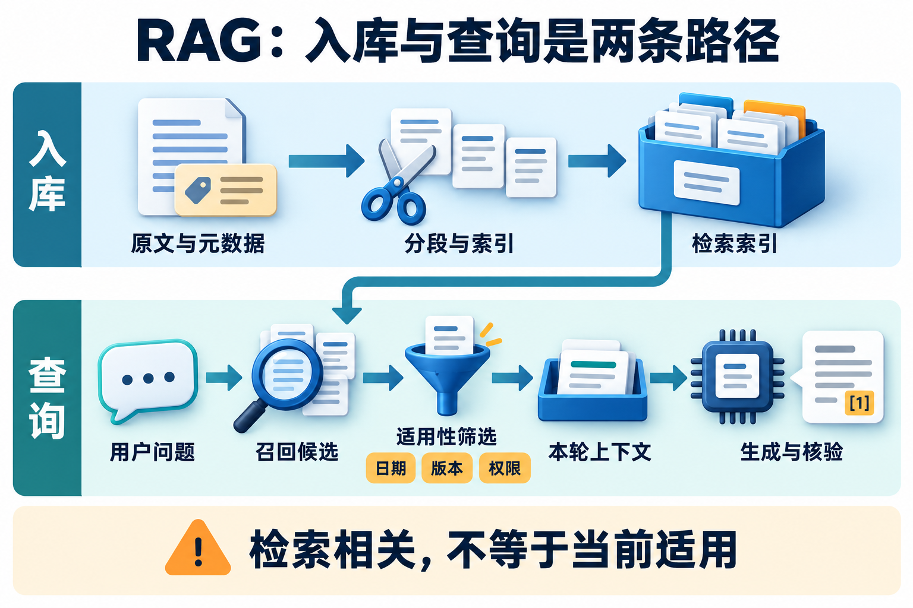

# RAG 与检索诊断

回答引用了真实制度，金额却还是错的：可能入库时丢了表头，可能召回了旧版，也可能模型把例外条款读反。排查时沿文档到答案的路径走，才能知道该修哪一段。

本篇先看材料如何被切分和召回，再看融合、重排、权限与评测。做算例时写清评测单位、相关性标注和样本来源；讲答案时指出一个具体失败信号，避免把所有问题都交给“换个模型”。

### Q017 一个 RAG 系统的完整数据流是什么？

**优先级：P0**

**30–60 秒回答：**

离线侧解析文档、保留元数据、分块、建立索引；在线侧理解查询、执行权限过滤、召回候选、可选重排、组织证据、生成答案并验证引用。RAG 的关键是让生成过程使用外部材料，而不只是调用向量库。解析丢表格、索引过期或生成误读都可能让最终答案失败。[RAG 起点](https://arxiv.org/abs/2005.11401)

展开详细答案、追问与案例

**详细答案：**

[查看原图](../../website/assets/diagrams/G5-rag-pipelines.png)

先分开看入库与查询两条链路，再沿查询链路辨认召回、筛选、装配输入和引用核验的位置。

先把入库与查询两条链路分开。入库接收可追踪的原文版本，解析正文和表格、清理重复、按结构分块，并附带文档 ID、章节、适用时间和访问范围，再建立检索索引。表格金额必须连着表头和人员类别保存，否则搜索虽然命中数字，也可能失去数字的含义。每个块都能回到原文位置，才有办法在回答出错后检查最早偏差。

查询从当前问题和可信身份出发，明确人员、日期与对象，筛掉无权或失效材料，再召回候选、融合或重排。随后按上下文预算选择能共同覆盖问题的证据，连同来源和未知项交给模型。排名最高的单个片段不一定足够，例如住宿标准和例外审批可能分属不同条款；缺必要条件时，应补查或澄清，不能直接拼一个精确金额。

最后分开检查结论与引用：文档存在、版本适用、原文确实支持相邻断言，数值与条件没有被误读。保存问题、索引版本、候选和实际输入片段，有利于区分检索遗漏与生成错误。原始 RAG 论文结合参数化生成与非参数化检索，现代工程管线的范围更广，不要求照搬其训练架构。增加步骤能改善可控性，也增加时延与维护成本，应围绕实际失败加入能力，而不是以组件数量验收。

**常见追问：**

1. **调用向量库是否就算完成 RAG？** 只完成一种候选获取方式。还需处理材料质量、适用性、上下文选择、生成与引用；向量分数高不能证明规则正确。
2. **没有找到证据能否凭模型知识回答？** 通用背景可按任务合同说明，但精确内部制度应限定范围并报告缺口。模型记忆不能替代当前有效且获准使用的内部证据。
3. **为什么记录实际输入而不只保存最终答案？** 候选可能完整却在选择时被删掉。只有实际片段、版本和来源关系，才能知道模型看见了什么，复现故障也要保护这些记录的权限。

**实战案例：**

政策助手回答住宿上限，引用链接真实，金额却属于管理人员。检查发现 PDF 表格解析只留下金额，没有保存类别表头。处理时让解析结果保留行列关系，分块附适用类别，在线阶段先核对用户类别再选证据。验收用普通员工、管理人员和类别未知三种请求，检查金额与条款匹配；未知类别进入澄清，错误片段能沿版本和位置回到原 PDF，而不是被归为一次不可解释的模型失误。

**常见误区：**

没搜到就凭记忆给出精确内部政策；把入库成功、召回成功与答案正确当成同一个状态；缺乏证据仍输出无条件结论。

**微练习：**

画出一份 PDF 到带引用答案的路径。验收：每阶段列输入、输出、版本标识与一种失败信号，并说明“表头丢失”和“生成误读”分别用什么中间证据识别。

**学习与参考：** [学习章：RAG 与检索](../../learning/06-rag-and-retrieval.md) · [RAG 原始论文](https://arxiv.org/abs/2005.11401)

### Q018 Chunk 大小和重叠该怎样选择？

**优先级：P1**

**30–60 秒回答：**

分块要保存完整语义单位与定位信息，例如标题、条款、表格行及其表头。把“仅适用于管理人员”切到别处，剩下的金额就像脱落标签的价签，很容易贴错对象。块过大又会稀释主题、占用上下文。先按结构建基线，再用代表性查询测大小与重叠，权衡边界丢失和冗余，没有通用最佳字数。

展开详细答案、追问与案例

**详细答案：**

选择块大小之前，先看文档结构和问题需要的证据单位。制度条款、标题限定、定义、表格行及表头可能共同表达一个规则；不能仅按字符数切断否定或例外。每块保留父文档、版本、位置和适用条件，必要时把上级标题作为明确元数据带回。结构解析有误时，增大块可能只是把错误包装得更长，应先检查原文到文本的转换。

较小块便于匹配局部问题，但可能丢失上下文；较大块包含更多条件，也会混入无关主题并消耗生成预算。重叠能让边界附近内容在相邻块中出现，却增加索引体积、重复候选和答案中的重复证据。先建立按段落或条款切分的基线，再在固定查询和标注下比较候选覆盖、条件完整性、最终回答以及时延，不能只观察平均相似度。

一种方案是小块负责召回，再按父段落扩展上下文。扩展时仍检查版本、权限和适用范围，并明确哪些文字是命中证据、哪些是补充背景，避免把旧版邻段或无关例外一起带入。英文 token 参数不等于中文字符数，应核算实际编码后的输入。最终选择还受证据数量与窗口约束，块变大后能放进模型的候选可能变少，所以检索阶段和生成阶段要联合验收，而不是各自挑一个看起来漂亮的分数。

**常见追问：**

1. **重叠越多越安全吗？** 不一定。它减少部分边界损失，但会制造重复块、增加成本，还可能挤掉其他必要证据。应测不同主题与条件组合下的实际收益。
2. **表格该怎样切？** 保留单元格与表头、行标签、单位和脚注的关联。若一行离开表头无法解释，返回时应补齐这些信息，不能把全部内容拍平成无标签字符串。
3. **父段落扩展能替代分块实验吗？** 不能。它增加召回后阅读范围，但不能修复根本未命中的文档；扩展内容本身也可能过长、过时或改变适用条件，需要单独评测。

**实战案例：**

一条规则写着“仅试用期员工不可报销，转正后适用”，初版在逗号附近截断，查询“试用期可报销吗”却只取到后半句。处理时将否定条件和后续状态作为一个语义单元，保存条款位置；对小块命中再带回同版父条款。验收分别用试用期、已转正和状态未知的问题，确认条件没有在检索或扩展时丢失，并检查重复片段不会把另一项必要条款挤出最终上下文。

**常见误区：**

拿英文 token 配置直接当中文字符数；统一切表格而不保留表头；通过加大重叠掩盖解析和版本错误。

**微练习：**

将本题规则从中间切开并模拟错误召回，再设计结构化分块。验收：能展示完整条件、原文位置、重叠造成的重复，并用三个员工状态验证正确回答或必要澄清。

**学习与参考：** [学习章：RAG 与检索](../../learning/06-rag-and-retrieval.md) · [Sentence Transformers 检索与段落示例](https://sbert.net/examples/sentence_transformer/applications/retrieve_rerank/README.html)

### Q019 为什么向量检索和关键词检索可以互补？

**优先级：P0**

**30–60 秒回答：**

关键词检索保留精确术语、产品编号等匹配信号，向量检索能表达部分语义相近关系，但可能混淆相近编号或否定条件。查制度编号时要认准字面，问“超标准怎么办”又可能需要找到“例外审批”。混合检索让两路分别召回，再去重和融合；分数尺度不一致时可用基于名次的 RRF，效果仍要在目标查询上验证。[RRF 公式](https://www.elastic.co/docs/reference/elasticsearch/rest-apis/reciprocal-rank-fusion)

展开详细答案、追问与案例

**详细答案：**

两路检索保留的信号不同。词项匹配适合制度编号、专用名词和明确短语，效果受分词与配置影响；稠密检索比较问题与文档的向量表示，可能捕捉不同措辞的关联。后者不是理解保证，两个相似编号、肯定与否定语句仍可能靠得很近。查询与文档还需处于兼容表示空间，等长向量不代表来自两套无关模型的坐标可以直接比较。

混合时先在同一授权和有效性条件下分别召回，按稳定文档或块标识去重，再融合。不同评分器尺度不一致，直接相加可能让数值较大的一路支配结果。RRF 累加每路的 1/(c+rank)，rank 从 1 起，某路未返回的候选在该路贡献为 0。它利用名次，避免直接比较原始分数，但也丢弃了分数间距，无法由融合值推出证据真实性或答案正确概率。

本题两路为 A,B,C 与 C,A,D，c=10。A 得 1/11+1/12，约 0.174242；C 得 1/13+1/11，约 0.167832，因此 A 排在 C 前。未出现于某路不是负证据，只是不增加该路贡献。常数、候选窗口和最终截断都影响结果，应分开比较编号查询、改写查询及否定条件，而不是只看一个平均分；融合后仍要检查版本与完整条件，不能让两路共同偏向的旧文档自动成为可靠结论。

**常见追问：**

1. **为什么不直接归一化再相加？** 可以作为候选方案，但归一化和权重依赖分数分布与任务，需独立验证。RRF 是另一种取舍，不能声称任何融合方法对所有数据最好。
2. **向量相似度高是否说明更可信？** 不说明。相似度衡量表示接近，权威性、时效与适用条件属于不同检查，旧政策可能与问题非常相似却不能用于当前回答。
3. **两路都没发现目标片段怎么办？** 融合无法创造候选外证据。先检查入库、表示兼容、术语和召回窗口，再考虑补充查询，不能仅调融合公式期待目标凭空出现。

**实战案例：**

用户按政策编号询问超标准住宿，关键词路找到编号条款，向量路找到措辞不同的例外审批。单路方案各漏一半必要证据。处理时保留两路候选与名次，按 RRF 融合，再核对条款版本和适用对象。验收手算 A 与 C 的分数，同时用精确编号、口语改写和带否定的问题检查证据覆盖；旧版即使排名靠前仍被排除，最终答案分别引用标准与例外条件。

**常见误区：**

把未校准分数直接相加；把融合分解释为正确概率；认为两种检索器名称不同，就必然提供互补候选。

**微练习：**

两路为 A,B,C 与 C,A,D，取 c=10。验收：算出 A、C 的融合分和完整排序 A、C、B、D，说明 D 在第一路的贡献为何为 0，并检查去重是否正确。

**学习与参考：** [学习章：RAG 与检索](../../learning/06-rag-and-retrieval.md) · [Elastic RRF](https://www.elastic.co/docs/reference/elasticsearch/rest-apis/reciprocal-rank-fusion) · [DPR 原始论文](https://arxiv.org/abs/2004.04906)

### Q020 召回和 Rerank 为什么分两阶段？

**优先级：P0**

**30–60 秒回答：**

第一阶段从大语料中快速找候选，第二阶段用更细致的相关性模型排序。可以想成先把资料搬到桌上，再逐份比较；不在桌上的关键证据，这轮重排也看不到。先查召回覆盖，再查排序和最终上下文是否保留必要条件。增加重排器前，还要计算额外延迟与每次请求成本。[两阶段检索说明](https://sbert.net/examples/sentence_transformer/applications/retrieve_rerank/README.html)

展开详细答案、追问与案例

**详细答案：**

大语料中若对每个问题与全部文档做细致联合比较，成本通常很高，所以先用高效检索器缩小候选集合，再由重排器判断问题与候选的相关程度。双编码器可以预先计算文档表示，交叉编码器常将问题与文档共同输入来评分，适用于较小候选集。这里描述的是常见两阶段设计，不表示所有重排器都采用同一种结构或输出同样校准的分数。

两个阶段的验收重点不同。召回阶段看必要证据能否进入候选，重排阶段看它能否排到最终保留位置。若目标文档不在 Top-20，仅调整这二十项顺序不能找到它；若它已在候选尾部，则可以检查重排、去重和最终选择。重排后的 Top-k 召回可能改善或下降，但这不等于候选全集的覆盖凭空增加，应始终说明指标在哪个集合和截断位置计算。

候选更多有机会覆盖多样证据，也会增加重排时延、模型调用和最终筛选压力。最后上下文不宜只按相关分机械截取，重复块可能占满预算，而金额与审批例外需要同时出现。重排也不负责证明制度有效或引用准确：权限、版本、条件和证据支持仍要独立检查。工程上固定候选比较有无重排，再固定预算比较不同候选量，才能判断收益来自排序还是更大的检索范围，避免把多个变化的效果混在一起。

**常见追问：**

1. **重排能提高 Recall 吗？** 在候选不变时，它能改变最终截断位置的 Recall，但不能补回候选外文档。回答时应区分候选覆盖和最终 Top-k 指标。
2. **候选数越大是否越好？** 不一定。额外候选可能重复或无关，带来成本并稀释证据；用目标任务测覆盖、延迟和答案质量，寻找符合预算的范围。
3. **最高相关分能当事实核验吗？** 不能。它衡量对问题的相关程度，不证明内容权威、版本适用或断言被支持；这些需要材料与结果检查。

**实战案例：**

内部助手漏掉例外审批条款。第一次故障中该条款不在 Top-20，更换重排器仍无效；第二次它在候选内，却被重复的操作指南挤出最终输入。处理时前者修复召回查询和分块，后者调整重排后去重与证据覆盖。验收保存两次候选、排序和实际上下文，分别证明错误在哪个边界发生，并核对新增处理的延迟与调用量，没有把不同故障都归为模型不够强。

**常见误区：**

把 rerank 当事实核验；认为它能生成不存在的证据；只看排序指标，不检查最终上下文是否同时覆盖关键条件。

**微练习：**

构造目标文档不在 Top-20 的查询，再把它放进候选尾部。验收：用两组对照说明哪次应改召回、哪次可改排序，并记录最终证据和额外成本。

**学习与参考：** [学习章：RAG 与检索](../../learning/06-rag-and-retrieval.md) · [Sentence Transformers 两阶段检索](https://sbert.net/examples/sentence_transformer/applications/retrieve_rerank/README.html)

### Q021 向量索引如何兼顾延迟与检索质量？

**优先级：P2**

**30–60 秒回答：**

精确搜索逐个比较，适合作为质量基线；近似最近邻索引用一定召回损失换取效率。以 HNSW、IVFFlat 等实现为例，索引与查询参数会影响速度、内存、构建成本和召回。应在真实过滤条件与并发下，比较近似结果对精确结果的覆盖，同时单独看业务答案效果。[pgvector 索引说明](https://github.com/pgvector/pgvector#indexing)

展开详细答案、追问与案例

**详细答案：**

先固定向量、距离定义和可见集合，再做精确搜索作为近邻质量基线。精确最近邻表示按该表示和距离找到了目标集合，不等于找到了业务上全部相关证据；embedding 本身仍可能遗漏否定、编号或条件。近似索引减少搜索工作，通常以部分近邻覆盖取舍换取速度。比较时不能一边更换编码模型，一边调整索引，再把全部变化归因于 ANN 参数。

HNSW 与 IVFFlat 等具体实现在构建、内存与查询开销上不同，参数也影响扫描范围和结果。应按实际语料、过滤选择率与并发测量延迟分布、内存、构建和更新成本，并对照精确 Top-10 的重合。预先规定同分处理，必要时承认多组等价近邻，避免边界并列导致表面差异。索引近邻覆盖与人工相关性指标分别报告，不能把二者都叫答案召回率。

过滤与近似搜索的组合尤其需要实测。pgvector 文档描述某些近似路径先扫描索引再过滤，严格条件下可能不足要求的数量；迭代扫描可以继续寻找候选，但仍受扫描限制。这是具体实现的执行行为，不能推广到所有向量库。可以比较提高扫描预算、分区或其他索引策略的成本，但任何性能优化都不能把无权正文先交给模型。最终还要在同一查询集检查答案，因为多找回近邻未必补到决定性条款。

**常见追问：**

1. **精确搜索是百分之百正确吗？** 仅对固定向量、距离和候选集合的近邻排序而言。它不是人工相关性真值，也不能修复错误 embedding、缺文档或过期材料。
2. **开启过滤后结果少就减少权限条件吗？** 不能。先检查过滤位置、选择率和扫描范围，选择可行索引或增加受控扫描；权限属于硬条件，不是可随性能调节的参数。
3. **提高查询扫描范围有什么代价？** 可能改善覆盖，但增加计算、延迟和资源竞争。应在目标并发与期限下比较，并确认索引配置和实际查询路径生效。

**实战案例：**

政策库在全量测试中结果充足，租户内查询却只返回少量片段。检查发现近似扫描后严格过滤，许多候选被合法排除。处理时以同一租户可见集合做精确对照，再比较扩大扫描与分区策略。验收各取 Top-10，固定 tie 规则计算重合率，并在更严格过滤下重测；同时记录实际延迟和答案覆盖，确认没有为了凑满数量去掉 ACL，缺结果与无权限也没有被混成同一种状态。

**常见误区：**

将“支持过滤”当成任何过滤下召回不变；把近邻覆盖当业务答案正确率；只在空闲机器全量查询测速度。

**微练习：**

同批向量精确与近似各取 Top-10，再加严格过滤。验收：说明距离、tie、分母和查询路径，统计重合率，分开解释索引遗漏、语义不相关与权限排除。

**学习与参考：** [学习章：RAG 与检索](../../learning/06-rag-and-retrieval.md) · [pgvector 精确与近似索引](https://github.com/pgvector/pgvector#indexing) · [pgvector 过滤说明](https://github.com/pgvector/pgvector#filtering)

### Q022 ACL 应放在哪里？文档更新和删除如何传播？

**优先级：P0**

**30–60 秒回答：**

访问控制由可信身份与服务端策略决定，应在证据进入模型上下文前生效，生成后再过滤无法撤回已经泄露的信息。索引需保存文档 ID、租户、权限、版本及生效状态。更新时切换有效版本；删除时清理原文、分块、索引及相关缓存，并处理已排队请求。具体一致性目标要明确记录。

展开详细答案、追问与案例

**详细答案：**

先把身份来源与内容相关性分开。主体和租户来自可信会话或服务身份，文档服务按对象策略检查读取范围；模型生成的用户 ID 或“看起来不机密”的判断不能授权。可以先约束候选并在正文读取处复核，但无权正文进入模型前必须被挡住。仅隐藏前端引用或生成后删敏感句，不能收回已经越过边界的数据，日志和诊断产物也要执行相应访问规则。

索引保存稳定文档 ID、内容版本、可见范围与有效状态，更新时明确哪个版本生效，以及如何处理旧缓存和在途请求。源权限变化而索引未同步时，可到权威系统复核或暂时拒绝敏感查询，不能为了可用性默认放行。若用 PostgreSQL 行级安全，还需核对真实执行角色：超级用户与具有 BYPASSRLS 属性的角色会绕过策略；表所有者通常也会，除非对该表启用 FORCE ROW LEVEL SECURITY；配置了策略不代表高权限连接自动隔离。

删除与撤权沿数据血缘传播。原文、块、向量或词项索引、候选缓存、摘要、答案缓存及排队请求都可能保留副本，已有会话也可能携带旧证据。应用应停止新选择、使相关派生产物失效，并按保存规则处理历史与备份，不能把删除主表夸大为所有副本立即消失。更强一致性会增加同步或复核成本，但必须先给出允许的窗口和拒绝行为，再讨论性能取舍，而不是让旧数据悄悄决定权限。

**常见追问：**

1. **能先检索再做 ACL 吗？** 若只是内部候选标识，可按明确边界设计；正文读取、工具返回和进入模型都不能绕过授权。不要把数据库执行顺序和最终数据可见性混为一谈。
2. **撤权时正在生成怎么办？** 检查请求持有的证据和权限版本，按预定一致性合同取消、重建或阻止继续交付，并处理相关上下文和产物，不能只等下一次索引更新。
3. **删除后历史审计也要消失吗？** 按业务保存合同区分新服务使用、审计与备份清理。应明确各副本期限和恢复规则，不承诺一次删除让所有历史副本瞬间消失。

**实战案例：**

A 用户失去一份政策附录权限，源文件已不可读，但结果缓存和会话摘要仍包含其内容。处理时从文档 ID 与版本定位派生副本，失效检索和答案缓存，新请求复核权威权限，受影响排队任务重建输入。验收分别从搜索、引用入口、旧会话与缓存发起读取，确认无权正文不再进入新推理；合法用户仍能查其可见政策，撤权传播延迟和异常拒绝都有记录。

**常见误区：**

让模型自行判断机密等级；只删源文件或向量；以 OAuth 已登录为由跳过对象检查，或用高权限数据库角色宣称 RLS 已生效。

**微练习：**

列出 A 撤权后可能残留证据的位置。验收：覆盖索引、结果缓存、会话、摘要和在途请求，写明复核边界、失效顺序及同步失败时的拒绝策略。

**学习与参考：** [学习章：RAG 与检索](../../learning/06-rag-and-retrieval.md) · [OWASP 授权指南](https://cheatsheetseries.owasp.org/cheatsheets/Authorization_Cheat_Sheet.html) · [PostgreSQL 行级权限](https://www.postgresql.org/docs/current/ddl-rowsecurity.html)

### Q023 RAG 如何评测，Recall@k、MRR 和答案质量有何区别？

**优先级：P0**

**30–60 秒回答：**

检索指标衡量证据是否进候选、排得是否靠前，回答指标衡量结论正确性、证据支持和引用。若标注了每个问题的全部相关文档，Recall@k 是 Top-k 中相关数除以全部相关数；MRR 平均首个相关结果名次的倒数。两者都不能直接当作答案正确率。评测还应覆盖无答案、过期政策和无权限样本。

展开详细答案、追问与案例

**详细答案：**

先确定评测单位是文档、块还是证据集合，并保存问题、主体权限、日期和语料版本。同一问题在不同条件下可能有不同相关材料，重复块不能冒充多个独立证据。标注全部相关项后，单查询 Recall@k 的分母是该查询全部相关项，不是返回数量，也不是查询总数；“命中至少一个”的查询比例应另称命中率。不完整标注时，只能按已标注集合解释结果并说明覆盖范围。

RR 关注首个相关结果：第一项相关则为 1，第三项为 1/3，评估截断内没有相关结果时按约定记 0。MRR 是约定查询集合上的 RR 平均，不能衡量多个必要证据是否齐全。真正无相关文档的查询会令 Recall 分母为零，不能硬算为成功；可从该聚合中分组排除并报告数量，另测正确拒答和错误回答。标注未知与确认无答案也应分开，避免将漏标当成无相关。

回答层分别核对结论、适用条件、证据支持与引用，尤其测试无答案、过期和无权限场景。四个相关文档中 Top-5 命中两个，Recall@5=0.5；首个排第三，RR=1/3，仍可能因漏掉例外而答错。调参集与独立测试按文档、问题近重复或时间关系合理切分，防止泄漏。模型裁判需固定规则与版本并抽样人工核对，指标和裁判判断都不是无需复核的业务真值。

**常见追问：**

1. **MRR 高为什么答案仍错？** 第一份相关材料可能排第一，但问题还需要例外、人员类别等另一份证据，或生成误读。应同时看证据覆盖与回答层检查。
2. **无答案问题如何并入报表？** 先明确分组和分母，单独报告无答案样本的正确拒答、误答等结果。不能默默删除后宣称覆盖所有请求，也不能把 0/0 填成满分。
3. **如何降低裁判偏差？** 使用清楚评分合同、固定裁判版本，抽样人工核查不同类型结果，检查位置、措辞和引用造成的偏差；变更裁判后不能直接比较旧分数。

**实战案例：**

测试集中四份相关条款，检索 Top-5 命中两份且首个在第三位。初版只统计“命中一个”，把这题标成完全成功。处理时记录 Recall=0.5 与 RR=1/3，再检查答案是否覆盖缺失的审批例外；另加入确认无答案、旧版和越权样本。验收复算分母，说明哪些样本进入哪个聚合，最终报表能同时显示检索表现与不受支持的结论，不把单一命中率包装成业务准确率。

**常见误区：**

将 Top-k 命中一个的比例称为完整 Recall；调参后仍使用同集宣称独立测试；把无相关文档或漏标问题静默计为满分。

**微练习：**

复算四相关文档、Top-5 命中两份、首个第三位的结果。验收：给出 Recall@5=0.5、RR=1/3，再加入无相关样本，写清零分母与 MRR 截断口径及答案仍错的原因。

**学习与参考：** [学习章：RAG 与检索](../../learning/06-rag-and-retrieval.md) · [Sentence Transformers 检索评测](https://sbert.net/docs/package_reference/sentence_transformer/evaluation.html#informationretrievalevaluator) · [指标与样本选择实现](https://github.com/huggingface/sentence-transformers/blob/main/sentence_transformers/sentence_transformer/evaluation/information_retrieval.py)

### Q024 RAG 回答错误应该按什么顺序排查？

**优先级：P0**

**30–60 秒回答：**

我先确认权威答案与用户权限，再沿数据链路找最早偏差：源文档是否正确有效，解析与分块是否保留关键条件，索引是否更新，目标证据是否被召回和选入上下文，最后检查模型是否误读或引用错位。每次只改一个关键因素做对照，保留原始失败样本作为回归集。

展开详细答案、追问与案例

**详细答案：**

[查看原图](../../website/assets/diagrams/G5-rag-pipelines.png)

沿原文、索引、候选、实际输入和结论逐段定位，先找最早偏差，再判断该修检索还是生成。

第一步确认这次问题的权威依据、日期、人员和可见范围，防止把错误标注当成系统故障。随后从源材料往后检查：文档是否存在和有效，解析是否丢表头或否定，分块是否保留完整条件，索引是否包含正确版本。最早出现偏差的位置优先修复，否则后续模型再强，也可能只是更流畅地解释错误输入。每阶段保留可受控读取的中间产物，而不是只留最终回答。

候选阶段记录查询、过滤条件、索引版本和名次，区分权限合法排除、近似遗漏与语义召回失败。证据已在候选却未进入模型时，检查重排、去重、截断和预算；最终输入正确才继续分析模型误读、冲突处理与引用位置。可以把人工确认的正确证据替换检索结果做对照：若仍答错，优先查提示和生成；若改善，再回到检索前链路，但不能据此一次断定是哪项参数。

实验一次只改变关键因素，并固定其余输入与评价合同，避免同时换模型、索引和分块后无法解释收益。保存原失败样本、修复前后产物和新引入的反例，加入回归集；检查是否修复一个类别却损害另一个类别。排障需要分阶段信号与因果对照，增加观测会占用存储和分析成本，也要控制敏感内容访问。最终报告应说明错误在哪条边界发生、证据如何支持判断及剩余未决项，而不是只写“幻觉减少”。

**常见追问：**

1. **正确材料替换后答对，是否就是 embedding 错？** 不一定。原问题还可能来自解析、索引更新、过滤或排序。该实验只把故障范围缩到检索与选择链路，需要继续定位最早偏差。
2. **为什么不先换更大模型？** 如果输入缺条款或金额已错，换模型可能掩盖问题并增加成本。应先确定模型看见了正确且完整的证据，再比较生成能力。
3. **如何确认修复没有过拟合？** 除原失败样本外，用相同机制的变体和独立任务验证，保留人员、日期、措辞与无答案反例，避免只为一条问题写特例。

**实战案例：**

三个政策问题分别因原文缺失、目标片段未召回和模型读反否定而失败。处理时第一题补正确来源并重建索引，第二题保留原文但替换候选定位召回问题，第三题固定正确证据比较生成输出。验收每次只改一环，保存中间候选与输入，确认三个实验能够得到不同诊断；再用同类变体回归，避免一个“扩大 top-k”的修复被误当作解决所有错误。

**常见误区：**

一出错就换更大模型；只有最终文本没有原证据；把合法权限排除当召回缺陷，或一次修改多个环节后宣布原因已找到。

**微练习：**

为“文档缺失、检索遗漏、生成误读”设计三次最小对照。验收：每次只改变一个环节，明确预期结果、可排除原因及下一步，且原失败样本能重新运行。

**学习与参考：** [学习章：RAG 与检索](../../learning/06-rag-and-retrieval.md) · [RAG 原始论文](https://arxiv.org/abs/2005.11401) · [Sentence Transformers 两阶段检索](https://sbert.net/examples/sentence_transformer/applications/retrieve_rerank/README.html)

## 参考资料

| 核心主张 | 一手来源 | 阅读要点 |
|---|---|---|
| 原始 RAG 将参数化生成与非参数化检索结合 | [RAG 论文](https://arxiv.org/abs/2005.11401) | 现代应用 RAG 不限于论文训练方式 |
| 两阶段检索先召回候选，再对候选重排 | [Sentence Transformers](https://sbert.net/examples/sentence_transformer/applications/retrieve_rerank/README.html) | 重排无法补回候选外证据 |
| RRF 按各路名次融合 | [Elastic 官方说明](https://www.elastic.co/docs/reference/elasticsearch/rest-apis/reciprocal-rank-fusion) | 在目标查询上比较融合效果 |
| 可比较精确搜索与近似索引；过滤影响需检查 | [pgvector README](https://github.com/pgvector/pgvector) | 特定数据库实现不代表所有产品 |

复习入口：[仓库首页](../../README.md) · 上一篇：[编排](02-planning-and-orchestration.md) · 下一篇：[工具、记忆与协议](04-tools-memory-protocols.md)
