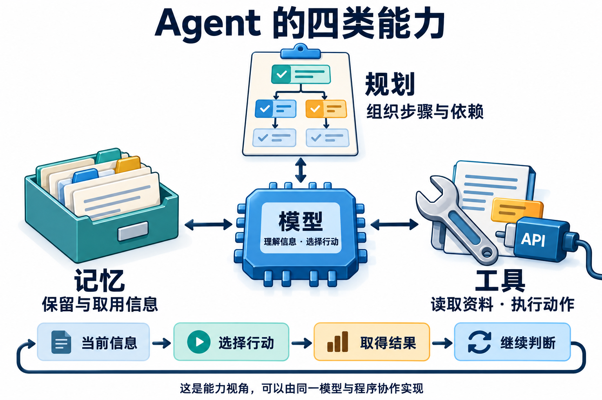
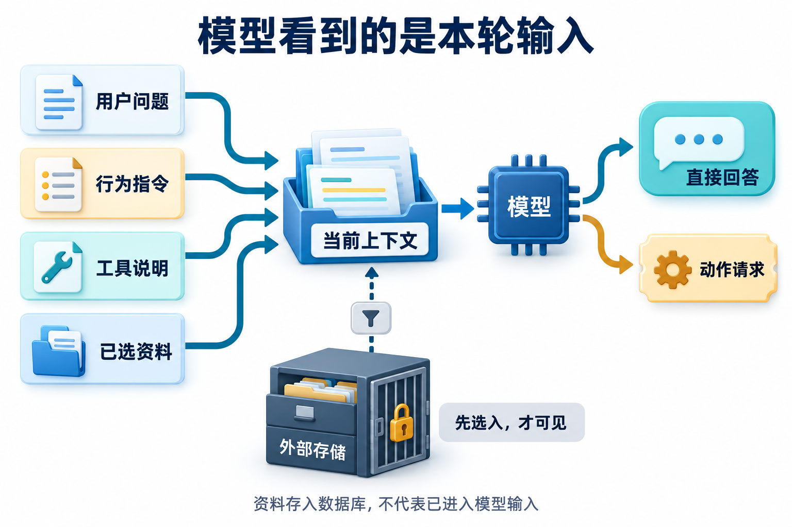
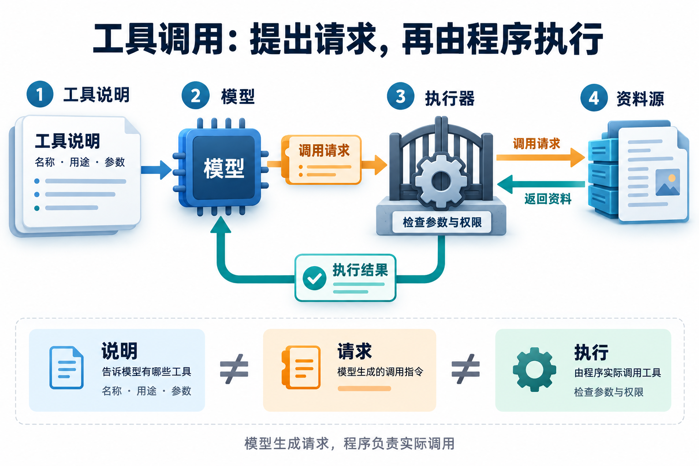
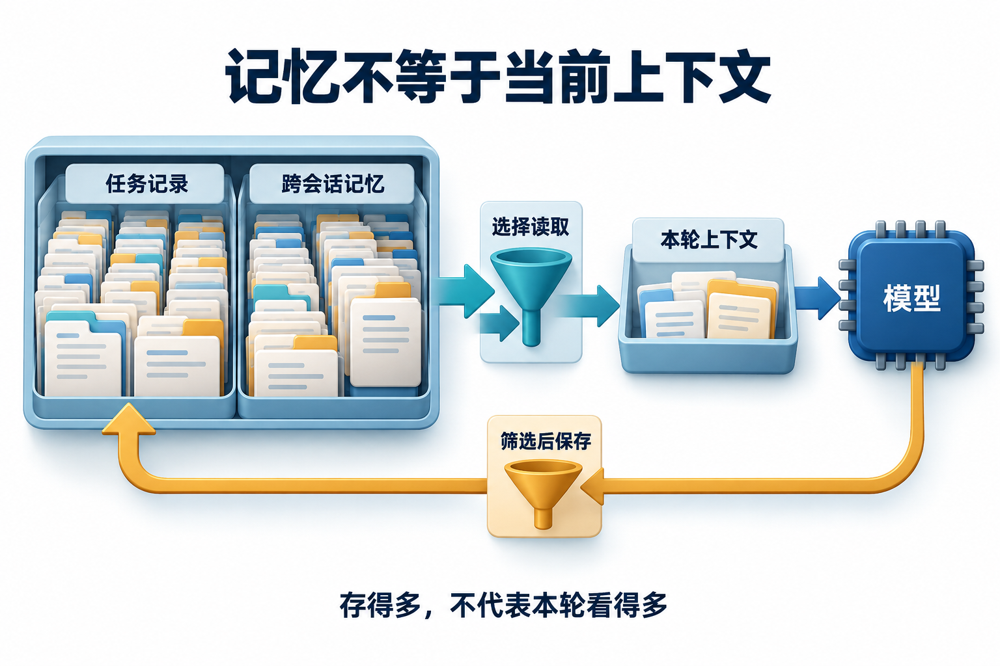
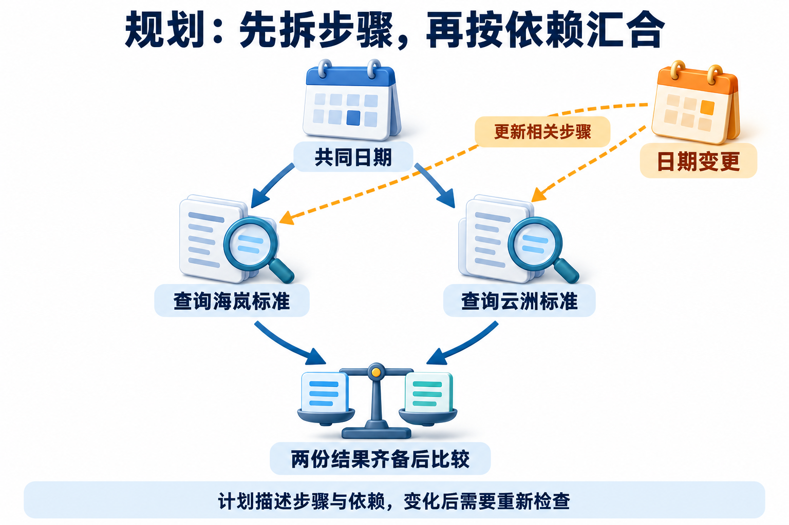
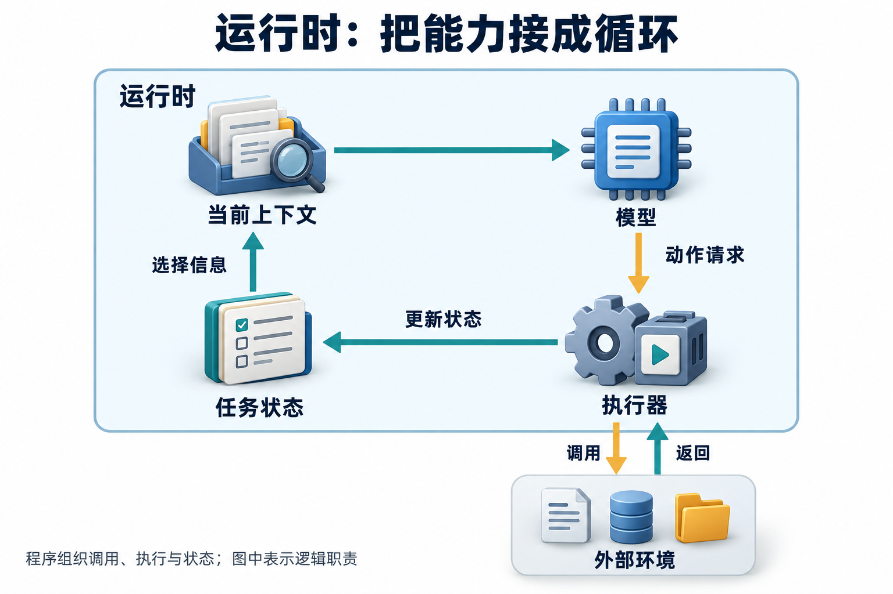

# 01 · Agent 的组成与运行

**Agent 在任务执行中读取结果，再决定下一步。** 一轮可以读取资料、执行动作、等待补充信息，也可以结束任务。每轮怎么走，取决于系统已经知道什么、还有什么没完成，以及当前允许做哪些动作。

模型给出下一步建议。运行时准备输入、校验建议、调用工具，并保存真实结果。后端决定对象是否已经创建、修改或删除。排查时，从这几份记录里找出最早出现偏差的位置。

## 单次调用、工作流与 Agent

| 方式 | 下一步由谁决定 | 适用条件 |
| --- | --- | --- |
| **单次模型调用** | 应用准备输入，模型一次给出结果。 | 所需信息已经齐全，输出能独立验收。 |
| **固定工作流** | 代码规定步骤和分支。模型可以处理其中的语言任务。 | 流程和异常分支可以预先列清楚。 |
| **Agent 循环** | 运行时根据新结果组织输入，决策策略再从允许的动作中选择。 | 执行结果决定还缺什么、接下来要查哪里。 |

固定工作流也可以多次调用模型。判断系统采用哪种方式，要看执行结果能改变哪些后续步骤。

只在需要临场选择的部分引入循环。能稳定校验的步骤交给程序。给循环设好次数、时间和停止条件。

## 模型、工具、记忆与规划

### 模型读取信息并给出建议

运行时提供的任务信息，要放进本次输入才能被模型使用。通常包括当前任务、工具说明、已确认的状态和相关证据。有些输出是可以交付的文字，有些输出是待校验的动作请求。

模型选错动作时，先核对它看到了哪些工具和证据。任务所需的信息可能在系统里，却在这次整理输入时被遗漏了。

### 工具读取数据与执行动作

工具声明告诉模型能请求什么、需要哪些参数。模型据此生成请求。运行时用可信身份检查参数、对象权限和业务条件，再决定是否执行。

执行完成后，把结果和原调用对应起来。读取任务需要核对数据来源和适用范围。写入任务要取得服务端确认，必要时按操作编号查询。整个任务仍要独立验收。

### 状态保存进度，记忆保留可复用信息

任务状态记录进度、待处理动作和已经确认的结果。记忆保存可能在后续任务中继续有用的信息。两者都可以放在模型输入之外，按本轮用途和权限选择读取。

恢复任务时，先读运行时保存的状态。用到长期记录时，再看它的来源、更新时间和适用范围。一次旧回复里的说法未经核实，仍然只是一条历史记录。

### 规划组织步骤和依赖

规划要写清楚每步依赖什么、交付什么，以及用什么条件判断完成。没有依赖的步骤可以并行。依赖还没满足的步骤先等待。

执行结果推翻了某个前提，就找出哪些步骤用过它。受影响的结论需要重算。已经确认且仍然适用的结果可以保留。

## 运行时与外部系统

**运行时负责让每一步可控、可追踪。** 它维护任务状态，限制可见工具和可执行动作，也负责预算、暂停和恢复。外部服务保有自己的权限规则和数据。调用方要根据回执或查询结果核实外部状态。

## 分层定位故障

| 看到的偏差 | 先查的记录 |
| --- | --- |
| 模型用了过期事实 | 本轮输入、证据来源和版本。 |
| 建议的动作无法执行 | 工具声明、动作参数、可信身份和校验结果。 |
| 应用报告成功，外部对象却找不到 | 工具回包、操作编号和后端状态。 |
| 恢复后又执行了一遍 | 持久化的进度、上次动作的确认状态和恢复判断。 |
| 一直循环，任务没有进展 | 每轮观察的变化、剩余预算和停止条件。 |

运行记录里要能串起本轮输入、所选动作、执行结果和状态变化。复盘时顺着这条链查，就能定位问题属于输入、决策、执行还是恢复。

<!-- question-links:start -->
## 配套面试练习

先合上正文讲一分钟，再用追问和案例检查理解。每题都可以跳回对应学习内容。

展开本章相关面试题

- [Q001 什么是 Agent，和普通 LLM 调用有何区别？](../questions/Q001.md#q001-什么是-agent和普通-llm-调用有何区别)
- [Q009 最小 Agent Loop 应包含哪些环节？](../questions/Q009.md#q009-最小-agent-loop-应包含哪些环节)
- [Q011 为什么用状态图组织 Agent？](../questions/Q011.md#q011-为什么用状态图组织-agent)
- [Q013 多个分支何时可以并发？](../questions/Q013.md#q013-多个分支何时可以并发)
- [Q025 Function Calling 的真正执行者是谁？](../questions/Q025.md#q025-function-calling-的真正执行者是谁)
- [Q026 怎样设计易用且可控的工具接口？](../questions/Q026.md#q026-怎样设计易用且可控的工具接口)
- [Q030 Context、短期记忆和长期记忆如何区分？](../questions/Q030.md#q030-context短期记忆和长期记忆如何区分)
- [Q031 上下文太长时如何压缩而不丢任务？](../questions/Q031.md#q031-上下文太长时如何压缩而不丢任务)
- [Q049 设计一个企业知识库客服 Agent，你会怎样开始？](../questions/Q049.md#q049-设计一个企业知识库客服-agent你会怎样开始)
- [Q052 面试官问“为什么选这个框架”，怎样回答？](../questions/Q052.md#q052-面试官问为什么选这个框架怎样回答)
- [Q053 怎样向面试官讲清一个真实个人项目？](../questions/Q053.md#q053-怎样向面试官讲清一个真实个人项目)

<!-- question-links:end -->

[基础原理目录](README.md) · [下一章：02 · LLM 基础原理](02-llm-primer.md)
