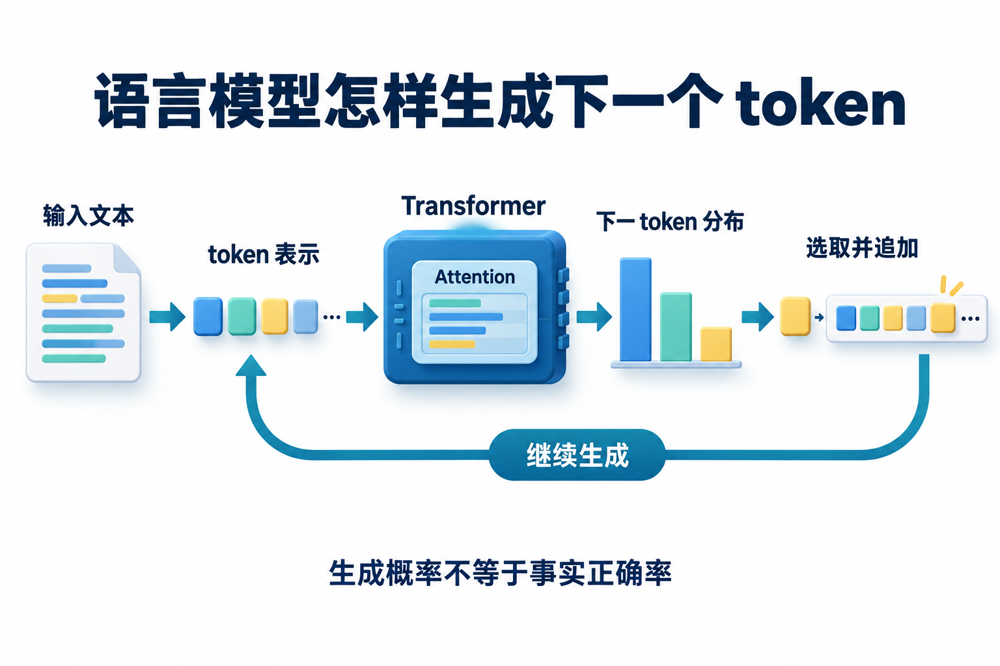

# 02 · 大模型的生成原理

**常见的语言模型会根据已有内容，计算下一个 token 的分布。** 系统选出一个 token，再把它接到后面，继续生成。这种方式叫自回归生成。词元（token）是模型处理文本的单位，可以是字、词的一部分，也可以是其他编码片段。

模型的**参数**来自训练。应用在调用时传入**上下文**。模型根据这些输入生成**输出**。换一份资料，答案就可能变化。参数要通过训练或适配更新。

## 文本编码与生成

分词器把文本转换成 token 编号。模型用编号查出相应的向量，再处理这些向量。生成的编号最后会被解码成文本。中文、英文和代码的切分方式都取决于词表和分词规则。估算容量时，用目标模型的分词器，或核对接口返回的实际用量。

### 逐步选择下一个 token

模型每走一步，都会根据现有序列给词表里的 token 打分。分数可以转换为概率。解码策略从中选出一个 token。它会成为下一步的输入，所以前面输出的差异会影响后面的内容。整段输出的概率，可以写成每一步条件概率的乘积。

降低采样温度通常会让分布更集中。它改变的是输出的选择方式。事实是否成立，要回查有效证据。按最高分逐步选词，也可能稳定地给出同一个错误答案。

## 因果注意力

**注意力让一个位置按权重读取其他位置的信息。** 每个位置的表示会被转换为 Query、Key 和 Value。当前 Query 与各个 Key 计算匹配分数，再用这些分数求权重。Value 是实际被加权求和的信息。

单个注意力头可写成 `softmax(QKᵀ / √dₖ + M)V`。计算可以拆成四步。

1. 用 Query 和 Key 做点积。分数表示这两个向量的匹配程度。
2. 除以 Key 维度的平方根。这样可以控制点积分数的尺度。
3. 加上遮罩 `M`。因果遮罩会屏蔽当前位置之后的内容。再用 softmax 把可见位置的分数变成权重。
4. 用权重对 Value 求和，把可用信息混合起来。

一个 Transformer 通常有多层和多个注意力头，也包括位置设计和前馈网络。最终还要从处理后的表示算出词表分数。注意力权重本身无法验证一条事实。

## 输入处理、逐步生成与缓存

服务先处理整段现有输入，这一段叫 **Prefill（预填充）**。随后逐步生成新 token，这一段叫 **Decode（解码生成）**。输入很长时，首段处理通常更重。输出很长时，生成阶段需要更多步。

**KV Cache（键值缓存）**保存过去位置已算出的 Key 和 Value。之后的步骤可以复用它们，只为新位置补算需要的部分。这样减少重复计算，也会占用额外内存。其他条件相同时，上下文越长，要保存的中间结果通常越多。

缓存能否跨请求使用，取决于服务实现和可复用的输入前缀。应用中的用户记忆和任务进度要另存。缓存被清理后，任务仍需要能从保存的状态恢复。

## 向量检索与模型训练

**嵌入表示（embedding）**把内容编码成向量。检索器按约定的度量比较这些向量，从中挑选相关材料。查询和资料要用兼容的表示。相似度只提供筛选线索，材料是否支持结论还要读原文。

训练阶段可以改变模型的行为。几个术语对应不同工作。

| 方法 | 改变什么 |
| --- | --- |
| **预训练** | 从大规模数据中学习语言和内容规律。 |
| **监督微调（SFT）** | 用输入和目标输出教模型按所需方式作答。 |
| **偏好优化** | 用候选输出的偏好信号调整模型行为。 |
| **低秩适配（LoRA）** | 用少量可训练参数做适配，可以与监督微调等目标配合。 |

让回答使用新资料，先检查检索结果和实际输入。资料已经齐全，模型仍反复漏掉同一条稳定要求，再分开评估提示、输出校验和训练。更改参数后，用独立任务验证是否有改善。

## 延迟与输出排查

记录输入长度、输出长度、到首 token 的时间和完成时间。首 token 的等待可能包含检索、排队、网络和输入处理。整段输出的耗时还受生成步数影响。先测慢在哪一段，再调整输入、输出或服务配置。

换模型后，重新核对分词和用量。优化缓存时，用相同请求对照首 token 耗时。判断回答质量时，固定输入并检查证据和结果。延迟和正确率分别验收。

<!-- question-links:start -->
## 配套面试练习

先合上正文讲一分钟，再用追问和案例检查理解。每题都可以跳回对应学习内容。

展开本章相关面试题

- [Q002 自回归语言模型到底在预测什么？](../questions/Q002.md#q002-自回归语言模型到底在预测什么)
- [Q003 Transformer 的 Attention 在做什么？](../questions/Q003.md#q003-transformer-的-attention-在做什么)
- [Q004 Prefill、Decode 与 KV Cache 为什么影响延迟？](../questions/Q004.md#q004-prefilldecode-与-kv-cache-为什么影响延迟)
- [Q005 预训练、SFT、偏好优化、LoRA 分别是什么？](../questions/Q005.md#q005-预训练sft偏好优化lora-分别是什么)
- [Q006 Prompt、RAG 与微调如何选？](../questions/Q006.md#q006-promptrag-与微调如何选)
- [Q007 为什么模型会给出流畅但错误的回答？](../questions/Q007.md#q007-为什么模型会给出流畅但错误的回答)

<!-- question-links:end -->

[上一章：01 · 组成与协作](01-system-map.md) · [基础原理目录](README.md) · [下一章：03 · 提示与上下文](03-context-and-prompts.md)
