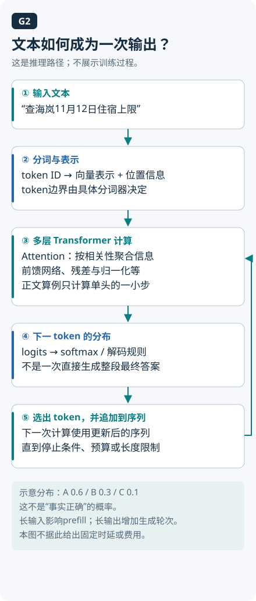

# 02 · 大模型最小原理：从 token 到一次生成

本章主线：**从文字生成到模型适配**。先理解自回归预测与注意力，再看生成阶段、缓存、训练与知识更新的区别。

## 按这个顺序逐题阅读

- [Q002 自回归语言模型到底在预测什么？](../questions/Q002.md)
- [Q003 Transformer 的 Attention 在做什么？](../questions/Q003.md)
- [Q004 Prefill、Decode 与 KV Cache 为什么影响延迟？](../questions/Q004.md)
- [Q005 预训练、SFT、偏好优化、LoRA 分别是什么？](../questions/Q005.md)
- [Q006 Prompt、RAG 与微调如何选？](../questions/Q006.md)
- [Q007 为什么模型会给出流畅但错误的回答？](../questions/Q007.md)

想查这一章与其他主题的关系，回到 [知识主线](knowledge-map.md)。

<details><summary>展开课程补充：机制、算例与实现</summary>

同一句“培训住宿能报销吗”，加上长篇制度后，助手等了更久才开始回答；它又能逐字续写，却仍可能引用错政策。这些现象需要分别看输入如何编码、模型怎样利用前文，以及输出如何一步步产生。

本章拆开政策助手的一次模型调用，从 token 走到注意力、缓存和生成，再分清哪些改动会更新模型参数。读完应能解释这几层各自处理什么，遇到慢或答错时先查哪一层。建议先读 [第 01 章：组成与协作](01-system-map.md)，分清模型和执行器的职责。概率与向量加权平均会在本章算例中用到，可以边算边补。

**阅读分层：** 必读“文本先变成token”“逐步选择”“Prefill/Decode”三节，能说明输入、输出和延迟来源即可；Attention数值推导及训练方法为数学与模型方向选读，可以稍后回查。选读不改变理解工具循环所需的前提。



下文算例只对应图中的注意力信息混合。算得7是手工Value的加权结果，不是“答案7元”，也没有完成从词表分布到语言输出的整个模型。用图定位计算的位置，避免把一段公式误当整台模型。

## 文本先变成 token

模型通常不直接把整句自然语言当作一个不可拆对象。分词器按照自己的词表与规则，把文本编码成 token ID；生成后再解码回文本。一个 token 可以对应词片段、字符或其他字节组合。中文、英文、标点和代码的切分并不一样，不能用“一个汉字固定等于几个 token”做容量承诺。实际预算应使用目标模型对应的分词器或服务返回的用量；更换模型后重新核对。

以“培训住宿能报销吗”为例，具体 token ID 由所用分词器决定。测量时应记录模型和分词器版本、原始字符串及编码结果，使用与目标模型匹配的词表计数。[Hugging Face 分词资料](https://huggingface.co/docs/transformers/tokenizer_summary)

## 生成是在条件分布上逐步选择

对典型自回归语言模型，已有序列是前缀：模型计算下一个 token 的条件分布，由解码策略选择输出，再把新 token 接到前缀后面。下一步会使用这个更新后的前缀，继续计算。整个序列的概率可以分解为各步条件概率的乘积，因此长回复通常需要多次生成步骤。[Hugging Face 生成机制](https://huggingface.co/docs/transformers/llm_tutorial)

假设词表里第一步输出“可以”的概率是 0.6，选到后下一步输出“报销”的条件概率是 0.7，那么这个两步路径的联合概率是 0.42。即使某条文字路径概率很高，也不能据此证明员工确实满足报销条件。事实需要有效政策与人员、日期等输入支撑。

温度和采样方式影响如何从分布选择 token，但不是事实认证开关。政策证据缺失时，换一种采样方式不会凭空补出可信的制度版本。因此，要同时观察语言生成与任务验收，不用“输出稳定”代替“结论正确”。

## 因果注意力的一个小算例

标准注意力把表示投影成 Query、Key、Value。当前 Query 与各 Key 计算匹配分数，经缩放和归一化后，用所得权重对 Value 加权；因果遮罩限制当前位置能使用哪些位置。完整 Transformer 还包括多头、位置相关设计、残差和前馈层等。[Attention 原论文](https://arxiv.org/abs/1706.03762)

记忆时可以借一张资料卡：Query 像当前查找线索，Key 像卡片上的匹配标签，Value 是随后按权重混合的内容。标签负责参与算权重，内容负责被加权，这样就不容易把 Key 和 Value 的作用背反。实际 Q、K、V 都是学习得到的数值表示，这个类比不意味着存在人工填写的目录，也不意味着权重最高的内容就是真的。

现在做一个极简算例：只保留一头、一维，Query 为 1，两条可见记录的 Key 为 0 与 `ln(2)`，Value 为 3 与 9。一维缩放因子为 1，得分为 0 与 `ln(2)`；指数为 1 与 2，归一化权重为 1/3 与 2/3，因此输出为 `3×1/3+9×2/3=7`。若第三条记录属于未来位置，其得分要被遮罩，不参与有效权重。这一步计算的是对 Value 的信息混合。

下面用 Python 标准库复算；二维算例见 [基础数学实验](../examples/foundations/README.md)。脚本使用手工数值，不加载模型。

```python
import math

scores = [0.0, math.log(2.0)]
weights = [math.exp(x) / sum(math.exp(s) for s in scores)
           for x in scores]
output = sum(w * v for w, v in zip(weights, [3.0, 9.0]))
assert math.isclose(output, 7.0)
print(round(output, 6))
# 7.0
```

## 为什么要区分 Prefill、Decode 与 KV Cache

已有输入进入模型时，要处理它们的表示；自回归生成开始后，再逐步产生新 token。常见服务将这两个阶段称为 Prefill 和 Decode。对常见因果注意力实现，KV Cache 保存过去位置的 Key 与 Value，以减少重复计算，但需要额外存储空间。[缓存机制参考](https://huggingface.co/docs/transformers/cache_explanation)

政策助手的问题很短，检索材料却可能很长，因此首 token 等待与后续生成速度可能受不同因素影响。应分别测输入长度、输出长度、首 token 时间及完成时间，才知道耗时落在哪个阶段。

KV Cache 保存计算中间表示，员工偏好档案保存业务数据，两者的读写方式和用途不同。把新制度放进上下文也不会因此更新模型参数。缓存是否跨请求复用、如何失效，需要看具体服务实现；“支持缓存”几个字还不足以回答这些问题。

## Embedding、训练方法与应用改动

检索常把文本编码成 embedding，再按某种距离找候选；生成模型则根据上下文产生后续 token。二者任务与输出不同，模型、维度和距离约定要匹配。相似度是相关性信号，不是答案真实性分数；政策编号只差一位时，精确匹配可能仍然关键。[检索编码与重排参考](https://sbert.net/examples/sentence_transformer/applications/retrieve_rerank/README.html)

比较训练概念时，先看它回答的是哪个问题。预训练描述广泛学习过程，SFT 用示范数据学习目标行为，偏好优化利用偏好信息；LoRA 描述怎样用较少的可训练参数做适配，可以与训练目标组合使用，不能和 SFT 当作互斥阶段。[SFT](https://huggingface.co/docs/trl/sft_trainer)、[DPO](https://huggingface.co/docs/trl/dpo_trainer)、[LoRA](https://arxiv.org/abs/2106.09685)

如果政策每天变，先检查新版是否入库、查询是否取到了它。若证据一直齐全，模型却反复违反稳定的输出要求，再用实验判断是否微调。这样能把“没拿到材料”和“拿到材料仍不会用”分开处理。

用案例区分两类改变：把政策新版放入检索库，是改变推理时可取得的材料；用标注样例训练模型，是改变参数。员工纠正了一次答案，应用可以记录反馈，但这条消息不会因此自动触发梯度更新。若团队确实建立了反馈训练流水线，还需要清洗、授权、数据版本和独立验证，不能把“能记日志”称为在线学习。

阅读模型说明时，可以沿输入、参数与输出三条线检查。输入侧问分词器是什么、材料是否完整；参数侧问采用哪个模型版本、是否额外适配；输出侧问解码限制、字段校验和验收方式。这样遇到错误时，能先定位“输入没有政策”还是“模型误读了政策”，再决定改检索、提示或训练，避免把所有故障都交给更大的模型。

## 延迟诊断：先区分增加了哪一段

下面是用于定位的教学对照，不是模型测速。A把政策输入从2千token增加到2万token，输出保持100token；B输入不变，输出由100token增加到2000token。A重点检查输入处理、检索与首token等待；B重点检查逐步生成与总完成时间。两者都可能受排队、硬件和实现影响，不能只凭长度算真实秒数。

变式：若首token时间不变，总耗时增加，应先看输出token数和Decode，还是立刻去扩检索库？先记录阶段数据，再选优化对象。在线样本只能用实际usage和耗时；离线政策策略没有模型token或网络等待，不填假指标。

## 动手验收

不用真实模型，先把注意力算例的 Value 从 `[3,9]` 改为 `[3,0]`，预测结果后运行，记录答案应为 1。然后为政策助手画两条路径：“文本→检索向量→候选文档”和“上下文→逐 token 生成→答案”。验收时分别标出输出类型、版本信息与一种失败条件；如果把 embedding 当成最终答复，或把缓存当成长期记忆，需要重画。

## 自检

1. 能否承诺任何中文模型都按同一汉字比例计费？
2. 因果遮罩为什么必须排除未来位置？
3. 采用 LoRA 是否意味着无需 SFT 数据、模型也会自动记住新政策？

<details><summary>参考答案</summary>

1. 不能。切分依赖分词器，计费还依赖具体服务口径，应实测并记录版本。
2. 自回归位置只能使用允许的前缀信息；算例把未来位置排除，避免把未来当作已知输入。
3. 不是。LoRA 是适配参数的方法，数据与训练目标仍需明确；运行时检索与参数训练是不同机制。

</details>

关联复习：[Q002–Q006](../docs/foundations/01-agent-and-llm.md)。[课程目录](README.md) · 上一章：[01 组成与协作](01-system-map.md) · 下一章：[03 上下文与提示](03-context-and-prompts.md)

<!-- question-links:start -->
## 配套面试练习

先合上正文讲一分钟，再用追问和案例检查理解。每题都可以跳回对应学习内容。

<details><summary>展开本章相关面试题</summary>

- [Q002 自回归语言模型到底在预测什么？](../questions/Q002.md#q002-自回归语言模型到底在预测什么)
- [Q003 Transformer 的 Attention 在做什么？](../questions/Q003.md#q003-transformer-的-attention-在做什么)
- [Q004 Prefill、Decode 与 KV Cache 为什么影响延迟？](../questions/Q004.md#q004-prefilldecode-与-kv-cache-为什么影响延迟)
- [Q005 预训练、SFT、偏好优化、LoRA 分别是什么？](../questions/Q005.md#q005-预训练sft偏好优化lora-分别是什么)
- [Q006 Prompt、RAG 与微调如何选？](../questions/Q006.md#q006-promptrag-与微调如何选)
- [Q007 为什么模型会给出流畅但错误的回答？](../questions/Q007.md#q007-为什么模型会给出流畅但错误的回答)

</details>
<!-- question-links:end -->

</details>
