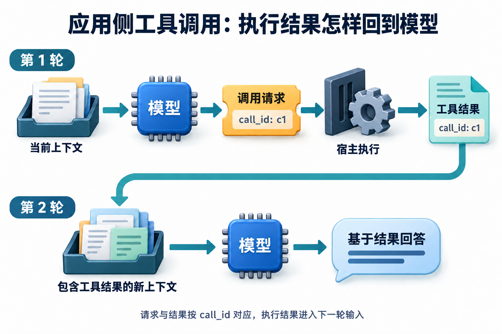

# 04 · 工具循环：把一次决定变成可追踪的行动

## Agent 循环中的状态、观察与轨迹

**智能体循环（Agent Loop）是组织“观察、决定、行动、反馈”的反复执行过程。** 它解决的是一次模型响应之后怎样继续工作：需要更多信息就获取信息，需要补充条件就等待用户，达到要求才结束。

一轮开始时，程序读取**状态（state）**，也就是当前目标、已知条件、进度和剩余预算；模型或规则据此提出下一步。运行时检查动作后才执行工具，工具带回的实际信息叫**观察（observation）**。观察进入状态和下一轮输入，才有条件继续判断。

**提出动作、尝试执行和确认结果是不同的事件。** 将这些事件按任务关联保存，便得到可追踪的**运行轨迹（trace）**。轨迹帮助我们看清流程，外部事情是否办成仍要核对实际结果；派工单填好了，还不能顺手盖“已办结”。

本章结合仓库 [lab.py](../examples/agent_lab/lab.py) 跟踪一次工具循环，练习从事件和计数还原经过。建议先读 [组成与协作](01-system-map.md)、[模型原理](02-llm-primer.md)和[提示与上下文](03-context-and-prompts.md)，并熟悉 Python 的函数与异常。

## 先看一个容易误判的运行记录

运行日志出现一条 `decision`，随后又出现 `stop`，中间却没有工具结果：这次搜索到底做成了吗？如果只看最后的“处理完成”，很容易把提出动作、实际执行和得到答案混在一起。政策助手需要把每一步留下来，才能回答这个问题。

## 先定义循环的不变量

**不变量**是流程无论走到哪一步，都应保持成立的规则，例如动作只能来自允许的工具集合，预算不能因为重新规划就归零。它帮助我们检查整个循环，而不只检查正常路径有没有跑通。

内部政策助手接到问题后，一次迭代可以写成：观察当前状态→决定下一步→校验→执行→记录观察。决定可以是查询工具、提出澄清或结束。运行时检查工具是否允许、参数是否合法、当前身份是否获授权，以及预算是否够用，通过后才进入执行。

沿着这条链读：决定说明准备做什么，校验说明是否允许，观察说明实际取得了什么。程序也允许澄清、拒绝和结束，**不是每一轮都必须调用工具。**

显式保存状态与转移，能够让执行路径和恢复点可检查；但状态图本身不会保证业务正确。[LangGraph 状态、节点与转移参考](https://docs.langchain.com/oss/python/langgraph/graph-api) 对政策助手，已确认日期属于状态，检索结果属于观察，用户缺少培训类型属于待补信息，实际工单是否存在属于环境终态。

至少要区分几种结束方式：已完成、等待补参、无权限、无法取得足够证据、预算耗尽及工具失败。它们不该都变成一句“处理完成”。实际状态名称由程序定义；旧agent_lab只覆盖部分路径，新政策实验的终态与可恢复条件以其README和实际报告为准。

## 新实验：观察真正参与下一步决定



[查看原图](../website/assets/diagrams/G3-tool-roundtrip.png)

图示应用侧工具返回后，再让模型处理结果的两轮模式。它不是每个工具必然增加两次外部模型请求的计费规则；托管工具可在平台内部执行，多个调用也可共享后续输入。下面的离线政策实验使用规则策略，不发出模型请求。

[政策实验](../examples/policy_agent/README.md)把策略输入限制为目标、条件、未知项和已经取得的可见观察；task_id、故障标签和标准答案不进入策略。同一任务可以因观察不同而走出不同路径。

这里的**决策策略（policy）** 指“下一步怎样选择”的规则或模型，与案例中的报销制度文件不是同一个概念。下面按实际输入和观察，逐项判断合法下一步：

| 输入或观察 | 本轮动作 | 后续检查 |
| --- | --- | --- |
| 日期未知 | 请求补充 | 等待前工具调用数为0 |
| 条件齐全，尚无证据 | search_policy | 先看实际返回再决定 |
| 返回当前有效P17-v2 | 引用条款并比较650与700 | 引用确实来自本次观察 |
| 返回stale_evidence | get_policy(P17,指定日期) | 旧材料不能支撑当前结论 |
| 权威源仍无当前资料 | 证据不足结束 | 不编造700元 |

这与下面旧lab的固定脚本用途不同：旧lab用于隔离测试执行边界，新实验用于观察依赖的规则决策。完整运行命令和三个过程见 [00 首次任务](00-first-agent.md)。两者都不是对真实模型能力的测量。

本政策实验用`pending_calls`（待执行调用）和下一待执行索引保存调用队列位置。暂停后恢复，应复用已确认的结果；结果未知的写入先查询或对账，不能仅凭队列位置判断是否重做。累计六次决策预算也不能重置。其他运行时可以采用不同状态结构，可恢复不等于允许无限重试。

<div id="当前实验中谁在做什么"></div>

## 旧执行器实验中谁在做什么

打开 `lab.py`，先读 `Action`、`Finish`、`State` 和 `RunResult`。`Action` 保存工具名与参数；`Finish` 表示策略希望结束；`State.observations` 保存已成功取得的工具结果；`RunResult` 汇总停止原因、事件与尝试次数。

再读 `scripted()`：它从预先给定序列取下一项，忽略传入状态。即使搜索返回另一份材料，它也照着预写序列往下走；`loop` 场景同样使用固定 lambda。这些替身便于把控制路径重复跑出来，真实 LLM 的规划、自然语言理解和工具选择效果还需要另外测量。

`run()` 管理步数和错误分支；`Runtime.invoke()` 在执行边界调用 `validate()`，检查工具白名单、字段与取值，写路径还要匹配运行时配置的 `Approval`。`search` 只对四条英文样例文本按关键词交集排序，既不是语义检索，也没有真实制度库。工单只存在同一进程的字典里，当前代码没有用户认证、租户对象权限或操作系统安全隔离。

因此，手册中的政策助手在本章先缩成“查询教学条目”的控制实验。先沿事件看清边界，再为真实政策资料更换适配器；新政策实验已经另列固定制度数据与观察驱动策略；真实模型路径按其验证记录单独判断。

## worked example：沿一次真实 trace 走到底

以下回到旧执行器实验 `agent_lab/lab.py`，与前面的政策实验使用不同的事件名和计数。在仓库根目录执行：

```bash
python3 examples/agent_lab/lab.py --scenario happy
```

第一步，脚本取出 `Action("search", {"query": "agent loop"})`，记录 `decision`。这条事件只表示做出了调用决定。随后运行时检查参数并执行搜索，才记录带 D1 的 `observation`。第二步，脚本取出固定 `Finish`，运行时记录停止并汇总。输出的关键行如下：

```jsonl
{"scenario": "happy", "step": 1, "event": "decision", "tool": "search"}
{"scenario": "happy", "step": 1, "event": "observation", "tool": "search", "attempt": 1, "result": {"documents": [{"id": "D1", "text": "Agent loops need an explicit step budget and stop condition."}]}}
{"scenario": "happy", "step": 2, "event": "stop", "reason": "final_answer"}
```

汇总的 `steps=2`、`search_attempts=1`、`created_count=0`。先对照事件数：搜索决定占一步，结束决定再占一步，真正的搜索尝试只有一次。这样读就能看出策略步数和工具尝试数各自在数什么。

最后文本预先写在脚本中，控制器没有独立检查引用是否支持回答。因此，这个结果验证了固定轨迹按预期结束；要评价回答质量，还需检查证据蕴含和真实模型的行为。

## 失败时，计数和终态如何变化

再在仓库根目录运行以下命令：

```bash
python3 examples/agent_lab/lab.py --scenario denied
python3 examples/agent_lab/lab.py --scenario retry
python3 examples/agent_lab/lab.py --scenario loop
```

`denied` 先记录创建工单的决定，但没有匹配的运行时批准，随后记录 `tool_rejected` 并以 `approval_required` 停止。创建数和写尝试数均为零。这里证明批准检查阻断了模拟写路径，不证明完整用户鉴权已实现，也没有交互式审批页面。

`retry` 在同一步首次检索暂时失败，第二次成功，再到第二步结束。其 `steps=2`，`search_attempts=2`。每次读调用最多尝试两次，包含首次；这与策略步数是不同预算。实验只有这一类暂时读错误会自动重试，没有退避计时、真实网络或总期限。

`loop` 连续检索三次，第三步后以 `step_budget_exhausted` 停止，不再向策略索取第四个决定。它验证步数上限，却没有验证 token 预算、并发配额或取消。缺字段则会成为 `invalid_arguments`；实验会停止，不会自动向用户追问。若要实现澄清分支，应新增状态和交互，而不是只改报错文本。

运行 `python3 examples/agent_lab/lab.py --scenario approval`，观察同一批准意图提交两次的结果：汇总是 `write_attempts=2`、`created_count=1`，第二次观察带有 `replayed=true`。前者统计进入模拟写路径的次数，后者统计后端字典实际对象数。

把它迁移到政策咨询场景，先分清用户是在重试，还是确实要再建一条。内容相同但业务意图独立的新工单，应使用新的操作标识；响应丢失后重试同一意图，则保留稳定标识以便核对。

当前实验只展示同一运行时里的顺序去重，进程重启后字典就消失。检查结果时要一起看计数、对象标识和内容，才能判断验证的是顺序重放，还是跨重启恢复等其他能力。

## 从 trace 读取执行结果

事件记录应让人区分“提出动作”“执行成功”“执行被拒”“结果未知”。特别是写操作超时，环境可能已经改变；旧lab通过替身验证部分不确定写入情景；跨进程持久恢复另见新政策实验T12。[实验能力边界](../examples/agent_lab/README.md) 不要把 trace 的最终字符串直接当作外部环境证据，也不要把缺少观察当作没有副作用。

## 动手验收

先遮住上文，预测三个失败场景的停止原因、策略步数、实际读写尝试数与新建对象数，再运行比对。接着在纸上将政策助手的“缺培训类型”映射为等待输入状态，写出补充信息后的下一条合法转移。验收时记录命令、输出、计数差异和仍需实现的状态转移。

## 自检

1. `decision` 事件出现后，能否宣布工具成功？
2. `retry` 的两次读尝试为什么只占一个工具决策步骤？
3. 这份实验通过后，能否说真实模型会正确处理报销问题？

<details><summary>参考答案</summary>

1. 不能，还需实际观察或环境核对；校验可能在执行前拒绝它。
2. 重试发生在同一决策的执行分支中，读尝试计数与策略决策计数独立。
3. 不能。决策和答案由脚本预设，数据也是合成条目；需要真实适配器、任务集和独立评测。

</details>

关联复习：[Q009–Q016](../docs/foundations/02-planning-and-orchestration.md)、[Q055](../docs/engineering/07-system-design-and-projects.md)。[阅读目录](README.md) · 上一章：[03 上下文](03-context-and-prompts.md) · 下一章：[05 工具与 MCP](05-tools-and-mcp.md)

<!-- question-links:start -->
## 配套面试练习

先合上正文讲一分钟，再用追问和案例检查理解。每题都可以跳回对应学习内容。

<details><summary>展开本章相关面试题</summary>

- [Q009 最小 Agent Loop 应包含哪些环节？](../questions/Q009.md#q009-最小-agent-loop-应包含哪些环节)
- [Q012 如何防止循环、反复重规划与无效重试？](../questions/Q012.md#q012-如何防止循环反复重规划与无效重试)
- [Q051 设计一个能创建、分派工单的 Agent，状态如何流转？](../questions/Q051.md#q051-设计一个能创建分派工单的-agent状态如何流转)

</details>
<!-- question-links:end -->
