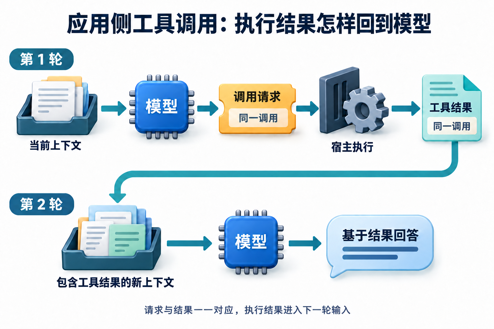

# 04 · Agent 工具循环

**工具循环把一次决策接到真实执行，再把执行结果送回下一轮。** 模型或规则决定下一步要做什么。运行时校验动作，调用工具，保存结果。下一次决策要看到新结果，才能据此推进任务。

循环的状态由运行时维护。已完成步骤、待确认条件和剩余预算都要有明确记录。最终是否完成，还要按任务要求核对证据或后端状态。

## 一轮的职责与边界

1. **准备输入。** 读取当前目标、已确认状态、已有证据和允许使用的工具。
2. **提出动作。** 决策策略选择直接回答、调用工具、等待补充或结束。需要执行的动作带上结构化参数。
3. **校验并执行。** 运行时检查参数、权限和预算。通过检查后才能派发动作。
4. **记录观察。** 保存返回数据、结构化错误或明确的拒绝原因。把结果关联到对应的调用，再更新任务状态。

工具可以返回成功、空结果或错误。请求超时或连接中断时，也可能暂时无法确认外部结果。运行时要保留这些差别，下一轮才有足够的信息选对处理方式。

## 工具结果回到下一轮

一次工具调用应有可追踪的标识。结果用同一个标识关联。多条调用同时执行时，回包可能顺序不同，仍应各自匹配到原请求。

日志里出现工具结果，只说明系统收到了它。要确认决策使用了结果，还得核对下一轮实际输入，以及随后选择的动作。候选证据可能在入队、筛选或裁剪时被遗漏。

## 观察变化与停止条件

| 当前观察 | 后续动作 |
| --- | --- |
| 缺少必要条件 | 保存待确认字段，等待用户补充。 |
| 证据为空或已经过期 | 在剩余预算内补查。确认无法取得时，说明证据缺口。 |
| 工具调用被拒绝 | 记录拒绝原因，根据当前权限结束或转入授权流程。 |
| 写入结果仍未知 | 按原操作编号回查，等待确认。 |
| 目标已经满足 | 核对任务要求，返回已验证的结果。 |
| 达到预算或用户取消 | 停止派发动作，保存进度和未确认结果。 |

有上限还要能识别原地打转。相同输入反复产生相同错误时，可以提前结束。重新尝试之前，应当有新的信息，或有明确的临时故障和重试条件。

## 决策、调用与执行次数

| 记录项 | 统计口径 |
| --- | --- |
| **决策次数** | 决策策略实际选择下一步的次数。 |
| **模型请求次数** | 发往模型的实际请求数。离线规则也能决策，模型请求数可以为零。 |
| **工具调用次数** | 已派发的逻辑调用数。一次决策可以发出多条调用。 |
| **执行尝试次数** | 实际尝试执行的次数。允许重试时，同一条调用可以有多次尝试。 |

运行轨迹（trace）记录每一步可观察的事件。排查时把决策、校验、执行、回包和终态串起来。日志的条数由记录粒度决定。要验证业务结果，直接读返回的对象和状态。

## 暂停、恢复与最终验收

暂停前保存任务状态、待处理动作、已确认结果和累计预算。恢复时从这些记录继续。已确认的步骤通常可以复用。恢复前还要核对证据是否过期，用户身份和权限是否仍然有效。

写入处于未知状态时，先核对外部执行结果。待办队列里还有动作，只说明本地尚未确认完成。重启也要沿用原操作编号和原有预算。

### 核对任务完成

读取任务要核对返回结论与有效资料。写入任务要核对实际对象、关键字段和允许的副作用。任务还在等待时，要让用户看见已完成的部分和待确认事项。文字回复和任务终态应当一致。

<!-- question-links:start -->
## 配套面试练习

先合上正文讲一分钟，再用追问和案例检查理解。每题都可以跳回对应学习内容。

展开本章相关面试题

- [Q009 最小 Agent Loop 应包含哪些环节？](../questions/Q009.md#q009-最小-agent-loop-应包含哪些环节)
- [Q012 如何防止循环、反复重规划与无效重试？](../questions/Q012.md#q012-如何防止循环反复重规划与无效重试)
- [Q037 一条有用的 Agent trace 应记录什么？](../questions/Q037.md#q037-一条有用的-agent-trace-应记录什么)
- [Q051 设计一个能创建、分派工单的 Agent，状态如何流转？](../questions/Q051.md#q051-设计一个能创建分派工单的-agent状态如何流转)

<!-- question-links:end -->

[上一章：03 · 提示与上下文](03-context-and-prompts.md) · [基础原理目录](README.md) · [下一章：05 · 工具与 MCP](05-tools-and-mcp.md)
