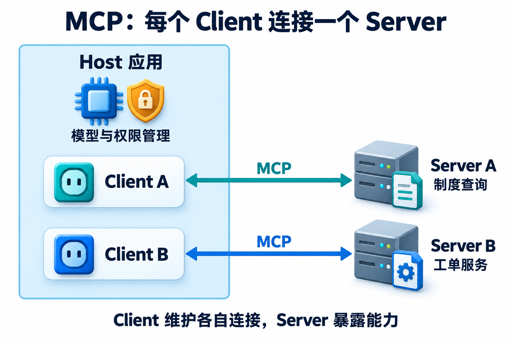

# 05 · 工具调用与 MCP

**工具调用让模型提出可执行的请求。** 模型选择工具并填写参数。实际动作由应用或平台的执行器完成，结果再返回给系统。工具可以读取外部信息，也可以改变外部状态。

**MCP（模型上下文协议）统一了应用连接能力提供方的方式。** 应用用它发现和使用工具、资源或提示模板。任务步骤、业务权限和验收条件仍由相关系统各自落实。

## 工具声明与执行边界

工具声明要写清动作、参数和适用范围。只读和写入尽量分成不同工具。这样在调用前就能按动作确定权限、审批和结果检查。

执行前分别校验三个层次。

| 校验项 | 程序要确认的内容 |
| --- | --- |
| **输入结构** | 工具名是否允许。必填字段、类型、取值和未知字段是否符合约定。 |
| **业务条件** | 对象、日期和当前状态是否可用。参数之间的关系是否成立。 |
| **对象权限** | 可信身份能否对这个具体对象执行动作。需要审批时，核对当前参数与已批准内容。 |

用户身份和租户来自可信会话。模型填出的身份字段不能覆盖会话身份。创建动作执行前要明确写入哪一条数据。工具输出交给模型前，也要检查返回结果中是否包含当前用户有权读取的信息。

## 请求与回包约定

**输入 Schema 描述结构。** MCP 工具用 `inputSchema` 表达参数约束。接入时检查校验器实际支持哪些约束，并在执行层运行校验。对象归属和业务有效性还要查业务数据。

回包应带上调用标识、结果状态和必要数据。读取结果保留能定位原文的证据标识。失败时返回可判断的错误类型、原因，以及是否允许重试。区分空结果、权限拒绝、临时失败和结果未知，运行时才能作出不同处理。

调用标识用来关联本次请求和回包。写入有重试或恢复要求时，还需要稳定的**操作编号**。同一业务意图的重试要沿用原操作编号，服务端据此核对是否已经处理。

## MCP 宿主、客户端与服务端

| 组件 | 负责的工作 |
| --- | --- |
| **宿主（Host）** | 承载用户交互、模型和任务流程，管理连接及可用能力。 |
| **客户端（Client）** | 与对应服务端交互，发现服务能力、发送请求并处理回包。 |
| **服务端（Server）** | 按约定提供工具、可读资源或提示模板，并返回结果。 |

一个宿主可以管理多条连接。服务端支持工具能力时，客户端用 `tools/list` 读取工具列表，用 `tools/call` 请求执行。资源提供可读取的内容，提示模板提供可复用的消息。宿主决定哪些能力和结果进入模型输入。

MCP 可以通过本地标准输入输出或 HTTP 交换消息。接入时先确认客户端和服务端支持的版本。

- **2025-11-25 版**先用 `initialize` 协商版本和能力，再按协商结果调用。
- **2026-07-28 版**用 `server/discover` 查询服务端支持的版本和能力。每次请求携带协议版本和所需的客户端能力，服务端可以独立处理该请求。

只有少量应用内函数时，直接调用通常更容易维护。

应用需要把任务交给另一套 Agent 时，可以使用适合任务交接的接口。A2A（Agent2Agent）关注 Agent 之间的任务交互。接到任务的一方也可以在内部用 MCP 连接工具。

## 连接授权与业务授权

连接层校验访问服务的资格。业务层校验当前身份能否对具体对象执行指定动作。HTTP 连接使用访问令牌时，要检查令牌能否用于当前服务及所需范围。访问具体对象时，再检查归属和权限。对本地进程，同样要控制它能使用的凭据和可访问资源。

审批针对这一次具体动作。要把批准绑定到操作者、目标对象和实际参数。参数改变后重新校验审批。写入前也要再验当前权限。

## 接入与排查

发现工具失败时，先查连接、协议版本和服务端声明的能力。工具可见却无法执行时，查参数校验、业务前置条件和对象权限。报告成功却看不到对象时，核对回包和服务端记录。

接入写工具前，应覆盖无权限、审批参数变化、响应超时和恢复后的重复提交。最终检查后端状态和对象数量。日志里的成功标志只记录调用方当时的判断。

<!-- question-links:start -->
## 配套面试练习

先合上正文讲一分钟，再用追问和案例检查理解。每题都可以跳回对应学习内容。

展开本章相关面试题

- [Q025 Function Calling 的真正执行者是谁？](../questions/Q025.md#q025-function-calling-的真正执行者是谁)
- [Q026 怎样设计易用且可控的工具接口？](../questions/Q026.md#q026-怎样设计易用且可控的工具接口)
- [Q027 Schema 合法为什么仍然不够？](../questions/Q027.md#q027-schema-合法为什么仍然不够)
- [Q028 MCP 的 Host、Client、Server 分别负责什么？](../questions/Q028.md#q028-mcp-的-hostclientserver-分别负责什么)
- [Q029 MCP 是否自动解决鉴权和 Prompt Injection？](../questions/Q029.md#q029-mcp-是否自动解决鉴权和-prompt-injection)

<!-- question-links:end -->

[上一章：04 · Agent 工具循环](04-agent-loop.md) · [基础原理目录](README.md) · [下一章：06 · RAG 与检索](06-rag-and-retrieval.md)
