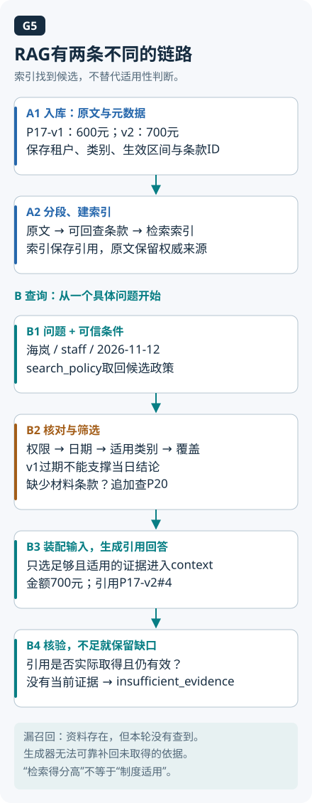

# 06 · RAG 与检索：从资料入库走到有依据的回答

[上一章：工具与 MCP](05-tools-and-mcp.md) · [学习目录](README.md) · [下一章：记忆与状态](07-memory-and-state.md)

助手找到了住宿政策，还给了很高的相似度分数，林悦却发现引用来自旧版制度。也可能版本没错，片段却漏掉了“仅适用于管理人员”。“搜到了一段相关文字”离“足以回答这次问题”还有几步，本章就沿着这些步骤排查。

读完应能分开描述入库与查询链路，手算一个混合检索结果，并定位为什么有检索仍会答错。建议先读 [工具调用](05-tools-and-mcp.md)和[模型原理中的 Embedding 说明](02-llm-primer.md)，了解调用边界与向量检索的输入输出。政策会更新、员工权限不同，外部证据需要按本次问题重新选择。

RAG 在生成前检索外部证据，让回答有机会依据这些材料。原始研究把参数化模型与外部检索记忆结合；今天工程中所说的 RAG 是更广的实践集合，不要求照搬论文架构，也不保证消除幻觉。[RAG 原始论文](https://arxiv.org/abs/2005.11401)

## 两条链路要分别设计

**入库链路**处理资料如何变成可检索对象：接收政策、解析正文与表格、清理重复、按语义边界分块、附带元数据、建立稀疏或稠密索引。元数据至少考虑政策 ID、版本、生效日期、章节、来源链接和访问范围。分块太小会切断适用条件，太大可能稀释关键内容；块大小是需要实验的参数，不存在对所有文档都最优的固定数字。

查询链路从这次问题和可信身份出发，生成检索条件、召回候选，再做融合或重排。随后选择可见且有效的证据，构造上下文，生成回答并校验引用，必要时拒答。入库链路准备了可检索的材料，查询链路还得为眼前这个问题选对材料。

排障时一起保存问题、索引版本、候选列表和最终使用的片段。候选里压根没有现行制度，应往检索之前查；候选齐全但最终没用上，再看排序、筛选和生成。最后一句回答再流畅，也不能替这些阶段提供证据。

精确搜索可作为对照基线；近似最近邻索引通常用一定召回取舍换速度，效果需要实测。过滤位置还会影响有效候选数：例如 pgvector 文档说明，某些近似索引扫描后再过滤，可能不足要求的结果数，可借助迭代扫描寻找更多候选。不要把此执行顺序推广到所有向量库；无论怎样优化，无权正文都不能先进入模型。[pgvector 过滤说明](https://github.com/pgvector/pgvector#filtering)

## 原文、标注与回答放在一起核对



T01的最小原文是：“普通员工海岚住宿金额上限为每晚700元”，来源P17-v2#4，2026-11-01起有效。标注不能只写“相关”：它必须匹配城市、staff类别、出行日期和读取范围。T02改成10月31日，当前标注依据随之变为P17-v1#4、600元。

| 问题条件 | 必须取得的证据 | 可支持的回答 |
| --- | --- | --- |
| T01，11月12日，海岚，650元 | P17-v2#4，700元 | 本例金额未超限 |
| T02，10月31日，海岚，650元 | P17-v1#4，600元 | 本例金额超过上限 |
| T06，11月12日，800元并询问例外咨询 | P17-v2#4与P20的材料条款 | 超出金额标准；咨询需日期、城市、金额、事由；咨询不等于批准 |

引用回答示范：“按P17-v2第4条，2026-11-12海岚普通员工上限为700元/晚；650元未超过该金额上限。”这句话刻意限定到金额条件，没有推断其他真实报销资格。

做一次漏召回：让候选只有P22办公制度。即使排序第一、分数最高，也没有住宿证据。运行`T01/empty-result`或`T01/no-current-source`，应得到证据不足；`stale-first`则允许追加权威查询。这些数据变式检查证据使用，不把本地词项过滤称为生产语义检索。[固定资料与变式](../examples/policy_agent/README.md)

## 稀疏与稠密检索分别看到什么

稀疏检索常根据词项及其权重匹配，适合制度编号、专用名词等线索；效果取决于分词和检索配置。稠密检索把问题与片段编码为向量，比较其表示，可能帮助匹配不同措辞。DPR 的双编码器就是将问题和段落映射到可比较空间的一种方法。[DPR 原始论文](https://arxiv.org/abs/2004.04906)

“可比较”要求表示空间兼容，长度相同只是其中一个条件。可以使用同一编码器，也可以使用联合训练的查询/文档编码器；两套无关模型生成的等长向量不能直接混用。文档换了 embedding 模型，通常需要相应重建索引并验证查询端兼容性。

可以借坐标图记住这件事：两张纸都画了横纵轴，不代表它们的原点、方向和单位相同。对应到检索，向量维度相同，还要确认编码器让这些坐标具有可比较的含义。这个类比说明兼容性，具体相似度仍由模型和距离约定决定。

例如两个单位向量 `(1,0)` 与 `(0.8,0.6)` 的余弦相似度是 `0.8`。它表达方向接近程度，**不是“答案有 80% 概率正确”**，也不能直接跨模型当成统一置信度。相似度阈值应在目标数据上校准，还要结合版本、适用条件与证据是否充分。[余弦相似度定义](https://scikit-learn.org/stable/modules/generated/sklearn.metrics.pairwise.cosine_similarity.html)

## 手算一次混合检索

林悦问：“去海岚住每晚 650 元，超标准能申请吗？”关键词搜索可能抓住城市与“超标准”，稠密搜索可能找到“例外审批”。假设两路检索得到以下排名：

| 片段 | 内容角色 | 稀疏排名 | 稠密排名 |
|---|---|---:|---:|
| A | 现行住宿标准与适用类别 | 1 | 未入选 |
| B | 差旅系统填写说明 | 2 | 2 |
| C | 超标准住宿的例外审批 | 3 | 1 |
| D | 历史问答记录 | 未入选 | 3 |

不同检索器分数尺度可能不同，直接相加不一定合理。RRF 使用排名融合：对每个候选累加 `1/(c+rank)`，排名从 1 开始，未出现在某一路的候选在该路贡献为 0。这里取常数 `c=60` 与仓库实验保持一致。[Elastic RRF 文档](https://www.elastic.co/docs/reference/elasticsearch/rest-apis/reciprocal-rank-fusion)

```text
A = 1/61        ≈ 0.01639344
B = 1/62 + 1/62 ≈ 0.03225806
C = 1/63 + 1/61 ≈ 0.03226646
D = 1/63        ≈ 0.01587302
融合顺序：C → B → A → D
```

这一步只汇总两个排序对候选的支持，尚未判断制度是否有效。重排器可以进一步逐对比较“问题—候选”，调整桌上这些材料的顺序；若片段 E 根本没被拿到桌上，这轮重排就无从比较它。排查遗漏时先看召回集合，别让重排器背一口它接不住的锅。[Sentence Transformers 检索与重排](https://www.sbert.net/examples/sentence_transformer/applications/retrieve_rerank/README.html)

## 从融合结果到回答，逐步核对

第一步，把问题拆成“适用住宿上限”和“例外路径”，确认日期与员工类别。第二步，只在林悦允许查看的政策范围检索；权限条件来自可信身份，不来自模型生成的租户名。第三步，融合后 C、B 靠前，但住宿标准 A 仍是必要证据，不能只拿前两项就认定证据完整；继续重排与筛选，并核对版本、生效区间与适用对象。历史问答 D 不能覆盖现行制度。

第四步，选取 A 的金额规则与 C 的审批条件，保留章节和来源。假如 A 只写管理人员标准，而林悦类别未知，正确动作是澄清，不是挑一个看似合理的数字。第五步，生成“在这些条件成立时适用某标准；例外需怎样申请”的回答，关键断言分别指向 A、C。引用链接存在不够，原文必须实际支持相邻结论。

第六步，校验来源当前仍可访问。权限撤回和政策更新需要影响索引、缓存与引用原文入口，不能只改前端按钮。授权应在正确的资源访问边界执行；即使某结果不会显示给用户，也不能先把无权正文送入模型再希望它保密。[OWASP 授权指南](https://cheatsheetseries.owasp.org/cheatsheets/Authorization_Cheat_Sheet.html)

第七步，若现有证据无法覆盖用户条件，应说明缺口、请求补充或转人工。一个“没有足够证据”的正确结果，比将检索相关性误当成事实正确性更符合任务目标。检索评测检查是否召回相关材料，回答评测检查是否忠实使用材料，两者需要分别测量。

## 练习：定位一个“搜到了却答错”的案例

准备 6 条虚构政策片段：现行标准、旧标准、例外流程、无关制度、不同员工类别和无权限资料。手工给 4 个问题标注相关且允许使用的片段，写出两路排名，按上式融合。故意把正确片段从两路候选中删除，再尝试重排。

**验收：** 能复算融合顺序；能指出重排无法修复哪一种遗漏；每个回答标注证据及版本；无权限片段不进入生成上下文；条件不足时明确拒答或澄清。可参考 [基础数学实验说明](../examples/foundations/README.md) 做手算对照，不依赖某个 SDK。

## 自检

1. 余弦分数 0.9 是否表示回答正确率 90%？
2. 向量库召回了旧政策，错一定在模型吗？
3. 加了重排器，Recall 一定更高吗？

<details><summary>参考答案</summary>

1. 不是，它是向量相似度；正确性需要目标任务证据与评测。
2. 不一定，可能是更新、元数据过滤或证据选择问题，应沿链路定位。
3. 不一定。它在候选范围内排序，无法找回未召回项；截取最终 top-k 还可能改变该截断位置的召回表现。

</details>

进一步练习见 [RAG 题](../docs/foundations/03-rag-and-search.md)。

<!-- question-links:start -->
## 配套面试练习

先合上正文讲一分钟，再用追问和案例检查理解。每题都可以跳回对应学习内容。

<details><summary>展开本章相关面试题</summary>

- [Q006 Prompt、RAG 与微调如何选？](../docs/foundations/01-agent-and-llm.md#q006-promptrag-与微调如何选)
- [Q017 一个 RAG 系统的完整数据流是什么？](../docs/foundations/03-rag-and-search.md#q017-一个-rag-系统的完整数据流是什么)
- [Q018 Chunk 大小和重叠该怎样选择？](../docs/foundations/03-rag-and-search.md#q018-chunk-大小和重叠该怎样选择)
- [Q019 为什么向量检索和关键词检索可以互补？](../docs/foundations/03-rag-and-search.md#q019-为什么向量检索和关键词检索可以互补)
- [Q020 召回和 Rerank 为什么分两阶段？](../docs/foundations/03-rag-and-search.md#q020-召回和-rerank-为什么分两阶段)
- [Q021 向量索引如何兼顾延迟与检索质量？](../docs/foundations/03-rag-and-search.md#q021-向量索引如何兼顾延迟与检索质量)
- [Q022 ACL 应放在哪里？文档更新和删除如何传播？](../docs/foundations/03-rag-and-search.md#q022-acl-应放在哪里文档更新和删除如何传播)
- [Q023 RAG 如何评测，Recall@k、MRR 和答案质量有何区别？](../docs/foundations/03-rag-and-search.md#q023-rag-如何评测recallkmrr-和答案质量有何区别)
- [Q024 RAG 回答错误应该按什么顺序排查？](../docs/foundations/03-rag-and-search.md#q024-rag-回答错误应该按什么顺序排查)
- [Q049 设计一个企业知识库客服 Agent，你会怎样开始？](../docs/engineering/07-system-design-and-projects.md#q049-设计一个企业知识库客服-agent你会怎样开始)
- [Q050 设计一个可以引用来源的研究助手，怎么保证报告可信？](../docs/engineering/07-system-design-and-projects.md#q050-设计一个可以引用来源的研究助手怎么保证报告可信)

</details>
<!-- question-links:end -->
