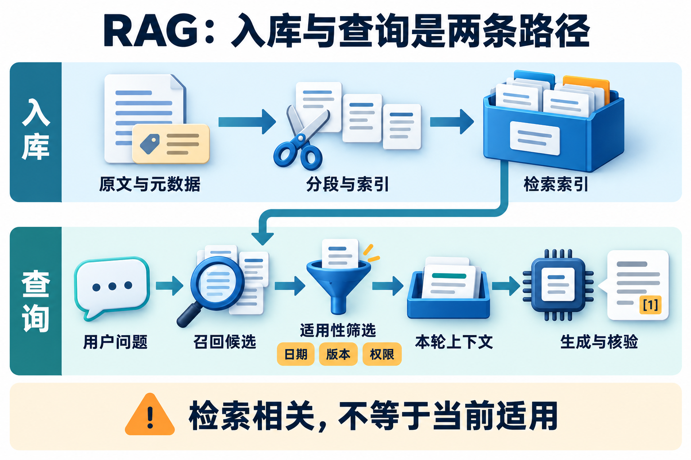

# 06 · RAG 与检索：从资料入库走到有依据的回答


## RAG 到底是什么

**RAG（Retrieval-Augmented Generation，检索增强生成）** 是把外部资料的检索结果加入模型输入，再让模型据此回答的方法。它不是向量数据库的别名，也不要求一定使用向量搜索：关键词搜索、数据库查询或文档读取都可能提供外部证据。[RAG 原始论文](https://arxiv.org/abs/2005.11401)

把一次请求拆开，三个动作就清楚了：**检索**输入问题，输出候选资料；**增强**从候选中选证据，组装本次上下文；**生成**读取问题与证据，输出回答和引用。资料仍保存在模型外，只有实际选入上下文的内容才会被这次生成看到。

先记住一个边界：**“检索到了什么”和“模型据此说了什么”是两件事。** 候选有用但生成误读，与正确证据根本没召回，需要修复不同的组件。

读完本章，应能解释召回、融合、重排各自在做什么，说明分块和版本条件怎样影响结果，并沿阶段定位错误。建议先了解[工具调用](05-tools-and-mcp.md)与[Embedding 的输入输出](02-llm-primer.md)。BM25 公式、近似索引参数和系统化优化留到[进阶 RAG](../advanced/06-agentic-rag.md)。

## 为什么需要先找资料

模型参数保存的是训练形成的统计规律，不能保证包含刚更新的产品说明或某个组织的私有制度。RAG 在回答时取得相关资料，因此更新文档和索引可以影响后续回答，而不必为了每次资料更新都重新训练模型。

**检索不改变模型参数，微调会更新参数。** RAG 和微调可以配合，但一次检索成功不能说明发生了学习；模型能复述旧知识，也不能说明它知道本次检索到的新版本。原始 RAG 论文还包含特定训练设计，本章解释的是常见工程链路，不把所有实现等同于原论文架构。

RAG 的收益有条件：资料必须可取得，索引必须能定位相关内容，选入的证据必须适用，生成还必须忠实使用它。所谓“有知识库”，并不自动满足这些条件。

## 两条链路要分别设计

**入库链路**把原始资料变成可检索对象：解析正文和表格，确定文档身份与版本，分块，保留出处和权限等元数据，再建立索引。它的输出是检索系统及其可追溯资料，不是某个问题的答案。

**查询链路**处理一次具体请求：确定问题和可信身份，在允许范围召回候选，融合或重排，核对适用条件，选择证据，组装上下文，再生成和核验回答。资料更新影响入库；用户换了日期、对象或问题，影响查询条件。

[](../website/assets/diagrams/G5-rag-pipelines.png)

图中的“适用性筛选”是逻辑关卡，不规定所有系统都先全库搜索再过滤。实现可以先限定权限域，也可以在可信存储层对候选 ID 过滤；**未经授权的正文不能先交给模型或外部重排服务**。日期和版本的处理也要考虑过滤后是否还剩足够候选。[pgvector 过滤与迭代扫描](https://github.com/pgvector/pgvector#filtering)

可以用下面的输入输出检查实现，而不依赖某个框架：

```text
入库：原文 + 文档身份/版本/权限 -> 可定位的片段 + 检索索引
查询：问题 + 可信访问范围 -> 候选片段 ID 与检索分数
选择：候选 + 适用条件 + 问题需求 -> 带出处的证据集合
生成：问题 + 证据集合 -> 回答 + 结论到原文的引用
核验：回答 + 实际证据 -> 支持 / 缺证据 / 冲突 / 条件不足
```

## 文档、片段和索引各保存什么

**文档**是具有身份、版本和来源的资料。**片段（chunk）**是一次检索返回的内容单位，通常由一段或几段正文组成。**索引（index）**保存用于查找的结构，例如“词项出现在哪些片段中”，或者“片段向量与 ID 的对应关系”；找到 ID 后仍需要取回相应正文。

每个片段至少应能追溯到文档 ID、版本、原文位置，以及适用范围。只有一串脱离标题、表头和条件的文字，即使相似度很高，也可能无法支持结论。父段落或整篇文档可以在命中小片段后按需读取，但不能因此绕过父文档权限。

**分块改变的是可被独立找到的证据单位。** 太小，限定条件可能与结论分开；太大，多个主题混在一起，向量表示与输入预算都可能受影响。重叠可减少边界截断，却会产生重复候选；它不能修复解析时已经丢失的表头。选择块大小应检查证据覆盖和最终输入长度，不能仅凭常见 token 数照搬。

## 稀疏与稠密检索分别看到什么

**词项检索**先对查询和文档做分词，再查倒排索引。倒排索引记录每个词出现在哪些片段中，因此不必为每次查询逐篇阅读全文。常见的 **BM25** 评分综合词出现次数、词的稀有程度和片段长度：重复出现有收益但会逐渐饱和，长片段也不会仅靠重复词无限占优。[Lucene BM25 说明](https://lucene.apache.org/core/10_5_2/core/org/apache/lucene/search/similarities/BM25Similarity.html)

词项匹配擅长精确编号、产品名和专有词，也容易漏掉措辞不同却意思相近的段落。中文分词、同义词、错别字和字段选择都会影响实际可匹配的词。现代稀疏检索还可能使用学习得到的词项权重，不能把所有稀疏方法都等同于 BM25。

**稠密检索**通过编码器把问题与片段映射为向量，再按内积、余弦或距离找近邻。双编码器分别编码查询与文档，使文档向量可以提前计算；它能否找到语义相关证据，取决于训练目标和目标语料，而不是向量维度越大就必然越懂业务。[DPR 原始论文](https://arxiv.org/abs/2004.04906)

问题向量与文档向量必须处于兼容表示空间。两套无关模型即使输出维度相同，也不能直接比较；换了编码器、距离约定或预处理，通常需要重新构建并验证索引。对非零向量，余弦是内积除以两者长度，例如 `(1,0)` 与 `(0.8,0.6)` 的余弦为 `0.8`；两侧归一化后，余弦排序与内积排序一致。[Faiss 度量说明](https://github.com/facebookresearch/faiss/wiki/MetricType-and-distances)

**向量搜索还分精确与近似。** 精确搜索以给定度量下真正的最近邻为目标，平坦扫描逐个比较全部向量是一种直接实现；近似最近邻搜索（ANN）借索引结构减少搜索工作，可能漏掉精确近邻。近邻本身也不必是业务正确证据，所以“ANN 找回了精确 top-k”与“找回了回答所需材料”要分开评价。相似度 `0.8` 更不是答案正确率 `80%`。

## 手算一次混合检索

**混合检索**让不同检索器提供互补候选。假设同一问题在两路中得到如下结果，字母代表稳定的片段 ID；这是教学排名，不是模型实测：

| 片段 | 证据角色 | 词项排名 | 向量排名 |
| --- | --- | ---: | ---: |
| A | 具体金额和适用条件 | 1 | 未入选 |
| B | 相关系统操作说明 | 2 | 2 |
| C | 例外处理条件 | 3 | 1 |
| D | 历史问答 | 未入选 | 3 |

两路原始分数可能不在同一尺度，不能默认直接相加。**RRF（倒数排名融合）**按排名累计支持：`score(d)=sum[1/(c+rank(d))]`，排名从 1 开始，没有进入某一路的候选在该路贡献为 0。本例取 `c=60`。[RRF 定义](https://www.elastic.co/docs/reference/elasticsearch/rest-apis/reciprocal-rank-fusion)

```text
A = 1/61        ≈ 0.01639344
B = 1/62 + 1/62 ≈ 0.03225806
C = 1/63 + 1/61 ≈ 0.03226646
D = 1/63        ≈ 0.01587302
融合顺序：C -> B -> A -> D
```

这个结果说明两路都支持的候选可能前移，**没有说明 C 的内容更权威，也没有说明前两项足够回答**。如果问题同时需要金额和例外条件，A、C 才构成必要证据；B 排名靠前并不能补上金额依据。

## 为什么召回和重排要分开

**召回**从大集合取得候选，优先兼顾覆盖与成本。**重排（rerank）**对已有候选做更精细的相关性判断，例如把查询与每个段落共同输入交叉编码器，重新给这些配对评分。逐对精细计算通常比可预计算文档表示的双编码检索更昂贵，因此常只对候选集合执行。[检索与重排说明](https://www.sbert.net/examples/sentence_transformer/applications/retrieve_rerank/README.html)

这两个阶段的数量要分别记录：召回可能取得 `K` 个候选，重排后取 `k` 个进入后续选择，通常 `K` 大于 `k`。**未进入候选集合的片段，重排器无法凭空找回；最终截断还可能再次丢失必要证据。** 发现漏证据，要先确认它在哪个阶段消失，再决定增大召回池、改检索方式，还是改重排与上下文选择。

重排分数仍不是业务有效性证明。高分旧版条款、无权资料和不适用于当前对象的规定，都需要独立处理，不能让相关性排序替代这些条件。

## 找到相互矛盾的材料时怎么办

先问它们是否真的在描述**同一对象、同一属性、同一适用条件和同一业务时间**。普通员工与管理人员的标准不同，可能是范围不同；新旧版本适用于不同日期，可能是时间不同。这两类问题应靠条件匹配解决，不应直接称为事实冲突。

若条件相同，继续核对原始来源、明确的取代关系和可信的权威规则。上传时间不能代替生效日期，相似度最高不能代替权威性，多份复制件也不能靠多数票压过一份正式原文。哪些来源有优先级，需要业务方提供规则；RAG 本身不会自动知道组织的全部制度关系。

**同级、同时有效、条件相同却给出不同结论时，保留冲突。** 回答应指出分歧和双方出处，必要时请求核实；不能把不同金额平均，也不能让模型挑一个更像答案的数字。只检索到一方时还不能知道是否存在另一方，这也是需要在评测中放入冲突资料的原因。

模型参数中的旧记忆与检索结果不同，也不意味着任意检索结果都应被相信。先确认来源和适用性；缺少可信证据时说明不确定。若一次任务需要多份资料共同支持一个结论，任一必要证据存在未解决冲突，都应限制该结论的确定程度。具体的版本筛选、冲突归约和补查策略见[进阶原理](../advanced/06-agentic-rag.md)。

## 原文、标注与回答放在一起核对

保留一个最小例子：用户问“2026-11-12 海岚普通员工住宿每晚 650 元是否超标”，适用原文明确写“2026-11-01 起，普通员工每晚上限 700 元”。证据在这个条件下支持“金额未超上限”；它不自动支持“已经批准报销”。如果出差日改为 10 月，必须重新选择相应有效版本，不能继续沿用 700。

**评测标注**事先记录这个问题需要哪些证据、适用条件和允许回答的边界；**实际引用**记录系统这次真的使用了哪份原文。两者不能混为一份记录，否则无法发现“引用存在但用错版本”。

| 需要保留 | 用来核对什么 |
| --- | --- |
| 问题、身份范围、业务日期 | 本次请求到底问什么、能看什么 |
| 候选 ID、排名、索引与文档版本 | 正确资料是否被找到、在哪里丢失 |
| 实际放入模型的片段及出处 | 模型这次到底看到了什么 |
| 回答中的关键断言与引用位置 | 原文是否支持该断言，而非仅有一个链接 |

## 从融合结果到回答，逐步核对

选择上下文时要覆盖问题需要的不同证据，而非只把排名最前的若干片段塞满窗口。去除重复内容，保留限定条件和出处；需要读取父段落时，再次确认权限和原文版本。截断不能把“仅限某类人员”与金额规则拆开。

生成之后，从关键结论反向找原文：条件是否相同、原文是否真的支持结论、数值是否可复算、是否存在未处理冲突。引用格式合法和来源链接存在，都不足以证明这些问题已经解决。

授权还会随时间改变。读取资料、向外部服务发送正文及返回历史结果，需要按适当边界检查当前权限；旧索引和旧缓存不应恢复已经撤回的资格。此类应用规则由系统执行，不能只让提示词要求模型保密。[OWASP 授权指南](https://cheatsheetseries.owasp.org/cheatsheets/Authorization_Cheat_Sheet.html)

## 分别评价检索与回答

检索评价问“所需证据是否进入候选、排序是否合适”；回答评价问“模型是否在实际证据支持的范围内回答”。例如问题必须同时取得 A、C，候选只有 B、C，则两份必要证据只命中一份；句子写得完整也不能补回缺失的 A。

比较检索方案时，固定任务集、资料版本、权限范围和证据标注，再比较候选覆盖、最终证据覆盖、成本与时延。不能只看召回条数或回答是否含引用；也不能把 ANN 近邻重现率当作业务证据召回率。[基础评测章](09-evaluation.md)解释指标，[进阶 RAG](../advanced/06-agentic-rag.md)说明怎样用替换实验定位瓶颈。

## 练习：定位一个“搜到了却答错”的案例

准备现行规则、旧规则、例外流程、无关资料和无权限资料，先标注问题必须取得的证据。然后分别制造：正确片段未召回；召回后被截断；两个同时有效来源冲突；证据齐全但生成误读。每次只改变一个阶段，说明应修哪一层以及怎样验证。

可运行[检索机制实验](../examples/advanced/retrieval-mechanisms.md)复算词项评分、向量排序、融合、候选损失和冲突筛选。实验使用手工词项与给定小向量，不代表真实语义检索或 ANN 性能。已有[政策实验](../examples/policy_agent/README.md)验证的是固定资料上的访问、适用与回答合同，两种实验的能力范围不同。

## 自检

1. RAG、向量检索与参数微调分别改变什么？
2. 检索器返回 top-10，为什么仍可能没有一条可用证据？
3. 加了重排器，为什么仍找不到漏掉的条款？
4. 两份资料分别写 700 与 500，为什么不能直接取最新上传的那份？

<details><summary>参考答案</summary>

1. RAG 把外部资料接入生成，向量检索是一种找候选的方法，参数微调更新模型参数。
2. 排名只在候选之间比较；候选可能无关、版本不适用、无权或不足以覆盖问题。
3. 重排只处理已有候选；要恢复缺失资料，应检查解析、分块、检索或候选预算等前序阶段。
4. 先匹配对象、属性、条件和业务时间，再查权威与取代关系；同级有效的真冲突需要保留和核实。

</details>

## 应用实验延伸

[第14章知识摄取](../advanced/14-ingestion-and-index-lifecycle.md)解释如何处理索引更新、删除与当前授权；[第06章进阶 RAG](../advanced/06-agentic-rag.md)解释检索算法、优化与冲突处理。

<!-- question-links:start -->
## 配套面试练习

先合上正文讲一分钟，再用追问和案例检查理解。每题都可以跳回对应学习内容。

<details><summary>展开本章相关面试题</summary>

- [Q006 Prompt、RAG 与微调如何选？](../questions/Q006.md#q006-promptrag-与微调如何选)
- [Q017 一个 RAG 系统的完整数据流是什么？](../questions/Q017.md#q017-一个-rag-系统的完整数据流是什么)
- [Q018 Chunk 大小和重叠该怎样选择？](../questions/Q018.md#q018-chunk-大小和重叠该怎样选择)
- [Q019 为什么向量检索和关键词检索可以互补？](../questions/Q019.md#q019-为什么向量检索和关键词检索可以互补)
- [Q020 召回和 Rerank 为什么分两阶段？](../questions/Q020.md#q020-召回和-rerank-为什么分两阶段)
- [Q021 向量索引如何兼顾延迟与检索质量？](../questions/Q021.md#q021-向量索引如何兼顾延迟与检索质量)
- [Q022 ACL 应放在哪里？文档更新和删除如何传播？](../questions/Q022.md#q022-acl-应放在哪里文档更新和删除如何传播)
- [Q023 RAG 如何评测，Recall@k、MRR 和答案质量有何区别？](../questions/Q023.md#q023-rag-如何评测recallkmrr-和答案质量有何区别)
- [Q024 RAG 回答错误应该按什么顺序排查？](../questions/Q024.md#q024-rag-回答错误应该按什么顺序排查)
- [Q049 设计一个企业知识库客服 Agent，你会怎样开始？](../questions/Q049.md#q049-设计一个企业知识库客服-agent你会怎样开始)
- [Q050 设计一个可以引用来源的研究助手，怎么保证报告可信？](../questions/Q050.md#q050-设计一个可以引用来源的研究助手怎么保证报告可信)

</details>
<!-- question-links:end -->

[上一章：05 · 工具与 MCP](05-tools-and-mcp.md) · [基础原理目录](README.md) · [下一章：07 · 记忆与状态](07-memory-and-state.md)
