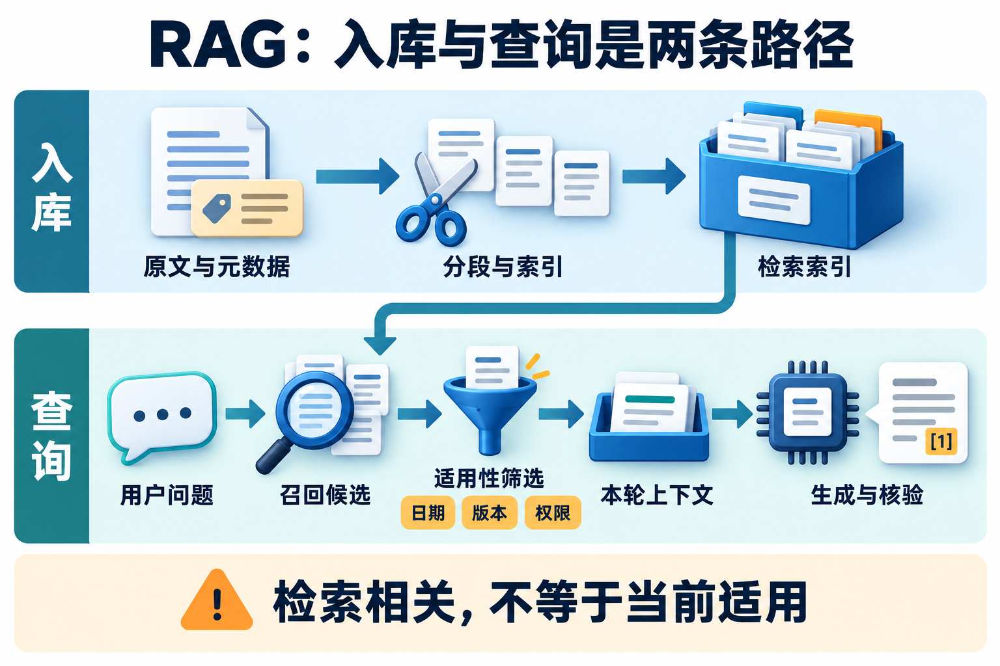

# 06 · RAG 与检索

**RAG 是在回答时，把检索到的外部资料交给模型。** 资料可以来自文档、搜索索引或数据库。新资料要先进入可查询的数据源，后续请求才有机会取到。更新资料和微调模型是两项独立的工作。

理解这条链路，要分清三份内容：**检索找到了什么、筛选后留下了什么、模型实际看到了什么。** 排查时，可以沿着这三份记录找到证据丢失的位置。

## 入库与查询

**入库**负责把原文变成可查的资料。系统解析正文和表格，再把内容切成片段。每个片段保留来源和版本。处理完成后，系统发布索引。

**查询**负责为当前请求取资料。系统先找候选，再筛选和排序。选中的片段进入模型输入。回答生成后，再核对关键结论与引用。

排查时，先看查询实际用了哪一版索引。再确认所需资料已经发布到这版索引中。资料还没进索引时，扩大召回范围也只能查找已有内容。

## 分块与索引

**分块决定了哪些内容可以被单独找到。** 每个片段都应能追溯到原文位置和文档版本。标题、表头、单位和适用条件也要保留。它们会影响正文的含义。

- **片段太小**，结论容易和限定条件分开。
- **片段太大**，多个主题容易混在一起，也会占用更多输入空间。
- **相邻片段重叠**，可以减少边界上的信息丢失。重叠越多，去重的工作也越多。

有时小片段更容易被找到，完整证据却在它所在的大段落里。可以先定位小片段，再按需读取原段落。扩大读取范围时，要核对原文版本和访问权限。

## 关键词检索与向量检索

### 关键词检索

关键词检索先把文本处理成可匹配的词。倒排索引记录每个词出现在哪些片段里。查询时沿这份记录查找，省去了逐篇阅读全文的工作。

**BM25** 是一种常见的排序方法。它会考虑词出现的次数、词有多稀有，以及片段有多长。同一个词重复出现，得分的增幅会逐渐减小。

编号、产品名和专有词通常适合用关键词匹配。中文分词会直接影响这些词能否被找到。

### 向量检索

向量检索把请求和文档片段转成向量，再按相似度或距离查找。文档向量可以提前算好。查询向量与文档向量需要处于兼容的表示空间。更换编码器后，通常要重新计算文档向量，再验证检索结果。

精确搜索按选定的度量寻找最近的向量。近似搜索减少了计算量，也可能漏掉部分近邻。排查这类损失时，先固定向量和度量，再与精确搜索对照。找到更接近的向量之后，还要核对其中有没有回答所需的证据。

## 召回、融合与重排

| 环节 | 负责的工作 |
| --- | --- |
| **召回** | 从大量资料中找出一批候选。 |
| **融合** | 合并多路检索结果。 |
| **重排** | 重新给已有候选排序，让更相关的片段靠前。 |

关键词检索和向量检索的分数通常使用不同的尺度。**RRF（倒数排名融合）**按名次合并结果。每一路按 `1 / (常数 + 名次)` 给片段计分，名次从 1 开始。片段出现在多路结果中，就累加各路得分。

**候选集合固定时，重排只能调整顺序。** 缺失的材料要通过补查或补读取得。重排通常需要逐条判断候选。候选越多，这一步的工作量通常也越大。

## 证据筛选与模型输入

候选资料要经过三项判断：

- **访问权限**决定当前用户能使用哪些资料。
- **适用条件**决定资料能否用于本次任务。重点核对日期、版本和对象。
- **相关性**决定哪些候选优先阅读。

搜索前就可以按权限和日期缩小范围。正文交给外部重排服务或模型前，必须完成访问检查。读取旧索引或缓存时，也要按当前权限判断。

整理模型输入时，先去掉重复片段。再为支持结论的必要材料留出空间。缩短文字时，要保住日期、单位和例外条款。核对时直接看送进模型的文字，确认这些条件还在。

### 处理资料冲突

先检查两份资料是否描述同一对象、同一时期和同一适用范围。条件不同，就分别按各自的范围处理。

条件一致时，再查原文来源、正式的取代关系和来源优先级。**上传时间和生效时间要分别记录。** 两份同级资料都适用，结论却互相冲突时，应保留双方出处，并说明分歧。

## 回答与引用核对

引用链接用来定位出处。核对时，要读到具体段落。逐项确认关键结论能否从原文推出。用到多个片段时，再检查它们的日期、对象和范围能否一起成立。

缺少资料，就围绕缺口补查。缺少用户条件，就请用户补充。达到查询上限后，给出已有证据能够支持的结论，并说明剩余的缺口。

## 分阶段排查与评测

排查时，用**片段编号和资料版本**串起各阶段的记录。先确认预期资料已经发布、当前可访问，也适用于本次任务。再沿实际执行顺序查找偏差。

| 看到的情况 | 先查哪里 |
| --- | --- |
| 原文有关键内容，索引中的片段却不完整 | 解析、分块和索引发布 |
| 资料已经入库，预期片段没进候选 | 查询写法、搜索范围和召回方式 |
| 片段进了候选，随后被移除 | 权限、适用条件和筛选原因 |
| 片段通过筛选，却没完整进入模型输入 | 排序、去重和截断 |
| 模型收到了完整证据，回答仍有偏差 | 模型对证据的使用，以及结论和引用 |

比较检索方案时，使用同一批请求。固定资料版本、访问范围和模型输入上限。分别记录以下结果：

- 找回了多少所需证据。
- 多少证据完整进入了模型输入。
- 多少关键结论得到了支持。
- 执行耗时多久，调用了多少次工具。

**Recall@K** 用来衡量前 K 个候选的覆盖情况。用前 K 个候选里找到的相关证据数，除以该请求已标注的相关证据总数。对于本来就没有可用证据的请求，单独检查系统是否能识别资料不足。

扩大候选范围后，如果找回的证据变多，最终输入却没有改善，就回查筛选、排序和输入整理。每次只改一个主要环节，结果更容易解释。

<!-- question-links:start -->
## 配套面试练习

先合上正文讲一分钟，再用追问和案例检查理解。每题都可以跳回对应学习内容。

展开本章相关面试题

- [Q006 Prompt、RAG 与微调如何选？](../questions/Q006.md#q006-promptrag-与微调如何选)
- [Q017 一个 RAG 系统的完整数据流是什么？](../questions/Q017.md#q017-一个-rag-系统的完整数据流是什么)
- [Q018 Chunk 大小和重叠该怎样选择？](../questions/Q018.md#q018-chunk-大小和重叠该怎样选择)
- [Q019 为什么向量检索和关键词检索可以互补？](../questions/Q019.md#q019-为什么向量检索和关键词检索可以互补)
- [Q020 召回和 Rerank 为什么分两阶段？](../questions/Q020.md#q020-召回和-rerank-为什么分两阶段)
- [Q021 向量索引如何兼顾延迟与检索质量？](../questions/Q021.md#q021-向量索引如何兼顾延迟与检索质量)
- [Q022 ACL 应放在哪里？文档更新和删除如何传播？](../questions/Q022.md#q022-acl-应放在哪里文档更新和删除如何传播)
- [Q023 RAG 如何评测，Recall@k、MRR 和答案质量有何区别？](../questions/Q023.md#q023-rag-如何评测recallkmrr-和答案质量有何区别)
- [Q024 RAG 回答错误应该按什么顺序排查？](../questions/Q024.md#q024-rag-回答错误应该按什么顺序排查)
- [Q049 设计一个企业知识库客服 Agent，你会怎样开始？](../questions/Q049.md#q049-设计一个企业知识库客服-agent你会怎样开始)
- [Q050 设计一个可以引用来源的研究助手，怎么保证报告可信？](../questions/Q050.md#q050-设计一个可以引用来源的研究助手怎么保证报告可信)

<!-- question-links:end -->

[上一章：05 · 工具与 MCP](05-tools-and-mcp.md) · [基础原理目录](README.md) · [下一章：07 · 记忆与状态](07-memory-and-state.md)
