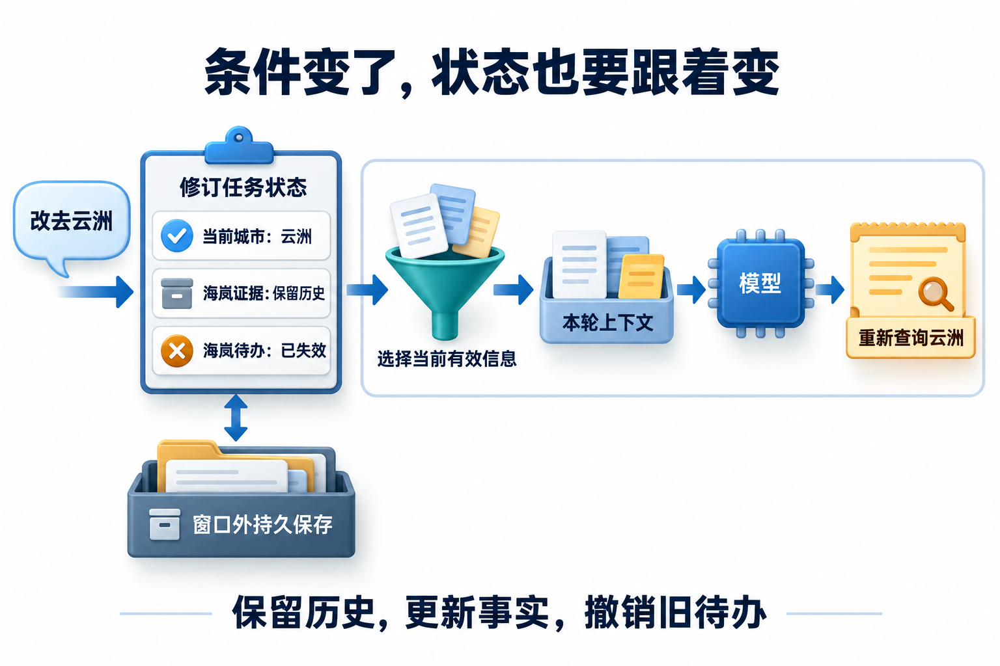

# 07 · 记忆与状态

**任务状态让执行可以接着走。记忆让已有信息可以再次使用。** 任务状态保存进度、已确认结果和待处理动作。记忆保存可跨步骤或跨会话复用的信息。两者都由应用管理，再按本轮需要选择读入。

模型只能看到传入的内容。需要用旧信息推进任务时，先核对它来自哪里、是否还有效，以及当前用户能否读取。

## 历史、状态、记忆与上下文

| 内容 | 保存的东西 |
| --- | --- |
| **对话历史** | 原始消息和工具回包。适合回查原话及当时的结果。 |
| **任务状态** | 目标、进度、必要条件、待处理动作、预算和已确认的结果。 |
| **长期记忆** | 有明确用途、能在以后复用的偏好和记录。 |
| **当前上下文** | 这次调用实际使用的指令、状态和证据。 |

原始消息适合保留出处。结构化状态适合推进任务。摘要适合压缩输入，还要保留原始位置、确认程度和更新时间。任务恢复时优先读取运行时维护的状态。

## 写入记忆

保存之前，先确定**用途、归属和有效期**。只在当前任务有用的条件留在任务状态里。需要跨会话复用的信息，才进入长期记忆。

- **用户明确提供的信息**，保留是偏好、事实还是临时要求。记录其适用范围。
- **工具核实的信息**，保留来源、版本、核实时间和访问范围。
- **模型推断的信息**，保留未确认状态。影响重要决定时，先重新确认。

把待确认信息、原始证据和已确定值分开存。写入权限也要校验。更新同一条记录时，用版本判断写入是否仍基于最新数据。并发更新发生冲突时，按业务规则合并或重新确认。

## 读取、更新与撤回

找回一条记忆后，检查它是否属于当前用户和场景，是否仍然有效，以及它能影响什么。排好顺序之后，再把本轮必要的部分放进上下文。相似度高只说明值得查看。

信息被更正时，写入新版本并让旧版本退出正常读路径。资料被撤回或权限变化时，处理受影响的缓存、索引和摘要。旧记录仍有保留要求时，限制它的可见范围。恢复旧任务时按当前权限和资料状态重新核对。

涉及当前权限、审批状态和外部写入结果时，优先查权威系统。历史记忆可以提供对象编号和线索，实际结论取自当前记录。

## 检查点与任务恢复

**检查点（checkpoint）保存已完成进度和继续所需的状态。** 需要重启后继续时，检查点要写到持久存储。保存待处理动作时，一并记录参数、稳定操作编号和上一次确认结果。用户补充必要条件后，合并到原任务状态，继续使用累计预算。

外部服务可能已完成写入，本地检查点却还没记下回执。恢复时先用原操作编号查询或对账。确认已执行后更新本地状态。只有服务支持安全重放时，才按原意图重试。无法确认时保留未知状态。

## 读写与恢复排查

| 看到的偏差 | 先查哪里 |
| --- | --- |
| 继续执行时漏掉已完成的步骤 | 检查点版本、读取位置和已确认结果。 |
| 旧偏好盖过了当前要求 | 读取排序、版本和适用范围。 |
| 已删除的资料又被用到 | 索引、缓存、摘要和实际读取权限。 |
| 恢复后发生重复写入 | 操作编号是否稳定，外部状态是否已经确认。 |

评估记忆时，先看它是否帮助完成后续任务。再检查过期信息能否被拦住，撤回后是否还能从缓存或索引中读到。

<!-- question-links:start -->
## 配套面试练习

先合上正文讲一分钟，再用追问和案例检查理解。每题都可以跳回对应学习内容。

展开本章相关面试题

- [Q011 为什么用状态图组织 Agent？](../questions/Q011.md#q011-为什么用状态图组织-agent)
- [Q030 Context、短期记忆和长期记忆如何区分？](../questions/Q030.md#q030-context短期记忆和长期记忆如何区分)
- [Q032 长期记忆怎样避免污染与跨用户泄漏？](../questions/Q032.md#q032-长期记忆怎样避免污染与跨用户泄漏)
- [Q051 设计一个能创建、分派工单的 Agent，状态如何流转？](../questions/Q051.md#q051-设计一个能创建分派工单的-agent状态如何流转)

<!-- question-links:end -->

[上一章：06 · RAG 与检索](06-rag-and-retrieval.md) · [基础原理目录](README.md) · [下一章：08 · 规划与多 Agent](08-planning-and-multi-agent.md)
